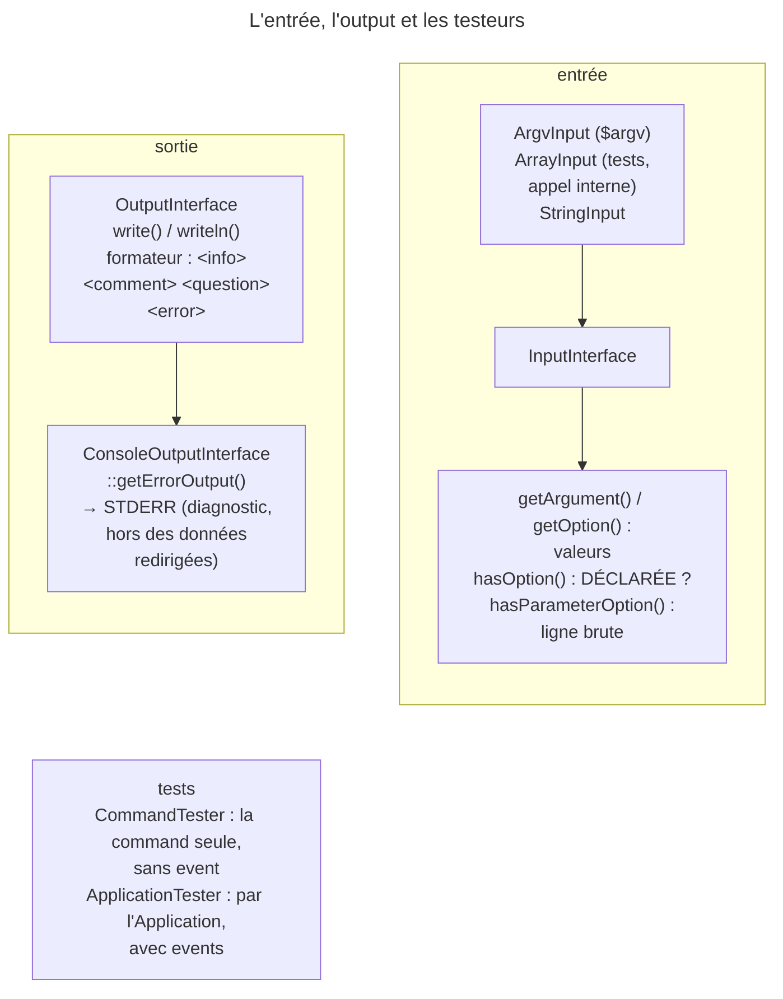

## Objectif

Lire l'entrée et écrire l'output par les deux abstractions du component, sans
jamais toucher `$argv`, `echo` ni `STDOUT` directement. C'est ce découplage qui
rend une command testable.

## L'essentiel

Une command lit par `InputInterface` et écrit par `OutputInterface`, jamais
par `$argv`, `echo` ou `STDOUT`. Ce découplage la rend testable : la même
command tourne avec `$argv`, un array ou une string. Les messages de
diagnostic vont sur un second flux, **`STDERR`**.

## Le schéma



## L'exemple : une command d'export

```php
public function __invoke(InputInterface $input, OutputInterface $output): int
{
    $dryRun = $input->getOption('dry-run');            // false si non passée
    $output->writeln('id;nom');                        // les données : STDOUT
    if ($output instanceof ConsoleOutputInterface) {
        $output->getErrorOutput()->writeln('<info>42 lignes</info>');   // diagnostic : STDERR
    }

    return Command::SUCCESS;
}
```

`php bin/console app:export > data.csv` ne mélange pas le diagnostic aux
données.

## `InputInterface` — lire

| Appel | Ce qu'il rend |
|---|---|
| `getArgument('username')`, `getOption('iterations')` | la valeur, ou la default value |
| `hasOption('dry-run')` | l'option est-elle **déclarée** ? — `true` même non passée |
| `hasParameterOption('--env')`, `getParameterOption('--env')` | lus sur la **ligne brute**, sans definition |
| `isInteractive()` | faux avec `-n`, `-q` ou `--silent` |

`setArgument()` et `setOption()` permettent à `interact()` de compléter une
valeur. Le nom attendu est le nom **kebab-case** déclaré : un
`#[Argument] string $userName` se lit `getArgument('user-name')`.

## `OutputInterface` — écrire

- `write()`, `writeln()`, avec un array pour plusieurs lignes.
- Quatre tags par défaut : `<info>` vert, `<comment>` jaune, `<question>`
  noir sur cyan, `<error>` blanc sur rouge. Un tag inconnu, `<script>`, passe
  intact.
- Une string venue de l'extérieur passe par `OutputFormatter::escape()`.
- Modes : `OUTPUT_NORMAL` interprète les tags, `OUTPUT_RAW` les laisse,
  `OUTPUT_PLAIN` les interprète **puis** applique `strip_tags()` : sur un output
  décoré, `<info>ok</info>` reste **toujours en vert**.
- `SymfonyStyle` enveloppe le tout : `title()`, `success()`, `error()`,
  `ask()`, `table()`, et `getErrorStyle()` pour `STDERR`.

## L'output d'erreur

`getErrorOutput()` appartient à `ConsoleOutputInterface`, pas à
`OutputInterface` : un `BufferedOutput` ne l'a pas, d'où le test de type.

## Tester une command

```php
$tester = new CommandTester($application->find('app:greet'));
$tester->setInputs(['Bob']);                                   // réponses aux questions
$tester->execute([], ['interactive' => false]);
$tester->execute([], ['capture_stderr_separately' => true]);
```

- `CommandTester` appelle la command **seule** : aucun event console.
  `ApplicationTester` passe par l'`Application`, avec `setAutoExit(false)`.
- Ordre : `initialize()`, `interact()` (en interactif), validation de l'entrée,
  `execute()` ; non interactive, un argument requis manquant lève « Not enough
  arguments ».
- Avec `capture_stderr_separately`, ce qu'écrit `getErrorStyle()` passe dans
  `getErrorOutput()`, comme le libellé d'une question de `QuestionHelper` ; celui
  de `SymfonyStyle::ask()` reste dans `getDisplay()`.

## Pièges d'examen

**Ne jamais utiliser `echo`** : l'output échapperait à la verbosity, au
formateur et aux tests.

**`getErrorOutput()` n'appartient pas à `OutputInterface`** mais à
`ConsoleOutputInterface` — d'où le test de type.

**`hasOption()` interroge la definition**, pas la ligne de command : il vaut
`true` même quand l'option n'a pas été passée. C'est `hasParameterOption()`
qui lit la ligne brute.

**`OUTPUT_PLAIN` garde les couleurs** d'un output décoré.

**Le nom passé à `getArgument()` est le nom kebab-case** déclaré, pas celui du
parameter PHP.

## Application

- Un export redirigé dans un file, avec une ligne de progression → la
  progression sur `getErrorOutput()`.
- Un nom de user affiché en vert alors qu'il contient `<error>` →
  `OutputFormatter::escape($name)`.

## QCM d'entraînement

**Question 1.** Un output **décoré** reçoit
`writeln('<info>ok</info> <script>x</script>', OutputInterface::OUTPUT_PLAIN)`.
Qu'affiche-t-il ?

- **A.** `ok x`, sans couleur
- **B.** `<info>ok</info> <script>x</script>` tel quel
- **C.** `ok` en vert, puis `x`
- **D.** `ok` en vert, puis `<script>x</script>`

<details>
<summary>Correction</summary>

**Bonne réponse : C.** `OUTPUT_PLAIN` interprète d'abord les tags, puis retire
ceux qui restent : la couleur de `<info>` survit, `<script>` disparaît.

</details>

**Question 2.** Une command invocable déclare `#[Argument] string $userName`.
Le code appelle `$input->getArgument('userName')`. Que se passe-t-il ?

- **A.** Une `InvalidArgumentException`
- **B.** La valeur passée, le nom PHP valant aussi
- **C.** `null`, l'argument étant facultatif
- **D.** La default value du parameter PHP

<details>
<summary>Correction</summary>

**Bonne réponse : A.** L'argument est déclaré sous le nom kebab-case
`user-name` : « The "userName" argument does not exist. ».

</details>

**Question 3.** Une command écrit `diag` par `$io->getErrorStyle()`. Le test
appelle `execute([], ['capture_stderr_separately' => true])`. Où lire `diag` ?

- **A.** Dans `getDisplay()`, avec le reste
- **B.** Nulle part : `STDERR` n'est pas capturé en test
- **C.** Dans `getStatusCode()`, comme message d'erreur
- **D.** Dans `getErrorOutput()`

<details>
<summary>Correction</summary>

**Bonne réponse : D.** L'option sépare les deux flux : `getDisplay()` garde
`STDOUT`, et `getErrorOutput()` reçoit ce qui part sur `STDERR`.

</details>

**Question 4.** En mode normal, une command écrit
`'<info>ok</info> <script>x</script>'` sur un output décoré. Que devient
`<script>x</script>` ?

- **A.** Il est retiré, comme tout tag HTML
- **B.** Il passe intact
- **C.** Il est échappé en `&lt;script&gt;`
- **D.** Une exception : tag de style inconnu

<details>
<summary>Correction</summary>

**Bonne réponse : B.** Le formateur n'interprète que les styles qu'il connaît ;
un tag inconnu reste du texte, et seul `<info>` devient une couleur.

</details>

## Fiche express

**Si tu dois retenir seulement 7 choses :**

- Lire par **`InputInterface`**, écrire par **`OutputInterface`** ; jamais
  `echo`.
- `ArgvInput`, `ArrayInput`, `StringInput` : même contrat.
- **`hasOption()`** : déclarée ? ; **`hasParameterOption()`** : ligne brute.
- Arguments et options sous leur nom **kebab-case**.
- Quatre tags ; **`escape()`** pour ce qui vient de l'extérieur.
- **`getErrorOutput()`** (`ConsoleOutputInterface`) pour `STDERR`.
- `CommandTester` : la command seule ; `ApplicationTester` : avec events.

Moyen mnémotechnique : **« Lire l'entrée, écrire l'output, crier sur
STDERR »**.

## Sources officielles

- [`InputInterface`, branche 8.0](https://github.com/symfony/symfony/blob/8.0/src/Symfony/Component/Console/Input/InputInterface.php)
- [`OutputInterface`, branche 8.0](https://github.com/symfony/symfony/blob/8.0/src/Symfony/Component/Console/Output/OutputInterface.php)
- [`Output`, branche 8.0](https://github.com/symfony/symfony/blob/8.0/src/Symfony/Component/Console/Output/Output.php)
- [`OutputFormatter`, branche 8.0](https://github.com/symfony/symfony/blob/8.0/src/Symfony/Component/Console/Formatter/OutputFormatter.php)
- [How to Style a Console Command](https://github.com/symfony/symfony-docs/blob/8.0/console/style.rst)
- [`CommandTester`, branche 8.0](https://github.com/symfony/symfony/blob/8.0/src/Symfony/Component/Console/Tester/CommandTester.php)

