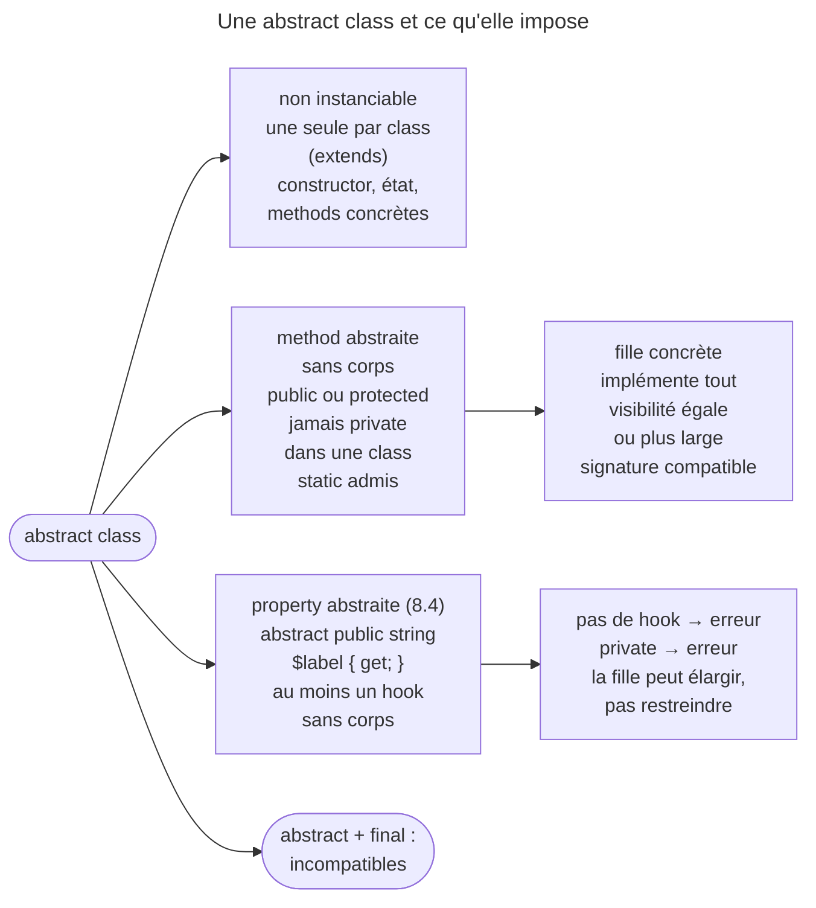

## Objectif

Écrire une abstract class correcte et savoir quand la préférer à une
interface.

## L'essentiel

Une abstract class ne s'instancie pas ; elle fournit du **comportement
partagé** — constructor, état, methods concrètes — et impose à ses filles des
methods abstraites, jamais `private`. Depuis PHP 8.4, elle peut aussi exiger
une **property**, par un hook sans corps. Face à une interface, la règle tient
en une ligne : l'interface décrit un contrat, l'abstract class partage du code.

## Le schéma



## L'exemple

```php
abstract class Repository
{
    public function __construct(protected Connection $connection) {}

    abstract protected function table(): string;      // pas de corps

    public function findAll(): array                  // corps fourni
    {
        return $this->connection->query('SELECT * FROM '.$this->table());
    }
}
```

## Règles

- Une abstract class **ne peut pas être instanciée** : « Cannot instantiate
  abstract class ».
- Une method abstraite n'a **pas de corps** et peut être `public` ou
  `protected`, jamais `private` dans une class ; un trait, lui, admet
  `abstract private` depuis PHP 8.0. Elle peut être `static`.
- Une class qui contient au moins une method — ou une property — abstraite
  **doit** être déclarée `abstract`.
- La class fille implémente toutes les methods abstraites, sauf à être
  elle-même abstraite, avec une visibilité **égale ou plus permissive** et une
  signature compatible : une method `protected` peut devenir `public`.

## Les properties abstraites — depuis PHP 8.4

```php
abstract class Shape
{
    abstract public string $label { get; }   // exigence : lisible en public
}

final class Circle extends Shape
{
    public string $label = 'cercle';         // une property ordinaire suffit
}
```

Une property ordinaire, `readonly` ou hookée satisfait `{ get; }`. Les règles :

- **Pas de hook, pas d'`abstract`** : PHP refuse avec « Only hooked properties may be declared abstract ».
- **Au moins un hook sans corps** ; l'autre peut porter un body par défaut.
- **`public` ou `protected`, jamais `private`.**
- **Elle compte comme une method abstraite** : une fille concrète qui ne la
  fournit pas est refusée.
- **La fille peut élargir, pas restreindre** : `protected` devient `public`,
  mais un `get` public ne devient pas `protected`. Un `set` exige une écriture
  publique, qu'une property `readonly` ne fournit pas.

## Interface ou abstract class ?

| | Interface | Abstract class |
|---|---|---|
| Corps de method | Non | Oui |
| Properties d'état | Non | Oui |
| Constructor | Signature seulement, déconseillée | Oui |
| Visibilité d'une method abstraite | Publique uniquement | `public` ou `protected` |
| Property exigée (PHP 8.4) | `public`, hooks sans corps | `public` ou `protected` ; un hook peut avoir un body |
| Nombre par class | Plusieurs | **Une seule** |

Une interface décrit **ce qu'un object sait faire** ; une abstract class
fournit **du comportement partagé**. Un besoin de constructor ou d'état commun
tranche pour l'abstract class.

## Pièges d'examen

**`abstract private` est une erreur fatale.** Une method abstraite privée
serait invisible depuis la class fille, donc impossible à implémenter.

**Une seule class parente.** Besoin de deux jeux de comportements partagés :
c'est un trait ou une composition, pas un second `extends`.

**`abstract` et `final` sont incompatibles** : l'un exige une extension,
l'autre l'interdit.

**Une property abstraite sans hook est une erreur fatale.**
`abstract public string $label;` ne compile pas : il faut `{ get; }`,
`{ set; }` ou les deux, dont au moins un sans corps.

## Application

- Des repositories qui partagent la connexion et `findAll()` → une abstract
  class avec `table()` abstraite.
- Deux classes sans lien à accepter comme un même type → une interface.

## QCM d'entraînement

**Question 1.** Que produit `new Repository($connection)`, `Repository` étant
abstraite ?

- **A.** Un object sans methods abstraites
- **B.** `null`
- **C.** Une `Error`
- **D.** Un warning, puis l'object

<details>
<summary>Correction</summary>

**Bonne réponse : C.** PHP refuse d'instancier une abstract class et lève une
`Error` ; seule une fille concrète peut être construite.

</details>

**Question 2.** La parente déclare `abstract protected function run(): void`,
et la fille l'implémente en `public`. Que se passe-t-il ?

- **A.** C'est accepté
- **B.** Une erreur fatale : la visibilité doit rester identique
- **C.** La method reste `protected`
- **D.** Un warning de compatibilité

<details>
<summary>Correction</summary>

**Bonne réponse : A.** Une implémentation peut élargir la visibilité promise ;
c'est la restreindre, vers `private`, qui serait refusé.

</details>

**Question 3.** Une abstract class déclare une method `create()` à la fois
`abstract`, `public` et `static`. Est-ce valide ?

- **A.** Non : une method statique ne peut pas être abstraite
- **B.** Oui
- **C.** Seulement dans une interface
- **D.** Seulement sans return type

<details>
<summary>Correction</summary>

**Bonne réponse : B.** Une method statique peut être abstraite dans une
abstract class ; chaque fille concrète fournit alors sa propre fabrique.

</details>

**Question 4.** `Shape` exige `abstract public string $label { get; }`, et
`Circle` déclare `protected string $label`. Résultat ?

- **A.** Accepté : `protected` suffit à la fille
- **B.** Accepté, la lecture restant publique
- **C.** La property devient `readonly`
- **D.** Une erreur fatale

<details>
<summary>Correction</summary>

**Bonne réponse : D.** La fille ne peut pas restreindre l'accès exigé : la
lecture promise est publique, et PHP l'exige publique dans `Circle`.

</details>

## Fiche express

**Si tu dois retenir seulement 6 choses :**

- **Non instanciable** ; une seule abstract class par `extends`.
- Method abstraite : **sans corps**, `public` ou `protected`, **jamais `private`**.
- Fille concrète : tout implémenter, visibilité **égale ou plus large**.
- 8.4 : property abstraite = **hook sans corps** ; jamais `private`.
- `abstract` + `final` : **incompatibles**.
- Interface = **contrat** ; abstract class = **comportement partagé**.

Moyen mnémotechnique : **« L'interface promet, l'abstract class aide »**.

## Sources officielles

- Manuel PHP — *Class Abstraction*

