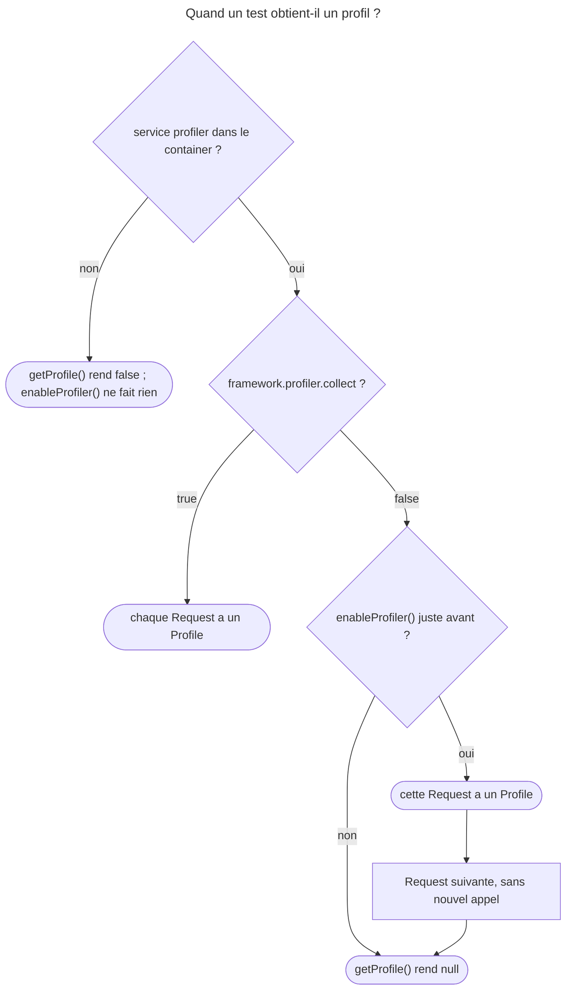

## Objectif

Lire les données du profiler depuis un test, pour vérifier une métrique que la
Response ne montre pas.

## Avant la règle : le problème à résoudre

Une page doit rester sous un budget : moins de 500 ms passées dans le framework.
La Response n'en dit rien ; le **profiler**, si. Mais profiler chaque Request
de la suite ralentirait tous les tests.

D'où un réglage en deux temps, et trois questions : ce que la **configuration**
active, ce que **`enableProfiler()`** ajoute — et pour combien de Requests —,
et ce que rend **`getProfile()`** quand il n'y a rien à lire.

On suppose connu l'object client.

## Le fil rouge : un budget de temps

```php
$client = static::createClient();
$client->enableProfiler();                    // la Request suivante seulement
$client->request('GET', '/lucky/number');

if ($profile = $client->getProfile()) {       // false ou null : rien à lire
    $this->assertLessThan(
        500,
        $profile->getCollector('time')->getDuration(),
        sprintf('Budget dépassé (token %s)', $profile->getToken()),
    );
}
```

## Le cycle complet en un schéma



## Deux réglages, pas un

En environment de test, le profiler est **activé mais ne collecte rien** :

```yaml
when@test:
    framework:
        profiler: { enabled: true, collect: false }
```

La collecte ralentirait tous les tests. On la déclenche donc au cas par cas :

```php
$client->enableProfiler();          // pour la requête suivante seulement
$crawler = $client->request('GET', '/lucky/number');
$profile = $client->getProfile();
```

Le point que l'examen teste : **`enableProfiler()` n'active pas le profiler**,
qui doit déjà l'être par configuration. Elle active seulement la **collecte**,
et seulement **pour la Request suivante** — une deuxième Request exige un
nouvel appel. Lu dans `KernelBrowser::enableProfiler()` : sans service
`profiler`, l'appel ne fait rien.

Exécuté avec FrameworkBundle 8.0.15, `GET /hello` sous trois configurations :

| Configuration | Request | `getProfile()` |
|---|---|---|
| aucune key `profiler` | après `enableProfiler()` | `false` |
| `enabled: true, collect: false` | sans `enableProfiler()` | `null` |
| idem | juste après `enableProfiler()` | un `Profile` |
| idem | la Request suivante | `null` |
| `enabled: true, collect: true` | chacune | un `Profile` |

`false` signifie « pas de profiler » ; `null`, « profiler présent, rien
collecté pour cette Response ». Lu dans `KernelBrowser::getProfile()`.

Deux cas de plus, rejoués pour cette page avec `collect: false` :

| Situation | `getProfile()` |
|---|---|
| avant toute Request, juste après `createClient()` | `false` |
| `enableProfiler()` appelée **après** `GET /hello`, sans nouvelle Request | `null` |
| la Request suivante | un `Profile` |

Lu dans `KernelBrowser::getProfile()` (8.0) : sans Response, ou sans service
`profiler`, la method rend `false`. L'ordre compte donc : `enableProfiler()`
**avant** la Request à mesurer.

## Lire un collector

```php
$profile->getCollector('time')->getDuration();
$profile->getToken();
```

Exécuté : le profil liste notamment les collectors `request`, `command`,
`time`, `memory` ; `getCollector('request')->getRoute()` rend `hello`.

Rejoué : `getDuration()` rend un `float` — en millisecondes, lu dans
`TimeDataCollector` (8.0). Un nom inconnu lève une exception — `getCollector('nope')` : `InvalidArgumentException`
« Collector "nope" does not exist. » ; `hasCollector('nope')` rend `false`.
La liste dépend des bundles installés : l'exemple de la documentation lit
`getCollector('db')`, que fournit un bundle tiers.

`getProfile()` rend `false` ou `null` si le profiler n'est pas disponible, d'où
l'idiome de la documentation :

```php
if ($profile = $client->getProfile()) {
    // …
}
```

`getToken()` sert à retrouver la Request dans le profiler web après coup, en
l'incluant dans le message d'échec de l'assertion.

## Le cadre d'usage

La documentation est nette : un functional test devrait **tester la Response**.
Le profiler sert aux cas où la métrique est le sujet du test — un budget de
Requests, un temps passé dans le framework.

## Concrètement dans ton application

- Un test de performance isolé : `enableProfiler()` juste avant la Request,
  avec `collect: false` gardé pour le reste de la suite.
- Deux Requests à mesurer : `enableProfiler()` avant **chacune**.
- Un profil toujours vide : vérifier l'ordre — l'appel doit précéder la
  Request.
- Un test qui doit passer sans profiler : `if ($profile = $client->getProfile())`.
- Un échec à analyser plus tard : le token dans le message d'assertion.

## À comprendre

- **Pourquoi deux réglages ?** `enabled` crée le service `profiler` ;
  `collect` décide si chaque Request est profilée. Désactiver la collecte garde
  le service disponible sans ralentir la suite.
- **Pourquoi `false` et `null` ?** `false` : il n'y a pas de quoi profiler
  — aucun service, ou aucune Response encore. `null` : le profiler existe,
  mais n'a rien enregistré pour cette Response.
- **Pourquoi la Request suivante seulement ?** La collecte se décide au moment
  de traiter une Request ; un appel tardif ne peut pas profiler après coup.

## À mémoriser

- En test : **`enabled: true`**, **`collect: false`**.
- **`enableProfiler()`** : la collecte, pas le profiler ; **la Request
  suivante** seulement.
- **`getProfile()`** : **`false`** = pas de profiler (ou pas de Response),
  **`null`** = rien collecté.
- **`collect: true`** : chaque Request, sans `enableProfiler()`.
- **`getCollector('time')->getDuration()`** ; nom inconnu → exception.
- **`getToken()`** dans le message d'échec.
- Moyen mnémotechnique : **« Activé par config, collecté sur demande »**.

## Pièges d'examen

**`enableProfiler()` n'active pas le profiler** ; elle active la collecte.

**Elle ne vaut que pour la Request suivante.**

**`getProfile()` peut rendre `false` ou `null`** — le tester. `false` : pas
de profiler ; `null` : rien collecté.

**`collect: true` collecte à chaque Request**, sans `enableProfiler()`.

## Application : trois scénarios

**Scénario 1 — Le profil toujours `null`.** Un test fait sa Request, puis
appelle `enableProfiler()` et lit le profil : `null`. *Solution.* L'appel vaut
pour la Request suivante : le placer **avant** `request()`.

**Scénario 2 — La suite devenue lente.** Pour un seul test de performance,
quelqu'un a passé `collect: true` en environment de test : toute la suite
ralentit. *Solution.* Revenir à `collect: false` et appeler
`enableProfiler()` dans ce seul test.

**Scénario 3 — Le test cassé sur la CI.** Sur un environment sans profiler,
`$client->getProfile()->getCollector('time')` échoue : `getProfile()` a rendu
`false`. *Solution.* L'idiome `if ($profile = $client->getProfile())`.

## QCM d'entraînement

Cinq questions sur le profiler en test. Choisis avant d'ouvrir la correction.

**Question 1.** Juste après `static::createClient()`, avant toute Request, le
test appelle `$client->getProfile()`. Que rend-il ?

- **A.** Un `Profile` vide, sans collector
- **B.** `null`
- **C.** Une `LogicException` : aucune Request
- **D.** `false`

<details>
<summary>Correction</summary>

**Bonne réponse : D.** Exécuté : `false`. Lu dans `KernelBrowser::getProfile()` :
sans Response, la method rend `false` avant même de chercher le profiler.

B est la valeur d'une Response non profilée. A et C sont faux.

</details>

**Question 2.** Avec `collect: false`, un test fait `GET /a`, appelle
`enableProfiler()`, puis lit `getProfile()` sans nouvelle Request. Que lit-il ?

- **A.** Le profil de `GET /a`
- **B.** `null` : `/a` n'a pas été profilée
- **C.** `false` : le profiler est absent
- **D.** Une exception : l'appel arrive trop tard

<details>
<summary>Correction</summary>

**Bonne réponse : B.** Exécuté : `null`, puis un `Profile` à la Request
suivante. La collecte se décide au traitement de la Request.

A suppose une collecte après coup. C confond avec l'absence de service. D est
faux.

</details>

**Question 3.** Que fait `$profile->getCollector('nope')` quand aucun collector
ne porte ce nom ?

- **A.** Une `InvalidArgumentException`
- **B.** Il rend `null`
- **C.** Il rend un collector vide
- **D.** Il rend `false`, comme `getProfile()`

<details>
<summary>Correction</summary>

**Bonne réponse : A.** Exécuté : « Collector "nope" does not exist. ».
`hasCollector('nope')` permet de tester d'abord : `false`.

B, C et D sont faux.

</details>

**Question 4.** Avec `collect: true`, le test fait deux Requests sans jamais
appeler `enableProfiler()`. Combien ont un profil ?

- **A.** Aucune : il faut toujours `enableProfiler()`
- **B.** La première seulement
- **C.** Les deux
- **D.** La dernière seulement, qui écrase l'autre

<details>
<summary>Correction</summary>

**Bonne réponse : C.** Exécuté : un `Profile` à chacune. `collect: true`
profile chaque Request.

A vaut pour `collect: false`. B et D sont faux.

</details>

**Question 5.** Selon la documentation, que devrait tester en priorité un
functional test ?

- **A.** Les données du profiler
- **B.** La Response
- **C.** Le temps passé dans le framework
- **D.** Le nombre de collectors chargés

<details>
<summary>Correction</summary>

**Bonne réponse : B.** `profiling.rst` : « a functional test only tests the
Response ». Le profiler sert quand la métrique est le sujet du test.

A et C sont les cas d'exception. D est faux.

</details>

## Fiche express

**Si tu dois retenir seulement 6 choses :**

- Test : **`enabled: true, collect: false`**.
- **`enableProfiler()`** active la **collecte**, pas le profiler.
- Pour **la Request suivante** seulement, donc **avant** `request()`.
- **`false`** : pas de profiler ou pas de Response ; **`null`** : rien collecté.
- **`collect: true`** : chaque Request profilée.
- **`getCollector()`** pour la métrique, **`getToken()`** pour la retrouver.

**En une phrase, pour tout reconstruire :**

```text
config : enabled: true, collect: false ; enableProfiler() AVANT la Request (une seule) ; getProfile() : false = rien à profiler, null = rien collecté ;
collect: true = toutes ; getCollector('time')->getDuration() ; getToken() dans le message
```

## Sources officielles

- [How to Use the Profiler in a Functional Test](https://github.com/symfony/symfony-docs/blob/8.0/testing/profiling.rst)
- [`KernelBrowser`, branche 8.0](https://github.com/symfony/symfony/blob/8.0/src/Symfony/Bundle/FrameworkBundle/KernelBrowser.php)
- [`Profile`, branche 8.0](https://github.com/symfony/symfony/blob/8.0/src/Symfony/Component/HttpKernel/Profiler/Profile.php)
- [`TimeDataCollector`, branche 8.0](https://github.com/symfony/symfony/blob/8.0/src/Symfony/Component/HttpKernel/DataCollector/TimeDataCollector.php)
