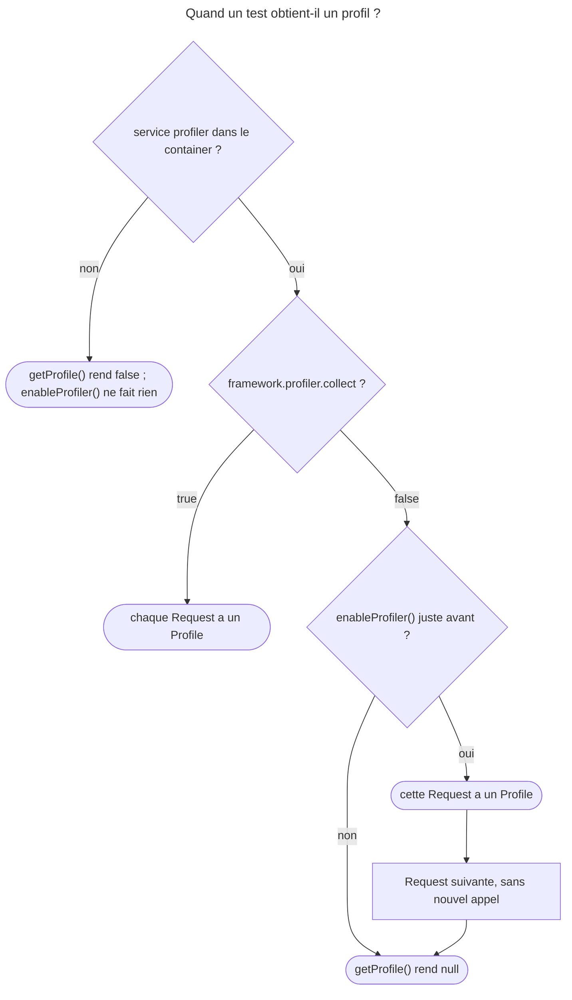

## Objectif

Lire les données du profiler depuis un test, pour vérifier une métrique que la
Response ne montre pas.

## L'essentiel

En test, le profiler est **activé** par la configuration mais **ne collecte
rien**. `enableProfiler()` déclenche la collecte, pour **la Request suivante**
seulement. `getProfile()` rend alors un `Profile`, ou `false` / `null` quand il
n'y a rien à lire : il faut le tester.

## Le schéma



## L'exemple

```php
$client = static::createClient();
$client->enableProfiler();                    // la Request suivante seulement
$client->request('GET', '/lucky/number');

if ($profile = $client->getProfile()) {       // false ou null : rien à lire
    $this->assertLessThan(
        500,
        $profile->getCollector('time')->getDuration(),
        sprintf('Budget dépassé (token %s)', $profile->getToken()),
    );
}
```

## Deux réglages, pas un

```yaml
when@test:
    framework:
        profiler: { enabled: true, collect: false }
```

- `enabled` crée le service `profiler` ; `collect` décide si chaque Request est
  profilée. `collect: false` garde le service sans ralentir la suite.
- **`enableProfiler()` n'active pas le profiler** : sans service `profiler`,
  l'appel ne fait rien. Elle active la **collecte**, pour la Request suivante.

| Configuration | Request | `getProfile()` |
|---|---|---|
| aucune key `profiler` | après `enableProfiler()` | `false` |
| `enabled: true, collect: false` | sans `enableProfiler()` | `null` |
| idem | juste après `enableProfiler()` | un `Profile` |
| idem | la Request suivante | `null` |
| `enabled: true, collect: true` | chacune | un `Profile` |

- `false` = pas de profiler (ou pas encore de Response, juste après
  `createClient()`) ; `null` = rien collecté pour cette Response.
- `enableProfiler()` appelée **après** la Request ne profile rien après coup :
  `null`, puis un `Profile` à la Request suivante.

## Lire un collector

```php
$profile->getCollector('time')->getDuration();   // un float, en millisecondes
$profile->getCollector('request')->getRoute();
$profile->getToken();                             // pour retrouver la Request dans le profiler web
```

- La liste des collectors dépend des bundles installés (`request`, `time`,
  `memory`…).
- Un nom inconnu : `InvalidArgumentException`, « Collector "nope" does not
  exist. » ; `hasCollector('nope')` rend `false`.
- La documentation : un functional test teste **d'abord la Response** ; le
  profiler sert quand la métrique est le sujet du test.

## Pièges d'examen

**`enableProfiler()` n'active pas le profiler** ; elle active la collecte.

**Elle ne vaut que pour la Request suivante.**

**`getProfile()` peut rendre `false` ou `null`** — le tester. `false` : pas
de profiler ; `null` : rien collecté.

**`collect: true` collecte à chaque Request**, sans `enableProfiler()`.

## Application

- Le profil est toujours `null` → `enableProfiler()` est appelée après
  `request()` : la placer avant.
- La CI n'a pas de profiler et `getProfile()->getCollector()` casse →
  l'idiome `if ($profile = $client->getProfile())`.

## QCM d'entraînement

**Question 1.** Juste après `static::createClient()`, avant toute Request, le
test appelle `$client->getProfile()`. Que rend-il ?

- **A.** Un `Profile` vide, sans collector
- **B.** `null`
- **C.** Une `LogicException` : aucune Request
- **D.** `false`

<details>
<summary>Correction</summary>

**Bonne réponse : D.** Sans Response, la method rend `false` avant même de
chercher le profiler ; `null` est la valeur d'une Response non profilée.

</details>

**Question 2.** Avec `collect: false`, un test fait `GET /a`, appelle
`enableProfiler()`, puis lit `getProfile()` sans nouvelle Request. Que lit-il ?

- **A.** Le profil de `GET /a`
- **B.** `null` : `/a` n'a pas été profilée
- **C.** `false` : le profiler est absent
- **D.** Une exception : l'appel arrive trop tard

<details>
<summary>Correction</summary>

**Bonne réponse : B.** La collecte se décide au traitement de la Request ; la
Request suivante, elle, aura un `Profile`.

</details>

**Question 3.** Que fait `$profile->getCollector('nope')` quand aucun collector
ne porte ce nom ?

- **A.** Une `InvalidArgumentException`
- **B.** Il rend `null`
- **C.** Il rend un collector vide
- **D.** Il rend `false`, comme `getProfile()`

<details>
<summary>Correction</summary>

**Bonne réponse : A.** « Collector "nope" does not exist. » ; `hasCollector()`
permet de tester d'abord, et rend `false`.

</details>

**Question 4.** Avec `collect: true`, le test fait deux Requests sans jamais
appeler `enableProfiler()`. Combien ont un profil ?

- **A.** Aucune : il faut toujours `enableProfiler()`
- **B.** La première seulement
- **C.** Les deux
- **D.** La dernière seulement, qui écrase l'autre

<details>
<summary>Correction</summary>

**Bonne réponse : C.** `collect: true` profile chaque Request ; A ne vaut que
pour `collect: false`, le réglage habituel en test.

</details>

## Fiche express

**Si tu dois retenir seulement 6 choses :**

- Test : **`enabled: true, collect: false`**.
- **`enableProfiler()`** active la **collecte**, pas le profiler.
- Pour **la Request suivante** seulement, donc **avant** `request()`.
- **`false`** : pas de profiler ou pas de Response ; **`null`** : rien collecté.
- **`collect: true`** : chaque Request profilée.
- **`getCollector()`** pour la métrique, **`getToken()`** pour la retrouver.

Moyen mnémotechnique : **« Activé par config, collecté sur demande »**.

```text
config : enabled: true, collect: false ; enableProfiler() AVANT la Request (une seule) ; getProfile() : false = rien à profiler, null = rien collecté ;
collect: true = toutes ; getCollector('time')->getDuration() ; getToken() dans le message
```

## Sources officielles

- [How to Use the Profiler in a Functional Test](https://github.com/symfony/symfony-docs/blob/8.0/testing/profiling.rst)
- [`KernelBrowser`, branche 8.0](https://github.com/symfony/symfony/blob/8.0/src/Symfony/Bundle/FrameworkBundle/KernelBrowser.php)
- [`Profile`, branche 8.0](https://github.com/symfony/symfony/blob/8.0/src/Symfony/Component/HttpKernel/Profiler/Profile.php)
- [`TimeDataCollector`, branche 8.0](https://github.com/symfony/symfony/blob/8.0/src/Symfony/Component/HttpKernel/DataCollector/TimeDataCollector.php)

