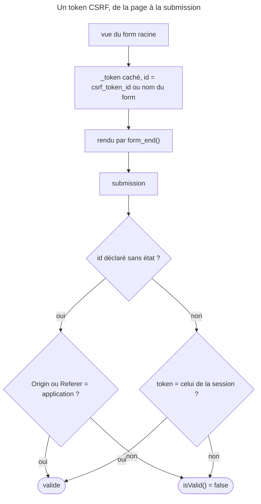

## Objectif

Savoir ce que le component Form protège seul contre le CSRF, comment le
régler, et ce qui change avec des tokens sans état. La vérification manuelle
par `isCsrfTokenValid()` dans un controller appartient au lot Controllers.

## Avant la règle : le problème à résoudre

Un user connecté à la boutique visite un autre site. Ce site contient
un form caché qui envoie un `POST` à `/compte/supprimer` : le navigateur
y joint les cookies de session de la boutique, et la Request part **au nom de
le user**, sans qu'il ait rien demandé. C'est une attaque CSRF.

La boutique doit donc distinguer un envoi venu de **ses propres pages** d'un
envoi forgé ailleurs. Il lui faut une preuve que l'attaquant ne peut pas
fabriquer — et elle ne veut pas l'écrire à la main dans chaque form.

## Le fil rouge : le form `task`

Un form `task` avec un field `title` et un sous-form `address`, protection
CSRF activée. Exécuté avec `symfony/form` 8.0.15 et `security-csrf` 8.0 :

```text
vue de task      : title, address, _token
vue de address   : city
soumis sans token        → invalide, « The CSRF token is invalid. Please try to resubmit the form. »
soumis avec le token     → valide
token de task sur other  → invalide
```

## Le cycle complet en un schéma



## Ce qui est automatique

Quand la protection est activée, un form ajoute un **field caché** portant
un token, et vérifie ce token à la submission. Un form soumis sans token
valide n'est pas valide : `isValid()` retourne `false`, sans qu'aucun code ne
teste quoi que ce soit.

Exécuté : avec un token absent ou altéré, le form est bien **soumis**
(`isSubmitted()` vaut `true`) mais **invalide**, et l'erreur est portée par le
form racine.

`FormTypeCsrfExtension` ajoute ce field dans `finishView()`, **sur le form
racine seulement** — la condition lue dans le code est `!$view->parent` : le
sous-form `address` n'a pas de token propre. Il est rendu par `form_end()`, ce
qui explique pourquoi désactiver `render_rest` fait disparaître le token.

## Les options du form

Déclarées dans `configureOptions()` ou passées à la création :

| Option | À quoi elle sert | Défaut |
|---|---|---|
| `csrf_protection` | active ou désactive la protection pour ce form | la configuration globale |
| `csrf_field_name` | le nom du field caché | `_token` |
| `csrf_token_id` | la string servant à générer le token | voir ci-dessous |
| `csrf_message` | le message d'erreur | « The CSRF token is invalid… » |

Exécuté : `csrf_field_name: '_csrf'` renomme le field ; `csrf_protection:
false` le supprime, et le form soumis sans token est alors valide ;
`csrf_message: 'Jeton refusé.'` remplace le message.

La protection s'active globalement par `framework.csrf_protection` ; les
options de form se règlent sous `framework.form.csrf_protection`
(`token_id`, `field_name`).

## Un identifier par form

Sans `csrf_token_id`, le code prend le défaut configuré pour le type, sinon **le
nom du form**, sinon la class du type. Exécuté : le form `task` a
pour identifier `task`, et son token est refusé par un form `other` ; le même
form `other` créé avec `csrf_token_id: 'task'` l'accepte.

Un identifier **différent par form** améliore la security des tokens avec
état : un token volé sur un form ne vaut rien sur un autre.

## Tokens avec ou sans état

Les tokens **avec état** sont stockés en session : les utiliser démarre une
session. C'est le mode de FrameworkBundle quand rien n'est configuré, et celui
où l'identifier par form compte.

Les tokens **sans état** ne dépendent pas de la session : la page reste
cachable. On les déclare par identifier, avec
`framework.csrf_protection.stateless_token_ids`. Pour les valider, Symfony
vérifie les headers **`Origin`** et **`Referer`** : si l'un correspond à
l'origine de l'application, le token est accepté. Exécuté avec
`SameOriginCsrfTokenManager` : `Origin` de l'application, accepté ; `Referer`
de l'application, accepté ; `Origin` étranger, refusé ; **aucun** des deux,
refusé.

Le code 8.0 (`SameOriginCsrfTokenManager::isValidOrigin()`) ajoute une règle
que la documentation ne dit pas : le header `Sec-Fetch-Site`, s'il est présent,
décide seul. Exécuté : `Origin` correct mais `Sec-Fetch-Site: cross-site`,
refusé ; `Origin` étranger mais `same-origin`, accepté. Pour une question
d'examen, la règle documentée reste celle à citer.

La documentation 8.0 décrit aussi une défense **en plus**, facultative : un
JavaScript fourni génère un token à chaque envoi et le met dans un cookie et un
header nommés `csrf-token`, que le serveur compare (« double-submit »).

La documentation 8.0 précise que les tokens sans état sont **activés par défaut
dans une application Flex** : la configuration fournie déclare
`stateless_token_ids: ['submit', 'authenticate', 'logout']` et donne
`submit` comme identifier par défaut aux form types autoconfigurés.

## Hors form

Pour un `<form>` écrit à la main, le token se produit dans le template :

```html
<input type="hidden" name="token" value="{{ csrf_token('delete-item') }}">
```

L'argument est l'identifier de token — une string arbitraire, à faire
correspondre à la vérification côté controller.

## Concrètement dans ton application

- Un form Symfony : rien à écrire. Le token est posé, rendu par `form_end()`,
  vérifié par `isValid()`.
- Une API appelée par un autre client : `csrf_protection: false` sur ce form,
  la protection reposant alors sur l'authentication de l'API.
- Une page publique à mettre en cache : un identifier sans état, `submit` par
  défaut avec Flex.
- Un `<form>` écrit à la main : `csrf_token('id')` dans le template, et la même
  string côté controller.

## À comprendre

- **Pourquoi un token bloque-t-il l'attaque ?** Parce que le site attaquant ne
  peut pas lire la page de la boutique, donc pas recopier le token qu'elle
  contient.
- **Pourquoi un identifier par form ?** Pour qu'un token obtenu sur un form
  anodin ne serve pas sur un form sensible.
- **Pourquoi `Origin` et `Referer` suffisent-ils sans session ?** Parce qu'un
  navigateur les pose lui-même, et qu'une page étrangère ne peut pas les
  falsifier.

## À mémoriser

- Field caché `_token`, ajouté au **form racine** seulement, rendu par
  `form_end()`.
- Token absent ou faux : soumis, mais **`isValid()` = `false`**.
- Options : `csrf_protection`, `csrf_field_name`, `csrf_token_id`,
  `csrf_message`.
- Identifier par défaut : défaut du type, sinon nom du form, sinon class.
- Avec état : session ; sans état : `Origin` / `Referer`, `submit` avec Flex.
- `csrf_token('id')` en Twig hors form.
- Moyen mnémotechnique : **« Poser, rendre, vérifier »**.

## Pièges d'examen

**Le token est rendu par `form_end()`.** Désactiver son option
`render_rest` le fait disparaître.

**Un form sans token valide est invalide** ; c'est le component qui
refuse.

**Sans `csrf_token_id`, l'identifier est le défaut du type, sinon le nom du
form** — et dans une application Flex, la configuration fournie donne `submit`
à tous les form types autoconfigurés : un identifier commun.

**Sans état ne veut pas dire sans contrôle** : ce sont les headers `Origin` et
`Referer` qui sont vérifiés.

**Un sous-form n'a pas son propre token** : seul le form racine en reçoit un.

## Application : trois scénarios

**Scénario 1 — Le form toujours refusé.** Chaque envoi affiche « The
CSRF token is invalid ». Le template rend les fields un par un et termine par
`form_end(form, {'render_rest': false})`. *Solution.* Retirer `render_rest:
false` : le token n'est plus rendu.

**Scénario 2 — Le token réutilisé.** Un audit montre qu'un token obtenu sur le
form de newsletter est accepté par le form de suppression de compte : les deux
types partagent le même `csrf_token_id`. *Solution.* Un identifier distinct par
form sensible, par exemple `csrf_token_id: 'delete_account'`.

**Scénario 3 — La page en cache qui démarre une session.** La page
d'accueil, avec un form de recherche protégé, ne peut plus être mise en cache.
*Solution.* Déclarer l'identifier de ce form dans `stateless_token_ids` : la
validation passe alors par `Origin` / `Referer`, sans session.

## QCM d'entraînement

Six questions sur la protection CSRF des forms. Choisis avant d'ouvrir la
correction.

**Question 1.** Un `OrderType` contient un field `address` de type `AddressType`, protection CSRF activée. Combien de fields `_token` porte la vue de l'`OrderType` ?

- **A.** Deux : un pour l'achat, un pour l'adresse
- **B.** Un seul, sur le form racine
- **C.** Aucun : un form composé gère son token autrement
- **D.** Un par field enfant de l'achat

<details>
<summary>Correction</summary>

**Bonne réponse : B.** `FormTypeCsrfExtension` n'ajoute le token que si la vue
n'a pas de parent (exécuté : `address` n'a que `city`).

A et D supposent un token par sous-form ou par field. C invente une autre
mécanique.

</details>

**Question 2.** Le form `other` est créé avec `'csrf_token_id' => 'task'`. On lui soumet un token généré pour le form `task`. Résultat ?

- **A.** Invalide : un token est lié au nom du form qui l'a émis
- **B.** Une exception : deux forms ne peuvent partager un identifier
- **C.** Valide : seul l'identifier compte
- **D.** Invalide : un token ne sert qu'une fois

<details>
<summary>Correction</summary>

**Bonne réponse : C.** Exécuté : le token de `task` est accepté par `other`
déclaré avec le même identifier.

A est le piège : le nom du form n'est que l'identifier **par défaut**. B et D
inventent des règles.

</details>

**Question 3.** Un form de type API est créé avec `'csrf_protection' => false`, puis soumis sans aucun token. Que vaut `isValid()` ?

- **A.** `true` si les autres constraints passent
- **B.** `false` : le token manque
- **C.** Une exception : un token est obligatoire pour soumettre
- **D.** `false` tant que la session n'est pas démarrée

<details>
<summary>Correction</summary>

**Bonne réponse : A.** Sans protection, aucun field `_token` n'est ajouté ni
vérifié (exécuté : valide).

B et D supposent la protection active. C invente une obligation.

</details>

**Question 4.** Un form est soumis avec une valeur de `_token` modifiée. Que valent `isSubmitted()` et `isValid()` ?

- **A.** `false` et une exception
- **B.** `false` et `false`
- **C.** Une `AccessDeniedException` avant le controller
- **D.** `true` et `false`

<details>
<summary>Correction</summary>

**Bonne réponse : D.** Le form est soumis ; c'est la validation qui échoue
(exécuté), avec l'erreur sur le form racine.

A et B confondent submission et validité. C invente un refus du firewall.

</details>

**Question 5.** L'identifier `submit` est déclaré dans `stateless_token_ids`. Un `POST` arrive sans header `Origin` ni `Referer`, et sans header `Sec-Fetch-Site`. Le token est-il accepté ?

- **A.** Oui : un token sans état n'est pas vérifié
- **B.** Non : rien ne prouve l'origine
- **C.** Oui, si la session contient le token
- **D.** Oui : l'absence de header vaut même origine

<details>
<summary>Correction</summary>

**Bonne réponse : B.** Exécuté avec `SameOriginCsrfTokenManager` : sans aucune
information d'origine, refusé.

A est le piège : « sans état » ne veut pas dire « sans contrôle ». C décrit un
token avec état. D invente une présomption.

</details>

**Question 6.** Un form est déclaré avec `'csrf_field_name' => '_csrf'`. Quel nom porte l'enfant caché dans sa vue ?

- **A.** `_token`, le nom fixé par le component
- **B.** `csrf`, sans le souligné
- **C.** `_csrf`
- **D.** `_csrf_token`, le préfixe étant ajouté

<details>
<summary>Correction</summary>

**Bonne réponse : C.** Exécuté : la vue porte `title, address, _csrf`.

A est le défaut, ici remplacé. B et D inventent une transformation du nom.

</details>

## Fiche express

**Si tu dois retenir seulement 6 choses :**

- Field caché **`_token`**, sur le **form racine** seulement, rendu par
  `form_end()`.
- Token absent ou faux : **soumis, mais invalide**.
- Quatre options : **`csrf_protection`, `csrf_field_name`, `csrf_token_id`,
  `csrf_message`**.
- Identifier par défaut : **défaut du type, sinon nom du form** ; un
  identifier distinct par form sensible.
- **Avec état** : session ; **sans état** : `Origin` / `Referer`, `submit` par
  défaut avec Flex.
- Hors form : **`csrf_token('id')`** dans le template.

**En une phrase, pour tout reconstruire :**

```text
form racine + _token(csrf_token_id ?: nom du form) → form_end() le rend
  → submission : session (avec état) | Origin/Referer (sans état) → sinon isValid() = false
```

## Sources officielles

- [CSRF protection](https://github.com/symfony/symfony-docs/blob/8.0/security/csrf.rst)
- [Form 8.0, `FormTypeCsrfExtension`](https://github.com/symfony/symfony/blob/8.0/src/Symfony/Component/Form/Extension/Csrf/Type/FormTypeCsrfExtension.php)
- [Security CSRF 8.0, `SameOriginCsrfTokenManager`](https://github.com/symfony/symfony/blob/8.0/src/Symfony/Component/Security/Csrf/SameOriginCsrfTokenManager.php)
- [FrameworkBundle 8.0, `Configuration`](https://github.com/symfony/symfony/blob/8.0/src/Symfony/Bundle/FrameworkBundle/DependencyInjection/Configuration.php)
