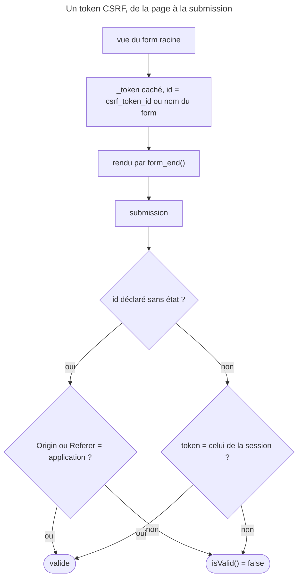

## Objectif

Savoir ce que le component Form protège seul contre le CSRF, comment le
régler, et ce qui change avec des tokens sans état. La vérification manuelle
par `isCsrfTokenValid()` dans un controller appartient au lot Controllers.

## L'essentiel

Protection activée, un form Symfony **pose** un field caché `_token`, le
**rend** par `form_end()` et le **vérifie** à la submission : sans token
valide, le form est soumis mais invalide, sans une ligne de code. Les tokens
**avec état** vivent en session ; les tokens **sans état** se valident par les
headers `Origin` et `Referer`.

## Le schéma



## L'exemple : le form `task`

Un form `task` avec un field `title` et un sous-form `address` :

```text
vue de task      : title, address, _token
vue de address   : city
soumis sans token        → invalide, « The CSRF token is invalid. Please try to resubmit the form. »
soumis avec le token     → valide
token de task sur other  → invalide
```

## Ce qui est automatique

- Token absent ou altéré : le form est **soumis** (`isSubmitted()` vaut
  `true`) mais **invalide** ; l'erreur est portée par le form racine.
- `FormTypeCsrfExtension` ajoute le field dans `finishView()`, sur le **form
  racine seulement** : un sous-form n'a pas de token propre.
- Le token est rendu par `form_end()` : désactiver `render_rest` le fait
  disparaître.

## Les options du form

| Option | Rôle | Défaut |
|---|---|---|
| `csrf_protection` | active ou désactive la protection pour ce form | la configuration globale |
| `csrf_field_name` | le nom du field caché | `_token` |
| `csrf_token_id` | la string qui génère le token | voir ci-dessous |
| `csrf_message` | le message d'erreur | « The CSRF token is invalid… » |

`csrf_protection: false` : un form soumis sans token est valide.
`csrf_message: 'Jeton refusé.'` remplace le message. Globalement :
`framework.csrf_protection` ; les options de form par défaut sous
`framework.form.csrf_protection` (`token_id`, `field_name`).

## Un identifier par form

Sans `csrf_token_id` : le défaut configuré pour le type, sinon **le nom du
form**, sinon la class du type. Un token du form `task` est refusé par le form
`other`, accepté si `other` reçoit `csrf_token_id: 'task'`. Un identifier
distinct par form sensible empêche de rejouer un token volé ailleurs.

## Tokens avec ou sans état

| | Avec état | Sans état |
|---|---|---|
| stockage | session (démarrée pour l'occasion) | aucun : la page reste cachable |
| validation | token = celui de la session | header `Origin` ou `Referer` = l'application |
| déclaration | le défaut sans configuration | `framework.csrf_protection.stateless_token_ids` |

- Sans état, **aucun** des deux headers : refusé.
- Le code 8.0 ajoute une règle que la documentation ne dit pas :
  `Sec-Fetch-Site`, s'il est présent, décide seul. À l'examen, citer la règle
  documentée.
- Dans une application Flex, la configuration fournie déclare
  `stateless_token_ids: ['submit', 'authenticate', 'logout']`.
- Hors form : `{{ csrf_token('delete-item') }}` dans le template.

## Pièges d'examen

**Le token est rendu par `form_end()`.** Désactiver son option
`render_rest` le fait disparaître.

**Un form sans token valide est invalide** ; c'est le component qui
refuse.

**Sans `csrf_token_id`, l'identifier est le défaut du type, sinon le nom du
form** — et dans une application Flex, la configuration fournie donne `submit`
à tous les form types autoconfigurés : un identifier commun.

**Sans état ne veut pas dire sans contrôle** : ce sont les headers `Origin` et
`Referer` qui sont vérifiés.

**Un sous-form n'a pas son propre token** : seul le form racine en reçoit un.

## Application

- Une page publique à mettre en cache, avec un form protégé → son
  identifier dans `stateless_token_ids`.
- Un form de suppression de compte → `csrf_token_id: 'delete_account'`,
  distinct de celui de la newsletter.

## QCM d'entraînement

**Question 1.** Un `OrderType` contient un field `address` de type
`AddressType`, protection CSRF activée. Combien de fields `_token` dans toute
la vue ?

- **A.** Deux : un par form type
- **B.** Un, dans la vue d'`OrderType`
- **C.** Un, dans la vue d'`AddressType`
- **D.** Aucun tant que `csrf_token_id` n'est pas défini

<details>
<summary>Correction</summary>

**Bonne réponse : B.** `FormTypeCsrfExtension` n'ajoute le field qu'au form
racine ; le sous-form `address` n'a pas de token propre.

</details>

**Question 2.** L'identifier `submit` est sans état. Un `POST` arrive sans
`Origin`, sans `Referer` et sans `Sec-Fetch-Site`. Le token est-il accepté ?

- **A.** Oui : sans état, rien n'est vérifié
- **B.** Oui, si le cookie de session est présent
- **C.** Non
- **D.** Oui : l'absence de header vaut même origine

<details>
<summary>Correction</summary>

**Bonne réponse : C.** Sans état, l'un des deux headers doit désigner
l'origine de l'application ; sans aucun des deux, le token est refusé.

</details>

**Question 3.** Un form d'API est créé avec `'csrf_protection' => false`,
puis soumis sans aucun token. Que vaut `isValid()` ?

- **A.** `true`, si les autres constraints passent
- **B.** `false` : le token reste exigé à la submission
- **C.** Une exception : un form soumis exige un token
- **D.** `false`, sauf si `csrf_field_name` est vide

<details>
<summary>Correction</summary>

**Bonne réponse : A.** L'option désactive la protection pour ce form : plus
de field caché, plus de vérification à la submission.

</details>

**Question 4.** Dans une application Flex, deux form types autoconfigurés ne
définissent pas `csrf_token_id`. Quel identifier de token utilisent-ils ?

- **A.** Leur nom de form, chacun le sien
- **B.** La class de leur type
- **C.** `_token`, le nom du field
- **D.** `submit`, le même pour les deux

<details>
<summary>Correction</summary>

**Bonne réponse : D.** La configuration fournie par Flex donne `submit` comme
identifier par défaut aux form types autoconfigurés.

</details>

## Fiche express

**Si tu dois retenir seulement 6 choses :**

- Field caché **`_token`**, sur le **form racine** seulement, rendu par
  `form_end()`.
- Token absent ou faux : **soumis, mais invalide**.
- Quatre options : **`csrf_protection`, `csrf_field_name`, `csrf_token_id`,
  `csrf_message`**.
- Identifier par défaut : **défaut du type, sinon nom du form** ; `submit`
  avec Flex.
- **Avec état** : session ; **sans état** : `Origin` / `Referer`.
- Hors form : **`csrf_token('id')`** dans le template.

Moyen mnémotechnique : **« Poser, rendre, vérifier »**.

## Sources officielles

- [CSRF protection](https://github.com/symfony/symfony-docs/blob/8.0/security/csrf.rst)
- [Form 8.0, `FormTypeCsrfExtension`](https://github.com/symfony/symfony/blob/8.0/src/Symfony/Component/Form/Extension/Csrf/Type/FormTypeCsrfExtension.php)
- [Security CSRF 8.0, `SameOriginCsrfTokenManager`](https://github.com/symfony/symfony/blob/8.0/src/Symfony/Component/Security/Csrf/SameOriginCsrfTokenManager.php)
- [FrameworkBundle 8.0, `Configuration`](https://github.com/symfony/symfony/blob/8.0/src/Symfony/Bundle/FrameworkBundle/DependencyInjection/Configuration.php)

