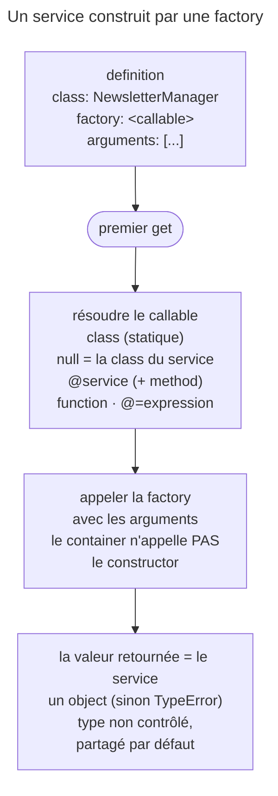

## Objectif

Faire construire un service par autre chose que `new`, choisir l'écriture de
l'option `factory` selon le callable, savoir à qui vont les `arguments`, et
prévoir ce que le container fait de la valeur retournée.

## L'essentiel

Avec l'option `factory`, le container ne fait pas `new` : il appelle un
callable — une method statique, la method d'un service (`@`), un service
invocable, une function. Les `arguments` vont **à la factory**, et la valeur
**retournée** devient le service, sans contrôle de son type.

## Le schéma



## Le fil rouge : un NewsletterManager

```php
class NewsletterManager
{
    public function __construct(private string $sender = 'none') {}

    public static function create(string $sender): self
    {
        return new self('factory:'.$sender);
    }
}
```

## Les écritures : choisir selon la nature du callable

| Ce qui fabrique | Écriture YAML |
|---|---|
| une method **statique** d'une autre class | `factory: ['App\Email\NewsletterManagerStaticFactory', 'createNewsletterManager']` |
| une method statique de la class **du service** | `factory: [null, 'create']` |
| une method d'un **service** | `factory: ['@App\Email\NewsletterManagerFactory', 'createNewsletterManager']` |
| un service **invocable** | `factory: '@App\Email\InvokableNewsletterManagerFactory'` → `__invoke()` |
| une function PHP | `factory: 'App\make_newsletter'` |

- **Sans `@`**, un nom de class : appel **statique**. **Avec `@`**, un id de
  service : le container le récupère, puis appelle la method.
- Une method d'instance sans `@` passe la compilation, puis le premier `get()`
  lève `Error` : « Non-static method … cannot be called statically ».
- En PHP : `->factory(NewsletterManagerStaticFactory::createNewsletterManager(...))`
  ou `->factory([service(…), 'createNewsletterManager'])`.

## `[null, 'create']` : la class du service elle-même

- `null` = la class de ce service ; ni une function globale, ni un service.
- `constructor: 'create'` dit la même chose ; avec `factory` sur le même
  service : `LogicException`,
  « …cannot declare a factory as well as a constructor ».
- `#[Autoconfigure(constructor: 'create')]` sur la class : appliqué
  seulement si le service est **autoconfiguré**.

## Les arguments vont à la factory

Avec `factory: [null, 'create']` et `arguments: ['fabien']` :

| Appel | Valeur reçue |
|---|---|
| `NewsletterManager::create()`, par le container | `'fabien'` |
| `__construct()`, par `new self(...)` dans `create()` | `'factory:fabien'` |

Les arguments de la factory sont autowirés si l'autowiring est actif.

## Ce que le container retient : la valeur retournée

- Un **object** obligatoire : `factory: 'strtoupper'` lève au premier `get()`
  « Return value must be of type ?object, string returned ».
- Type **non contrôlé** : `class` n'a pas d'effet sur l'object obtenu, mais
  l'autowiring la lit. Une factory qui rend un `stdClass` pour la class `Liar`
  fait échouer son consommateur : « must be of type App\Liar, stdClass given ».
- **Partagé** par défaut : la factory est appelée une fois ; avec
  `shared: false`, à chaque `get()`.

## Une expression comme factory

```yaml
factory: '@=parameter("kernel.debug") ? service("tracable_newsletter") : service("newsletter")'
```

`arg(0)` y lit le premier argument de la definition. Sans le component
ExpressionLanguage, le file ne se charge pas ; `@=` n'est accepté que pour
`factory`, pas pour `configurator`.

## Pièges d'examen

**Les arguments vont à la factory.** Le container n'appelle pas le constructor
du service lui-même ; si la factory fait `new self(…)`, c'est elle qui choisit
ce qu'elle lui passe.

**`[null, 'create']` désigne la class du service**, pas une function globale.

**Une factory de service utilise `@`** ; une factory statique nomme la class ;
`'@service'` seul appelle `__invoke()`.

**Une method d'instance sans `@` échoue au premier `get()`**, pas à la
compilation : `Error`, « Non-static method … cannot be called statically ».

**Le container ne contrôle pas le type retourné** : l'erreur arrive chez le
consommateur.

**`factory` et `constructor` ne se combinent pas** : `LogicException` dès le
chargement de la configuration.

**`#[Autoconfigure(constructor: …)]` dépend de l'autoconfiguration** : avec
`autoconfigure: false`, l'attribute est ignoré et le constructor est utilisé.

## Application

- Une connexion se crée par `Connection::fromDsn()` → `factory: [null,
  'fromDsn']`, ou `constructor: 'fromDsn'`.
- Un client vient d'un service `ClientFactory::build()` non statique →
  `factory: ['@App\ClientFactory', 'build']`.

## QCM d'entraînement

**Question 1.** Un service déclare `factory: ['App\Mail\ClientFactory', 'build']`,
et `build()` est une method **non statique**. Que se passe-t-il ?

- **A.** Le container instancie `ClientFactory`, puis appelle `build()` dessus
- **B.** La compilation passe ; le premier `get()` lève une `Error`
- **C.** La compilation échoue et exige une factory statique
- **D.** Le container ignore la factory et utilise le constructor

<details>
<summary>Correction</summary>

**Bonne réponse : B.** Sans `@`, le premier élément est une class et la method
est appelée statiquement ; une method d'instance exige la forme `@`.

</details>

**Question 2.** `Manager::create(string $sender)` fait
`return new self('factory:'.$sender);`. Le service a
`factory: [null, 'create']` et `arguments: ['fabien']`. Que reçoit le
constructor ?

- **A.** `'fabien'`, passé par le container avant l'appel à `create()`
- **B.** Rien : avec une factory, le constructor ne s'exécute jamais
- **C.** `'fabien'` deux fois : une par le container, une par `create()`
- **D.** `'factory:fabien'`

<details>
<summary>Correction</summary>

**Bonne réponse : D.** Le container appelle `create('fabien')`, et c'est
`create()` qui choisit ce qu'elle passe au constructor.

</details>

**Question 3.** `NewsletterManager` porte `#[Autoconfigure(constructor:
'create')]`, mais sa definition a `autoconfigure: false`. Comment le service
est-il construit ?

- **A.** Par `create()` : un attribute est toujours lu
- **B.** La compilation échoue : l'attribute exige l'autoconfiguration
- **C.** Par le constructor
- **D.** Par les deux : le constructor, puis `create()`

<details>
<summary>Correction</summary>

**Bonne réponse : C.** `#[Autoconfigure]` n'est appliqué qu'aux services
autoconfigurés ; sans autoconfiguration, l'attribute est ignoré.

</details>

**Question 4.** Un service déclare `factory: '@app.newsletter_factory'`, sans
nom de method. Qu'appelle le container ?

- **A.** La method `__invoke()` de ce service
- **B.** Le constructor de `app.newsletter_factory`, dont l'instance devient le service
- **C.** Une method statique `create()`, choisie par défaut
- **D.** Rien : la compilation échoue sans nom de method

<details>
<summary>Correction</summary>

**Bonne réponse : A.** Un service seul, sans method, est traité comme une
factory invocable : le container appelle son `__invoke()`.

</details>

## Fiche express

**Si tu dois retenir seulement 7 choses :**

- **Sans `@`** : statique ; **avec `@`** : un service ; `'@service'` seul :
  `__invoke()`.
- **`[null, 'create']`** = la class du service ; `constructor:` équivaut.
- `factory` **et** `constructor` : `LogicException`.
- Les **arguments vont à la factory**, jamais directement au constructor.
- La valeur retournée **est** le service : un object, type non contrôlé.
- Partagée par défaut ; `shared: false` rappelle la factory.
- `@=` : une expression, avec ExpressionLanguage.

Moyen mnémotechnique : **« Qui fabrique ? Avec quoi ? Que rend-il ? »**

## Sources officielles

- [Using a Factory to Create Services](https://github.com/symfony/symfony-docs/blob/8.0/service_container/factories.rst)
- [DependencyInjection 8.0, `Loader\YamlFileLoader`](https://github.com/symfony/symfony/blob/8.0/src/Symfony/Component/DependencyInjection/Loader/YamlFileLoader.php)
- [DependencyInjection 8.0, `Definition`](https://github.com/symfony/symfony/blob/8.0/src/Symfony/Component/DependencyInjection/Definition.php)
- [DependencyInjection 8.0, `Container`](https://github.com/symfony/symfony/blob/8.0/src/Symfony/Component/DependencyInjection/Container.php)

