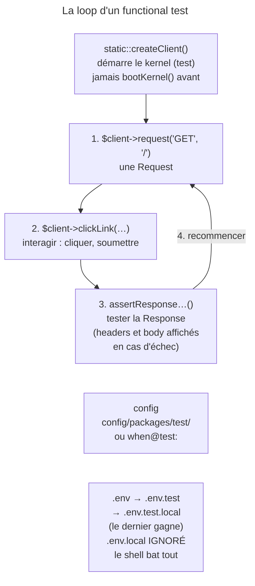

## Objectif

Écrire un test qui traverse l'application entière, et connaître les assertions
que Symfony ajoute à PHPUnit — c'est là que se joue la lisibilité du test.

## L'essentiel

Un test d'application étend `WebTestCase`, qui ajoute un client à
`KernelTestCase` : `createClient()` démarre le kernel, en environment `test`.
Les assertions de Symfony rendent l'échec lisible, et la configuration des
tests a ses propres files — `.env.local` n'en fait pas partie.

## Le schéma



## L'exemple : la page d'accueil

```php
class PostControllerTest extends WebTestCase
{
    public function testHome(): void
    {
        $client = static::createClient();
        $client->request('GET', '/');           // une URL écrite en dur

        $this->assertResponseIsSuccessful();
        $this->assertRouteSame('home');
        $this->assertSelectorTextContains('h1', 'Hello World');
    }
}
```

## Le squelette

- `WebTestCase` **étend `KernelTestCase`** et lui ajoute le client.
- `createClient()` démarre le kernel : `bootKernel()` puis `createClient()`
  lève une `LogicException` — « Booting the kernel before calling
  "…WebTestCase::createClient()" is not supported, the kernel should only be
  booted once. ».
- La documentation recommande une **URL en dur** : un test qui génère son URL
  suit un changement de route au lieu de le détecter.

## L'environment `test`

La configuration propre aux tests va dans `config/packages/test/` ou sous
**`when@test`**. Les variables d'environment, une variable `A` définie dans
les quatre files :

| Situation | Valeur de `A` |
|---|---|
| `APP_ENV=test`, les quatre files | celle de `.env.test.local` |
| `APP_ENV=test`, sans `.env.test.local` | celle de `.env.test` |
| `APP_ENV=dev` | celle de `.env.local` |
| `APP_ENV=test`, `A` déjà définie dans le shell | celle du shell |

`.env.local` n'est pas lu en test, délibérément : une machine de
développement ne doit pas modifier le résultat des tests.

## Les assertions de Symfony

| Sur… | Assertions |
|---|---|
| la Response | `assertResponseIsSuccessful()` (tout 2xx), `assertResponseStatusCodeSame()`, `assertResponseRedirects()`, `assertResponseHasHeader()`, `assertResponseHasCookie()`, `assertResponseIsUnprocessable()` (422) |
| la Request | `assertRouteSame()`, `assertRequestAttributeValueSame()` |
| le navigateur | `assertBrowserHasCookie()`, `assertBrowserHistoryIsOnFirstPage()` |
| le contenu | `assertSelectorExists()`, `assertSelectorCount()`, `assertSelectorTextContains()`, `assertPageTitleSame()`, `assertInputValueSame()`, `assertCheckboxChecked()` |

Sur un échec, l'assertion affiche headers **et** corps de la Response, là où
`assertEquals(200, $code)` n'affiche qu'un nombre.
`self::setBrowserKitAssertionsAsVerbose(false)` réduit l'affichage aux
headers ; le parameter `$verbose` fait de même au cas par cas.

## Pièges d'examen

**`WebTestCase` étend `KernelTestCase`** ; `createClient()` démarre déjà le
kernel.

**`.env.local` est ignoré en test**, contrairement à `.env.test.local`.

**`assertResponseIsSuccessful()` couvre tout le 2xx**, pas seulement 200 —
exécuté : une Response 201 passe.

**Une variable du shell bat `.env.test.local`.**

**Une URL en dur est la bonne pratique**, à rebours de l'intuition.

## Application

- Activer `strict_variables` de Twig pour les seuls tests →
  `when@test: twig: strict_variables: true`.
- Une valeur à fixer pour toute l'équipe en test → `.env.test`, versionné ;
  pour sa machine seulement → `.env.test.local`.

## QCM d'entraînement

**Question 1.** `A` est définie dans `.env` et dans `.env.test`, pas dans
`.env.test.local`, ni dans le shell. Quelle valeur voit la suite de tests ?

- **A.** Celle de `.env`, le file de base
- **B.** Celle de `.env.test`
- **C.** Aucune : `.env.test.local` est requis
- **D.** Celle de `.env.local`, s'il existe

<details>
<summary>Correction</summary>

**Bonne réponse : B.** Les files sont lus dans l'ordre `.env`, `.env.test`,
`.env.test.local`, et le dernier qui définit la variable gagne.

</details>

**Question 2.** Après `self::setBrowserKitAssertionsAsVerbose(false)`,
`assertResponseIsSuccessful()` échoue sur un 404. Qu'affiche l'échec ?

- **A.** Les headers et le body de la Response
- **B.** Le seul code 404
- **C.** Les headers de la Response
- **D.** Rien : l'assertion devient silencieuse

<details>
<summary>Correction</summary>

**Bonne réponse : C.** Le mode verbeux, actif par défaut, ajoute le body ;
désactivé, l'échec n'affiche plus que les headers.

</details>

**Question 3.** `strict_variables` de Twig doit valoir `true` en test
seulement, dans `config/packages/twig.yaml`. Quelle key l'exprime ?

- **A.** `test:`
- **B.** `when@test:`
- **C.** `env(test):`
- **D.** `environment(test):`

<details>
<summary>Correction</summary>

**Bonne réponse : B.** `when@test` restreint un block de configuration à
l'environment `test` ; `config/packages/test/` est l'autre façon de faire.

</details>

**Question 4.** `A` vaut `x` dans `.env.local` et `y` dans `.env.test.local`.
Avec `APP_ENV=dev`, quelle valeur l'application lit-elle ?

- **A.** `x`
- **B.** `y`
- **C.** Celle de `.env`
- **D.** Aucune : conflit

<details>
<summary>Correction</summary>

**Bonne réponse : A.** Hors test, `.env.local` est lu ; `.env.test.local`
ne vaut que pour l'environment `test`.

</details>

## Fiche express

**Si tu dois retenir seulement 6 choses :**

- **`WebTestCase` étend `KernelTestCase`** ; `createClient()` démarre le
  kernel.
- Quatre temps : Request, interaction, assertion, recommencer.
- Config de test : **`when@test`** ou `config/packages/test/`.
- `.env` → `.env.test` → `.env.test.local` ; **`.env.local` ignoré** ; le
  shell bat tout.
- `assertResponseIsSuccessful()` : **tout 2xx** ; `assertRouteSame()` : la
  route qui a répondu.
- **URL en dur**, pas générée.

Moyen mnémotechnique : **« Request, clic, assertion, encore »**.

## Sources officielles

- [Testing](https://github.com/symfony/symfony-docs/blob/8.0/testing.rst)
- [FrameworkBundle 8.0, `WebTestCase`](https://github.com/symfony/symfony/blob/8.0/src/Symfony/Bundle/FrameworkBundle/Test/WebTestCase.php)
- [Dotenv 8.0, `Dotenv::loadEnv()`](https://github.com/symfony/symfony/blob/8.0/src/Symfony/Component/Dotenv/Dotenv.php)

