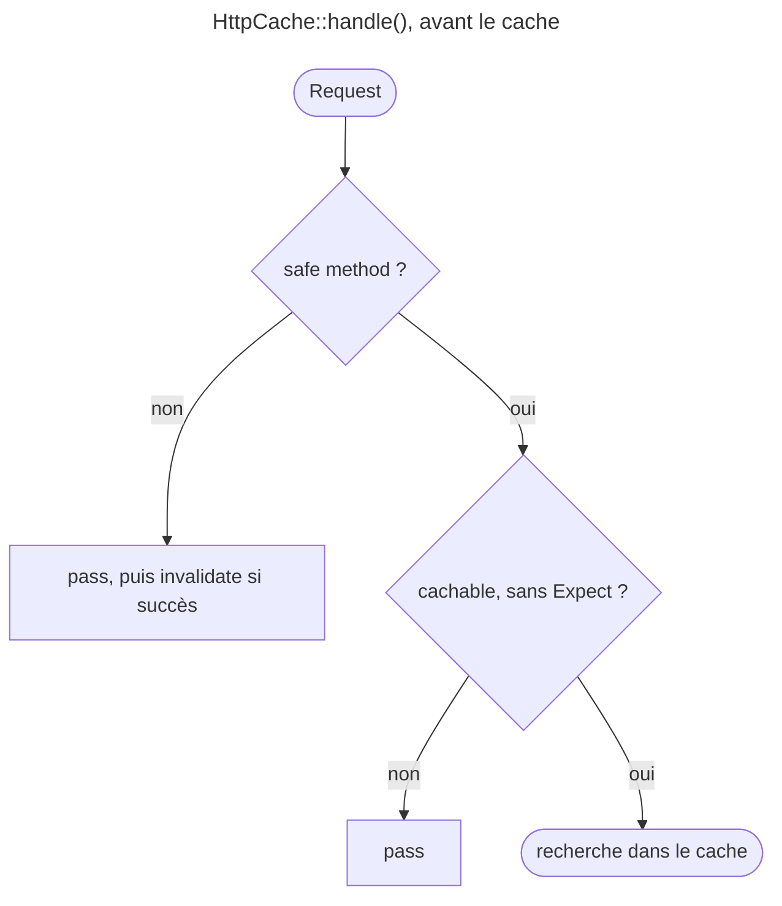
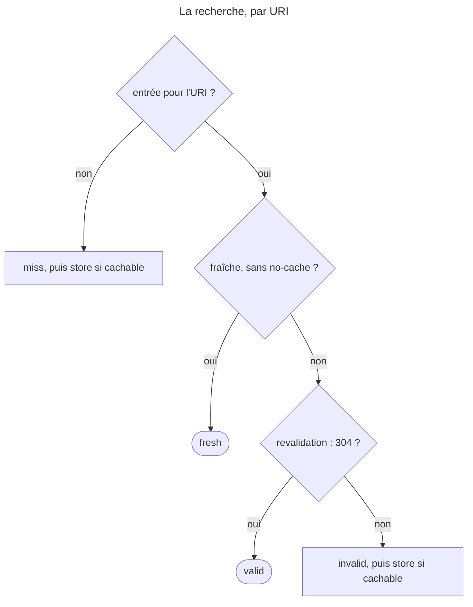

## Objectif

Savoir ce que Symfony apporte **par-dessus** le protocole : un reverse proxy
écrit en PHP, un attribute déclaratif, et une trace pour comprendre pourquoi une
Response a été servie du cache ou non.

## L'essentiel

Par-dessus le protocole HTTP, Symfony apporte un **reverse proxy écrit en
PHP**, activé par une option ; un attribute **`#[Cache]`** qui déclare la
politique d'une action ; et une trace, **`X-Symfony-Cache`**, qui dit pourquoi
une Response vient du cache ou non. Le cache ne vaut que pour les safe
methods, et sa key est l'URI. ESI est hors périmètre.

## Le schéma





## L'exemple : une page publique d'une heure

```yaml
when@prod:
    framework:
        http_cache: true
```

```php
use Symfony\Component\HttpKernel\Attribute\Cache;

#[Cache(public: true, maxage: 3600, mustRevalidate: true)]
public function index(): Response
{
    return $this->render('blog/index.html.twig');
}
```

## Le reverse proxy de Symfony

- `framework.http_cache: true` suffit : le kernel stocke les Responses et les
  ressert. Sous `when@prod`, parce qu'un cache masquerait les changements
  pendant le développement.
- Ce n'est pas Varnish, ni aussi rapide qu'un proxy écrit en C ; mais
  l'application ne parle que HTTP, et passer à un autre proxy ne la change pas.
- En debug, le header **`X-Symfony-Cache`** trace chaque décision (`miss,
  store` puis `fresh`) ; hors debug, `trace_level` vaut `none`. `short`, conçu
  pour les journaux du serveur, ne trace que la main Request ; `full`, tout ;
  `trace_header` renomme le header.

## Déclarer plutôt que construire

- `#[Cache]` pose une politique par défaut ; **les headers posés dans le
  controller l'emportent** : `#[Cache(maxage: 60)]` et `setMaxAge(10)` donnent
  `max-age=10`.
- L'attribute écrit ses options en camelCase (`maxage`, `smaxage`,
  `mustRevalidate`, `lastModified`) ; `$response->setCache([...])` les mêmes
  en snake_case (`max_age`, `s_maxage`, `must_revalidate`, `etag`).
- `$response->expire()` marque la Response périmée ;
  `$response->setNotModified()` en fait un 304 sans contenu.

## Ce que le cache ne fera pas

- **La key de cache est l'URI**, query string normalisée : `?b=2&a=1` et
  `?a=1&b=2` partagent leur entrée. Pour `QUERY`, le body entre aussi dans la
  key.
- Une entrée `public` sert tout le monde : exécuté, Bob reçoit la page d'Alice.
  Sinon, une Request avec `Cookie` ou `Authorization` rend la Response
  `private`, jamais stockée.
- **Safe methods seulement** : jamais `PUT` ou `DELETE` ; ne jamais modifier
  l'état sur un `GET` ou un `HEAD`. En 8.0, `Request::isMethodCacheable()`
  retient aussi `QUERY`. Exécuté, un `POST` à `max-age=60` donne
  `pass, invalidate` à chaque fois.
- **L'invalidation à la demande n'est pas dans la spécification HTTP** : avec
  l'expiration seule, il faut attendre l'échéance.

## Pièges d'examen

**`framework.http_cache: true` suffit** à activer le proxy ; aucune class à
écrire.

**Le controller l'emporte sur `#[Cache]`**, pas l'inverse.

**La key de cache est l'URI**, pas la route ni ses parameters — corps compris
pour `QUERY`.

**Le cache HTTP ne s'applique qu'aux safe methods.**

**L'invalidation à la demande est hors spécification HTTP** ; RFC 9111 §4.4
n'impose que celle qui suit une method non sûre réussie.

**`X-Symfony-Cache` n'apparaît qu'en debug** ou si `trace_level` le demande.

## Application

- Mesurer l'efficacité du cache route par route → `trace_level: short`, et le
  header dans le journal d'Apache.
- Une action qui doit rester une heure en cache sauf exception → `#[Cache]`,
  et `setMaxAge()` dans le code pour l'exception.

## QCM d'entraînement

**Question 1.** Un développeur écrit `#[Cache(max_age: 600)]` sur une action.
Que se passe-t-il ?

- **A.** `max-age=600`, comme avec `setCache()`
- **B.** Une `Error` : parameter nommé inconnu
- **C.** L'option est ignorée sans erreur
- **D.** `s-maxage=600`, par défaut partagé

<details>
<summary>Correction</summary>

**Bonne réponse : B.** L'attribute écrit `maxage` en camelCase ; le snake_case
`max_age` est celui des options de `setCache()`.

</details>

**Question 2.** Une page `public, max-age=60` est demandée en
`/search?b=2&a=1`, puis en `/search?a=1&b=2`. Que trace la seconde Request ?

- **A.** `miss, store` : l'URI diffère
- **B.** `pass` : une query string n'est jamais cachée
- **C.** `fresh`
- **D.** `stale, invalid` : l'entrée est remplacée

<details>
<summary>Correction</summary>

**Bonne réponse : C.** L'URI sert de key après normalization de la query
string, triée : les deux Requests partagent la même entrée.

</details>

**Question 3.** Les opérations veulent que le header de trace s'appelle
`X-Cache` au lieu de `X-Symfony-Cache`. Quelle option ?

- **A.** `trace_header`
- **B.** `trace_level: header`
- **C.** `cache_header_name`
- **D.** Aucune : le nom est figé

<details>
<summary>Correction</summary>

**Bonne réponse : A.** `trace_level` choisit le détail de la trace, et
`trace_header` le nom du header qui la porte.

</details>

**Question 4.** Pourquoi la documentation active-t-elle `http_cache` sous
`when@prod` ?

- **A.** Le proxy PHP ne fonctionne pas en debug
- **B.** Pour voir ses changements en dev
- **C.** `when@dev` ne peut pas contenir `framework`
- **D.** Les tests exigent qu'il soit désactivé

<details>
<summary>Correction</summary>

**Bonne réponse : B.** En développement, on veut voir chaque modification ;
un cache resservirait l'ancienne Response jusqu'à son échéance.

</details>

## Fiche express

**Si tu dois retenir seulement 7 choses :**

- **`framework.http_cache: true`** : un reverse proxy en PHP, remplaçable.
- **`X-Symfony-Cache`** en debug ; sinon `trace_level` (`none`, `short`,
  `full`), `trace_header`.
- `#[Cache]` déclare ; **le controller l'emporte**.
- Attribute en camelCase, `setCache()` en snake_case.
- Key : **l'URI**, query normalisée ; body compris pour `QUERY`.
- **Safe methods** seulement ; `Cookie` ou `Authorization` → `private`.
- Invalidation à la demande : **hors HTTP**.

Moyen mnémotechnique : **« Activer, déclarer, tracer »**.

## Sources officielles

- [HTTP Cache](https://github.com/symfony/symfony-docs/blob/8.0/http_cache.rst)
- [HTTP Cache Validation](https://github.com/symfony/symfony-docs/blob/8.0/http_cache/validation.rst)
- [HTTP Cache Expiration](https://github.com/symfony/symfony-docs/blob/8.0/http_cache/expiration.rst)
- [`HttpCache\Store`, branche 8.0](https://github.com/symfony/symfony/blob/8.0/src/Symfony/Component/HttpKernel/HttpCache/Store.php)

