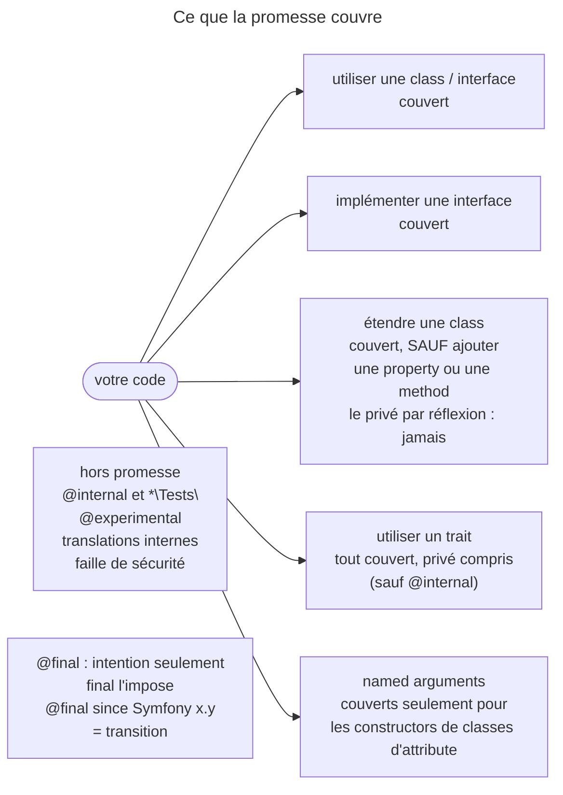

## Objectif

Savoir ce que la backward compatibility promise garantit **au user de
Symfony**, et surtout ce qu'elle ne garantit pas.

## L'essentiel

La promesse suit le *semantic versioning* : seule une version **majeure** peut
casser la compatibilité ; une mineure ajoute et déprécie. Mais elle n'est pas
globale : elle dépend de la **manière** dont on utilise le code — utiliser,
implémenter, étendre — et trois zones en sont exclues. Le piège le plus visé :
les named arguments.

## Le schéma



## L'exemple : un argument ajouté en mineure

```php
public function say(string $text, /* bool $stripWhitespace = true */): void
{
    $stripWhitespace = 2 <= \func_num_args() ? func_get_arg(1) : false;
}
```

## Utiliser, étendre, implémenter

**Utiliser** et **implémenter une interface** sont toujours couverts.
**Étendre** l'est pour l'essentiel, mais la grille officielle répond **non** à
quatre lignes : ajouter une **property**, ajouter une **method**, appeler une
method privée ou lire une property privée par réflexion. Les deux premières
vous concernent en code ordinaire : si Symfony ajoute le même nom en mineure,
la collision est à votre charge.

## Les traits, et leur asymétrie avec les classes

La grille des traits ne répond **jamais non** : properties et methods,
publiques, protégées **ou privées**, tout est garanti. Le privé d'une class ne
l'est jamais, celui d'un trait toujours : un trait importé fait partie de
*votre* class. Seule exception : `@internal`.

## Ajouter un argument : toujours en dernier

Un argument ne s'ajoute à une method publique **qu'en dernière position**, en
commentaire dans la signature, documenté en PHPDoc et lu par
`func_num_args()` et `func_get_arg()`. Le défaut retenu **préserve** le
comportement actuel — `false` ici, quand le commentaire annonce `true`.

## Les trois exclusions

- ce qui porte `@internal`, et tout namespace `*\Tests\` ;
- les fonctionnalités `@experimental` : **une seule mineure** — prolongeable
  d'une au cas par cas —, **jamais** dans une LTS ;
- les translations internes de sécurité et de validation.

Une rupture est aussi tolérée pour corriger une faille de sécurité.

## Le piège des named arguments

Les **noms de parameters** ne sont couverts que pour les constructors de
classes d'attribute : `#[Route(path: '/blog')]` survit à une mineure,
`$service->method(timeout: 5)` peut casser.

## final et @final

`final` interdit l'extension. `@final` marque la même intention **sans
l'imposer** : le code fonctionne, mais l'étendre sort de la promesse.
`@final since Symfony x.y` annonce une class qui deviendra finale à la
prochaine majeure : elle n'est pas encore considérée finale.

## Pièges d'examen

**« Étendre est couvert » est vrai à quatre lignes près.** Ajouter une
**property** ou une **method** à une class Symfony étendue n'est pas
garanti : Symfony peut introduire le même nom en mineure. Les deux autres
lignes visent le privé par réflexion, jamais garanti.

**Les named arguments ne sont pas couverts**, sauf pour les constructors de
classes d'attribute.

**`@final` n'interdit rien techniquement.** Le code qui étend une class `@final`
fonctionne — il sort simplement de la promesse. Seul le mot-clé `final` empêche
l'extension.

**Privé d'un trait ≠ privé d'une class.** Le premier est garanti, le second
jamais. Le trait devient votre code ; la class reste celle de Symfony.

**Un argument ne s'ajoute qu'en dernière position.** Une signature Symfony qui
porte un argument en commentaire n'est pas un oubli : c'est le procédé
officiel.

## Application

- Une class Symfony étendue qui a besoin d'un helper → préférer une class à
  part plutôt qu'une method ajoutée à la sous-classe.
- Un appel de service à rendre robuste aux mineures → arguments par position,
  pas par nom.

## QCM d'entraînement

**Question 1.** Dans `say(string $text, /* bool $stripWhitespace = true */)`,
quelle valeur reçoit le code quand l'appelant omet le second argument ?

- **A.** `true`, annoncé dans le commentaire
- **B.** `null`, faute de valeur
- **C.** `false`
- **D.** Une `ArgumentCountError`

<details>
<summary>Correction</summary>

**Bonne réponse : C.** Le défaut lu par `func_num_args()` est celui qui
préserve le comportement actuel ; le commentaire annonce seulement la suite.

</details>

**Question 2.** Corriger une faille de sécurité impose une rupture dans une
version mineure. La promesse l'interdit-elle ?

- **A.** Oui : seule une majeure peut casser
- **B.** Non : c'est une tolérance prévue
- **C.** Oui, sauf pour les classes `@internal`
- **D.** Seulement si la LTS n'est pas touchée

<details>
<summary>Correction</summary>

**Bonne réponse : B.** Le document tolère explicitement une rupture nécessaire
pour corriger une faille, en plus des exclusions habituelles.

</details>

**Question 3.** Les messages d'erreur traduits que Symfony fournit pour la
validation et la security sont-ils couverts ?

- **A.** Non : elles sont internes
- **B.** Oui, comme toute API publique
- **C.** Oui, sauf dans une version LTS
- **D.** Seulement les messages de validation

<details>
<summary>Correction</summary>

**Bonne réponse : A.** Ces translations sont destinées à un usage interne et
peuvent changer ou disparaître à tout moment, hors de la promesse.

</details>

**Question 4.** Une class porte `@final since Symfony 8.1`. Que signifie
l'annotation ?

- **A.** La class est finale depuis 8.1
- **B.** PHP refuse de l'étendre depuis 8.1
- **C.** Rien : l'annotation est ignorée
- **D.** Finale à la prochaine majeure

<details>
<summary>Correction</summary>

**Bonne réponse : D.** L'annotation demande d'arrêter de l'étendre, mais la
class n'est pas encore considérée finale ; la majeure suivante tranchera.

</details>

## Fiche express

**Si tu dois retenir seulement 7 choses :**

- Utiliser, implémenter : **couverts** ; étendre : sauf **ajout** de property
  ou de method.
- Privé par réflexion : jamais ; privé d'un **trait** : toujours.
- Named arguments : **constructors d'attribute** seulement.
- Hors promesse : `@internal`, `*\Tests\`, `@experimental`, translations
  internes.
- `@experimental` : **une mineure**, jamais en LTS.
- Argument ajouté **en dernier**, défaut qui préserve le comportement.
- `@final` marque l'intention ; **`final`** l'impose.

Moyen mnémotechnique : **« Trois verbes, trois verdicts »**.

## Sources officielles

- [Our Backward Compatibility Promise](https://github.com/symfony/symfony-docs/blob/8.0/contributing/code/bc.rst)

