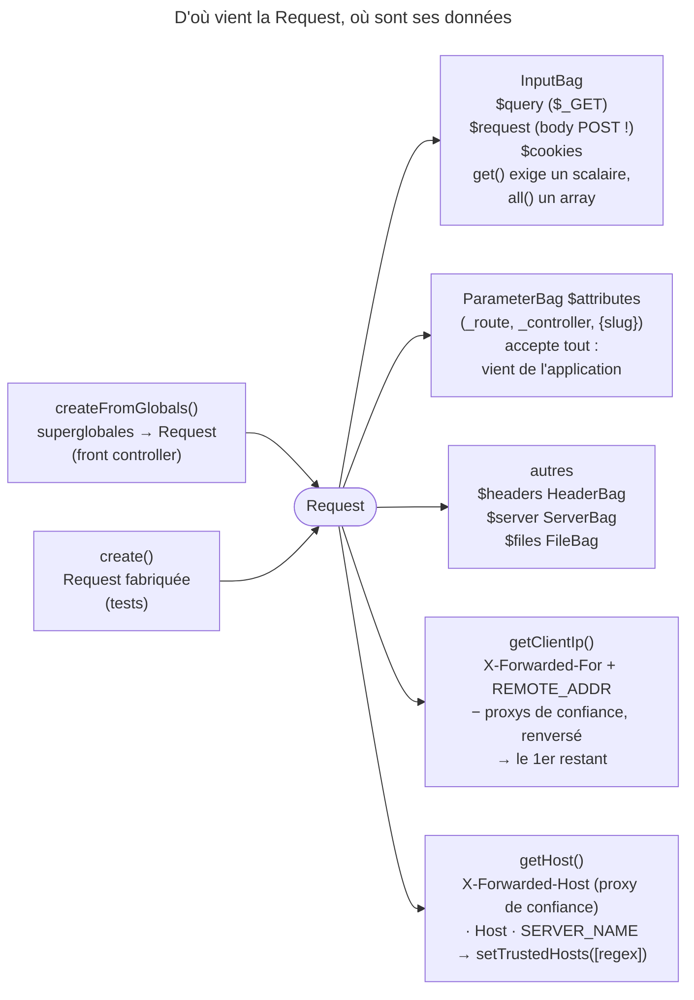

## Objectif

Choisir le bon sac de la `Request` et connaître la constraint que `InputBag`
impose — c'est là que se situe le piège.

## L'essentiel

La `Request` range chaque source de données dans un **sac** typé ; on nomme
toujours le sac, car `Request::get()` n'existe plus en 8.0. Trois sacs sont des
`InputBag`, qui **refusent un array** dans `get()`. Deux données viennent du
client et se falsifient : l'adresse IP et le `Host` — chacune a sa propre liste
de confiance, vide par défaut.

## Le schéma



## L'exemple : lire une recherche

```php
// /search?q=php&tags[]=php&tags[]=http
$request->query->get('q');       // 'php'
$request->query->all('tags');    // ['php', 'http']
$request->query->get('tags');    // BadRequestException : valeur non scalaire
$request->attributes->get('_route');
```

## Les sacs

| Property | Type | Contenu |
|---|---|---|
| `$query` | `InputBag` | Parameters d'URL (`$_GET`) |
| `$request` | `InputBag` | Corps de form (`$_POST`) |
| `$cookies` | `InputBag` | Cookies |
| `$attributes` | `ParameterBag` | Données de l'application (route, `_route`, `_controller`) |
| `$headers`, `$server`, `$files` | `HeaderBag`, `ServerBag`, `FileBag` | Headers, `$_SERVER`, files téléversés |

Le nom `$request` désigne le **corps POST**, pas la Request entière.
`getPayload()` lit le body JSON ou form-data et rend, lui aussi, un `InputBag`.

## InputBag n'accepte que des scalaires

`InputBag::get()` lève une `BadRequestException` sur une valeur non scalaire :
un array reçu là où un scalaire est attendu doit échouer bruyamment. `all($key)`
en est le miroir : il refuse ce qui n'est pas un array, et rend `[]` pour une
key absente. `$attributes`, un `ParameterBag`, n'a pas cette restriction : son
contenu vient de l'application, pas du client.

Sur un `POST`, `getMethod()` lit `X-HTTP-Method-Override` **sans rien activer** ;
seul `_method` exige `enableHttpMethodParameterOverride()`. En 8.0, un override
vers `GET`, `HEAD`, `CONNECT` ou `TRACE` est ignoré ; `getRealMethod()` donne la
method reçue.

## Client et proxys

Sans proxys de confiance (`setTrustedProxies()` ou `trusted_proxies`),
`getClientIp()` ignore `X-Forwarded-For` et rend l'adresse du proxy. Une fois
déclarés, Symfony complète la chaîne d'adresses avec `REMOTE_ADDR`,
retire toute adresse appartenant à un proxy de confiance, **renverse** le reste
et rend le premier élément : l'adresse non fiable **la plus proche du serveur**.

```php
// X-Forwarded-For: 1.2.3.4, 5.6.7.8   (aucun des deux de confiance)
$request->getClientIp();    // '5.6.7.8', et non '1.2.3.4'
```

Le client d'origine n'est renvoyé que si toute la chaîne de proxies est déclarée
de confiance.

## Le host, et la seconde liste de confiance

Un `Host` falsifié empoisonne une URL absolue d'email ou une key de cache.
`Request::setTrustedHosts(['^(.+\.)?example\.com$'])` fait lever une
`SuspiciousOperationException` à `getHost()` sur un host hors liste. Les
patterns sont des regex **non ancrées** (`{motif}i`) : `['example.com']`
accepte `example.com.attaquant.test`. Et une liste vide ne vérifie rien.
Deux listes, deux dangers : `trusted_proxies` garde `X-Forwarded-For`,
`trusted_hosts` garde `Host`.

## Pièges d'examen

**`$request->request` n'est pas la Request** : c'est le body POST.

**`get()` sur un array lève.** Ce n'est pas `null`, ni le premier élément.

**`getClientIp()` sans trusted proxies renvoie l'IP du proxy**, pas celle du
client — et c'est le comportement sûr.

**`getClientIp()` ne renvoie pas « la plus à gauche ».** Il renvoie l'adresse
non fiable la plus proche du serveur — ce qui coïncide avec le client d'origine
uniquement quand toute la chaîne de proxies est déclarée de confiance. Fonder une
allow-list sur la lecture inverse revient à faire confiance à une valeur que le
client contrôle.

**`Request::create()` n'est pas `createFromGlobals()`.** La première fabrique
une Request arbitraire — tests, sub-Requests ; la seconde lit les superglobales.

## Application

- Un filter multiple `?tags[]=a&tags[]=b` → `$request->query->all('tags')`.
- Une application derrière un load balancer → déclarer ses adresses en
  `trusted_proxies`, et ancrer chaque pattern de `trusted_hosts`.

## QCM d'entraînement

**Question 1.** Un `POST` porte `X-HTTP-Method-Override: PUT`, et rien n'a été
activé. Que rend `getMethod()` ?

- **A.** `POST` : l'override doit être activé
- **B.** `PUT`
- **C.** `POST`, et `getRealMethod()` rend `PUT`
- **D.** Une `SuspiciousOperationException`

<details>
<summary>Correction</summary>

**Bonne réponse : B.** Le header est lu sur tout `POST` sans configuration ;
seul le parameter `_method` demande une activation. `getRealMethod()` rend
`POST`.

</details>

**Question 2.** Que fait `$request->query->get('page', ['défaut'])` ?

- **A.** Une `InvalidArgumentException`
- **B.** Une `BadRequestException`, comme sur un array reçu
- **C.** Elle rend `['défaut']` si `page` manque
- **D.** Elle rend le premier élément du défaut

<details>
<summary>Correction</summary>

**Bonne réponse : A.** Le défaut d'un `InputBag` doit lui aussi être scalaire ;
l'erreur vient du code appelant, pas du client, d'où une autre exception.

</details>

**Question 3.** Un controller Symfony 8.0 appelle `$request->get('id')`. Que
se passe-t-il ?

- **A.** La valeur est cherchée dans `attributes`, puis `query`
- **B.** `null` : aucun sac n'est nommé
- **C.** Une `Error` : la method n'existe plus
- **D.** Une deprecation, puis la valeur

<details>
<summary>Correction</summary>

**Bonne réponse : C.** Le raccourci qui fouillait plusieurs sacs a été
supprimé ; il faut nommer le sac, par exemple `$request->attributes->get('id')`.

</details>

**Question 4.** Le body JSON d'une Request est `"42"`. Que fait
`getPayload()` ?

- **A.** Un `InputBag` qui contient `42`
- **B.** Une `JsonException`
- **C.** Un `InputBag` vide
- **D.** Une `BadRequestException` : 42 est un scalaire

<details>
<summary>Correction</summary>

**Bonne réponse : B.** Le JSON est valide mais ne décode pas en array ; la
method exige un document qui donne des parameters nommés.

</details>

## Fiche express

**Si tu dois retenir seulement 7 choses :**

- Nommer le sac : **`Request::get()` n'existe plus** en 8.0.
- `$request` = **body POST** ; `$attributes` = données de l'application.
- `InputBag::get()` refuse un array, **`all()`** refuse un scalaire.
- `getPayload()` : JSON ou form-data, rendu en **`InputBag`**.
- `X-HTTP-Method-Override` lu **sans activation** ; vers `GET` ignoré en 8.0.
- `getClientIp()` : l'adresse non fiable la plus proche du serveur — le client d'origine seulement si toute la chaîne de proxies est de confiance.
- Trusted hosts : regex **non ancrées**, liste vide = aucun contrôle.

Moyen mnémotechnique : **« Nommer le sac, ancrer le host, déclarer le proxy »**.

## Sources officielles

- [Component HttpFoundation](https://github.com/symfony/symfony-docs/blob/8.0/components/http_foundation.rst) — *Accessing Request Data*,
  `createFromGlobals()`, `create()`
- [`Request`](https://github.com/symfony/symfony/blob/8.0/src/Symfony/Component/HttpFoundation/Request.php) — `setTrustedHosts()` l. 642, `getHost()` l. 1132,
  sacs publics l. 94-130, `getClientIp()` l. 821,
  `getClientIps()` l. 798, `normalizeAndFilterClientIps()` l. 2146-2183 (branche 8.0, `6f841c0`)
- [`InputBag`](https://github.com/symfony/symfony/blob/8.0/src/Symfony/Component/HttpFoundation/InputBag.php) — `get()` et sa `BadRequestException` (branche 8.0, `6f841c0`)
