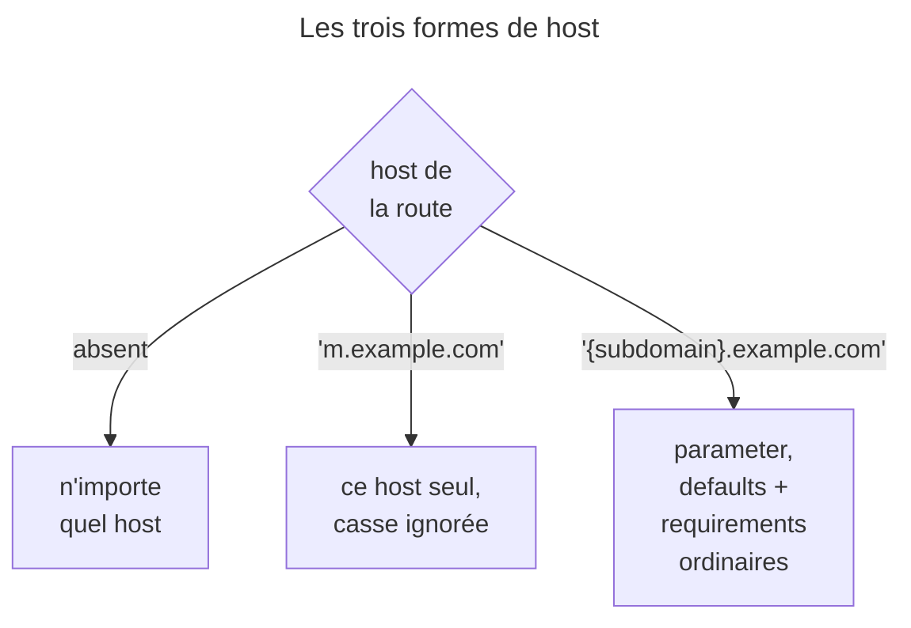
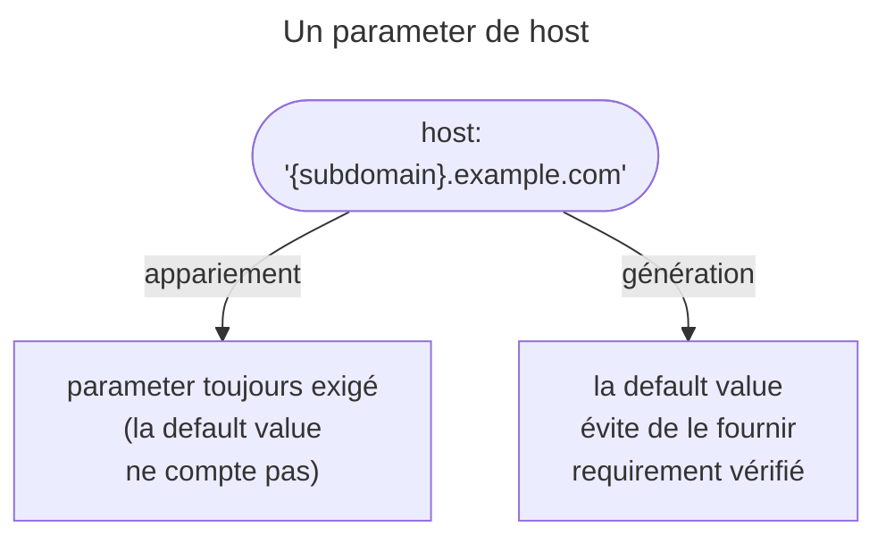
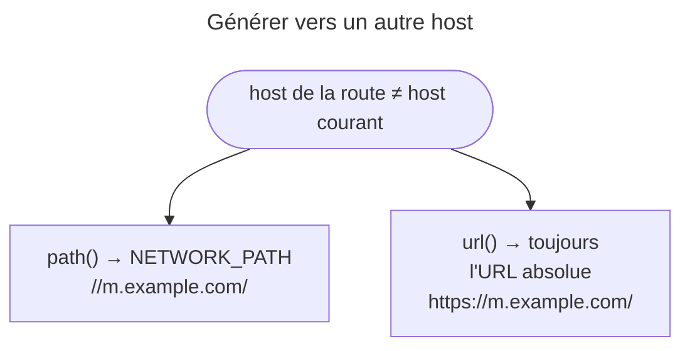

## Objectif

Faire dépendre une route du nom de host de la Request.

## L'essentiel

L'option `host` fait dépendre une route du nom de host ; sans elle, tout host
correspond. Le host prend des parameters, avec `defaults` et `requirements`
ordinaires — mais une default value de host ne rend **rien facultatif** :
elle ne sert qu'à la génération. La comparaison ignore la casse, et `path()`
vers un autre host produit `//hôte/…`.

## Le schéma







## L'exemple : un site mobile

```php
#[Route(
    '/',
    name: 'mobile_homepage',
    host: '{subdomain}.example.com',
    defaults: ['subdomain' => 'm'],
    requirements: ['subdomain' => 'm|mobile'],
)]
public function mobileHomepage(): Response {}

#[Route('/', name: 'homepage')]   // après : sans host, elle capte tout
public function homepage(): Response {}
```

## L'option `host`

Elle exige que le host de la Request corresponde. Deux routes peuvent ainsi
partager le **même path** et ne différer que par le host ; sans `host`, une
route accepte n'importe quel host. La comparaison **ignore la casse** : le
matcher met le host en minuscules, et l'expression compilée porte le drapeau
`i`. Un requirement `EN|FR` accepte `en.example.com`, et l'attribute vaut `en`
(test `testHostIsCaseInsensitive`).

## Le host accepte des parameters

Comme un path : `defaults` et `requirements` sont les mêmes options, sans key
séparée pour le host. Le parameter apparié est disponible en attribute de
Request et en argument de controller.

## Une default value de host ne rend rien facultatif

Dans `RouteCompiler`, le calcul du premier parameter facultatif n'est fait que
pour le path : un parameter de host est toujours exigé à l'appariement. Avec
l'exemple, une Request vers `example.com` ne correspond pas à
`mobile_homepage`, malgré la default value `m`. Celle-ci sert à la
**génération**, pour ne pas fournir `subdomain` à chaque URL.

## Générer vers un autre host

Quand le host de la route diffère de celui de la Request courante,
`UrlGenerator` bascule de `ABSOLUTE_PATH` vers `NETWORK_PATH` :

| Request courante | `path('mobile_homepage')` |
|---|---|
| `m.example.com` | `/` |
| `www.example.com` | `//m.example.com/` |

Le résultat est relatif au schéma, pas absolu ; `url()` produit toujours l'URL
absolue complète. Le requirement du host est vérifié à la génération.

## Pièges d'examen

**Sans requirement de host, une route accepte n'importe quel host.** L'absence de
l'option n'est pas une restriction implicite au domain principal.

**Une default value de host ne sert qu'à la génération.** Contrairement au
path, elle ne rend pas le parameter facultatif à l'appariement.

**`path()` vers un autre host donne `//hôte/chemin`**, pas `https://hôte/chemin`.

**Le host ignore la casse**, requirement compris.

**Deux routes peuvent partager le même path** et ne se distinguer que par
le host : la route sans `host` doit donc venir après celle qui en a un, sinon
elle capte toutes les Requests.

## Application

- Un back-office sur `admin.example.com` → `host: 'admin.example.com'` sur ses
  routes, déclarées avant les routes sans host.
- Un lien vers le site mobile dans un email → `url()`, jamais `path()`.

## QCM d'entraînement

**Question 1.** Une route a `host: '{lang}.example.com'` et le requirement
`EN|FR`. Le client appelle `en.example.com`. Que vaut l'attribute `lang` ?

- **A.** `EN`
- **B.** `en`
- **C.** Rien : pas de correspondance
- **D.** `EN`, normalisé par le requirement

<details>
<summary>Correction</summary>

**Bonne réponse : B.** La comparaison du host ignore la casse, et la valeur
appariée est celle du host mis en minuscules par le matcher.

</details>

**Question 2.** La route `mobile_homepage` a le host `m.example.com`. Depuis
`https://www.example.com`, que produit `url('mobile_homepage')` ?

- **A.** `https://m.example.com/`
- **B.** `//m.example.com/`
- **C.** `/`
- **D.** `https://www.example.com/`

<details>
<summary>Correction</summary>

**Bonne réponse : A.** `url()` produit toujours une URL absolue ; c'est
`path()` qui, vers un autre host, se contente d'une URL relative au schéma.

</details>

**Question 3.** Avec l'exemple, le code génère `mobile_homepage` en passant
`subdomain` à `tablet`. Que se passe-t-il ?

- **A.** `//tablet.example.com/`
- **B.** `//m.example.com/`, valeur ignorée
- **C.** `/`
- **D.** Une `InvalidParameterException`

<details>
<summary>Correction</summary>

**Bonne réponse : D.** Le requirement `m|mobile` du host est contrôlé à la
génération comme celui d'un parameter de path, et `tablet` le viole.

</details>

**Question 4.** Avec les deux routes de l'exemple, le client appelle `/` sur
`x.example.com`. Quelle route répond ?

- **A.** `mobile_homepage`, avec `subdomain` à `x`
- **B.** `mobile_homepage`, avec la default value `m`
- **C.** `homepage`
- **D.** Aucune : 404

<details>
<summary>Correction</summary>

**Bonne réponse : C.** `x` viole le requirement du host, et la default value
ne rend pas le parameter facultatif : la route sans host prend la main.

</details>

## Fiche express

**Si tu dois retenir seulement 6 choses :**

- Sans `host` → **n'importe quel** host.
- Host comparé **sans casse** ; valeur appariée en minuscules.
- Parameters de host : `defaults` et `requirements` **ordinaires**.
- Default value de host : **génération seulement**, jamais facultative au match.
- `path()` vers un autre host → **`//hôte/…`** ; `url()` → absolue.
- Route sans host **après** celle qui en a un.

Moyen mnémotechnique : **« Le défaut du host ne sert qu'à écrire »**.

## Sources officielles

- [Routing, section « Sub-Domain Routing »](https://github.com/symfony/symfony-docs/blob/8.0/routing.rst)
- [`RouteCompiler::compilePattern()`](https://github.com/symfony/symfony/blob/8.0/src/Symfony/Component/Routing/RouteCompiler.php)
- [`UrlGenerator::doGenerate()`](https://github.com/symfony/symfony/blob/8.0/src/Symfony/Component/Routing/Generator/UrlGenerator.php)
- [`UrlMatcherTest`](https://github.com/symfony/symfony/blob/8.0/src/Symfony/Component/Routing/Tests/Matcher/UrlMatcherTest.php) et [`UrlGeneratorTest`](https://github.com/symfony/symfony/blob/8.0/src/Symfony/Component/Routing/Tests/Generator/UrlGeneratorTest.php)

