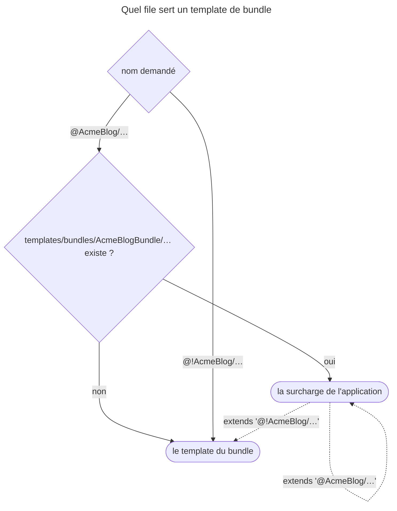

## Objectif

Savoir ce que TwigBundle ajoute à Twig, où il cherche les templates, et quelles
options de configuration comptent. La distinction component / bridge / bundle
est traitée dans le lot Symfony Architecture.

## L'essentiel

Twig seul compile et rend un template. TwigBundle le branche sur Symfony : il
dit **où** chercher les templates, **comment** surcharger ceux d'un bundle, et
quelles **options** de `config/packages/twig.yaml` changent le comportement.

## Le schéma



La dernière flèche est un piège : la surcharge s'étend **elle-même**.

## L'exemple

```twig
{# templates/bundles/AcmeBlogBundle/user/profile.html.twig #}



    <p class="banner">Bienvenue</p>
    {{ parent() }}

```

`@AcmeBlog/user/profile.html.twig` rend désormais le bandeau puis le contenu
d'origine ; `@!AcmeBlog/…` rend l'original seul.

## Trois packages, trois roles

| Package | Role |
|---|---|
| `twig/twig` | l'engine : syntaxe, compiler, filters de base |
| `symfony/twig-bridge` | les extensions qui exposent les components : `path()`, `trans`, le rendu de form |
| `symfony/twig-bundle` | l'intégration : configuration, paths, services |

`composer require symfony/twig-bundle` installe les trois : le bundle exige le
bridge, qui exige `twig/twig`.

## Où vivent les templates

- Par défaut dans `templates/` : `twig.default_path` vaut
  `%kernel.project_dir%/templates`.
- `twig.paths` **ajoute** des directories ; la valeur est un namespace
  facultatif. Sans namespace, le path rejoint l'espace principal ; avec, il se
  référence en `@Nom/…`.
- Un bundle expose ses templates sous `@NomDuBundle/…` **sans** le suffixe
  `Bundle` : `@AcmeBlog/user/profile.html.twig`.

## Surcharger le template d'un bundle

Pour chaque bundle, deux emplacements, dans cet ordre — le premier gagne :

1. `templates/bundles/AcmeBlogBundle/` — le nom complet, suffixe compris ;
2. le directory du bundle.

L'original reste accessible sous **`@!AcmeBlog`**, ce qui permet à la surcharge
de l'étendre. Étendre `@AcmeBlog/…` depuis la surcharge la fait s'étendre
elle-même : le rendu tourne jusqu'à épuiser la mémoire, sans message Twig.

## Les options qui changent le comportement

| Option | Effet | Défaut |
|---|---|---|
| `default_path` | déplace le directory des templates | `templates/` |
| `paths` | ajoute des directories, nommés ou non | aucun |
| `globals` | variables disponibles dans **tous** les templates | aucune |
| `form_themes` | theme de rendu des forms | `form_div_layout.html.twig` |
| `strict_variables` | variable inexistante : erreur au lieu de `null` | `%kernel.debug%` |

`strict_variables` suit `kernel.debug` : **stricte en `dev`, permissive en
`prod`**. `{{ typo }}` lève une `RuntimeError` en dev et rend une string vide en
prod ; `typo|default('x')`, `typo is defined` et `user.name ?? 'anon'` passent
partout.

Dans `globals`, `'@id'` désigne un **service** ; `'@@texte'` produit la string
`@texte`.

## Les commands

- `debug:twig` — filters, functions, tests, globales et paths ; avec un nom de
  template, le file qui le sert : « Matched File », puis les « Overridden
  Files » qu'il masque ; `--filter` restreint la liste.
- `lint:twig` — vérifie la syntaxe sans rendre, et sort avec le code `1` en cas
  d'erreur ; `--show-deprecations` traite les deprecations comme des erreurs.

## Pièges d'examen

**Trois packages, un seul à installer.** L'engine, le bridge et le bundle sont
distincts : c'est le bundle qui tire les deux autres, et c'est lui seul qui rend
Twig configurable.

**Le nom d'espace d'un bundle perd son suffixe ; le directory de surcharge le
garde.** `@AcmeBlog/...` d'un côté, `templates/bundles/AcmeBlogBundle/` de
l'autre.

**`strict_variables` n'a pas la même valeur partout.** Par défaut elle vaut
`kernel.debug`.

**Le directory par défaut se change, mais on peut aussi en ajouter.** Ce sont
deux options différentes : l'une remplace, l'autre complète.

## Application

- La page plante sur « Allowed memory size exhausted » après une surcharge →
  elle étend `@AcmeBlog/…` : écrire `@!AcmeBlog/…`.
- Une surcharge n'est pas prise en compte → `debug:twig @AcmeBlog/…` ; le
  directory s'appelle souvent `templates/bundles/AcmeBlog/`, sans le suffixe.

## QCM d'entraînement

**Question 1.** Une surcharge,
`templates/bundles/AcmeBlogBundle/user/profile.html.twig`, commence par
``. Que se passe-t-il au rendu ?

- **A.** Le template d'origine est étendu normalement
- **B.** Une `LoaderError` : template introuvable
- **C.** Le rendu épuise la mémoire, sans fin
- **D.** Twig ignore la surcharge et rend l'original

<details>
<summary>Correction</summary>

**Bonne réponse : C.** `@AcmeBlog` désigne d'abord la surcharge, qui s'étend
donc elle-même. A décrit `@!AcmeBlog`.

</details>

**Question 2.** `kernel.debug` vaut `true`, `strict_variables` n'est pas
configurée. Que rend `{{ typo|default('fallback') }}` si `typo` n'existe pas ?

- **A.** Une `RuntimeError` : la variable n'existe pas
- **B.** Une string vide
- **C.** `null`, affiché comme `null`
- **D.** `fallback`

<details>
<summary>Correction</summary>

**Bonne réponse : D.** `default` accepte une variable inexistante, même en mode
strict. A vaut pour `{{ typo }}` seul en dev, B pour `{{ typo }}` en prod.

</details>

**Question 3.** `twig.paths` contient `'%kernel.project_dir%/extra/': Admin`.
Comment rendre `extra/ns.html.twig` ?

- **A.** `'@Admin/ns.html.twig'`
- **B.** `'ns.html.twig'`, `paths` rejoignant l'espace principal
- **C.** `'Admin/ns.html.twig'`
- **D.** `'@!Admin/ns.html.twig'`, obligatoire pour un path ajouté

<details>
<summary>Correction</summary>

**Bonne réponse : A.** Un path nommé se référence par `@Nom/…`. B vaut pour un
path sans namespace ; l'espace `!` n'existe que pour les bundles.

</details>

**Question 4.** `debug:twig @AcmeBlog/user/profile.html.twig` liste le file du
bundle sous « Overridden Files ». Qu'est-ce que cela signifie ?

- **A.** Le file du bundle sera rendu
- **B.** Le file du bundle est en erreur de syntaxe
- **C.** Un file de l'application le masque
- **D.** Le bundle n'est pas enregistré

<details>
<summary>Correction</summary>

**Bonne réponse : C.** « Matched File » pointe vers la surcharge ; le file du
bundle passe dans « Overridden Files ».

</details>

## Fiche express

**Si tu dois retenir seulement 6 choses :**

- **Engine, bridge, bundle** : le bundle tire les deux autres et configure.
- **`default_path`** remplace `templates/` ; **`paths`** ajoute.
- Surcharge : **`templates/bundles/AcmeBlogBundle/`** ; original : **`@!AcmeBlog`**.
- **`strict_variables`** = `%kernel.debug%` ; `default`, `is defined`, `??`
  passent toujours.
- **`globals`** : `@` service, `@@` littéral.
- **`debug:twig <nom>`** dit qui sert ; **`lint:twig`** sort en 1 sur erreur.

Moyen mnémotechnique : **« la surcharge d'abord, le bang pour l'original »**.

```text
twig/twig ← twig-bridge ← twig-bundle (configure) ; templates/ + paths (@Nom) ;
@AcmeBlog = surcharge puis bundle ; @!AcmeBlog = bundle ; strict_variables = kernel.debug
```

## Sources officielles

- [Templates, emplacements et namespaces](https://github.com/symfony/symfony-docs/blob/8.0/templates.rst)
- [TwigBundle, `Configuration`](https://github.com/symfony/symfony/blob/8.0/src/Symfony/Bundle/TwigBundle/DependencyInjection/Configuration.php) et [`TwigExtension`](https://github.com/symfony/symfony/blob/8.0/src/Symfony/Bundle/TwigBundle/DependencyInjection/TwigExtension.php)
- [`debug:twig`](https://github.com/symfony/symfony/blob/8.0/src/Symfony/Bridge/Twig/Command/DebugCommand.php) et [`lint:twig`](https://github.com/symfony/symfony/blob/8.0/src/Symfony/Bridge/Twig/Command/LintCommand.php)
