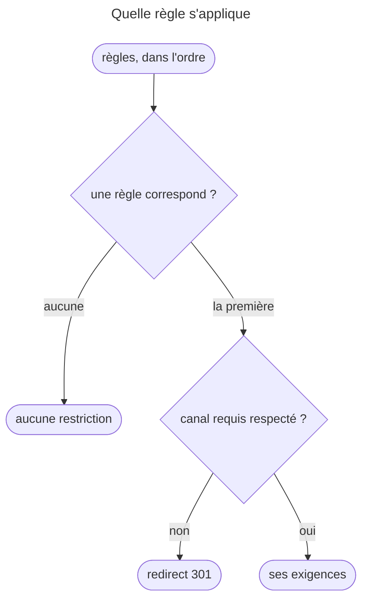
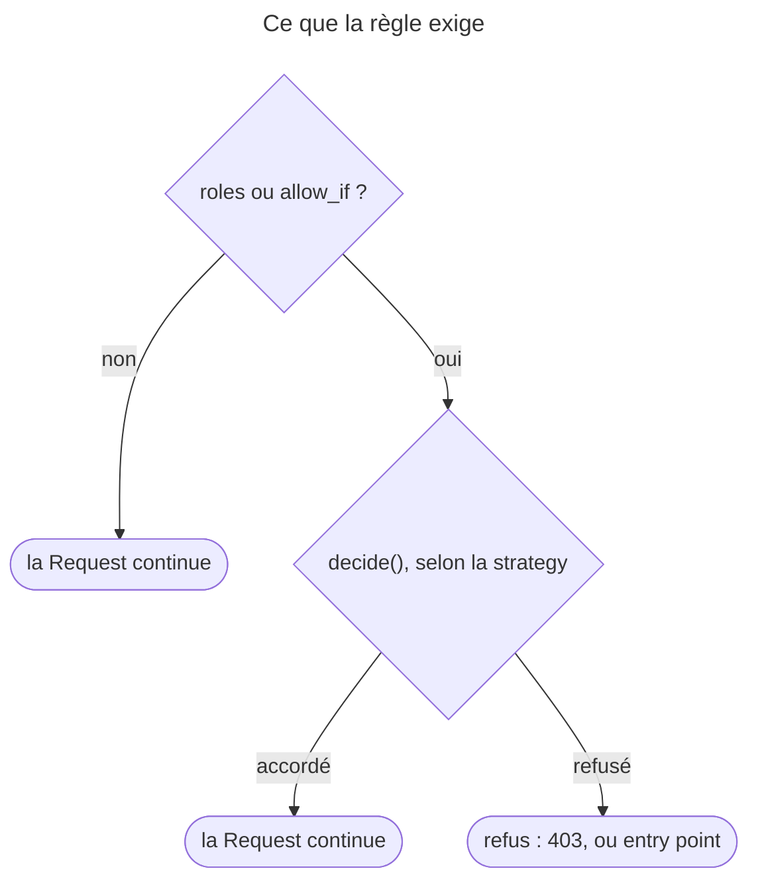

## Objectif

Protéger des URL par la configuration, connaître la règle d'ordre, et savoir
comment se combinent plusieurs exigences dans une même règle.

## L'essentiel

`access_control` protège des **URL** par la configuration. Les règles sont lues
dans l'ordre, **seule la première qui correspond** s'applique, et ses exigences
— `roles`, `allow_if` — passent ensemble par la strategy de décision.

## Le schéma





## L'exemple

```yaml
security:
    access_control:
        - { path: '^/admin/users', roles: ROLE_SUPER_ADMIN }   # le plus précis d'abord
        - { path: '^/admin', roles: ROLE_ADMIN }
        - { path: '^/internal', roles: PUBLIC_ACCESS, ips: [127.0.0.1, ::1] }
        - { path: '^/internal', roles: ROLE_NO_ACCESS }          # tous les autres
```

## La règle

- Les règles sont évaluées **dans l'ordre** ; **seule la première qui
  correspond** est appliquée.
- D'où l'écriture **du plus spécifique au plus général** : avec `^/admin` avant
  `^/admin/users`, un `ROLE_SUPER_ADMIN` sans hiérarchie reçoit 403 sur
  `/admin/users`, et un `ROLE_ADMIN` y entre — sans erreur de configuration.
- Une URL qu'**aucune** règle ne couvre n'est pas restreinte.

## Ce qui fait correspondre une règle

| Key | Ce qu'elle contraint |
|---|---|
| `path`, `host` | le path, le host — expressions régulières, `path` sans la query string |
| `ips` (ou `ip`) | l'adresse du client, masques acceptés |
| `port`, `methods` | le port, les methods HTTP |
| `route` | le nom de la route |
| `attributes` | des attributes de la Request |
| `request_matcher` | un service `RequestMatcherInterface` |

- Tous les critères d'une règle doivent correspondre.
- `request_matcher` ne se combine avec aucun autre : la configuration est
  refusée (`InvalidConfigurationException`, « should not be specified alongside
  other options »).
- `methods: [POST]` est un critère : un `GET` ne correspond pas, donc passe.
- `ips` **fait correspondre**, il ne restreint pas : une Request d'ailleurs
  passe à la règle suivante. Pour fermer la zone, une seconde règle sur le même
  path exige `ROLE_NO_ACCESS`, un role que personne n'a.

## Ce que la règle exige

- `roles` — passés comme attributes à `decide()`, avec la Request pour sujet ;
- `allow_if` — une expression, **ajoutée aux attributes** ; elle voit la
  Request sous `request` ;
- `requires_channel: https` — une Request `http` reçoit un redirect **301**.

Les exigences sont soumises **ensemble** à la strategy :

| Règle | `affirmative` (défaut) | `unanimous` |
|---|---|---|
| `roles: [ROLE_ADMIN, ROLE_EDITOR]`, user `ROLE_EDITOR` | 200 | 200 |
| `roles: ROLE_ADMIN` + `allow_if` vrai, user sans `ROLE_ADMIN` | **200** | 403 |
| même règle, visiteur anonyme | **200** | 401 |

Deux roles valent « l'un ou l'autre » : le même voter les examine. Un role et
une expression relèvent de deux voters : « ou » en `affirmative`, « et » en
`unanimous`.

## Ce que cela ne fait pas

`access_control` protège des **URL** et ignore les objects : « l'auteur
modifie son article » est le travail d'un voter. Un refus produit une
`AccessDeniedException` : 403 pour un user connu, entry point pour un anonyme.

## Pièges d'examen

**Seule la première règle correspondante s'applique** ; les autres ne sont pas
cumulées.

**Du plus spécifique au plus général**, sinon la règle fine devient inatteignable.

**`path` est une expression régulière**, comparée sans la query string.

**`roles` + `allow_if` accorde si l'un des deux suffit**, avec la strategy par
défaut.

**Aucune règle ne correspond : aucune restriction.**

**`access_control` ne remplace pas un voter** : il ignore les objects.

## Application

- Un `ROLE_SUPER_ADMIN` reçoit 403 sur `/admin/users` → `^/admin` est écrit
  avant `^/admin/users` : inverser.
- Une règle `ips` laisse passer les Requests extérieures → ajouter
  `{ path: ^/internal, roles: ROLE_NO_ACCESS }` juste après.

## QCM d'entraînement

**Question 1.** Les règles sont `{ path: ^/internal, roles: PUBLIC_ACCESS, ips:
[127.0.0.1] }` puis `{ path: ^/internal, roles: ROLE_NO_ACCESS }`. Un user
`ROLE_ADMIN` ouvre `/internal/x` depuis `10.0.0.1`. Que reçoit-il ?

- **A.** 200 : il est authentifié
- **B.** 401 : il doit se reconnecter
- **C.** 403
- **D.** 200 : `ROLE_ADMIN` passe toutes les règles

<details>
<summary>Correction</summary>

**Bonne réponse : C.** L'IP ne correspond pas à la première règle ; la seconde
exige `ROLE_NO_ACCESS`, que personne n'a. B vaut pour un anonyme.

</details>

**Question 2.** Une règle `{ path: ^/admin, request_matcher: app.matcher, roles:
ROLE_ADMIN }` est ajoutée. Que se passe-t-il ?

- **A.** Les deux critères doivent correspondre
- **B.** `request_matcher` l'emporte, `path` est ignoré
- **C.** `path` l'emporte, `request_matcher` est ignoré
- **D.** La configuration est refusée

<details>
<summary>Correction</summary>

**Bonne réponse : D.** SecurityBundle refuse `request_matcher` à côté de tout
autre critère, par une `InvalidConfigurationException` au chargement.

</details>

**Question 3.** Une règle `{ path: ^/plain, methods: [POST], roles: ROLE_ADMIN }`
est la seule. Un anonyme fait `GET /plain`. Que reçoit-il ?

- **A.** 200 : la règle ne correspond pas
- **B.** 401 : la règle couvre le path
- **C.** 405 : la method n'est pas autorisée
- **D.** 403 : la method est refusée

<details>
<summary>Correction</summary>

**Bonne réponse : A.** `methods` est un critère de correspondance ; une URL
qu'aucune règle ne couvre n'est pas restreinte. Un `POST` recevrait 401.

</details>

**Question 4.** En `unanimous`, une règle exige `roles: ROLE_ADMIN` et
`allow_if: "true"`. Un anonyme arrive. Que reçoit-il ?

- **A.** 200 : l'expression est vraie
- **B.** 401
- **C.** 403 : il n'a pas `ROLE_ADMIN`
- **D.** 200 : `unanimous` ne s'applique qu'aux voters de l'application

<details>
<summary>Correction</summary>

**Bonne réponse : B.** En `unanimous`, il faut l'expression **et** le role ; le
refus d'un anonyme passe par l'entry point, 401. En `affirmative`, il obtient
200.

</details>

## Fiche express

**Si tu dois retenir seulement 7 choses :**

- **Première règle qui correspond**, et elle seule.
- **Du plus spécifique au plus général.**
- **`path`** : regex, **sans query string**.
- Critères : `path`, `host`, `ips`, `port`, `methods`, `route`, `attributes` —
  ou **`request_matcher` seul**.
- **`ips`** fait correspondre ; **`ROLE_NO_ACCESS`** ferme le reste.
- **`roles` + `allow_if`** : « ou » en `affirmative`, « et » en `unanimous`.
- **`requires_channel`** → **301**.

Moyen mnémotechnique : **« Le premier qui correspond, et la strategy
tranche »**.

```text
access_control : première règle qui correspond (précis d'abord) ; path regex sans query ; ips = critère ;
request_matcher seul ; roles + allow_if = strategy (affirmative : ou) ; requires_channel = 301 ; pas d'objects
```

## Sources officielles

- [How Does the Security access_control Work?](https://github.com/symfony/symfony-docs/blob/8.0/security/access_control.rst)
- [SecurityBundle 8.0, `SecurityExtension`](https://github.com/symfony/symfony/blob/8.0/src/Symfony/Bundle/SecurityBundle/DependencyInjection/SecurityExtension.php)
- [Security HTTP 8.0, `AccessListener`](https://github.com/symfony/symfony/blob/8.0/src/Symfony/Component/Security/Http/Firewall/AccessListener.php)

