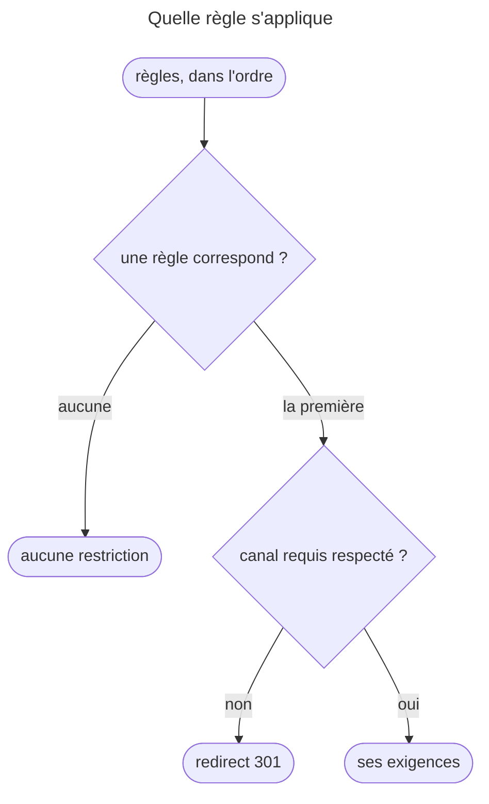
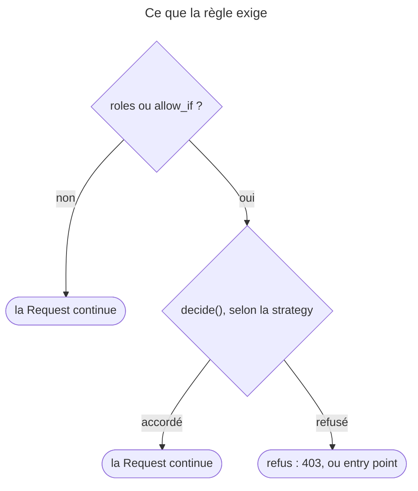

## Objectif

Protéger des URL par la configuration, connaître la règle d'ordre, et savoir
comment se combinent plusieurs exigences dans une même règle.

## Avant la règle : le problème à résoudre

Un back-office sous `/admin` est réservé aux administrateurs, sa gestion des
comptes aux super-administrateurs, et une zone `/internal` ne doit répondre
qu'au serveur lui-même. Tout cela s'écrit en configuration, sans toucher aux
controllers — à condition de savoir **quelle règle** s'applique et **ce
qu'elle exige**.

Trois questions : **laquelle** des règles s'applique, **ce qui la fait
correspondre**, et comment se combinent **plusieurs exigences**.

On suppose connus les firewalls, les roles et les strategies de décision.

## Le fil rouge : un back-office et une zone interne

```yaml
security:
    access_control:
        - { path: '^/admin/users', roles: ROLE_SUPER_ADMIN }   # le plus précis d'abord
        - { path: '^/admin', roles: ROLE_ADMIN }
        - { path: '^/internal', roles: PUBLIC_ACCESS, ips: [127.0.0.1, ::1] }
        - { path: '^/internal', roles: ROLE_NO_ACCESS }          # tous les autres
```

## Le cycle complet en un schéma





## La règle

```yaml
security:
    access_control:
        - { path: '^/admin/users', roles: ROLE_SUPER_ADMIN }
        - { path: '^/admin', roles: ROLE_ADMIN }
        - { path: '^/profile', roles: IS_AUTHENTICATED_FULLY }
```

Les règles sont évaluées **dans l'ordre**, et **seule la première qui
correspond est appliquée**. Les suivantes sont ignorées, même si elles
correspondent aussi.

D'où la règle d'écriture : **du plus spécifique au plus général**. Inverser les
deux premières lignes rendrait `ROLE_SUPER_ADMIN` inatteignable, puisque
`^/admin` capturerait déjà `/admin/users` — sans aucune erreur de
configuration.

Une URL qu'**aucune** règle ne couvre n'est pas restreinte par
`access_control`. Exécuté : `/whoami`, hors de toute règle, répond 200 à un
anonyme.

Rejoué pour cette page avec SecurityBundle 8.0.15, sans hiérarchie de roles,
sur `/admin/users/plain` :

| Ordre des deux règles | user `ROLE_ADMIN` | user `ROLE_SUPER_ADMIN` |
|---|---|---|
| `^/admin/users` d'abord | 403 | 200 |
| `^/admin` d'abord | **200** | **403** |

Dans le second ordre, la règle `ROLE_SUPER_ADMIN` n'est jamais lue.

## Ce qui fait correspondre une règle

`path` est une expression régulière, pas un préfixe littéral, comparée **sans
la query string** : un parameter `?x=` ne peut pas être protégé ici.

| Key | Ce qu'elle contraint |
|---|---|
| `path`, `host` | le path, le host — expressions régulières |
| `ips` (ou `ip`) | l'adresse du client, masques acceptés |
| `port`, `methods` | le port, les methods HTTP |
| `route` | le nom de la route |
| `attributes` | des attributes de la Request, à égalité exacte |
| `request_matcher` | un service `RequestMatcherInterface` |

Tous les critères d'une même règle doivent correspondre. `request_matcher` ne
se combine avec aucun autre : SecurityBundle refuse la configuration
(« should not be specified alongside other options »).

Rejoué : une règle `path: secret=1` exigeant `ROLE_ADMIN` laisse un anonyme
ouvrir `/plain?secret=1` (200) ; une règle `methods: [POST]` sur `^/plain`
répond 401 à un POST anonyme et laisse passer le GET.

`ips` ne **restreint** pas : il fait **correspondre**. La documentation le
précise, et montre l'astuce pour fermer une zone à tous les autres — une
seconde règle sur le même path, exigeant un role que personne n'a,
`ROLE_NO_ACCESS`. Rejoué avec les deux règles du fil rouge :

| Request sur `/internal/x` | Résultat |
|---|---|
| depuis `127.0.0.1`, anonyme | 200 — la première règle correspond |
| depuis `10.0.0.1`, anonyme | 401 — la seconde, entry point |
| depuis `10.0.0.1`, user `ROLE_ADMIN` | 403 — personne n'a `ROLE_NO_ACCESS` |

## Ce que la règle exige

Une fois la règle choisie, trois options imposent l'accès :

- `roles` — passés comme attributes à `decide()`, avec la **Request** pour
  sujet ;
- `allow_if` — une expression, **ajoutée à la liste des attributes** ;
- `requires_channel` — exécuté : `https` sur une Request `http` donne un
  redirect **301** vers `https://…`.

Plusieurs exigences ne s'additionnent donc pas : elles sont soumises ensemble
à la strategy de décision. Exécuté avec SecurityBundle 8.0.15 :

| Règle | `affirmative` (défaut) | `unanimous` |
|---|---|---|
| `roles: [ROLE_ADMIN, ROLE_EDITOR]`, user `ROLE_EDITOR` | 200 | 200 |
| `roles: ROLE_ADMIN` + `allow_if` vrai, user sans `ROLE_ADMIN` | **200** | 403 |
| même règle, visiteur anonyme | **200** | 401 |
| `roles: [ROLE_USER, IS_AUTHENTICATED_FULLY]`, user sans `ROLE_USER` | **200** | 403 |

Deux roles ensemble valent « l'un ou l'autre » quelle que soit la strategy, car
c'est le même voter qui les examine. Dès que deux voters interviennent — un
role et une expression, un role et un état d'authentication —, la strategy
décide : « ou » en `affirmative`, « et » en `unanimous`. La documentation
l'avertit pour `roles` + `allow_if`.

Rejoué pour cette page : les quatre lignes du tableau donnent les mêmes codes.

Dans `allow_if`, l'expression voit la Request sous `request`. Rejoué,
`allow_if: "request.headers.has('X-Secure-Access')"` sans `roles` : 200 avec ce
header, 401 sans.

## Ce que cela ne fait pas

`access_control` protège des **URL**. Il ne sait rien des objects : « l'auteur
peut modifier son article » ne s'y exprime pas — c'est le travail d'un voter.

Un refus produit une `AccessDeniedException`, traitée comme partout ailleurs :
403 pour un user connu, entry point pour un anonyme.

## Concrètement dans ton application

- Écrire les règles du plus précis au plus général.
- Ancrer chaque `path` par `^` : c'est une expression régulière.
- Ne jamais protéger un parameter de query string ici.
- Fermer une zone hors d'un réseau : `ips` + `PUBLIC_ACCESS`, puis
  `ROLE_NO_ACCESS` sur le même path.
- Combiner un role et une expression : vérifier la strategy ; en
  `affirmative`, c'est un « ou ».
- Imposer HTTPS : `requires_channel: https`.
- Un droit sur un object : un voter, pas `access_control`.

## À comprendre

- **Pourquoi la première seulement ?** Une Request doit recevoir une exigence
  claire ; cumuler les règles rendrait l'ordre d'écriture impossible à lire.
- **Pourquoi `ips` ne bloque-t-il pas ?** Il fait partie des critères de
  correspondance, comme `path` ; une Request d'ailleurs passe simplement à la
  règle suivante.
- **Pourquoi `roles` + `allow_if` donne-t-il un « ou » ?** Les deux deviennent
  des attributes d'un même `decide()`, tranchés par la strategy — `affirmative`
  par défaut.

## À mémoriser

- **Première règle qui correspond**, et elle seule.
- **Du plus spécifique au plus général.**
- **`path`** : regex, **sans query string**.
- Critères : `path`, `host`, `ips`, `port`, `methods`, `route`, `attributes` —
  ou **`request_matcher` seul**.
- **`ips`** fait correspondre ; **`ROLE_NO_ACCESS`** ferme le reste.
- **`roles` + `allow_if`** : « ou » en `affirmative`, « et » en `unanimous`.
- **`requires_channel`** → **301**.
- Moyen mnémotechnique : **« Le premier qui correspond, et la strategy
  tranche »**.

## Pièges d'examen

**Seule la première règle correspondante s'applique** ; les autres ne sont pas
cumulées.

**Du plus spécifique au plus général**, sinon la règle fine devient inatteignable.

**`path` est une expression régulière**, comparée sans la query string.

**`roles` + `allow_if` accorde si l'un des deux suffit**, avec la strategy par
défaut.

**Aucune règle ne correspond : aucune restriction.**

**`access_control` ne remplace pas un voter** : il ignore les objects.

## Application : trois scénarios

**Scénario 1 — Le super-administrateur bloqué.** Un `ROLE_SUPER_ADMIN` sans
hiérarchie reçoit 403 sur `/admin/users`. *Solution.* La règle `^/admin` est
écrite avant `^/admin/users` : inverser l'ordre.

**Scénario 2 — La zone interne ouverte.** Une règle
`{ path: ^/internal, roles: PUBLIC_ACCESS, ips: [127.0.0.1] }` devait réserver
`/internal` au serveur ; une Request extérieure passe quand même. *Solution.*
`ips` ne restreint pas : ajouter `{ path: ^/internal, roles: ROLE_NO_ACCESS }`
juste après.

**Scénario 3 — L'exception qui ouvre tout.** Une règle exige `ROLE_ADMIN` et un
`allow_if` pour un header de supervision ; tout user connecté passe dès que
l'expression est vraie. *Solution.* C'est le « ou » d'`affirmative` : voulu,
le documenter ; sinon, mettre la condition dans l'expression elle-même.

## QCM d'entraînement

Cinq questions sur les règles d'accès. Choisis avant d'ouvrir la correction.

**Question 1.** Les règles sont `{ path: ^/internal, roles: PUBLIC_ACCESS, ips:
[127.0.0.1] }` puis `{ path: ^/internal, roles: ROLE_NO_ACCESS }`. Un user
`ROLE_ADMIN` ouvre `/internal/x` depuis `10.0.0.1`. Que reçoit-il ?

- **A.** 200 : il est authentifié
- **B.** 401 : il doit se reconnecter
- **C.** 403
- **D.** 200 : `ROLE_ADMIN` passe toutes les règles

<details>
<summary>Correction</summary>

**Bonne réponse : C.** Exécuté avec SecurityBundle 8.0.15. L'IP ne correspond
pas à la première règle ; la seconde exige `ROLE_NO_ACCESS`, que personne n'a.

A et D supposent que la première règle s'applique. B vaut pour un anonyme.

</details>

**Question 2.** Une règle `{ path: ^/admin, request_matcher: app.matcher, roles:
ROLE_ADMIN }` est ajoutée. Que se passe-t-il ?

- **A.** Les deux critères doivent correspondre
- **B.** `request_matcher` l'emporte, `path` est ignoré
- **C.** `path` l'emporte, `request_matcher` est ignoré
- **D.** La configuration est refusée

<details>
<summary>Correction</summary>

**Bonne réponse : D.** Exécuté : `InvalidConfigurationException` « The
"request_matcher" option should not be specified alongside other options ».

A, B et C supposent une combinaison que SecurityBundle interdit.

</details>

**Question 3.** Une règle `{ path: ^/plain, methods: [POST], roles: ROLE_ADMIN }`
est la seule. Un anonyme fait `GET /plain`. Que reçoit-il ?

- **A.** 200 : la règle ne correspond pas
- **B.** 401 : la règle couvre le path
- **C.** 405 : la method n'est pas autorisée
- **D.** 403 : la method est refusée

<details>
<summary>Correction</summary>

**Bonne réponse : A.** Exécuté : 200 en GET, 401 en POST. `methods` est un
critère de correspondance, et une URL qu'aucune règle ne couvre n'est pas
restreinte.

B oublie le critère. C et D confondent avec le routing.

</details>

**Question 4.** En `unanimous`, une règle exige `roles: ROLE_ADMIN` et
`allow_if: "true"`. Un anonyme arrive. Que reçoit-il ?

- **A.** 200 : l'expression est vraie
- **B.** 401
- **C.** 403 : il n'a pas `ROLE_ADMIN`
- **D.** 200 : `unanimous` ne s'applique qu'aux voters de l'application

<details>
<summary>Correction</summary>

**Bonne réponse : B.** Exécuté : en `unanimous`, il faut l'expression **et** le
role ; le refus d'un anonyme passe par l'entry point, ici 401. En
`affirmative`, la même Request obtient 200.

A est le résultat d'`affirmative`. C vaut pour un user connu. D est faux.

</details>

**Question 5.** Quelle variable donne accès à la Request dans une expression
`allow_if` ?

- **A.** `request`
- **B.** `this.request`
- **C.** `app.request`, comme dans Twig
- **D.** Aucune : `allow_if` ne voit que le user

<details>
<summary>Correction</summary>

**Bonne réponse : A.** La documentation 8.0 : `request`, l'object `Request` de
HttpFoundation. Rejoué : `request.headers.has('X-Secure-Access')` accorde avec ce
header et refuse sans.

B et C n'existent pas dans l'expression. D est faux.

</details>

## Fiche express

**Si tu dois retenir seulement 7 choses :**

- **Première règle** qui correspond, **seule**.
- **Spécifique d'abord**, général ensuite.
- **`path`** = regex, **sans query string**.
- **`request_matcher`** ne se combine avec rien.
- **`ips`** fait correspondre ; **`ROLE_NO_ACCESS`** ferme.
- **`roles` + `allow_if`** : la strategy tranche (« ou » par défaut).
- **Aucune règle** : aucune restriction ; un droit sur un object : un voter.

**En une phrase, pour tout reconstruire :**

```text
1re règle qui correspond (path regex sans query, host, ips, methods, route… ou request_matcher seul) ; ordre : spécifique → général ;
ips = correspondance, ROLE_NO_ACCESS ferme ; roles + allow_if → decide() : ou (affirmative) / et (unanimous) ; https → 301
```

## Sources officielles

- [How Does the Security access_control Work?](https://github.com/symfony/symfony-docs/blob/8.0/security/access_control.rst)
- [SecurityBundle 8.0, `SecurityExtension`](https://github.com/symfony/symfony/blob/8.0/src/Symfony/Bundle/SecurityBundle/DependencyInjection/SecurityExtension.php)
- [Security HTTP 8.0, `AccessListener`](https://github.com/symfony/symfony/blob/8.0/src/Symfony/Component/Security/Http/Firewall/AccessListener.php)
