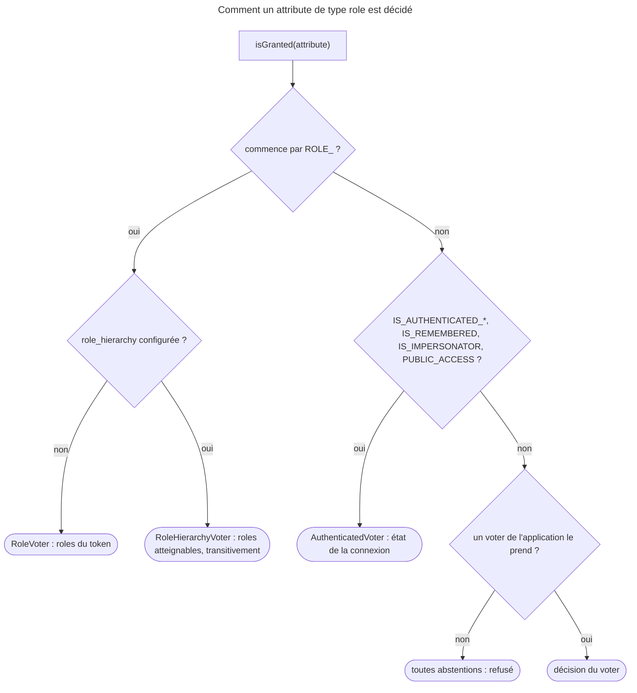

## Objectif

Nommer un role correctement et connaître la seule règle que Symfony impose.

## L'essentiel

Un role est une string qui **doit** commencer par `ROLE_`. La hiérarchie évite
de recopier les roles sur chaque compte, mais elle est appliquée par le
**voter**, pas par le user. Et certains attributes ressemblent à des roles sans
en être : ils décrivent l'état de la connexion.

## Le schéma



## L'exemple

```yaml
security:
    role_hierarchy:
        ROLE_EDITOR: ROLE_USER
        ROLE_ADMIN: [ROLE_EDITOR, ROLE_ALLOWED_TO_SWITCH]
```

```php
$this->isGranted('ROLE_EDITOR');            // vrai pour un ROLE_ADMIN : hiérarchie
in_array('ROLE_EDITOR', $user->getRoles()); // faux pour le même user : la documentation dit BAD
$this->isGranted('IS_AUTHENTICATED_FULLY'); // un état de connexion, pas un role
```

## La règle

- Un role est une string libre qui commence par **`ROLE_`** — « otherwise,
  things won't work as expected ».
- `RoleVoter` ne vote que sur ce préfixe, **sensible à la casse** : un user dont
  `getRoles()` rend `['ADMIN']` ou `['role_admin']` n'obtient jamais
  `isGranted()` vrai ; tous les voters s'abstiennent, et l'abstention vaut
  refus.
- `getRoles()` garantit d'ordinaire `ROLE_USER`.

## La hiérarchie

- Un `ROLE_ADMIN` obtient `ROLE_USER` sans qu'on l'écrive sur le user ; la
  hiérarchie est **transitive** et ne **remonte** pas.
- Elle est appliquée par le voter : `isGranted('ROLE_USER')` est vrai,
  `in_array('ROLE_USER', $user->getRoles())` est faux.
- Avec `role_hierarchy`, le container remplace `RoleVoter` par
  **`RoleHierarchyVoter`**, qui l'étend et calcule les roles atteignables.
- Les valeurs de `role_hierarchy` sont **statiques** ; pour une hiérarchie en
  base, la documentation recommande un voter — un service qui implémente
  `RoleHierarchyInterface` et décore `security.role_hierarchy` marche aussi.
- `php bin/console debug:security:role-hierarchy` affiche la hiérarchie au
  format Mermaid (`graph TB`).

## Les attributes qui ne sont pas des roles

`AuthenticatedVoter` traite six attributes d'**état** de l'authentication :

| Attribute | Accordé quand |
|---|---|
| `PUBLIC_ACCESS` | toujours, anonyme compris |
| `IS_AUTHENTICATED` | un user est authentifié |
| `IS_AUTHENTICATED_REMEMBERED` | authentifié, cookie « se souvenir de moi » compris |
| `IS_AUTHENTICATED_FULLY` | authentifié dans cette session |
| `IS_REMEMBERED` | authentifié par le cookie « se souvenir de moi » |
| `IS_IMPERSONATOR` | le user en usurpe un autre |

Ils s'emploient dans `isGranted()`, jamais dans `getRoles()`.

## Pièges d'examen

**Un role sans `ROLE_` n'est jamais accordé**, même présent dans `getRoles()`.

**`in_array('ROLE_ADMIN', $user->getRoles())` ignore la hiérarchie.** La
documentation marque cette ligne `BAD` et lui oppose `isGranted('ROLE_ADMIN')`.

**Les valeurs de `role_hierarchy` sont statiques** ; une hiérarchie en base
demande du code — un voter, selon la documentation.

**`IS_AUTHENTICATED_FULLY` n'est pas un role** et n'a rien à faire dans
`getRoles()`.

## Application

- Un user dont la base porte `admin` n'accède à rien → le role doit s'écrire
  `ROLE_ADMIN`.
- Un template teste `'ROLE_EDITOR' in app.user.roles` et rate les admins →
  écrire `is_granted('ROLE_EDITOR')`.

## QCM d'entraînement

**Question 1.** `getRoles()` rend `['role_admin']`. Que donne
`isGranted('ROLE_ADMIN')` ?

- **A.** `true` : la string figure dans `getRoles()`
- **B.** `true` : le préfixe n'est pas sensible à la casse
- **C.** `false`
- **D.** Une exception : role invalide

<details>
<summary>Correction</summary>

**Bonne réponse : C.** `RoleVoter` compare au préfixe `ROLE_` en respectant la
casse : `role_admin` n'est pas un role, et rien ne l'accorde.

</details>

**Question 2.** `ROLE_SUPER_ADMIN: [ROLE_ADMIN]` et `ROLE_ADMIN: ROLE_USER`. Un
user ne porte que `ROLE_SUPER_ADMIN`. Que donne `isGranted('ROLE_USER')` ?

- **A.** `false` : la hiérarchie ne s'applique qu'à un niveau
- **B.** `true`
- **C.** `false` : `ROLE_USER` doit figurer dans `getRoles()`
- **D.** `true`, mais seulement si `ROLE_ADMIN` est aussi sur le user

<details>
<summary>Correction</summary>

**Bonne réponse : B.** La hiérarchie est transitive : `ROLE_USER` est atteint
par `ROLE_ADMIN`, sans figurer sur le user.

</details>

**Question 3.** Quel voter décide `isGranted('ROLE_USER')` quand `role_hierarchy`
est configurée ?

- **A.** `RoleVoter`, puis `RoleHierarchyVoter` en second
- **B.** `AuthenticatedVoter`
- **C.** Un voter de l'application, à écrire
- **D.** `RoleHierarchyVoter`, à la place de `RoleVoter`

<details>
<summary>Correction</summary>

**Bonne réponse : D.** `RoleHierarchyVoter` étend `RoleVoter` et le remplace
dans le container dès qu'une hiérarchie existe.

</details>

**Question 4.** Un visiteur anonyme. Lequel de ces attributes `isGranted()`
accorde-t-il ?

- **A.** `IS_AUTHENTICATED`
- **B.** `ROLE_USER`
- **C.** `PUBLIC_ACCESS`
- **D.** `IS_AUTHENTICATED_REMEMBERED`

<details>
<summary>Correction</summary>

**Bonne réponse : C.** `PUBLIC_ACCESS` est accordé à tous ; les trois autres
supposent un user authentifié.

</details>

## Fiche express

**Si tu dois retenir seulement 6 choses :**

- Un role commence par **`ROLE_`**, casse comprise.
- Sans le préfixe : **jamais** accordé.
- Hiérarchie **transitive**, appliquée par le **voter** (`RoleHierarchyVoter`).
- **`in_array(…, getRoles())`** ignore la hiérarchie : `isGranted()`.
- `role_hierarchy` **statique** ; en base : un voter.
- `IS_AUTHENTICATED_*`, `PUBLIC_ACCESS`, `IS_IMPERSONATOR` : des **états**, pas
  des roles.

Moyen mnémotechnique : **« ROLE_ devant, la hiérarchie dans le voter »**.

```text
role = ROLE_* (casse) ; RoleVoter → RoleHierarchyVoter si role_hierarchy (transitive, statique) ;
isGranted, pas in_array ; AuthenticatedVoter : PUBLIC_ACCESS, IS_AUTHENTICATED(_FULLY/_REMEMBERED), IS_REMEMBERED, IS_IMPERSONATOR
```

## Sources officielles

- [Security, « Roles » et « Hierarchical Roles »](https://github.com/symfony/symfony-docs/blob/8.0/security.rst)
- [Security Core 8.0, `RoleVoter`](https://github.com/symfony/symfony/blob/8.0/src/Symfony/Component/Security/Core/Authorization/Voter/RoleVoter.php)
- [Security Core 8.0, `RoleHierarchyVoter`](https://github.com/symfony/symfony/blob/8.0/src/Symfony/Component/Security/Core/Authorization/Voter/RoleHierarchyVoter.php)
- [Security Core 8.0, `AuthenticatedVoter`](https://github.com/symfony/symfony/blob/8.0/src/Symfony/Component/Security/Core/Authorization/Voter/AuthenticatedVoter.php)

