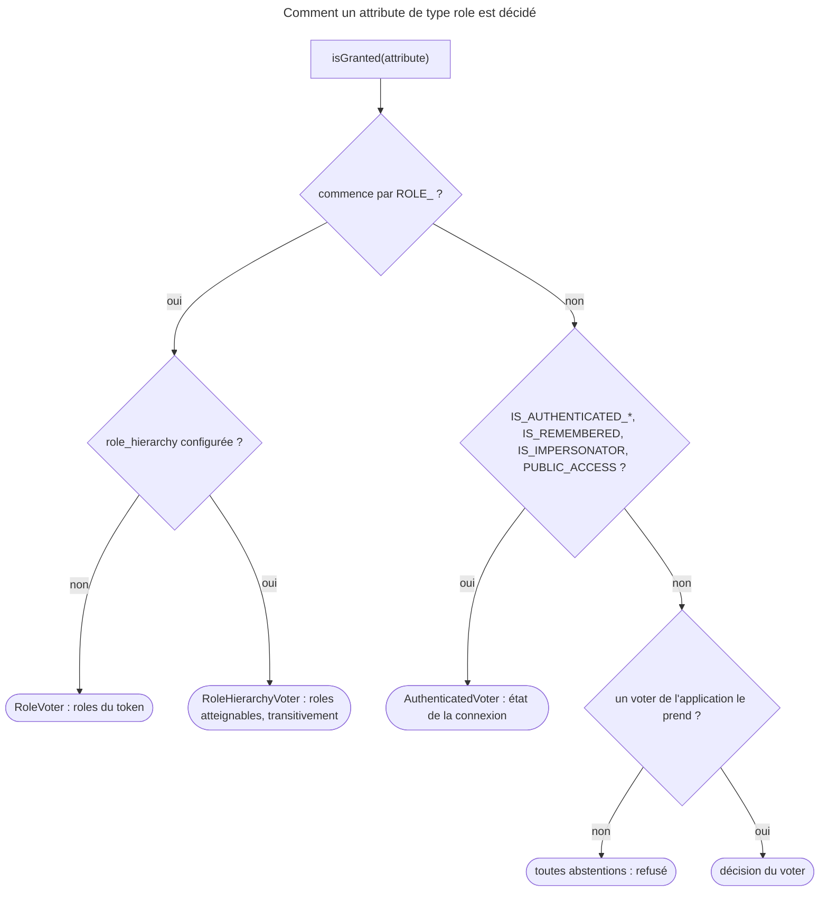

## Objectif

Nommer un role correctement et connaître la seule règle que Symfony impose.

## Avant la règle : le problème à résoudre

Une application distingue lecteurs, éditeurs et administrateurs. Un
administrateur doit pouvoir tout ce que peut un éditeur, sans qu'on recopie la
liste sur chaque compte. Et une page doit parfois dépendre non pas du role,
mais de la façon dont le user s'est connecté.

Trois questions : ce qu'est **un role valide**, ce que fait **la hiérarchie**,
et ce que sont les **attributes qui ressemblent à des roles** sans en être.

On suppose connus les users et `isGranted()`.

## Le fil rouge : lecteur, éditeur, administrateur

```yaml
security:
    role_hierarchy:
        ROLE_EDITOR: ROLE_USER
        ROLE_ADMIN: [ROLE_EDITOR, ROLE_ALLOWED_TO_SWITCH]
```

```php
$this->isGranted('ROLE_EDITOR');            // vrai pour un ROLE_ADMIN : hiérarchie
in_array('ROLE_EDITOR', $user->getRoles()); // faux pour le même user : la documentation dit BAD
$this->isGranted('IS_AUTHENTICATED_FULLY'); // un état de connexion, pas un role
```

## Le cycle complet en un schéma



## La règle

Un role est une string libre, avec **une** constraint : elle doit commencer par
`ROLE_`. La documentation : « otherwise, things won't work as expected ». La
raison est dans `RoleVoter` : il ne vote que sur les attributes qui commencent
par ce préfixe, et s'abstient sur les autres.

Exécuté avec SecurityBundle 8.0.15, un user dont `getRoles()` rend
`['ADMIN']` : `isGranted('ADMIN')` est **faux**, alors que la string figure bien
dans `getRoles()`. Aucun voter ne s'en charge, et l'abstention générale vaut
refus.

`getRoles()` retourne le tableau des roles du user ; la convention est
d'y garantir `ROLE_USER`.

Le préfixe est **sensible à la casse**. Lu dans `RoleVoter` (8.0) :
`str_starts_with($attribute, $this->prefix)`, avec `ROLE_`. Rejoué, un user
dont `getRoles()` rend `['role_admin']` : `isGranted('role_admin')` et
`isGranted('ROLE_ADMIN')` sont tous deux **faux**.

## La hiérarchie

```yaml
security:
    role_hierarchy:
        ROLE_ADMIN: ROLE_USER
        ROLE_SUPER_ADMIN: [ROLE_ADMIN, ROLE_ALLOWED_TO_SWITCH]
```

Un `ROLE_ADMIN` obtient alors `ROLE_USER` sans qu'on l'écrive sur le user.
Exécuté, user portant `ROLE_ADMIN` seul :

| Test | Résultat |
|---|---|
| `isGranted('ROLE_USER')` | vrai |
| `in_array('ROLE_USER', $user->getRoles())` | **faux** |

La hiérarchie est appliquée par le voter, pas par le user.

Rejoué pour cette page, la même configuration :

| User portant | `ROLE_USER` | `ROLE_ADMIN` | `ROLE_SUPER_ADMIN` |
|---|---|---|---|
| `ROLE_ADMIN` | vrai | vrai | **faux** : la hiérarchie ne remonte pas |
| `ROLE_SUPER_ADMIN` | **vrai** : par `ROLE_ADMIN`, transitivement | vrai | vrai |

Et le voter change. Rejoué : sans `role_hierarchy`, le container porte un
`RoleVoter` ; avec, un `RoleHierarchyVoter` à sa place — lu dans le code 8.0, il
étend `RoleVoter` et calcule les roles par `getReachableRoleNames()`. Une
hiérarchie circulaire, `ROLE_A: ROLE_B` et `ROLE_B: ROLE_A`, ne bloque rien :
un user `ROLE_A` obtient `ROLE_B`.

Les **valeurs** de `role_hierarchy` sont statiques : la documentation précise
qu'on ne peut pas y stocker une hiérarchie venue d'une base de données, et
recommande un voter pour ce besoin. Ce n'est pas une impossibilité du
framework : exécuté, un service qui décore `security.role_hierarchy` et
implémente `RoleHierarchyInterface` ajoute un role calculé à l'exécution, et
`isGranted()` l'accorde.

Rejoué : un decorator qui ajoute `ROLE_REPORTER` à tout `ROLE_EDITOR`, avec
`ROLE_ADMIN: ROLE_EDITOR` en configuration — un `ROLE_ADMIN` obtient
`ROLE_EDITOR` **et** `ROLE_REPORTER`.

`php bin/console debug:security:role-hierarchy` affiche la hiérarchie
configurée, au format Mermaid.

Rejoué : l'output commence par `graph TB`, liste les roles, puis une flèche
par lien — `ROLE_ADMIN --> ROLE_USER`, `ROLE_SUPER_ADMIN --> ROLE_ADMIN`.

## Les attributes qui ne sont pas des roles

`AuthenticatedVoter` 8.0 traite six attributes : `IS_AUTHENTICATED_FULLY`,
`IS_AUTHENTICATED_REMEMBERED`, `IS_AUTHENTICATED`, `IS_REMEMBERED`,
`IS_IMPERSONATOR` et `PUBLIC_ACCESS`. Ils s'emploient comme des roles dans
`isGranted()`, mais décrivent l'**état de l'authentication**, pas
le user. `IS_AUTHENTICATED_FULLY` exige une connexion de cette session ;
`IS_AUTHENTICATED_REMEMBERED` accepte aussi un retour par cookie « se souvenir
de moi ».

Rejoué pour un visiteur anonyme : `PUBLIC_ACCESS` vrai, `IS_AUTHENTICATED` et
`ROLE_USER` faux.

## Concrètement dans ton application

- Nommer : `ROLE_` en majuscules, toujours.
- Tester : `isGranted('ROLE_X')`, jamais `in_array()` sur `getRoles()`.
- Hériter : `role_hierarchy`, du role le plus fort vers les plus faibles.
- Vérifier la hiérarchie : `debug:security:role-hierarchy`.
- Une hiérarchie en base : un voter, ou un decorator de
  `security.role_hierarchy`.
- Une page « ré-authentifie-toi » : `IS_AUTHENTICATED_FULLY`, qui refuse le
  retour par cookie.

## À comprendre

- **Pourquoi le préfixe ?** `RoleVoter` doit reconnaître ses attributes parmi
  tous ceux qu'on passe à `isGranted()` ; le préfixe est ce signe.
- **Pourquoi `in_array()` échoue-t-il ?** La hiérarchie vit dans le voter ;
  `getRoles()` ne rend que ce qui est écrit sur le user.
- **Pourquoi des états à part ?** Être connecté par cookie ou dans cette session
  n'est pas un droit du user, c'est un fait sur la connexion.

## À mémoriser

- Role = **`ROLE_`** en tête, **sensible à la casse** ; sinon jamais accordé.
- **`role_hierarchy`** : transitive, descendante seulement.
- Avec hiérarchie : **`RoleHierarchyVoter`** remplace `RoleVoter`.
- **`isGranted()`**, pas **`in_array($r, getRoles())`**.
- Valeurs **statiques** ; base de données → voter ou decorator.
- **`debug:security:role-hierarchy`** → Mermaid.
- **Six états** : `IS_AUTHENTICATED_FULLY`, `_REMEMBERED`, `IS_AUTHENTICATED`,
  `IS_REMEMBERED`, `IS_IMPERSONATOR`, `PUBLIC_ACCESS`.
- Moyen mnémotechnique : **« ROLE_ devant, la hiérarchie dans le voter »**.

## Pièges d'examen

**Un role sans `ROLE_` n'est jamais accordé**, même présent dans `getRoles()`.

**`in_array('ROLE_ADMIN', $user->getRoles())` ignore la hiérarchie.** La
documentation marque cette ligne `BAD` et lui oppose `isGranted('ROLE_ADMIN')`.

**Les valeurs de `role_hierarchy` sont statiques** ; une hiérarchie en base
demande du code — un voter, selon la documentation.

**`IS_AUTHENTICATED_FULLY` n'est pas un role** et n'a rien à faire dans
`getRoles()`.

## Application : trois scénarios

**Scénario 1 — Le role importé.** Une synchronisation d'annuaire écrit des roles
`admin` en minuscules ; personne n'obtient l'accès administrateur.
*Solution.* Les convertir en `ROLE_ADMIN` : le préfixe est obligatoire, et
sensible à la casse.

**Scénario 2 — Le menu qui disparaît.** Un template teste
`'ROLE_EDITOR' in app.user.roles` ; les administrateurs ne voient pas le menu
des éditeurs. *Solution.* `is_granted('ROLE_EDITOR')`, qui passe par la
hiérarchie.

**Scénario 3 — La modification sensible.** Changer d'email doit exiger une
connexion récente, pas un retour par cookie. *Solution.*
`IS_AUTHENTICATED_FULLY` sur cette action.

## QCM d'entraînement

Cinq questions sur les roles. Choisis avant d'ouvrir la correction.

**Question 1.** `getRoles()` rend `['role_admin']`. Que donne
`isGranted('role_admin')` ?

- **A.** `true` : la string figure dans `getRoles()`
- **B.** `true` : le préfixe n'est pas sensible à la casse
- **C.** `false`
- **D.** Une exception : role invalide

<details>
<summary>Correction</summary>

**Bonne réponse : C.** Exécuté avec SecurityBundle 8.0.15. `RoleVoter` exige
`ROLE_` au sens strict de `str_starts_with()` ; il s'abstient, et l'abstention
générale vaut refus.

A et B sont les deux idées reçues. D est faux.

</details>

**Question 2.** `ROLE_SUPER_ADMIN: [ROLE_ADMIN]` et `ROLE_ADMIN: ROLE_USER`. Un
user ne porte que `ROLE_SUPER_ADMIN`. `isGranted('ROLE_USER')` ?

- **A.** `false` : la hiérarchie ne s'applique qu'à un niveau
- **B.** `true`
- **C.** `false` : `ROLE_USER` doit figurer dans `getRoles()`
- **D.** `true`, mais seulement si `ROLE_ADMIN` est aussi sur le user

<details>
<summary>Correction</summary>

**Bonne réponse : B.** Exécuté : la hiérarchie est transitive, `ROLE_USER` est
atteint par `ROLE_ADMIN`.

A, C et D sont faux.

</details>

**Question 3.** Quel voter décide `isGranted('ROLE_USER')` quand `role_hierarchy`
est configurée ?

- **A.** `RoleVoter`, puis `RoleHierarchyVoter` en second
- **B.** `AuthenticatedVoter`
- **C.** Un voter de l'application, à écrire
- **D.** `RoleHierarchyVoter`, à la place de `RoleVoter`

<details>
<summary>Correction</summary>

**Bonne réponse : D.** Rejoué : le service `RoleVoter` disparaît du container
quand la hiérarchie est configurée ; lu dans le code 8.0, `RoleHierarchyVoter`
étend `RoleVoter`.

A suppose deux voters. B traite les états de connexion. C est faux.

</details>

**Question 4.** Par quoi commence l'output de `debug:security:role-hierarchy` ?

- **A.** `graph TB`, du Mermaid
- **B.** Un array ASCII des roles
- **C.** Du YAML, la configuration telle qu'écrite
- **D.** Un JSON des roles atteignables

<details>
<summary>Correction</summary>

**Bonne réponse : A.** Rejoué : `graph TB`, la liste des roles, puis une flèche
par lien, `ROLE_ADMIN --> ROLE_USER`.

B, C et D sont faux.

</details>

**Question 5.** Un visiteur anonyme. Lequel de ces attributes `isGranted()`
accorde-t-il ?

- **A.** `IS_AUTHENTICATED`
- **B.** `ROLE_USER`
- **C.** `PUBLIC_ACCESS`
- **D.** `IS_AUTHENTICATED_REMEMBERED`

<details>
<summary>Correction</summary>

**Bonne réponse : C.** Rejoué : `PUBLIC_ACCESS` vrai, `IS_AUTHENTICATED` et
`ROLE_USER` faux. `AuthenticatedVoter` accorde `PUBLIC_ACCESS` à tous.

A et D demandent une connexion. B demande un role.

</details>

## Fiche express

**Si tu dois retenir seulement 7 choses :**

- Un role commence par **`ROLE_`**, en majuscules.
- Sans le préfixe, **jamais accordé**.
- **`role_hierarchy`** est transitive, et descend seulement.
- **`RoleHierarchyVoter`** remplace `RoleVoter` avec une hiérarchie.
- **`isGranted()`**, jamais **`in_array()`** sur `getRoles()`.
- Hiérarchie dynamique : **voter** ou decorator de `security.role_hierarchy`.
- **`IS_AUTHENTICATED_*`**, **`PUBLIC_ACCESS`** : des états, pas des roles.

**En une phrase, pour tout reconstruire :**

```text
ROLE_ (casse stricte) sinon abstention = refus ; role_hierarchy transitive → RoleHierarchyVoter ; isGranted, pas in_array ;
valeurs statiques (voter / décorateur pour la base) ; debug:security:role-hierarchy = Mermaid ; IS_* et PUBLIC_ACCESS = états
```

## Sources officielles

- [Security, « Roles » et « Hierarchical Roles »](https://github.com/symfony/symfony-docs/blob/8.0/security.rst)
- [Security Core 8.0, `RoleVoter`](https://github.com/symfony/symfony/blob/8.0/src/Symfony/Component/Security/Core/Authorization/Voter/RoleVoter.php)
- [Security Core 8.0, `RoleHierarchyVoter`](https://github.com/symfony/symfony/blob/8.0/src/Symfony/Component/Security/Core/Authorization/Voter/RoleHierarchyVoter.php)
- [Security Core 8.0, `AuthenticatedVoter`](https://github.com/symfony/symfony/blob/8.0/src/Symfony/Component/Security/Core/Authorization/Voter/AuthenticatedVoter.php)
