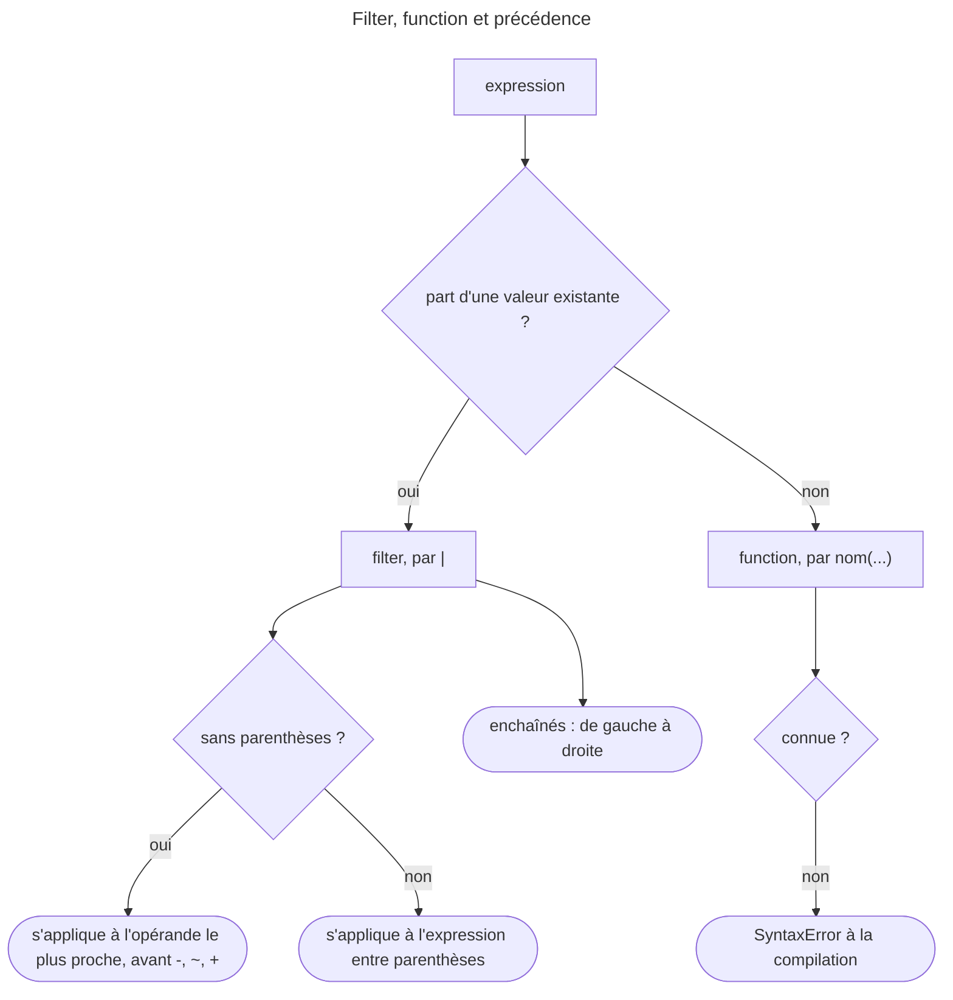

## Objectif

Distinguer un filter d'une function, savoir enchaîner et paramétrer, et
reconnaître les extensions que Symfony ajoute.

## L'essentiel

Un **filter** transforme une valeur existante, une **function** en produit une,
un **test** vérifie. Les filters s'enchaînent de gauche à droite et collent à
l'opérande le plus proche. Le cœur de Twig, ses packages « extra » et Symfony
n'apportent pas les mêmes.

## Le schéma


## La différence

```html
{{ name|upper }}                          {# filter : part d'une valeur #}
{{ path('blog_show', {slug: post.slug}) }} {# function : part de ses arguments #}
{{ items is empty }}                       {# test, par is #}
```

`date` existe sous les deux formes : `now|date('d/m')` filtre une date,
`date()` en construit une.

## Enchaîner

- Les filters s'appliquent **de gauche à droite**. L'ordre compte quand ils ne
  commutent pas : sur `'  abcdef'`, `|slice(0, 5)|trim` donne `abc`,
  `|trim|slice(0, 5)` donne `abcde` ; `trim` et `lower` commutent.
- Arguments nommés : `{{ price|number_format(decimal: 2) }}`.
- Functions fléchées pour `filter`, `map`, `reduce`, `sort`, `find` :
  `users|filter(u => u.active)|map(u => u.name)|join(', ')` ; `find` rend le
  **premier** élément qui convient.
- `…` applique un filter à tout un block.

**Précédence.** La documentation :
« the filter operator has the highest precedence ». `{{ -1|abs }}` donne `-1` — `abs` s'applique à `1`, puis le
moins ; `{{ (-1)|abs }}` donne `1`. `{{ 'a'|upper ~ 'b' }}` donne `Ab`.

## Le cœur de Twig et les packages « extra »

`truncate` n'est **pas** un filter du cœur de Twig 3.22 : on tronque avec
`slice`, ou `|u.truncate(50)` du package `twig/string-extra` (activé dans
Symfony par `twig/extra-bundle`). Un filter ou une function inconnus sont une
`SyntaxError` **à la compilation** : le template ne se compile pas, même si la
ligne n'est jamais exécutée.

## Ce que Symfony ajoute

| Ajout | Origine |
|---|---|
| `path()`, `url()` | Routing |
| `asset()`, `asset_version()` | Asset |
| `trans` (filter), `t()` | Translation |
| `form_start()`, `form_row()`, `form_widget()` | Form |
| `is_granted()` | Security |
| `dump()` | VarDumper |

`php bin/console debug:twig` liste ce qui est réellement disponible.

## En ajouter

Depuis Twig 3.21, les attributes `#[AsTwigFilter]`, `#[AsTwigFunction]` et
`#[AsTwigTest]` sur les methods publiques d'une class suffisent : TwigBundle 8.0
les enregistre par autoconfiguration, sans `AbstractExtension` ni tag.

```php
final class AppTwig
{
    #[AsTwigFilter('shout')]
    public function shout(string $s): string { return strtoupper($s).'!'; }
}
```

## Pièges d'examen

**Filter ou function se décide à la source, pas au nom.** On part d'une valeur
existante : c'est un filter. On part de rien : c'est une function. Le même mot
peut exister sous les deux formes.

**L'ordre des filters enchaînés compte quand ils ne commutent pas.** `slice`
puis `trim` n'égale pas `trim` puis `slice` ; `trim` et `lower`, si.

**Un filter de la documentation peut exiger un package.** `u`, `format_*`,
`markdown_to_html` ne sont pas dans le cœur ; `truncate` n'existe pas du tout.

**Ce que Symfony ajoute vient du bridge, pas de l'engine.** Les functions de route,
d'asset, de translation et de form n'existent pas dans un Twig installé
seul.

## Application

- `{{ -price|abs }}` affiche un nombre négatif → écrire `(-price)|abs`.
- « Unknown "truncate" filter » → `slice`, ou `twig/string-extra` et `u.truncate`.

## QCM d'entraînement

**Question 1.** Que rend `{{ -1|abs }}` ?

- **A.** `1`
- **B.** `-1`
- **C.** Une `SyntaxError` : opérande ambigu
- **D.** `0`

<details>
<summary>Correction</summary>

**Bonne réponse : B.** Le filter, de précédence la plus haute, s'applique à
`1` ; le moins vient ensuite.

</details>

**Question 2.** Un template contient, dans un `if` jamais vrai,
`{{ title|truncate(20) }}`. Que se passe-t-il au rendu, avec Twig 3.22 seul ?

- **A.** Rien : la ligne n'est jamais exécutée
- **B.** Une `SyntaxError` : le template ne compile pas
- **C.** Une `RuntimeError` seulement si la ligne s'exécute
- **D.** Le titre est tronqué à 20 caractères

<details>
<summary>Correction</summary>

**Bonne réponse : B.** « Unknown "truncate" filter », levé à la compilation du
template entier.

</details>

**Question 3.** Que rend `{{ [3, 8, 12]|find(v => v > 5) }}` ?

- **A.** `8`
- **B.** `8, 12`
- **C.** `1`, la position
- **D.** `true`

<details>
<summary>Correction</summary>

**Bonne réponse : A.** `find` rend le premier élément qui convient ; B
décrirait `filter`.

</details>

**Question 4.** Une class porte `#[AsTwigFilter('shout')]` sur une method
publique et est un service autoconfiguré. Que faut-il de plus pour utiliser
`|shout` dans Symfony 8.0 ?

- **A.** Étendre `AbstractExtension`
- **B.** Le tag `twig.extension`
- **C.** Rien
- **D.** Un `getFilters()` qui la déclare

<details>
<summary>Correction</summary>

**Bonne réponse : C.** TwigBundle 8.0 enregistre les attributes de Twig 3.21
par autoconfiguration.

</details>

## Fiche express

**Si tu dois retenir seulement 6 choses :**

- **Filter** transforme (`|`), **function** produit (`nom()`), **test** vérifie
  (`is`).
- Enchaînés **de gauche à droite** ; l'ordre compte s'ils ne commutent pas.
- Le filter a la **précédence la plus haute** : `-1|abs` vaut `-1`.
- Arguments **nommés** ; **functions fléchées** pour `filter`, `map`, `reduce`,
  `sort`, `find`.
- **Pas de `truncate`** dans le cœur ; inconnu = erreur de compilation.
- **`#[AsTwigFilter]`**, **`#[AsTwigFunction]`**, **`#[AsTwigTest]`** depuis
  Twig 3.21.

Moyen mnémotechnique : **« le filter colle à son voisin, la parenthèse le
décolle »**.

```text
filter = valeur|f, function = f(), test = is ; gauche à droite ; précédence max (-1|abs = -1) ;
truncate hors cœur (string-extra) ; inconnu = SyntaxError ; AsTwigFilter/Function/Test autoconfigurés
```

## Sources officielles

- [Symfony Twig Reference](https://github.com/symfony/symfony-docs/blob/8.0/reference/twig_reference.rst)
- [Twig 3.22, filters et functions](https://github.com/twigphp/Twig/blob/v3.22.0/doc/templates.rst)
- [Twig 3.22, index des filters](https://github.com/twigphp/Twig/blob/v3.22.0/doc/filters/index.rst) et [filter `u`](https://github.com/twigphp/Twig/blob/v3.22.0/doc/filters/u.rst)
- [Twig 3.22, attributes `AsTwigFilter`](https://github.com/twigphp/Twig/blob/v3.22.0/doc/advanced.rst)

