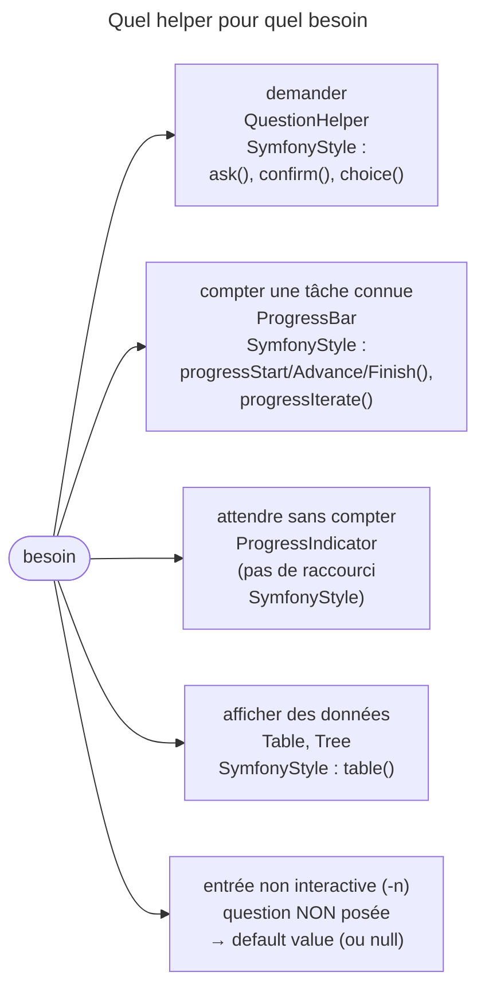

## Objectif

Savoir quels outils le component fournit déjà, pour ne pas réécrire une progress bar ni une saisie interactive à la main.

## L'essentiel

Le component fournit déjà la saisie interactive, la progress bar, les
tables. À l'examen, il faut savoir **qu'ils existent**, à quel besoin chacun
répond, et deux comportements : sans interaction, une question rend sa
**default value** sans rien demander ; `SymfonyStyle` est la porte d'entrée
recommandée.

## Le schéma



## L'exemple : confirmer avant d'importer

```php
$io = new SymfonyStyle($input, $output);
if (!$io->confirm('Importer 42 lignes ?', false)) {
    return Command::SUCCESS;
}
$io->progressStart(42);
foreach ($rows as $row) {
    // …
    $io->progressAdvance();
}
$io->progressFinish();
$io->table(['ID', 'Nom'], $summary);
```

## Le catalogue

La documentation 8.0 en recense neuf : `QuestionHelper`, `ProgressBar`,
`ProgressIndicator`, `Table`, `Tree`, `FormatterHelper` (blocks colorés),
`ProcessHelper` (lancer un process en affichant son déroulé),
`DebugFormatterHelper` et `Cursor`. Aucun n'est à connaître dans le détail.

- Une command qui étend `Command` y accède par `$this->getHelper('question')`.
- Une command invocable n'a pas `getHelper()` : `new QuestionHelper()`, ou
  `SymfonyStyle` — la règle : `SymfonyStyle` d'abord.

## Les questions

```php
new Question('Nom du projet ?', 'defaut');
new ConfirmationQuestion('Continuer ?', false);
new ChoiceQuestion('Environnement ?', ['dev', 'prod'], 0);
```

| Situation | Résultat |
|---|---|
| `ConfirmationQuestion('?', false)`, saisie `yeti` ou `Yes` | `true` : toute saisie commençant par `y` |
| `ConfirmationQuestion('?')`, saisie vide | `true` : le défaut omis vaut `true` |
| non interactive, `ChoiceQuestion(…, ['dev', 'prod'], 0)` | `'dev'` — la valeur, pas l'index |
| non interactive, `Question('?')` sans défaut | `null` |
| interactive, sans défaut, fin de l'entrée | `MissingInputException` : « Aborted. » |

La dernière ligne est le `cron` lancé sans `-n` : la question est posée sur
une entrée vide, et la command s'arrête. D'où les questions dans `interact()`,
et un repli pour toute valeur obtenue ainsi.

## La progression

- `ProgressBar($output, 100)` : `start()`, `advance()`, `finish()`. Le total
  est **facultatif** : sans lui, la barre passe en mode *throbber*, un compteur
  sans pourcentage (`0 [>---…]` au lieu de `0/3 [>---…]   0%`) ; `setMaxSteps()` le corrige en
  route.
- `ProgressIndicator` n'a pas de compteur : il anime une attente — une
  Response réseau — sans unité de progression.

## Le helper Table

```php
(new Table($output))
    ->setHeaders(['ID', 'Nom'])
    ->setRows([[1, 'Alice'], [2, 'Bob']])
    ->render();
```

`$io->table(['ID', 'Nom'], $rows)` fait la même chose par `SymfonyStyle`.

## Pièges d'examen

**Sans interaction, aucune question n'est posée** : la default value
s'applique silencieusement.

**`ConfirmationQuestion` vaut `true` par défaut** si le second argument est omis.

**`ProgressBar` n'exige pas de total** : sans lui, elle compte sans
pourcentage. `ProgressIndicator` sert quand il n'y a rien à compter.

**Une question sans défaut, en interactif, sur une entrée vide** lève
`MissingInputException`.

**`getHelper()` vient de `Command`** — indisponible dans une command invocable
qui ne l'étend pas.

## Application

- Une command lancée par `cron` qui pose une question → `-n`, et une default
  value à chaque question.
- Un traitement de 10 000 lignes → `$io->progressIterate($rows)`.

## QCM d'entraînement

**Question 1.** `new ConfirmationQuestion('Supprimer ?', false)` ; le user
tape `yeti`. Que rend la question ?

- **A.** `false`, la default value
- **B.** `true`
- **C.** `false` : seuls `y` et `yes` valent oui
- **D.** Une nouvelle demande : saisie invalide

<details>
<summary>Correction</summary>

**Bonne réponse : B.** Toute saisie qui commence par `y` vaut oui ; le second
argument ne sert que quand le user ne saisit rien.

</details>

**Question 2.** Lancée avec `-n`, une command pose
`new ChoiceQuestion('Environnement ?', ['dev', 'prod'], 0)`. Que rend la
question ?

- **A.** `0`, l'index par défaut
- **B.** `null`, faute de saisie
- **C.** `'dev'`
- **D.** Une `MissingInputException`

<details>
<summary>Correction</summary>

**Bonne réponse : C.** Sans interaction, la question n'est pas posée et rend
la default value, sous la forme de la valeur du choix, pas de son index.

</details>

**Question 3.** Sous `cron`, sans `-n`, une command pose `new Question('Nom ?')`
sans default value, et l'entrée standard est vide. Que se passe-t-il ?

- **A.** La question rend `null`
- **B.** La question rend une string vide
- **C.** La command attend indéfiniment une saisie
- **D.** Une `MissingInputException`

<details>
<summary>Correction</summary>

**Bonne réponse : D.** L'entrée reste interactive sans `-n` : la question est
posée sur une entrée vide, et la command s'arrête sur « Aborted. ».

</details>

**Question 4.** Une `ProgressBar` est créée sans total, puis démarrée. Que
s'affiche-t-il ?

- **A.** Un compteur sans pourcentage
- **B.** Une exception : le total est requis
- **C.** Une barre à 0 %, sur un total de 100
- **D.** Rien tant que `setMaxSteps()` n'est pas appelé

<details>
<summary>Correction</summary>

**Bonne réponse : A.** Sans total, la barre ne peut pas calculer de
pourcentage : elle compte les étapes, et `setMaxSteps()` peut fixer le total.

</details>

## Fiche express

**Si tu dois retenir seulement 6 choses :**

- Neuf helpers, à connaître **par leur usage**.
- Trois questions : `Question`, **`ConfirmationQuestion`** (défaut `true`,
  tout `y…` = oui), **`ChoiceQuestion`** (rend la valeur).
- Non interactive : **default value**, ou `null`, sans rien demander.
- Interactive sans défaut sur une entrée vide : **`MissingInputException`**.
- `ProgressBar` : total **facultatif** ; `ProgressIndicator` : rien à compter.
- **`SymfonyStyle`** d'abord ; `getHelper()` seulement si la class étend
  `Command`.

Moyen mnémotechnique : **« Demander, compter, afficher — SymfonyStyle
d'abord »**.

## Sources officielles

- [The Console Helpers](https://github.com/symfony/symfony-docs/blob/8.0/components/console/helpers/map.rst.inc)
- [Question Helper](https://github.com/symfony/symfony-docs/blob/8.0/components/console/helpers/questionhelper.rst)
- [Progress Bar](https://github.com/symfony/symfony-docs/blob/8.0/components/console/helpers/progressbar.rst)
- [`QuestionHelper`, branche 8.0](https://github.com/symfony/symfony/blob/8.0/src/Symfony/Component/Console/Helper/QuestionHelper.php)
- [`SymfonyStyle`, branche 8.0](https://github.com/symfony/symfony/blob/8.0/src/Symfony/Component/Console/Style/SymfonyStyle.php)

