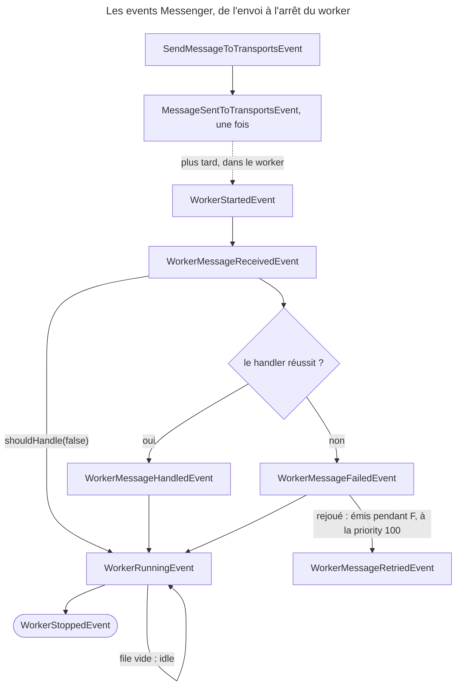

## Objectif

Réagir au cycle de vie d'un message sans écrire de middleware, savoir quel
event porte quelle information — et ce qu'un listener peut y changer. Le
mécanisme d'abonnement lui-même est traité dans *Event dispatcher and kernel
events*.

## Avant la règle : le problème à résoudre

Une alerte doit partir quand un message échoue **définitivement**. Un compteur
doit suivre les messages envoyés. Un worker doit sauter les messages d'un client
en maintenance. Écrire un middleware pour chacun est possible, mais lourd, et il
verrait aussi ce qui ne le concerne pas. Messenger émet des **events** à des
moments précis ; un listener suffit — à condition de savoir **lesquels** sont
émis, **quand**, et **ce qu'on peut y changer**.

On suppose connus l'event dispatcher, les workers et les retries.

## Le fil rouge : l'alerte d'échec définitif

```php
#[AsEventListener]
public function onFailed(WorkerMessageFailedEvent $event): void
{
    if (!$event->willRetry()) {
        $this->alerting->notify($event->getThrowable());
    }
}
```

Trois questions se cachent dans ces six lignes : l'event est-il émis pour un
message synchrone (non) ; `willRetry()` est-il juste à cet instant (oui, à la
priority par défaut) ; et que voit-on au premier échec d'un message qui sera
rejoué (`willRetry()` vaut `true`, pas d'alerte).

## Le cycle complet en un schéma

La séquence réelle, journalisée avec Messenger 8.0 pour un message routé vers
un transport puis consommé, `max_retries: 1`, handler qui échoue :



Rien, dans ce schéma, ne concerne un message **non routé** : il ne traverse
aucun de ces points.

## Event ou middleware

La frontière n'est pas « observer contre modifier » : plusieurs events
Messenger se modifient. Elle tient à **où** et **quand** ils sont émis.

- La **chaîne de middleware** est traversée à chaque `dispatch()`, message
  synchrone compris.
- Les **events** ne sont émis qu'à deux endroits : à l'envoi vers un
  transport, et dans un worker.

Exécuté avec Messenger 8.0.15, un message **non routé**, traité pendant
`dispatch()` : le middleware et le handler s'exécutent, **aucun** event
Messenger n'est émis. Lu dans `SendMessageMiddleware` :
`SendMessageToTransportsEvent` n'est émis que si le message a des *senders*.

Pour agir sur **tous** les messages, il faut donc un middleware ; pour agir à
l'envoi vers un transport ou autour d'un worker, un listener suffit.

## Le catalogue

La documentation 8.0 en liste dix :

| Event | Quand |
|---|---|
| `SendMessageToTransportsEvent` | avant l'envoi vers les transports |
| `MessageSentToTransportsEvent` | après l'envoi, une fois même pour plusieurs transports |
| `WorkerStartedEvent` | le worker démarre |
| `WorkerRunningEvent` | à chaque loop, y compris **à vide** |
| `WorkerMessageReceivedEvent` | un message vient d'être récupéré |
| `WorkerMessageHandledEvent` | un message a été traité avec succès |
| `WorkerMessageFailedEvent` | le handler a levé |
| `WorkerMessageRetriedEvent` | le message est remis en file pour un retry |
| `WorkerRateLimitedEvent` | le worker est ralenti par un limiteur de débit |
| `WorkerStoppedEvent` | le worker s'arrête |

Le code 8.0 en contient un onzième, `WorkerMessageSkipEvent`, émis par
`messenger:failed:retry` quand on choisit de ne pas rejouer un message.

Ce qui compte est la **forme** : un couple avant/après à l'envoi, et un cycle
complet côté worker — démarrage, loop, réception, succès ou échec, retry,
arrêt.

Rejoué : un message routé vers **deux** transports donne **un seul**
`MessageSentToTransportsEvent`.

## Ce qu'un listener peut changer

| Event | Method | Effet, exécuté |
|---|---|---|
| `SendMessageToTransportsEvent` | `setEnvelope()` | le stamp ajouté est lu par le worker à la réception |
| `WorkerMessageReceivedEvent` | `shouldHandle(false)` | le handler n'est **jamais** appelé, aucun event de succès ni d'échec |
| `WorkerMessageReceivedEvent` | `addStamps()` | le stamp est présent sur l'Envelope qui atteint le handler |

Un listener peut donc **interrompre** le traitement d'un message reçu — ce
qu'on attribue souvent au seul middleware.

Rejoué une nouvelle fois : le stamp posé par `setEnvelope()` est vu dans
`WorkerMessageReceivedEvent`, celui de `addStamps()` dans
`WorkerMessageHandledEvent` ; après `shouldHandle(false)`, l'event suivant est
directement `WorkerRunningEvent`.

## Les deux qui comptent

**`WorkerMessageFailedEvent`** porte l'exception et dit si le message sera
rejoué : `willRetry()`. Mais `willRetry()` est **positionné** par
`SendFailedMessageForRetryListener`, à la priority 100. Exécuté, un message qui
sera réessayé :

| Listener | `willRetry()` |
|---|---|
| priority 150 | `false` |
| priority 0 (défaut) | `true` |

Un listener qui passe avant 100 lit toujours `false`. Le failure transport, lui,
écoute à -100.

Rejoué avec `max_retries: 1` : au premier échec, `willRetry()` vaut `true` à la
priority 0 ; au second, `false`. Et `WorkerMessageRetriedEvent` est émis
**pendant** la diffusion de `WorkerMessageFailedEvent`, par le listener de
retry : un listener de priority 0 sur l'échec écrit **après** celui du retry.

**`WorkerRunningEvent`** est émis à **chaque itération**, même quand la file est
vide, et `isWorkerIdle()` le signale. Exécuté, file vide, `--time-limit=2
--sleep=0.5` : 4 émissions, toutes à vide. Un traitement coûteux placé là
s'exécute en boucle.

## Un exemple

```php
#[AsEventListener]
public function onFailed(WorkerMessageFailedEvent $event): void
{
    if (!$event->willRetry()) {
        $this->alerting->notify($event->getThrowable());
    }
}
```

La priority par défaut, 0, place ce listener **après** la décision de retry.

## Concrètement dans ton application

- Alerte d'échec définitif : `WorkerMessageFailedEvent`, priority par défaut,
  `!willRetry()`.
- Marquer chaque message envoyé : `SendMessageToTransportsEvent` et
  `setEnvelope()`.
- Sauter un message sans le faire échouer : `WorkerMessageReceivedEvent` et
  `shouldHandle(false)`.
- Rien de coûteux sur `WorkerRunningEvent`, sauf en testant `isWorkerIdle()`.
- Tout message, synchrone compris : un middleware, pas un listener.

## À comprendre

- **Pourquoi aucun event en synchrone ?** Les events Messenger sont émis par
  le code d'envoi et par le worker ; un message traité dans `dispatch()` ne
  passe par aucun des deux.
- **Pourquoi `willRetry()` dépend-il de la priority ?** C'est un listener,
  à 100, qui le décide ; avant lui, la décision n'existe pas encore.
- **Pourquoi `WorkerRunningEvent` à vide ?** C'est le battement du worker :
  les limites de temps et de mémoire s'y vérifient, file vide ou non.

## À mémoriser

- **Dix** events documentés, **onze** dans le code (`WorkerMessageSkipEvent`).
- **Non routé** = **aucun** event Messenger ; un middleware le voit.
- **`willRetry()`** fiable **après** la priority 100.
- **`WorkerMessageRetriedEvent`** est émis **pendant** `WorkerMessageFailedEvent`.
- **`WorkerRunningEvent`** à chaque tour, même à vide (`isWorkerIdle()`).
- **`shouldHandle(false)`**, **`addStamps()`**, **`setEnvelope()`** : ce qu'un
  listener peut changer.
- Moyen mnémotechnique : **« envoyer, recevoir, réussir ou échouer, tourner,
  s'arrêter »**.

## Pièges d'examen

**`WorkerRunningEvent` se déclenche à vide** : y placer du travail lourd le fait
tourner en permanence.

**`WorkerMessageFailedEvent` n'est pas un abandon** : `willRetry()` dit s'il
reste des tentatives — à condition d'écouter après la priority 100.

**Un message non routé n'émet aucun event Messenger** : seul un middleware
le voit.

**Un listener peut empêcher le traitement** : `shouldHandle(false)` sur
`WorkerMessageReceivedEvent`.

## Application : trois scénarios

**Scénario 1 — L'alerte à chaque hoquet.** L'alerte d'échec part au premier
timeout, alors que le message réussit au retry. *Solution.* Tester
`willRetry()`, à la priority par défaut : `true` au premier échec, `false` au
dernier.

**Scénario 2 — Le compteur qui ne voit rien.** Un listener de
`SendMessageToTransportsEvent` doit compter les inscriptions, mais le message
n'est routé nulle part. *Solution.* Aucun event pour un message non routé : un
middleware, ou un routage.

**Scénario 3 — Le client en maintenance.** Ses messages doivent attendre, sans
partir en file d'échec. *Solution.* `shouldHandle(false)` sur
`WorkerMessageReceivedEvent` : ni handler, ni event d'échec.

## QCM d'entraînement

Cinq questions sur les events. Choisis avant d'ouvrir la correction.

**Question 1.** Un message est routé vers `async` et `audit`. Combien de
`MessageSentToTransportsEvent` sont émis au `dispatch()` ?

- **A.** Deux : un par transport
- **B.** Un seul, pour les deux
- **C.** Aucun : il est émis par le worker
- **D.** Trois : avant, pendant et après l'envoi

<details>
<summary>Correction</summary>

**Bonne réponse : B.** Rejoué. La documentation : « If the message was sent to
multiple transports, the event is dispatched only once. »
`SendMessageToTransportsEvent`, avant l'envoi, est lui aussi unique.

A est l'idée reçue. C et D sont faux.

</details>

**Question 2.** Un listener de priority 0 sur `WorkerMessageFailedEvent` et un
listener de `WorkerMessageRetriedEvent` journalisent. Le message sera rejoué.
Quelle ligne est écrite en premier ?

- **A.** Celle du listener de `WorkerMessageFailedEvent`
- **B.** Les deux en même temps
- **C.** Aucune : un échec rejoué n'émet pas d'event
- **D.** Celle du retry

<details>
<summary>Correction</summary>

**Bonne réponse : D.** Rejoué. Lu dans `SendFailedMessageForRetryListener` : à
la priority 100, pendant la diffusion de l'échec, il émet
`WorkerMessageRetriedEvent` ; le listener de priority 0 passe ensuite.

A suppose que l'échec est entièrement diffusé d'abord. B et C sont faux.

</details>

**Question 3.** `max_retries: 1`, un handler qui échoue toujours. Que lit un
listener de priority 0 dans `willRetry()`, au premier puis au second échec ?

- **A.** `true`, puis `false`
- **B.** `false`, puis `false`
- **C.** `true`, puis `true`
- **D.** `false`, puis `true`

<details>
<summary>Correction</summary>

**Bonne réponse : A.** Rejoué : une tentative de retry reste après le premier
échec, aucune après le second.

B serait la lecture d'un listener à la priority 150. C et D sont faux.

</details>

**Question 4.** Un listener appelle `shouldHandle(false)` sur
`WorkerMessageReceivedEvent`. Quel event le worker émet-il ensuite ?

- **A.** `WorkerMessageHandledEvent`
- **B.** `WorkerMessageFailedEvent`
- **C.** `WorkerRunningEvent`
- **D.** `WorkerMessageSkipEvent`

<details>
<summary>Correction</summary>

**Bonne réponse : C.** Rejoué : ni succès ni échec, le worker passe à son
battement.

A et B supposent que le handler a tourné. D est émis par
`messenger:failed:retry`, pas par un message sauté ainsi.

</details>

**Question 5.** Un listener de `SendMessageToTransportsEvent` ajoute un stamp
par `setEnvelope()`. Le worker le voit-il à la réception ?

- **A.** Non : seuls les stamps du `dispatch()` voyagent
- **B.** Non : un listener ne peut pas modifier l'Envelope
- **C.** Seulement en synchrone
- **D.** Oui, l'Envelope envoyée le porte

<details>
<summary>Correction</summary>

**Bonne réponse : D.** Rejoué : le stamp est sur l'Envelope reçue par
`WorkerMessageReceivedEvent`. `SendMessageMiddleware` relit l'Envelope de
l'event avant d'envoyer.

A et B sont faux. C est faux : en synchrone, cet event n'est pas émis.

</details>

## Fiche express

**Si tu dois retenir seulement 7 choses :**

- **Non routé** : aucun event Messenger ; un middleware le voit.
- À l'envoi : **`SendMessageToTransportsEvent`**, puis **`MessageSentToTransportsEvent`**, une fois.
- Worker : started, **received**, handled ou **failed**, **running**, stopped.
- **`willRetry()`** : après la priority 100.
- **`WorkerMessageRetriedEvent`** : pendant l'échec, par le listener de retry.
- **`WorkerRunningEvent`** : même à vide.
- **`shouldHandle(false)`** : ni handler, ni succès, ni échec.

**En une phrase, pour tout reconstruire :**

```text
envoi : SendMessageToTransports (setEnvelope) → MessageSentToTransports (×1) ; worker : Started → Received (shouldHandle, addStamps)
→ Handled | Failed (willRetry après 100 ; Retried émis dedans) → Running (même idle) → Stopped ; non routé : rien
```

## Sources officielles

- [Messenger, « Messenger Events »](https://github.com/symfony/symfony-docs/blob/8.0/messenger.rst)
- [Messenger 8.0, `SendMessageMiddleware`](https://github.com/symfony/symfony/blob/8.0/src/Symfony/Component/Messenger/Middleware/SendMessageMiddleware.php)
- [Messenger 8.0, `Worker`](https://github.com/symfony/symfony/blob/8.0/src/Symfony/Component/Messenger/Worker.php)
- [Messenger 8.0, `SendFailedMessageForRetryListener`](https://github.com/symfony/symfony/blob/8.0/src/Symfony/Component/Messenger/EventListener/SendFailedMessageForRetryListener.php)
