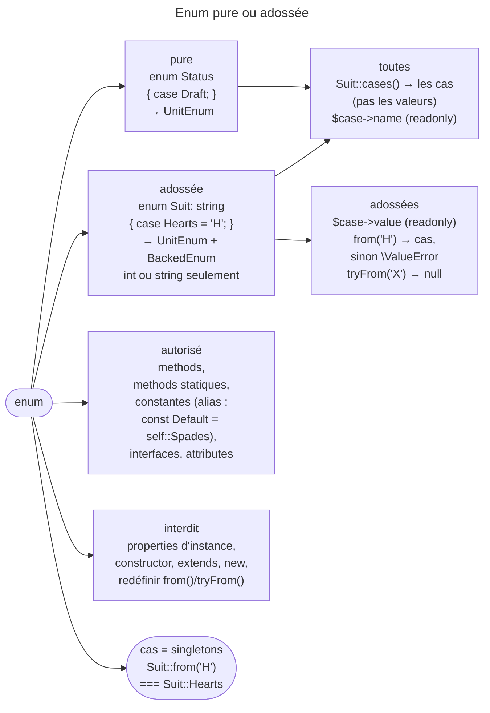

## Objectif

Distinguer enum pure et enum adossée, choisir entre `from()` et `tryFrom()`, et
savoir ce qu'une enum ne peut pas faire.

## L'essentiel

Une enum **pure** n'a que des cas ; une enum **adossée** donne à chaque cas une
valeur `int` ou `string`. Toutes ont `cases()` et `->name` ; les adossées
ajoutent `->value`, `from()` — qui **lève** — et `tryFrom()` — qui rend
**`null`**. Une enum porte methods, constantes et interfaces, mais **aucun
état** : ni property d'instance, ni constructor, ni `new`, ni inheritance.

## Le schéma



## L'exemple

```php
enum Suit: string implements Colorful
{
    case Hearts = 'H';
    case Spades = 'S';

    const Default = self::Spades;          // alias

    public function color(): string
    {
        return match ($this) {
            self::Hearts => 'Red',
            self::Spades => 'Black',
        };
    }
}

$suit = Suit::tryFrom($input) ?? Suit::Default;
```

## Pure ou adossée

Une enum pure déclare des cas sans valeur. Une enum adossée (*backed*) donne à
chaque cas une valeur de type `int` ou `string` — aucun autre type —, unique et
constante. Une enum adossée implémente automatiquement `BackedEnum` ; toute
enum implémente `UnitEnum`.

## L'API

Toutes les enums exposent `cases()`, qui rend les cas eux-mêmes, et `->name`,
en lecture seule. Les enums **adossées uniquement** ajoutent `->value`, en
lecture seule, `from()`, qui lève une `\ValueError` si aucun cas ne correspond,
et `tryFrom()`, qui rend alors `null`. Pour les valeurs :
`array_column(Suit::cases(), 'value')`.

## Ce qu'une enum peut faire

Methods, methods statiques, constantes, implémentation d'interfaces et
attributes. Une constant peut désigner un cas : c'est un alias. Ses cas sont
des singletons, comparables par `===`.

Elle ne peut pas porter d'**état** : pas de property d'instance, pas de
constructor, pas d'`extends`, pas de `new` — « Cannot instantiate enum ».
`->value` et `->name` sont en lecture seule : toute modification, directe ou
indirecte, lève une `Error`.

## Pièges d'examen

**`from()` lève, `tryFrom()` renvoie `null`.** Sur une entrée user,
`from()` produit une `\ValueError` non rattrapée. C'est la distinction la plus
testée.

**Redéfinir `from()` ou `tryFrom()` sur une enum adossée est une erreur
fatale.** Ces methods sont fournies par l'engine.

**`cases()` sur une enum adossée renvoie les cas, pas les valeurs.** Pour les
valeurs : `array_column(Suit::cases(), 'value')`.

**Une enum pure n'a pas de `->value`.** Y accéder ne lève rien : PHP émet un
avertissement « Undefined property » et rend `null` — exécuté.

## Application

- Une valeur venue d'un form → `tryFrom()` et une valeur de repli.
- Une valeur de votre propre base, censée toujours valide → `from()`, qui
  échoue bruyamment.

## QCM d'entraînement

**Question 1.** Que vaut `Suit::from('H') === Suit::Hearts` ?

- **A.** `true`
- **B.** `false` : deux instances distinctes
- **C.** Une `Error`
- **D.** `true` seulement avec `==`

<details>
<summary>Correction</summary>

**Bonne réponse : A.** Chaque cas est un singleton : `from()` rend l'object du
cas lui-même, identique à celui qu'on nomme directement.

</details>

**Question 2.** Que produit `new Suit()` ?

- **A.** Le premier cas, par défaut
- **B.** Une `Error`
- **C.** Un object sans cas
- **D.** Un cas `null`

<details>
<summary>Correction</summary>

**Bonne réponse : B.** Une enum ne s'instancie jamais : PHP refuse `new` avec
« Cannot instantiate enum », ses seules instances étant ses cas.

</details>

**Question 3.** Que fait PHP de `enum F: float { case A = 1.0; }` ?

- **A.** Il l'accepte
- **B.** Un warning de conversion
- **C.** Une erreur fatale
- **D.** Il l'accepte si les valeurs sont entières

<details>
<summary>Correction</summary>

**Bonne réponse : C.** Le type d'adossement ne peut être que `int` ou `string` ;
tout autre type est refusé à la compilation de l'enum.

</details>

**Question 4.** Une enum adossée implémente-t-elle `UnitEnum` ?

- **A.** Non : seulement `BackedEnum`
- **B.** Non, aucune interface
- **C.** Seulement si elle le déclare elle-même
- **D.** Oui, en plus de `BackedEnum`

<details>
<summary>Correction</summary>

**Bonne réponse : D.** Toute enum implémente `UnitEnum` ; une enum adossée y
ajoute automatiquement `BackedEnum`, sans rien déclarer.

</details>

## Fiche express

**Si tu dois retenir seulement 6 choses :**

- Pure : des cas ; adossée : **`int` ou `string`**, unique et constante.
- `cases()` → les **cas** ; `name` et `value` en **lecture seule**.
- **`from()` lève** `\ValueError` ; **`tryFrom()` rend `null`**.
- Methods, constantes (alias), interfaces : **oui**.
- État, constructor, `extends`, **`new`** : **non**.
- `UnitEnum` pour toutes, **`BackedEnum`** en plus pour les adossées.

Moyen mnémotechnique : **« from fâche, tryFrom tolère »**.

## Sources officielles

- Manuel PHP — *Enumerations*

