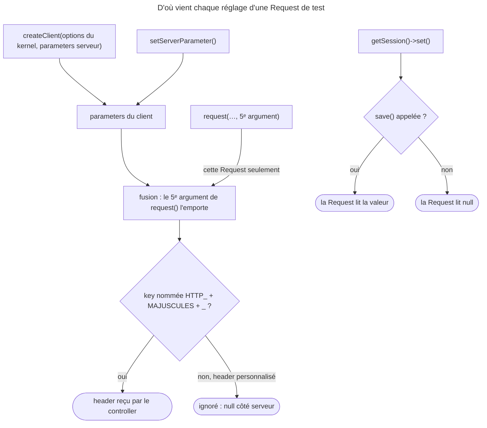

## Objectif

Régler le client avant ou pendant la Request : headers, host, session,
comportement face aux exceptions.

## Avant la règle : le problème à résoudre

Un site multilingue choisit sa langue selon le host ; son API exige un header
`X-Session-Token` ; un form refuse tout envoi sans token CSRF. Un test doit
donc **régler le navigateur simulé** avant de s'en servir.

Trois questions : **où** passer un réglage — pour tout le test ou pour une
Request —, **comment nommer** un header, et comment **préparer la session**
pour qu'une Request la voie.

On suppose connu l'object client.

## Le fil rouge : un site sur `en.example.com`

```php
$client = static::createClient([], [                 // 1ᵉʳ : kernel ; 2ᵉ : serveur
    'HTTP_HOST' => 'en.example.com',                  // toutes les Requests
]);

$client->request('GET', '/api/me', [], [], [
    'HTTP_X_SESSION_TOKEN' => 'abc',                  // X-Session-Token, une fois
]);

$session = $client->getSession();
$session->set('_csrf/form', 'fhr8d5sha3a69tpv24s5');
$session->save();                                     // sinon, invisible
```

## Le cycle complet en un schéma



## Les deux arguments de `createClient()`

```php
$client = static::createClient([], [
    'HTTP_HOST'       => 'en.example.com',
    'HTTP_USER_AGENT' => 'MySuperBrowser/1.0',
]);
```

Le **premier** porte les options du kernel — `environment`, `debug` — celles-là
mêmes que `bootKernel()` accepte. Le **second** porte les parameters serveur,
donc les headers.

## La règle de nommage des headers

C'est le piège de l'item, et il est mécanique. Un header personnalisé se
transforme selon la section 4.1.18 de la RFC 3875 :

1. remplacer les tirets par des soulignés ;
2. passer en majuscules ;
3. préfixer par `HTTP_`.

`X-Session-Token` devient donc **`HTTP_X_SESSION_TOKEN`**.

Les headers standards de CGI échappent au préfixe — `CONTENT_TYPE`,
`REMOTE_ADDR` — mais l'examen porte sur la règle des headers personnalisés.

Exécuté avec FrameworkBundle 8.0.15, un controller qui renvoie ce qu'il lit
dans `$request->headers` :

| Key passée au client | `X-Session-Token` côté serveur |
|---|---|
| `HTTP_X_SESSION_TOKEN` | `abc` |
| `X-Session-Token` | `null` |
| `X_SESSION_TOKEN` | `null` |

`CONTENT_TYPE`, sans préfixe, arrive bien comme `Content-Type`. Sans réglage,
le user agent vaut `Symfony BrowserKit`.

Rejoué pour cette page : `HTTP_AUTHORIZATION` arrive comme `Authorization`,
`AUTHORIZATION` sans préfixe donne `null` ; `HTTP_X_REQUEST_ID` arrive comme
`X-Request-Id`. Le défaut du user agent est lu dans
`AbstractBrowser::setServerParameters()` (8.0).

## Par Request plutôt que par client

Le même array se passe en **cinquième** argument de `request()` :

```php
$client->request('GET', '/', [], [], [
    'HTTP_HOST' => 'en.example.com',
]);
```

`createClient()` règle tout le test ; `request()` règle une Request. La position
compte : le cinquième argument, après les parameters et les files. Exécuté :
`HTTP_HOST` passé à `createClient()` vaut encore à la deuxième Request.

Les deux se combinent. Lu dans `AbstractBrowser::request()` (8.0) : l'array de
la Request est fusionné **par-dessus** celui du client. Rejoué, client créé avec
`HTTP_HOST` `a.example.com` :

| Request | Host reçu |
|---|---|
| 5ᵉ argument `HTTP_HOST` `b.example.com` | `b.example.com` |
| la suivante, sans 5ᵉ argument | `a.example.com` |
| après `setServerParameter('HTTP_HOST', 'c.example.com')` | `c.example.com` |

`setServerParameter()` modifie le client en cours de test ; le 5ᵉ argument ne
vaut que pour sa Request.

## Préparer la session

```php
$session = $client->getSession();
$session->set('_csrf/form', 'fhr8d5sha3a69tpv24s5');
$session->save();

$client->request('POST', '/form', ['form' => ['_token' => 'fhr8d5sha3a69tpv24s5']]);
```

`save()` est nécessaire : sans elle la valeur n'est pas persistée et la Request
ne la verra pas. Le cas d'usage typique est le token CSRF, qu'on ne peut pas
deviner sans avoir affiché le form. Exécuté :

| Avant la Request | Valeur lue par le controller |
|---|---|
| `set('k', 'unsaved')` | `null` |
| `set('k', 'saved')` puis `save()` | `saved` |
| `set` + `save()` **avant toute Request** | lue aussi : `getSession()` rend déjà une `Session` |

## Les cookies

`testing.rst` liste `$client->getCookieJar()` parmi les objects internes du
client. Rejoué : `getCookieJar()->set(new Cookie('flavor', 'choco'))` — la
class `Cookie` de BrowserKit — et la Request suivante porte le cookie `flavor`,
de valeur `choco`.

## Voir les exceptions

```php
$client->catchExceptions(false);
```

Sans cela, une exception est convertie en page d'erreur et le test échoue sur un
code 500 muet. Avec, l'exception remonte à PHPUnit, qui affiche sa class, son
message et sa trace.

## Remplacer le client

Le client est le service **`test.client`** dans le container, en environment
`test` ou dès que `framework.test` est activée. Il peut donc être redéfini
entièrement.

## Concrètement dans ton application

- Un site multi-domaine : `HTTP_HOST` dans le 2ᵉ argument de `createClient()`.
- Une seule Request différente : le 5ᵉ argument de `request()`.
- Un réglage qui change en cours de test : `setServerParameter()`.
- Un token d'API : `HTTP_AUTHORIZATION`, `HTTP_X_…` — jamais le nom du header
  tel quel.
- Un form CSRF : `getSession()`, `set()`, **`save()`**, puis la Request.
- Un 500 muet : `catchExceptions(false)`.

## À comprendre

- **Pourquoi `HTTP_` ?** Le client remplit le tableau `$_SERVER` simulé, et PHP
  y range les headers sous la convention CGI ; HttpFoundation reconstruit les
  headers à partir de ces keys.
- **Pourquoi deux niveaux ?** Le client garde un état — host, user agent — pour
  tout le test ; une Request peut le contredire sans le modifier.
- **Pourquoi `save()` ?** La Request relit la session enregistrée ; une valeur
  seulement posée en mémoire n'y est pas encore.

## À mémoriser

- **`createClient($optionsKernel, $server)`** : kernel d'abord, headers ensuite.
- **`X-Session-Token`** → **`HTTP_X_SESSION_TOKEN`** ; `CONTENT_TYPE` sans
  préfixe.
- **5ᵉ argument** de `request()` : une Request, prioritaire.
- **`setServerParameter()`** : le client, pour la suite.
- User agent par défaut : **`Symfony BrowserKit`**.
- **`getSession()` → `set()` → `save()`**, avant la Request.
- **`catchExceptions(false)`** ; client = service **`test.client`**.
- Moyen mnémotechnique : **« Kernel, puis serveur ; HTTP_ en majuscules ; save »**.

## Pièges d'examen

**`createClient()` prend d'abord les options du kernel, ensuite les headers.**

**Un header personnalisé devient `HTTP_` + majuscules + soulignés.**

**Les headers de Request sont le cinquième argument** de `request()`.

**`$session->save()` est obligatoire** pour que la valeur soit visible.

**`catchExceptions(false)` ne change pas l'application**, seulement ce que le
client fait de l'exception.

## Application : trois scénarios

**Scénario 1 — Le token ignoré.** Le test passe `['X-Api-Key' => 'k']` au
client ; le controller lit `null`. *Solution.* `HTTP_X_API_KEY` : le nom CGI,
préfixé et en majuscules.

**Scénario 2 — Le form refusé.** Le test pose le token CSRF en session et
soumet ; le form est déclaré invalide. *Solution.* `$session->save()` manquait :
la Request n'a pas vu le token.

**Scénario 3 — Le second domaine.** Tout le test vise `en.example.com`, sauf une
Request qui doit viser `fr.example.com`. *Solution.* Le 5ᵉ argument de cette
Request : il l'emporte pour elle seule, et la suivante revient au host du
client.

## QCM d'entraînement

Cinq questions sur la configuration du client. Choisis avant d'ouvrir la
correction.

**Question 1.** Le client est créé avec `['HTTP_HOST' => 'a.example.com']`.
Une Request passe `['HTTP_HOST' => 'b.example.com']` en 5ᵉ argument ; la
suivante n'en passe aucun. Quels hosts reçoit l'application ?

- **A.** `a.example.com`, puis `a.example.com`
- **B.** `b.example.com`, puis `b.example.com`
- **C.** `b.example.com`, puis `a.example.com`
- **D.** Une exception : deux hosts sont déclarés

<details>
<summary>Correction</summary>

**Bonne réponse : C.** Exécuté. L'array de la Request est fusionné par-dessus
celui du client, pour cette Request seulement.

A ignore la fusion. B suppose que le 5ᵉ argument modifie le client. D est faux.

</details>

**Question 2.** En cours de test, toutes les Requests **suivantes** doivent
viser `c.example.com`. Quel appel ?

- **A.** `$client->setServerParameter('HTTP_HOST', 'c.example.com')`
- **B.** `$client->request('GET', '/', ['HTTP_HOST' => 'c.example.com'])`
- **C.** `$client->getRequest()->headers->set('Host', 'c.example.com')`
- **D.** `$client->setHost('c.example.com')`

<details>
<summary>Correction</summary>

**Bonne réponse : A.** Exécuté : la Request suivante reçoit `c.example.com`.

B place la valeur dans les parameters de la Request, pas dans les headers.
C modifie une Request déjà traitée. D n'existe pas.

</details>

**Question 3.** Une API lit `$request->headers->get('Authorization')`. Quelle key
le test passe-t-il ?

- **A.** `AUTHORIZATION`
- **B.** `HTTP_AUTHORIZATION`
- **C.** `Authorization`
- **D.** `HTTP_HEADER_AUTHORIZATION`

<details>
<summary>Correction</summary>

**Bonne réponse : B.** Exécuté : `Bearer abc` reçu ; `AUTHORIZATION` sans
préfixe donne `null`.

A oublie le préfixe, C garde le nom du header, D ajoute un mot au nom.

</details>

**Question 4.** Sans aucun réglage, quel `User-Agent` reçoit l'application ?

- **A.** `Mozilla/5.0 (compatible; Symfony)`
- **B.** Aucun : le header est absent
- **C.** `PHPUnit`
- **D.** `Symfony BrowserKit`

<details>
<summary>Correction</summary>

**Bonne réponse : D.** Exécuté, et lu dans
`AbstractBrowser::setServerParameters()` : c'est la default value de
`HTTP_USER_AGENT`.

A, B et C sont faux.

</details>

**Question 5.** Chaque Request d'un test doit porter le cookie `flavor=choco`,
préparé par `$cookie = new Cookie('flavor', 'choco')`. Quel appel, avant les
Requests ?

- **A.** `$client->setServerParameter('flavor', 'choco')`
- **B.** `$client->getSession()->set('flavor', 'choco')`
- **C.** `$client->getCookieJar()->set($cookie)`
- **D.** `$client->request('GET', '/', ['flavor' => 'choco'])`

<details>
<summary>Correction</summary>

**Bonne réponse : C.** Exécuté avec le `Cookie` de BrowserKit : la Request
suivante porte `flavor`, de valeur `choco`.

A pose un parameter serveur, B une valeur de session, D un parameter de
Request : aucun n'est un cookie.

</details>

## Fiche express

**Si tu dois retenir seulement 7 choses :**

- **`createClient()`** : options du **kernel**, puis parameters **serveur**.
- Header personnalisé : **`HTTP_` + MAJUSCULES + `_`**.
- **`CONTENT_TYPE`** échappe au préfixe.
- **5ᵉ argument** de `request()` : une Request, prioritaire.
- **`setServerParameter()`** pour la suite du test.
- **`save()`** après `set()` en session.
- **`catchExceptions(false)`** : l'exception remonte, l'application ne change pas.

**En une phrase, pour tout reconstruire :**

```text
createClient(kernel, serveur) ; X-Foo-Bar → HTTP_X_FOO_BAR (CONTENT_TYPE à part) ; request(…, 5ᵉ) l'emporte une fois ;
setServerParameter() pour la suite ; session : set + save ; cookies : getCookieJar() ; catchExceptions(false)
```

## Sources officielles

- [Testing](https://github.com/symfony/symfony-docs/blob/8.0/testing.rst)
- [`WebTestCase`, branche 8.0](https://github.com/symfony/symfony/blob/8.0/src/Symfony/Bundle/FrameworkBundle/Test/WebTestCase.php)
- [`KernelBrowser`, branche 8.0](https://github.com/symfony/symfony/blob/8.0/src/Symfony/Bundle/FrameworkBundle/KernelBrowser.php)
- [`AbstractBrowser`, branche 8.0](https://github.com/symfony/symfony/blob/8.0/src/Symfony/Component/BrowserKit/AbstractBrowser.php)
