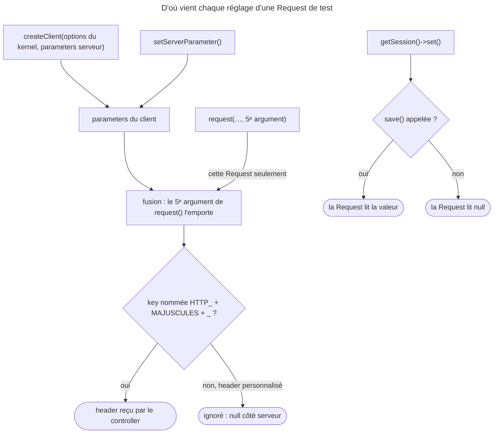

## Objectif

Régler le client avant ou pendant la Request : headers, host, session,
comportement face aux exceptions.

## L'essentiel

Le client de test se règle à deux niveaux : **`createClient()`** pour tout le
test, le **5ᵉ argument** de `request()` pour une seule Request. Un header s'y
écrit sous son nom **CGI** — `HTTP_` + majuscules + soulignés. Et une valeur
posée en session n'est vue qu'après **`save()`**.

## Le schéma



## L'exemple

```php
$client = static::createClient([], [                 // 1ᵉʳ : kernel ; 2ᵉ : serveur
    'HTTP_HOST' => 'en.example.com',                  // toutes les Requests
]);

$client->request('GET', '/api/me', [], [], [
    'HTTP_X_SESSION_TOKEN' => 'abc',                  // X-Session-Token, une fois
]);

$session = $client->getSession();
$session->set('_csrf/form', 'fhr8d5sha3a69tpv24s5');
$session->save();                                     // sinon, invisible
```

## Les deux arguments de `createClient()`

Le **premier** porte les options du kernel — `environment`, `debug`, celles de
`bootKernel()`. Le **second** porte les parameters serveur, donc les headers,
pour toutes les Requests du client.

## La règle de nommage des headers

Un header personnalisé suit la RFC 3875 : tirets → soulignés, majuscules,
préfixe `HTTP_`. `X-Session-Token` devient **`HTTP_X_SESSION_TOKEN`**.

| Key passée au client | `X-Session-Token` côté serveur |
|---|---|
| `HTTP_X_SESSION_TOKEN` | `abc` |
| `X-Session-Token` | `null` |
| `X_SESSION_TOKEN` | `null` |

- Les headers standards de CGI échappent au préfixe : `CONTENT_TYPE`, sans
  préfixe, arrive bien comme `Content-Type`.
- `HTTP_AUTHORIZATION` arrive comme `Authorization` ; `AUTHORIZATION` donne
  `null`.
- Sans réglage, le user agent vaut `Symfony BrowserKit`.

## Par Request plutôt que par client

L'array de la Request est fusionné **par-dessus** celui du client, pour cette
Request seulement. Client créé avec `HTTP_HOST` `a.example.com` :

| Request | Host reçu |
|---|---|
| 5ᵉ argument `HTTP_HOST` `b.example.com` | `b.example.com` |
| la suivante, sans 5ᵉ argument | `a.example.com` |
| après `setServerParameter('HTTP_HOST', 'c.example.com')` | `c.example.com` |

`setServerParameter()` modifie le client pour la suite du test.

## Préparer la session

| Avant la Request | Valeur lue par le controller |
|---|---|
| `set('k', 'unsaved')` | `null` |
| `set('k', 'saved')` puis `save()` | `saved` |
| `set` + `save()` **avant toute Request** | lue aussi |

Le cas typique : un token CSRF, qu'on ne peut pas deviner sans afficher le
form.

## Les cookies

`$client->getCookieJar()->set(new Cookie('flavor', 'choco'))` — le `Cookie` de
BrowserKit — et la Request suivante porte le cookie `flavor`.

## Voir les exceptions

`$client->catchExceptions(false)` : l'exception remonte à PHPUnit au lieu d'un
500 muet ; l'application, elle, ne change pas. Le client est le service
**`test.client`**, en environment `test` ou avec `framework.test`.

## Pièges d'examen

**`createClient()` prend d'abord les options du kernel, ensuite les headers.**

**Un header personnalisé devient `HTTP_` + majuscules + soulignés.**

**Les headers de Request sont le cinquième argument** de `request()`.

**`$session->save()` est obligatoire** pour que la valeur soit visible.

**`catchExceptions(false)` ne change pas l'application**, seulement ce que le
client fait de l'exception.

## Application

- Le test passe `['X-Api-Key' => 'k']` et le controller lit `null` →
  `HTTP_X_API_KEY`.
- Le token CSRF posé en session est ignoré et le form est invalide →
  `$session->save()` manquait.

## QCM d'entraînement

**Question 1.** Le client est créé avec `['HTTP_HOST' => 'a.example.com']`.
Une Request passe `['HTTP_HOST' => 'b.example.com']` en 5ᵉ argument ; la
suivante n'en passe aucun. Quels hosts reçoit l'application ?

- **A.** `a.example.com`, puis `a.example.com`
- **B.** `b.example.com`, puis `b.example.com`
- **C.** `b.example.com`, puis `a.example.com`
- **D.** Une exception : deux hosts sont déclarés

<details>
<summary>Correction</summary>

**Bonne réponse : C.** L'array de la Request est fusionné par-dessus celui du
client, pour cette Request seulement ; B supposerait que le client change.

</details>

**Question 2.** En cours de test, toutes les Requests **suivantes** doivent
viser `c.example.com`. Quel appel ?

- **A.** `$client->setServerParameter('HTTP_HOST', 'c.example.com')`
- **B.** `$client->request('GET', '/', ['HTTP_HOST' => 'c.example.com'])`
- **C.** `$client->getRequest()->headers->set('Host', 'c.example.com')`
- **D.** `$client->setHost('c.example.com')`

<details>
<summary>Correction</summary>

**Bonne réponse : A.** B place la valeur dans les parameters de la Request, C
modifie une Request déjà traitée, et D n'existe pas.

</details>

**Question 3.** Sans aucun réglage, quel `User-Agent` reçoit l'application ?

- **A.** `Mozilla/5.0 (compatible; Symfony)`
- **B.** Aucun : le header est absent
- **C.** `PHPUnit`
- **D.** `Symfony BrowserKit`

<details>
<summary>Correction</summary>

**Bonne réponse : D.** C'est la default value de `HTTP_USER_AGENT`, posée par
`AbstractBrowser` à la création du client.

</details>

**Question 4.** Chaque Request d'un test doit porter le cookie `flavor=choco`,
préparé par `$cookie = new Cookie('flavor', 'choco')`. Quel appel, avant les
Requests ?

- **A.** `$client->setServerParameter('flavor', 'choco')`
- **B.** `$client->getCookieJar()->set($cookie)`
- **C.** `$client->getSession()->set('flavor', 'choco')`
- **D.** `$client->request('GET', '/', ['flavor' => 'choco'])`

<details>
<summary>Correction</summary>

**Bonne réponse : B.** Les autres posent un parameter serveur, une valeur de
session ou un parameter de Request : aucun n'est un cookie.

</details>

## Fiche express

**Si tu dois retenir seulement 7 choses :**

- **`createClient()`** : options du **kernel**, puis parameters **serveur**.
- Header personnalisé : **`HTTP_` + MAJUSCULES + `_`**.
- **`CONTENT_TYPE`** échappe au préfixe.
- **5ᵉ argument** de `request()` : une Request, prioritaire.
- **`setServerParameter()`** pour la suite du test.
- **`save()`** après `set()` en session.
- **`catchExceptions(false)`** : l'exception remonte, l'application ne change pas.

Moyen mnémotechnique :
**« Kernel, puis serveur ; HTTP_ en majuscules ; save »**.

```text
createClient(kernel, serveur) ; X-Foo-Bar → HTTP_X_FOO_BAR (CONTENT_TYPE à part) ; request(…, 5ᵉ) l'emporte une fois ;
setServerParameter() pour la suite ; session : set + save ; cookies : getCookieJar() ; catchExceptions(false)
```

## Sources officielles

- [Testing](https://github.com/symfony/symfony-docs/blob/8.0/testing.rst)
- [`WebTestCase`, branche 8.0](https://github.com/symfony/symfony/blob/8.0/src/Symfony/Bundle/FrameworkBundle/Test/WebTestCase.php)
- [`KernelBrowser`, branche 8.0](https://github.com/symfony/symfony/blob/8.0/src/Symfony/Bundle/FrameworkBundle/KernelBrowser.php)
- [`AbstractBrowser`, branche 8.0](https://github.com/symfony/symfony/blob/8.0/src/Symfony/Component/BrowserKit/AbstractBrowser.php)

