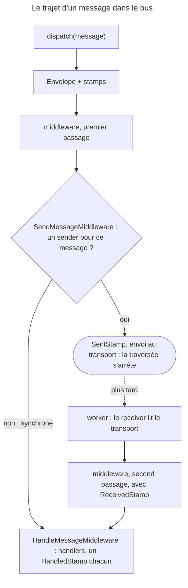

## Objectif

Nommer correctement les concepts du component et comprendre ce que
« dispatcher » veut dire. Transports, handlers et middleware ont chacun leur
item.

## L'essentiel

Le controller **dispatche** un message ; le **routage** décide s'il est traité
tout de suite ou envoyé vers un transport pour un worker. Le code appelant ne
change pas. Le message voyage dans une **Envelope** immuable, et ce qui s'est
passé se lit sur l'Envelope **retournée** par `dispatch()`.

## Le schéma



Les middleware sont appelés « both when a message is originally dispatched and
again later when a message is received from a transport » : **deux fois** pour
un message asynchrone.

## L'exemple

```php
final class Welcome                        // un object PHP ordinaire, sans interface
{
    public function __construct(public string $who) {}
}

#[AsMessageHandler]
final class WelcomeMailer
{
    public function __invoke(Welcome $message): string
    {
        return 'mailed '.$message->who;
    }
}

$envelope = $this->bus->dispatch(new Welcome('alice'));
```

Sans `routing`, `WelcomeMailer` tourne pendant `dispatch()`. Avec
`routing: { App\Message\Welcome: async }`, il tourne plus tard, dans un worker.

## Les six concepts de la documentation

| Concept | Role |
|---|---|
| **Sender** | sérialise et envoie le message vers « quelque chose » : un broker, une API |
| **Receiver** | récupère, désérialise et transmet aux handlers |
| **Handler** | exécute la logique métier ; appelé par `HandleMessageMiddleware` |
| **Middleware** | accède au message et à l'Envelope pendant la traversée du bus |
| **Envelope** | emballe le message pour y attacher des informations |
| **Envelope Stamps** | ces informations : délai, transport, résultat, marqueurs |

Ni le **message** — une class ordinaire — ni le **bus**, qui fait traverser la
chaîne de middleware, ne figurent dans la liste.

## Dispatcher

`dispatch()` confie le message au bus. Avec deux handlers pour `Welcome`,
dispatché avec un `DelayStamp(5000)` :

| Routage | Handlers exécutés avant le retour | Stamps de l'Envelope retournée |
|---|---|---|
| aucun (synchrone) | **les deux** | `DelayStamp`, `BusNameStamp`, `HandledStamp` ×2 |
| `in-memory://` | **aucun** | `DelayStamp`, `BusNameStamp`, `SentStamp`, `TransportMessageIdStamp` |
| `sync://` | **les deux** | `DelayStamp`, `BusNameStamp`, `SentStamp`, `ReceivedStamp`, `HandledStamp` ×2 |

- Synchrone : **déjà traité** au retour. Asynchrone : seulement **envoyé**.
- `sync://` est un vrai transport qui redispatche aussitôt : envoyé **et**
  traité.
- Un `DelayStamp` n'a **aucun effet** en synchrone : c'est une consigne pour le
  transport.
- Non routé et sans handler : `NoHandlerForMessageException`.

## L'Envelope et les stamps

```php
$envelope = $this->bus->dispatch($message, [new DelayStamp(5000)]);
$result   = $envelope->last(HandledStamp::class)?->getResult();
```

- Le résultat se lit sur le `HandledStamp`, **seulement** en synchrone ; avec
  deux handlers, `last()` rend le second, `all()` les deux.
- `HandleTrait::handle()` exige **exactement un** handler : sinon
  `LogicException`, « was handled multiple times » ou, sur un message routé,
  « was handled zero times ».
- **L'Envelope est immuable** : `with()` clone avant d'ajouter un stamp. Seule
  l'Envelope **retournée** par `dispatch()` porte le `SentStamp`.

## Pièges d'examen

**`dispatch()` ne signifie pas « traité » en asynchrone** — et signifie « déjà
traité » en synchrone.

**Un message n'implémente aucune interface.** C'est une class ordinaire.

**Le résultat se lit sur l'Envelope retournée**, via `HandledStamp`, et
uniquement en synchrone.

**Un `DelayStamp` ne retarde rien en synchrone.**

**Sans handler ni routage, `dispatch()` lève une exception.**

**Les six concepts de la documentation** sont sender, receiver, handler,
middleware, envelope et stamps — pas « message » ni « bus ».

## Application

- Un service cherche le `SentStamp` sur l'Envelope qu'il a passée à
  `dispatch()` → lire celle que `dispatch()` retourne.
- Une query à `HandleTrait` lève une `LogicException` depuis qu'on l'a routée
  vers `async` → une query qui attend une valeur reste synchrone.

## QCM d'entraînement

**Question 1.** Quel élément appelle les handlers d'un message ?

- **A.** `SendMessageMiddleware`
- **B.** `HandleMessageMiddleware`
- **C.** Le bus lui-même, après la chaîne de middleware
- **D.** Le receiver, dès qu'il a désérialisé le message

<details>
<summary>Correction</summary>

**Bonne réponse : B.** Les handlers sont appelés par un middleware ; quand le
message a un sender, `SendMessageMiddleware` arrête la traversée avant lui.

</details>

**Question 2.** Un service utilise `HandleTrait` sur un message routé vers
`async`. Que fait `$this->handle($message)` ?

- **A.** Une `LogicException` : traité zéro fois
- **B.** Rend `null`, le résultat arrivera plus tard
- **C.** Attend que le worker ait traité le message
- **D.** Rend l'Envelope, avec son `SentStamp`

<details>
<summary>Correction</summary>

**Bonne réponse : A.** Le message est parti vers le transport sans
`HandledStamp`, et `handle()` exige exactement un handler exécuté.

</details>

**Question 3.** Un middleware journalise chaque Envelope qu'il voit. Un
message routé vers `async` est dispatché, puis consommé par
`messenger:consume async`. Combien de lignes ?

- **A.** Une, à l'envoi seulement
- **B.** Une, à la réception seulement
- **C.** Deux : à l'envoi, puis à la réception
- **D.** Aucune : les middleware ne voient que les messages synchrones

<details>
<summary>Correction</summary>

**Bonne réponse : C.** Le message traverse le bus une fois pour partir, puis
une seconde fois quand le worker le reçoit du transport.

</details>

**Question 4.** Que vaut `$a === $b` ?

```php
$a = new Envelope(new Welcome('alice'));
$b = $a->with(new DelayStamp(1000));
```

- **A.** `true` : `with()` ajoute le stamp à l'Envelope
- **B.** `true`, mais seulement sans transport
- **C.** Une erreur : `with()` attend un array
- **D.** `false` : c'est une autre Envelope

<details>
<summary>Correction</summary>

**Bonne réponse : D.** `with()` clone avant d'ajouter : `$a` n'a toujours aucun
`DelayStamp`, et `with()` est variadique.

</details>

## Fiche express

**Si tu dois retenir seulement 6 choses :**

- **Six concepts** : sender, receiver, handler, middleware, envelope, stamps.
- Un **message** est une class ordinaire ; le **routage** décide de son sort.
- **Synchrone** : traité au retour ; **asynchrone** : seulement envoyé.
- Le résultat : **`HandledStamp`**, sur l'Envelope **retournée**.
- **`HandleTrait`** : exactement un handler, sinon `LogicException`.
- Les middleware voient un message asynchrone **deux fois**.

Moyen mnémotechnique :
**« emballer, envoyer ou traiter, lire le retour »**.

```text
dispatch → Envelope (immuable) → middleware → sender ? oui : SentStamp, stop / non : handlers, HandledStamp ;
worker → ReceivedStamp → middleware à nouveau → handlers ; HandleTrait = un seul handler, synchrone
```

## Sources officielles

- [Messenger, « Concepts »](https://github.com/symfony/symfony-docs/blob/8.0/messenger.rst)
- [Messenger 8.0, `HandleTrait`](https://github.com/symfony/symfony/blob/8.0/src/Symfony/Component/Messenger/HandleTrait.php)
- [Messenger 8.0, `HandleMessageMiddleware`](https://github.com/symfony/symfony/blob/8.0/src/Symfony/Component/Messenger/Middleware/HandleMessageMiddleware.php)
- [Messenger 8.0, `SendMessageMiddleware`](https://github.com/symfony/symfony/blob/8.0/src/Symfony/Component/Messenger/Middleware/SendMessageMiddleware.php)
- [Messenger 8.0, `Envelope`](https://github.com/symfony/symfony/blob/8.0/src/Symfony/Component/Messenger/Envelope.php)
- [Messenger 8.0, `SyncTransport`](https://github.com/symfony/symfony/blob/8.0/src/Symfony/Component/Messenger/Transport/Sync/SyncTransport.php)

