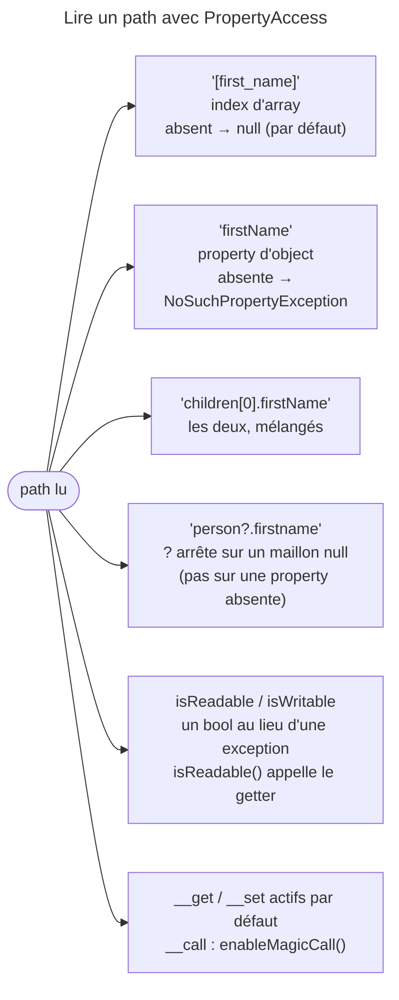

## Objectif

Lire et écrire une valeur désignée par un **path**, et prévoir ce qui se
passe quand ce path n'existe pas.

## L'essentiel

PropertyAccess lit et écrit une valeur désignée par un **path** : les
**crochets** visent un index d'array, le **point** une property d'object.
Le piège central : un path absent rend `null` sur un array, mais **lève** sur
un object — deux défauts opposés, renversables par l'accessor builder.

## Le schéma



## L'exemple : une personne et ses enfants

```php
$propertyAccessor = PropertyAccess::createPropertyAccessor();

$propertyAccessor->getValue($person, 'firstName');
$propertyAccessor->setValue($person, 'children[0].firstName', 'Wouter');
// équivaut à $person->getChildren()[0]->firstName = 'Wouter'

if ($propertyAccessor->isWritable($person, 'children[0].firstName')) {
    // ...
}
```

## Deux notations, deux cibles

| Path | Cible | Résultat |
|---|---|---|
| `a` | array | `NoSuchPropertyException`, qui suggère `[a]` |
| `[x]` | `stdClass` | `NoSuchIndexException` : pas d'`ArrayAccess` |

Écrire dans un array le modifie **par référence** : `setValue($a, '[y]', 2)`
ajoute la key à `$a`. Les conventions d'accessors d'un object sont celles des
forms (lot 07).

## Le path absent : deux comportements opposés

| Cible | Path absent | Pour renverser |
|---|---|---|
| index d'array | rend `null` | `enableExceptionOnInvalidIndex()` → `NoSuchIndexException` |
| property d'object | lève `NoSuchPropertyException` | `disableExceptionOnInvalidPropertyPath()` → `null` |

Le builder n'est pas la seule voie : `new PropertyAccessor()` prend les
mêmes réglages en drapeaux — `THROW_ON_INVALID_INDEX`,
`THROW_ON_INVALID_PROPERTY_PATH`, `MAGIC_CALL` —, et une application les fixe
sous `framework.property_access`. Exécuté avec le seul drapeau
`THROW_ON_INVALID_INDEX` : l'index absent lève, la property absente rend `null`.

Un maillon `null` est un troisième cas : `person.firstname` lève une
`UnexpectedTypeException`, `person?.firstname` rend `null`.

## Demander avant d'appeler

`isReadable()` et `isWritable()` rendent un bool là où `getValue()` et
`setValue()` lèveraient. Elles ne sont pas sans effet :

| Appel | Methods de l'object appelées |
|---|---|
| `isReadable($person, 'firstName')` | `getFirstName()` |
| `isWritable($person, 'firstName')` | aucune |
| `isWritable($person, 'children[0].firstName')` | `getChildren()` |

`isReadable()` lit le path entier ; `isWritable()` lit tout sauf le dernier
maillon, qu'elle examine sans appeler le setter.

## Les methods magiques

`__get()` et `__set()` sont utilisées par défaut ; `__call()` doit être
activée, `enableMagicCall()` : sans elle, une lecture qui ne passe que par
`__call()` lève `NoSuchPropertyException`.

Pour une collection, le couple ajout/retrait l'emporte sur le setter, et seuls
les éléments qui changent sont touchés : `['a']` → `['a', 'b']` appelle
`getChildren()` puis `addChild()`.

## Pièges d'examen

**Un index d'array absent rend `null` ; une property d'object absente lève.**
Les deux défauts sont opposés.

**Les crochets ne sont pas décoratifs** : ils choisissent la cible array.

**`__get()` marche seule ; `__call()` doit être activée.**

**`isReadable()` appelle le getter** — elle ne fait qu'éviter l'exception.

**`?` arrête sur `null`**, pas sur une property absente.

## Application

- Lire un field facultatif dans un array de configuration → `[cle]`, qui
  rend `null` si la key manque.
- Lire une donnée exposée seulement par `__call()` → l'accessor builder et
  `enableMagicCall()`.

## QCM d'entraînement

**Question 1.** `isWritable($person, 'children[0].firstName')` est appelé ;
les accessors journalisent leurs appels. Lequel s'exécute ?

- **A.** `getChildren()`
- **B.** Aucun : `isWritable()` n'appelle rien
- **C.** `setFirstName()` sur l'enfant
- **D.** `getChildren()` puis le setter de l'enfant

<details>
<summary>Correction</summary>

**Bonne réponse : A.** `isWritable()` lit les maillons qui précèdent le
dernier pour l'atteindre ; le dernier est seulement inspecté.

</details>

**Question 2.** `$a = ['x' => 1];` puis `$propertyAccessor->setValue($a, '[y]', 2);`.
Que vaut `$a` ensuite ?

- **A.** `['x' => 1]` : la copie est modifiée, pas `$a`
- **B.** `['y' => 2]` : l'array est remplacé
- **C.** `['x' => 1, 'y' => 2]`
- **D.** Une `NoSuchIndexException` : `y` n'existe pas

<details>
<summary>Correction</summary>

**Bonne réponse : C.** L'array est passé par référence et modifié sur place ;
écrire un index absent l'ajoute, sans exception, aux keys existantes.

</details>

**Question 3.** Dans une application Symfony, où règle-t-on les drapeaux de
l'accessor, comme la levée sur index absent ?

- **A.** `framework.serializer`
- **B.** `framework.property_access`
- **C.** Un compiler pass maison, seul moyen
- **D.** Dans chaque appel à `getValue()`

<details>
<summary>Correction</summary>

**Bonne réponse : B.** La configuration du framework expose ces réglages ;
hors framework, le builder ou les drapeaux du constructor font de même.

</details>

**Question 4.** Une class n'expose `getSecret()` que par `__call()`. Que
rend `getValue($obj, 'secret')` avec un accessor construit par
`createPropertyAccessorBuilder()->enableMagicCall()` ?

- **A.** `null` : la property n'existe pas
- **B.** Une `NoSuchPropertyException`, comme par défaut
- **C.** Une `LogicException` : `__call()` est interdit
- **D.** La valeur rendue par `__call()`

<details>
<summary>Correction</summary>

**Bonne réponse : D.** Une fois activé, `__call()` sert de getter ; sans
cette activation, la lecture lève, alors que `__get()` marche d'office.

</details>

## Fiche express

**Si tu dois retenir seulement 6 choses :**

- **`[index]`** pour un array, **`.property`** pour un object.
- Absent : array → **`null`**, object → **exception** ; le builder renverse.
- `?` arrête sur un maillon **`null`** seulement.
- `isReadable()` / `isWritable()` : un bool ;
  **`isReadable()` appelle le getter**.
- `__get()` / `__set()` par défaut ; **`__call()`** sur activation.
- Collection : ajout/retrait **avant** le setter.

Moyen mnémotechnique : **« Crochet pour l'array, point pour l'object »**.

## Sources officielles

- [`components/property_access.rst`, branche 8.0](https://github.com/symfony/symfony-docs/blob/8.0/components/property_access.rst)
- [`PropertyAccessor`, branche 8.0](https://github.com/symfony/symfony/blob/8.0/src/Symfony/Component/PropertyAccess/PropertyAccessor.php)

