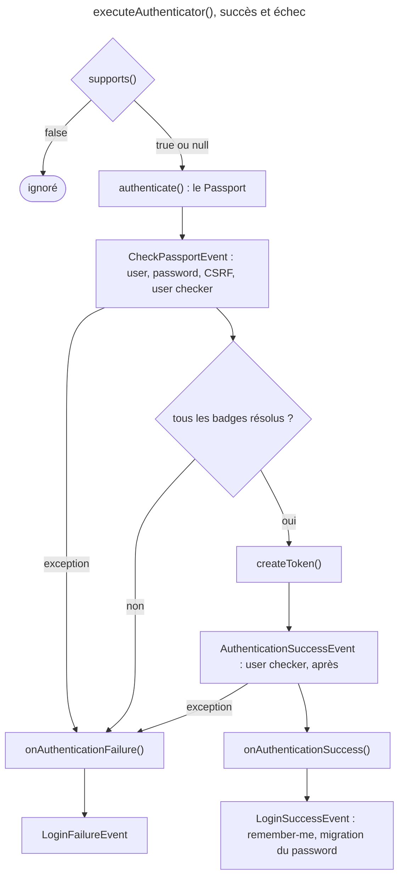

## Objectif

Décrire le flux d'authentication de Symfony 8.0 en nommant correctement
chaque object, savoir lequel construire selon qu'il y a ou non des identifiers
à vérifier, et diagnostiquer un badge qui n'a pas l'effet attendu.

## L'essentiel

Trois objects se partagent l'authentication : l'**authenticator** décide s'il
prend la Request et constitue un dossier, le **passport** ; chaque **badge**
du dossier porte une information ou déclenche une vérification. L'authenticator
ne valide rien lui-même : des listeners vérifient chaque badge.

## Le schéma



Remember-me et rehachage arrivent **après** `onAuthenticationSuccess()`. Une
exception levée dans `authenticate()` mène au même échec que les vérifications.

## L'exemple

```php
class ApiKeyAuthenticator extends AbstractAuthenticator
{
    public function supports(Request $request): ?bool
    {
        return $request->headers->has('auth-token');
    }

    public function authenticate(Request $request): Passport
    {
        $userIdentifier = /* retrouver l'identifier à partir du header */;

        return new SelfValidatingPassport(new UserBadge($userIdentifier));
    }

    public function onAuthenticationSuccess(Request $request, TokenInterface $token, string $firewallName): ?Response
    {
        return null; // la Request continue vers le controller
    }

    public function onAuthenticationFailure(Request $request, AuthenticationException $exception): ?Response
    {
        return new JsonResponse(['message' => strtr($exception->getMessageKey(), $exception->getMessageData())], 401);
    }
}
```

## Les cinq methods de l'authenticator

| Method | Ce qu'elle fait | Retour |
|---|---|---|
| `supports()` | prendre ou non la Request | `true`, `false` ou `null` |
| `authenticate()` | constituer le dossier | un `Passport`, jamais un user ni un bool |
| `createToken()` | transformer le passport validé en token | un `TokenInterface` |
| `onAuthenticationSuccess()` | la suite après succès | une `Response`, ou `null` pour continuer |
| `onAuthenticationFailure()` | la suite après échec | une `Response`, ou `null` pour continuer |

`AbstractAuthenticator` fournit `createToken()` (un `PostAuthenticationToken`) ;
l'ancien `createAuthenticatedToken()` n'existe plus.

## `supports()` : trois retours possibles

- `true` — `authenticate()` est appelé ; `false` — l'authenticator est ignoré ;
- `null` — `authenticate()` « can be called **lazily** when accessing the token
  storage » : seulement si quelqu'un lit le token.
- Ce `null` n'agit que sur un firewall `lazy` **avec état** : avec
  `stateless: true`, `lazy` est ignoré sans avertissement.

## Passport ou SelfValidatingPassport

`Passport` **exige** des credentials :
`__construct(UserBadge $userBadge, CredentialsInterface $credentials, array $badges = [])`.

- Une preuve à contrôler (password, callable) → `Passport` et des credentials.
- Rien à vérifier (token d'API déjà digne de confiance) →
  `SelfValidatingPassport`, qui ne prend que `UserBadge` et les badges.

## Les badges

| Badge | Role |
|---|---|
| `UserBadge` | l'identifier du user — **obligatoire** |
| `PasswordCredentials` | password en clair, vérifié par le hasher |
| `CustomCredentials` | vérification par un callable, qui doit rendre exactement `true` |
| `PasswordUpgradeBadge` | autorise le réencodage du password |
| `RememberMeBadge` | demande le cookie « se souvenir de moi » |
| `CsrfTokenBadge` | fait vérifier un token CSRF |
| `PreAuthenticatedUserBadge` | user authentifié en amont : `checkPreAuth()` n'est pas appelé |

- `UserBadge` accepte un *user loader* ; s'il rend `null`, l'échec est
  **masqué** par défaut en « Invalid credentials. », pour ne pas révéler
  quels users existent ; seule `security.expose_security_errors: all` montre « Username could
  not be found. ».
- Un identifier vide ou de plus de 4096 octets est refusé dès la construction
  (`BadCredentialsException`).
- `CustomCredentials` compare avec `true` au sens strict : `1` échoue.

## Diagnostiquer un badge

- Un badge **non résolu** fait échouer l'authentication : « Security badge …
  is not resolved, did you forget to register the correct listeners? ».
- `RememberMeBadge` est **désactivé** à sa création : il faut le badge, la key
  `remember_me` sur le firewall, et l'activation — `_remember_me` dans la
  Request, `always_remember_me`, ou `enable()`.
- Ordre du diagnostic : `authenticate()` est-il appelé (`supports()`, `lazy`) ?
  L'échec vient-il des vérifications (`CheckPassportEvent`) ? L'effet
  manque-t-il après le succès (`LoginSuccessEvent`) ?

## Pièges d'examen

**`supports()` = `null` n'est pas « redemande-moi »** : c'est l'authentication
lazy, et seulement sur un firewall `lazy` avec état.

**`RememberMeBadge` n'active rien à lui seul** : sans `remember_me` ni
activation, aucun cookie.

**Un badge non résolu est une panne**, pas une permission silencieuse.

**`getUser()` sur un passport sans `UserBadge` lève une `LogicException`** :
erreur de programmation, pas échec de connexion.

**`createToken()`, pas `createAuthenticatedToken()`.**

## Application

- `authenticate()` n'est jamais appelé sur une page qui ne lit pas le user →
  `supports()` rend `null` sur un firewall `lazy` : rendre `true`.
- Le cookie `REMEMBERME` n'est jamais posé → ajouter `remember_me` au firewall
  et activer le badge.

## QCM d'entraînement

**Question 1.** Le user loader d'un `UserBadge` rend `null`. La configuration
`security` ne définit pas `expose_security_errors`. Quelle key de message
reçoit `onAuthenticationFailure()` ?

- **A.** « Username could not be found. »
- **B.** « Invalid credentials. »
- **C.** Aucune : `UserBadge` lève une `LogicException`
- **D.** Aucune : le user reste anonyme, sans échec

<details>
<summary>Correction</summary>

**Bonne réponse : B.** La `UserNotFoundException` est remplacée par une
`BadCredentialsException` tant que `expose_security_errors` ne vaut pas `all` ;
A est la key visible avec `all`.

</details>

**Question 2.** Le callable d'un `CustomCredentials` rend `1` pour un token
valide. Que se passe-t-il ?

- **A.** Succès : `1` est évalué comme vrai
- **B.** Succès, avec un avertissement dans les logs
- **C.** Une `TypeError`, le callable doit déclarer `: bool`
- **D.** L'authentication échoue

<details>
<summary>Correction</summary>

**Bonne réponse : D.** La comparaison avec `true` est stricte : « Credentials
check failed as the callable passed to CustomCredentials did not return
"true". ». Aucun return type n'est imposé au callable.

</details>

**Question 3.** `authenticate()` construit `new UserBadge($email)` avec un field
email vide. Que se passe-t-il ?

- **A.** Le user provider est appelé avec `''`
- **B.** Le user reste anonyme, la page s'affiche
- **C.** Une `BadCredentialsException`, donc un échec
- **D.** Une `LogicException` au moment de `createToken()`

<details>
<summary>Correction</summary>

**Bonne réponse : C.** « Empty user identifier. » est levée dès le constructor
de `UserBadge`, dans `authenticate()`, et mène à `onAuthenticationFailure()`.

</details>

**Question 4.** Une class étend `AbstractAuthenticator`. Quelle method de
l'interface n'a-t-elle **pas** besoin d'écrire ?

- **A.** `supports()`
- **B.** `createToken()`
- **C.** `authenticate()`
- **D.** `onAuthenticationSuccess()`

<details>
<summary>Correction</summary>

**Bonne réponse : B.** `AbstractAuthenticator` implémente `createToken()` et
rend un `PostAuthenticationToken` ; les quatre autres restent à écrire.

</details>

## Fiche express

**Si tu dois retenir seulement 8 choses :**

- **Authenticator** (process) → **passport** (dossier) → **badges** (pièces).
- Cinq methods ; **`createToken()`** fourni par `AbstractAuthenticator`.
- **`supports()` = `null`** : lazy, seulement sur un firewall `lazy` avec état.
- Une preuve à vérifier : **`Passport`** ; aucune : **`SelfValidatingPassport`**.
- **`UserBadge`** obligatoire ; user introuvable **masqué** en « Invalid
  credentials. ».
- **`CustomCredentials`** : `true` strict.
- Badge **non résolu** = échec.
- **`RememberMeBadge`** : badge + `remember_me` + activation.

Moyen mnémotechnique : **« l'authenticator remplit, les listeners vérifient »**.

```text
supports (true/false/null=lazy) → authenticate → Passport(UserBadge, credentials, badges) | SelfValidatingPassport
→ CheckPassportEvent → createToken → onAuthenticationSuccess → LoginSuccessEvent (remember-me) ; échec → onAuthenticationFailure
```

## Sources officielles

- [Custom Authenticators](https://github.com/symfony/symfony-docs/blob/8.0/security/custom_authenticator.rst)
- [Security HTTP 8.0, `AuthenticatorInterface`](https://github.com/symfony/symfony/blob/8.0/src/Symfony/Component/Security/Http/Authenticator/AuthenticatorInterface.php)
- [Security HTTP 8.0, `AuthenticatorManager`](https://github.com/symfony/symfony/blob/8.0/src/Symfony/Component/Security/Http/Authentication/AuthenticatorManager.php)
- [Security HTTP 8.0, `Passport`](https://github.com/symfony/symfony/blob/8.0/src/Symfony/Component/Security/Http/Authenticator/Passport/Passport.php)
- [Security HTTP 8.0, `CustomCredentials`](https://github.com/symfony/symfony/blob/8.0/src/Symfony/Component/Security/Http/Authenticator/Passport/Credentials/CustomCredentials.php)
- [Security HTTP 8.0, `CheckRememberMeConditionsListener`](https://github.com/symfony/symfony/blob/8.0/src/Symfony/Component/Security/Http/EventListener/CheckRememberMeConditionsListener.php)
- [SecurityBundle 8.0, `SecurityExtension`](https://github.com/symfony/symfony/blob/8.0/src/Symfony/Bundle/SecurityBundle/DependencyInjection/SecurityExtension.php)
- [SecurityBundle 8.0, `MainConfiguration`](https://github.com/symfony/symfony/blob/8.0/src/Symfony/Bundle/SecurityBundle/DependencyInjection/MainConfiguration.php)

