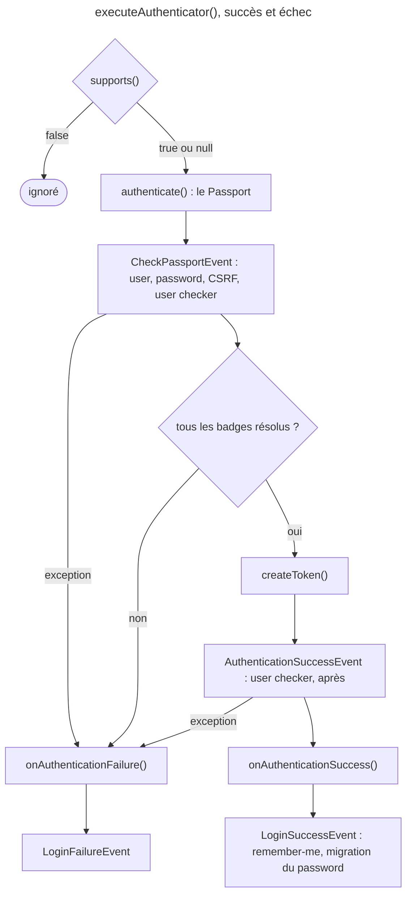

## Objectif

Décrire le flux d'authentication de Symfony 8.0 en nommant correctement
chaque object, savoir lequel construire selon qu'il y a ou non des identifiers
à vérifier, et diagnostiquer un badge qui n'a pas l'effet attendu.

## Avant la règle : le problème à résoudre

Une API reçoit un header `auth-token` ; un form reçoit un email et un
password. Les deux doivent finir sur la même chose : un user connecté, ou un
refus propre. Entre les deux, il faut décider **qui prend la Request**,
**qu'est-ce qui prouve l'identité**, et **qui vérifie la preuve**.

Symfony répartit ce travail entre trois objects :

- **Authenticator** — le *process*. Il décide s'il prend la Request en charge
  et en extrait ce qu'il faut.
- **Passport** — le *dossier* qu'il constitue : qui prétend se connecter, et
  avec quelle preuve.
- **Badge** — une *pièce* de ce dossier. Chaque badge porte une information ou
  déclenche une vérification.

L'authenticator ne valide rien lui-même. Il remplit un dossier ; des listeners
vérifient ensuite chaque pièce.

On suppose connus les firewalls, les users et les user providers.

## Le fil rouge : un authenticator de token d'API

L'exemple de la documentation 8.0, à peine abrégé :

```php
class ApiKeyAuthenticator extends AbstractAuthenticator
{
    public function supports(Request $request): ?bool
    {
        return $request->headers->has('auth-token');
    }

    public function authenticate(Request $request): Passport
    {
        $apiToken = $request->headers->get('auth-token');
        if (null === $apiToken) {
            throw new CustomUserMessageAuthenticationException('No API token provided');
        }

        $userIdentifier = /* retrouver l'identifier à partir du token */;

        return new SelfValidatingPassport(new UserBadge($userIdentifier));
    }

    public function onAuthenticationSuccess(Request $request, TokenInterface $token, string $firewallName): ?Response
    {
        return null; // la Request continue vers le controller
    }

    public function onAuthenticationFailure(Request $request, AuthenticationException $exception): ?Response
    {
        return new JsonResponse(
            ['message' => strtr($exception->getMessageKey(), $exception->getMessageData())],
            Response::HTTP_UNAUTHORIZED,
        );
    }
}
```

Quatre methods écrites, une héritée : `createToken()` vient
d'`AbstractAuthenticator`.

## Le cycle complet en un schéma

Lu dans `AuthenticatorManager::executeAuthenticator()` :



Remember-me et rehachage arrivent donc **après** `onAuthenticationSuccess()`.

Une exception levée **dans** `authenticate()` aboutit au même échec :
l'appel est dans le même `try` que les events. C'est ce qui rend le
`throw new CustomUserMessageAuthenticationException(...)` du fil rouge
suffisant pour produire un 401.

## Les cinq methods de l'authenticator

`AuthenticatorInterface` définit exactement cinq methods :

```php
public function supports(Request $request): ?bool;
public function authenticate(Request $request): Passport;
public function createToken(Passport $passport, string $firewallName): TokenInterface;
public function onAuthenticationSuccess(Request $request, TokenInterface $token, string $firewallName): ?Response;
public function onAuthenticationFailure(Request $request, AuthenticationException $exception): ?Response;
```

| Method | Ce qu'elle fait | Retour |
|---|---|---|
| `supports()` | Prendre ou non la Request | `true`, `false` ou `null` |
| `authenticate()` | Constituer le dossier | un `Passport`, jamais un user ni un bool |
| `createToken()` | Transformer le passport validé en token | un `TokenInterface` |
| `onAuthenticationSuccess()` | Décider de la suite après succès | une `Response`, ou `null` pour continuer |
| `onAuthenticationFailure()` | Décider de la suite après échec | une `Response`, ou `null` pour continuer |

`AbstractAuthenticator` fournit `createToken()` : il construit un
`PostAuthenticationToken` avec le user du passport, le nom du firewall et
`getRoles()`. L'ancien nom `createAuthenticatedToken()` n'existe plus.

## `supports()` : trois retours possibles

- `true` — l'authenticator prend la Request, `authenticate()` est appelé ;
- `false` — il est ignoré ;
- `null` — la documentation de l'interface : « authenticate() can be called
  **lazily** when accessing the token storage ».

`null` ne veut donc pas dire « redemande-moi » : il veut dire « authentifie
seulement si quelqu'un lit le token ». Exécuté avec SecurityBundle 8.0.15, un
authenticator qui journalise ses appels, et `/plain`, une page qui ne lit pas
le user :

| Firewall | `supports()` | `/plain` | `/whoami` (lit le token) |
|---|---|---|---|
| `lazy: true`, avec état | `null` | **`authenticate()` jamais appelé** | appelé |
| `lazy: true`, avec état | `true` | appelé | appelé |
| sans `lazy` | `null` | appelé | appelé |
| `lazy: true`, **`stateless: true`** | `null` | **appelé** | appelé |

La dernière ligne s'explique dans `SecurityExtension` :
`$isLazy = !$firewall['stateless'] && $firewall['lazy']`. Sur un firewall sans
état, `lazy` est ignoré sans avertissement.

## Passport ou SelfValidatingPassport

Le constructor de `Passport` **exige** des credentials :

```php
public function __construct(UserBadge $userBadge, CredentialsInterface $credentials, array $badges = [])
```

Il n'existe donc pas de `Passport` sans credentials. Quand il n'y a rien à
vérifier — token d'API déjà digne de confiance, header signé en amont — c'est
`SelfValidatingPassport` qu'il faut construire ; son constructor ne prend que
`UserBadge` et les badges.

```php
// Formulaire : un password à vérifier, un token CSRF, une case « se souvenir de moi »
return new Passport(
    new UserBadge($email),
    new PasswordCredentials($plaintextPassword),
    [
        new CsrfTokenBadge('authenticate', $csrfToken),
        new RememberMeBadge(),
    ],
);

// Rien à vérifier : le porteur du token est déjà authentifié
return new SelfValidatingPassport(new UserBadge($apiToken));
```

Le choix se fait sur une seule question : **y a-t-il une preuve à contrôler ?**
Oui → `Passport` et des credentials. Non → `SelfValidatingPassport`.

## Les badges

| Badge | Role |
|---|---|
| `UserBadge` | Porte l'identifier user. **Obligatoire.** |
| `PasswordCredentials` | Password en clair, à vérifier par le hasher |
| `CustomCredentials` | Vérification par un callable, qui doit rendre exactement `true` |
| `PasswordUpgradeBadge` | Autorise le réencodage du password |
| `RememberMeBadge` | Demande le cookie « se souvenir de moi » |
| `CsrfTokenBadge` | Fait vérifier un token CSRF |
| `PreAuthenticatedUserBadge` | User déjà authentifié en amont : `checkPreAuth()` n'est pas appelé |

`UserBadge` accepte un *user loader* en second argument, quand le chargement ne
doit pas passer par le provider configuré. S'il rend `null`, `UserBadge`
lève `UserNotFoundException`. Un identifier vide, ou de plus de 4096 octets,
est refusé dès la construction (`BadCredentialsException`).

**Rejoué avec SecurityBundle 8.0.15**, un authenticator dont
`onAuthenticationFailure()` rend `getMessageKey()` et `getMessage()` :

| Situation | Ce que reçoit `onAuthenticationFailure()` |
|---|---|
| `new UserBadge('')` | « Empty user identifier. » |
| identifier de 4097 octets | « Username too long. » |
| user loader qui rend `null`, configuration par défaut | key « Invalid credentials. », message « Bad credentials. » |
| idem, `expose_security_errors: account_status` | key « Invalid credentials. » |
| idem, `expose_security_errors: all` | key « Username could not be found. » |
| callable `CustomCredentials` qui rend `true` | — : 200 |
| callable `CustomCredentials` qui rend `1` ou `false` | « Credentials check failed as the callable passed to CustomCredentials did not return "true". » |

Deux leçons. Un user introuvable est **masqué** par défaut :
`AuthenticatorManager::handleAuthenticationFailure()` remplace l'exception par
une `BadCredentialsException`, « to prevent user enumeration » ; seule l'option
`security.expose_security_errors: all` la laisse passer.
Et `CustomCredentials` compare avec `true` au sens strict : `1` échoue.

Avec `PreAuthenticatedUserBadge`, rejoué : `checkPreAuth()` n'est pas appelé,
mais `checkPostAuth()` l'est toujours, avec le `PostAuthenticationToken`.

## Diagnostiquer un badge

**Un badge non résolu fait échouer l'authentication.** Exécuté, un badge
maison dont `isResolved()` rend `false` : **401**, « Authentication failed:
Security badge "App\…\UnresolvedBadge" is not resolved, did you forget to
register the correct listeners? ».

**`RememberMeBadge` est désactivé à sa création.** Il faut à la fois le badge,
la key `remember_me` sur le firewall, et son activation : parameter
`_remember_me` dans la Request, `always_remember_me`, ou `enable()`. Exécuté :

| Firewall | Badge | `_remember_me` | Cookie `REMEMBERME` |
|---|---|---|---|
| sans `remember_me` | `enable()` | — | aucun |
| `remember_me` | non activé | absent | **effacé** |
| `remember_me` | non activé | `on` | posé |
| `remember_me` | `enable()` | absent | posé |
| `always_remember_me: true` | non activé | absent | posé |

Le diagnostic tient en trois questions, dans l'ordre du schéma :

1. **`authenticate()` est-il appelé ?** Sinon, regarder `supports()` et `lazy`.
2. **L'échec arrive-t-il avant le token ?** Un badge non résolu, des
   credentials refusés ou un `checkPreAuth()` qui lève : `CheckPassportEvent`.
3. **L'effet manque-t-il après le succès ?** Remember-me et rehachage vivent
   sur `LoginSuccessEvent` : vérifier la configuration du firewall et
   l'activation du badge.

## Concrètement dans ton application

- Token d'API déjà fiable : `SelfValidatingPassport(new UserBadge(...))`.
- Form maison : `Passport` + `PasswordCredentials`, et
  `CsrfTokenBadge`.
- Ne prendre que certaines Requests : `supports()` rend `false` pour les
  autres.
- Laisser passer la Request après succès : `onAuthenticationSuccess()` rend
  `null`.
- Cookie « se souvenir de moi » sans checkbox :
  `(new RememberMeBadge())->enable()`, et `remember_me` sur le firewall.
- Message d'erreur pour le user : `CustomUserMessageAuthenticationException`,
  dans `authenticate()`.

## À comprendre

- **Pourquoi un dossier plutôt qu'un bool ?** Chaque vérification — password,
  CSRF, user checker — est un listener distinct ; le passport leur donne un
  object commun à inspecter.
- **Pourquoi un badge non résolu fait-il échouer ?** Un badge exprime une
  exigence. Si aucun listener ne l'a satisfaite, Symfony ne peut pas savoir
  que la vérification a eu lieu : il refuse.
- **Pourquoi masquer le user introuvable ?** « Ce compte n'existe pas » et
  « mauvais password » doivent se ressembler, sinon un attaquant énumère les
  comptes.

## À mémoriser

- **Cinq methods** : `supports`, `authenticate`, `createToken`,
  `onAuthenticationSuccess`, `onAuthenticationFailure`.
- **`authenticate()` → `Passport`** ; `createToken()` vient
  d'`AbstractAuthenticator`.
- **`supports()`** : `true`, `false`, `null` = lazy, seulement avec état.
- **`Passport`** exige des credentials ; sinon **`SelfValidatingPassport`**.
- **`UserBadge`** : seul badge obligatoire ; vide ou > 4096 octets → refusé.
- **Badge non résolu** = échec ; **`RememberMeBadge`** naît désactivé.
- Moyen mnémotechnique : **« l'authenticator remplit, les listeners vérifient »**.

## Pièges d'examen

**`supports()` = `null` n'est pas « redemande-moi »** : c'est l'authentication
lazy, et seulement sur un firewall `lazy` avec état.

**`RememberMeBadge` n'active rien à lui seul** : sans `remember_me` ni
activation, aucun cookie.

**Un badge non résolu est une panne**, pas une permission silencieuse.

**`getUser()` sur un passport sans `UserBadge` lève une `LogicException`** :
erreur de programmation, pas échec de connexion.

**`createToken()`, pas `createAuthenticatedToken()`.**

## Application : trois scénarios

**Scénario 1 — L'API qui ne connecte personne.** Un authenticator de token
rend `null` dans `supports()` sur un firewall `stateless: true`, et l'équipe
s'attend à une authentication lazy. *Solution.* Il n'y en a pas :
sur un firewall sans état, `lazy` est ignoré, `authenticate()` est appelé à
chaque Request. Rendre `true` quand le header est présent, `false` sinon.

**Scénario 2 — Le compte introuvable qui ressemble à un mauvais password.**
Le support se plaint que « Invalid credentials. » s'affiche pour un email
inexistant. *Solution.* C'est le comportement par défaut, voulu ; seul
`expose_security_errors: all` montre « Username could not be found. », au
risque de révéler quels comptes existent.

**Scénario 3 — Le SSO en amont.** Un reverse proxy a déjà authentifié
le user et transmet son identifier. *Solution.*
`SelfValidatingPassport`, avec `PreAuthenticatedUserBadge` si `checkPreAuth()`
ne doit pas s'appliquer ; `checkPostAuth()` reste appelé.

## QCM d'entraînement

Cinq questions sur les authenticators. Choisis avant d'ouvrir la correction.

**Question 1.** Le user loader d'un `UserBadge` rend `null`. La configuration
`security` ne définit pas `expose_security_errors`. Quelle key de message
reçoit `onAuthenticationFailure()` ?

- **A.** « Username could not be found. »
- **B.** « Invalid credentials. »
- **C.** Aucune : `UserBadge` lève une `LogicException`
- **D.** Aucune : le user reste anonyme, sans échec

<details>
<summary>Correction</summary>

**Bonne réponse : B.** Rejoué avec SecurityBundle 8.0.15 : la
`UserNotFoundException` est remplacée par une `BadCredentialsException`, de
key « Invalid credentials. », tant que `expose_security_errors` ne vaut pas
`all`.

A est la key visible avec `expose_security_errors: all`. C confond avec un
passport sans `UserBadge`. D est faux : l'authentication échoue.

</details>

**Question 2.** Le callable d'un `CustomCredentials` rend `1` pour un token
valide. Que se passe-t-il ?

- **A.** Succès : `1` est évalué comme vrai
- **B.** Succès, avec un avertissement dans les logs
- **C.** Une `TypeError`, le callable doit déclarer `: bool`
- **D.** L'authentication échoue

<details>
<summary>Correction</summary>

**Bonne réponse : D.** Rejoué : 401, « Credentials check failed as the
callable passed to CustomCredentials did not return "true". ». Lu dans
`CustomCredentials::executeCustomChecker()`, la comparaison est stricte.

A et B supposent une comparaison souple. C est faux : aucun return type
n'est imposé au callable.

</details>

**Question 3.** Un authenticator ajoute `PreAuthenticatedUserBadge` à son
passport. Quelle method du user checker n'est **pas** appelée ?

- **A.** `checkPreAuth()`
- **B.** `checkPostAuth()`
- **C.** Les deux
- **D.** Aucune : le badge ne concerne que le password

<details>
<summary>Correction</summary>

**Bonne réponse : A.** Lu dans `UserCheckerListener::preCheckCredentials()`,
qui rend la main dès que le badge est présent ; rejoué, `checkPostAuth()` est
appelé avec le `PostAuthenticationToken`.

B et C oublient que le contrôle après authentication reste en place. D est
faux.

</details>

**Question 4.** `authenticate()` construit `new UserBadge($email)` avec un
field email vide. Que se passe-t-il ?

- **A.** Le user provider est appelé avec `''`
- **B.** Le user reste anonyme, la page s'affiche
- **C.** Une `BadCredentialsException`, donc un échec
- **D.** Une `LogicException` au moment de `createToken()`

<details>
<summary>Correction</summary>

**Bonne réponse : C.** Rejoué : « Empty user identifier. », levée dès le
constructor de `UserBadge`, donc dans `authenticate()` ; l'exception mène à
`onAuthenticationFailure()`.

A suppose que le badge accepte la string vide. B et D sont faux.

</details>

**Question 5.** Une class étend `AbstractAuthenticator`. Quelle method de
l'interface n'a-t-elle **pas** besoin d'écrire ?

- **A.** `supports()`
- **B.** `createToken()`
- **C.** `authenticate()`
- **D.** `onAuthenticationSuccess()`

<details>
<summary>Correction</summary>

**Bonne réponse : B.** Lu dans le code 8.0 : `AbstractAuthenticator`
implémente `createToken()` et rend un `PostAuthenticationToken` ; les quatre
autres restent à écrire.

A, C et D sont à écrire dans chaque authenticator.

</details>

## Fiche express

**Si tu dois retenir seulement 7 choses :**

- **Cinq methods** ; `createToken()` est fourni par `AbstractAuthenticator`.
- `authenticate()` rend un **`Passport`**, jamais un user.
- `supports()` à **`null`** = lazy, et seulement sur un firewall avec état.
- **`Passport`** exige des credentials ; sinon **`SelfValidatingPassport`**.
- **`UserBadge`** est le seul badge obligatoire.
- Un **badge non résolu** fait échouer l'authentication.
- **`RememberMeBadge`** naît désactivé : `remember_me` + activation.

**En une phrase, pour tout reconstruire :**

```text
supports (true/false/null=lazy si avec état) → authenticate = Passport (credentials) ou SelfValidatingPassport → badges résolus sinon échec
→ createToken (AbstractAuthenticator) → onAuthenticationSuccess → LoginSuccessEvent : remember-me (badge activé), rehachage
```

## Sources officielles

- [Custom Authenticators](https://github.com/symfony/symfony-docs/blob/8.0/security/custom_authenticator.rst)
- [Security HTTP 8.0, `AuthenticatorInterface`](https://github.com/symfony/symfony/blob/8.0/src/Symfony/Component/Security/Http/Authenticator/AuthenticatorInterface.php)
- [Security HTTP 8.0, `AuthenticatorManager`](https://github.com/symfony/symfony/blob/8.0/src/Symfony/Component/Security/Http/Authentication/AuthenticatorManager.php)
- [Security HTTP 8.0, `Passport`](https://github.com/symfony/symfony/blob/8.0/src/Symfony/Component/Security/Http/Authenticator/Passport/Passport.php)
- [Security HTTP 8.0, `CustomCredentials`](https://github.com/symfony/symfony/blob/8.0/src/Symfony/Component/Security/Http/Authenticator/Passport/Credentials/CustomCredentials.php)
- [Security HTTP 8.0, `CheckRememberMeConditionsListener`](https://github.com/symfony/symfony/blob/8.0/src/Symfony/Component/Security/Http/EventListener/CheckRememberMeConditionsListener.php)
- [SecurityBundle 8.0, `SecurityExtension`](https://github.com/symfony/symfony/blob/8.0/src/Symfony/Bundle/SecurityBundle/DependencyInjection/SecurityExtension.php)
- [SecurityBundle 8.0, `MainConfiguration`](https://github.com/symfony/symfony/blob/8.0/src/Symfony/Bundle/SecurityBundle/DependencyInjection/MainConfiguration.php)
