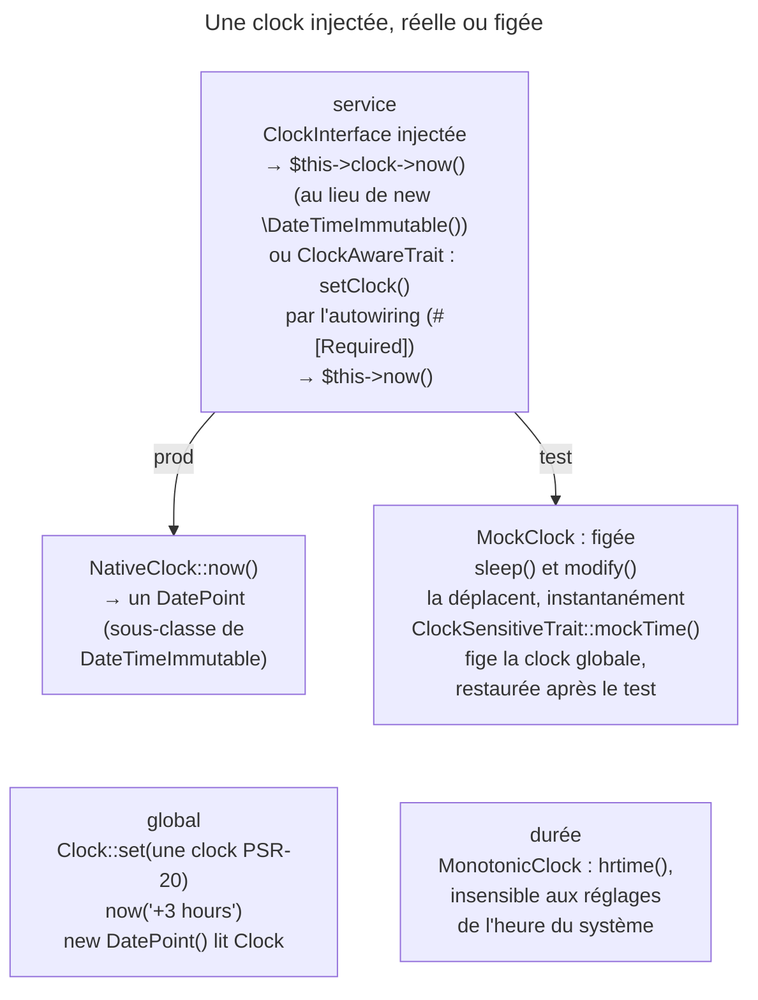

## Objectif

Rendre testable du code qui dépend de l'heure. C'est la raison d'être du
component, énoncée telle quelle par la documentation : **découpler l'application
de la clock système** pour pouvoir figer le temps.

## L'essentiel

Le component Clock existe pour **découpler le code de la clock système** :
un service qui lit l'heure par une `ClockInterface` injectée se teste pour
n'importe quelle date. `NativeClock` en production, `MockClock` en test,
`MonotonicClock` pour chronométrer. Une `MockClock` ne bouge jamais seule.

## Le schéma



## L'exemple : un token qui expire

```php
class ExpirationChecker
{
    public function __construct(private ClockInterface $clock) {}

    public function isExpired(\DateTimeInterface $validUntil): bool
    {
        return $this->clock->now() > $validUntil;
    }
}

$clock = new MockClock('2022-11-16 15:20:00');
$checker = new ExpirationChecker($clock);
$clock->sleep(600);          // 15:30:00, sans attendre
```

## Trois clocks, trois usages

| Implémentation | Ce qu'elle fait | Quand |
|---|---|---|
| `NativeClock` | l'heure système — équivalent à `new \DateTimeImmutable()` | production |
| `MockClock` | une heure figée, déplacée à la main | tests |
| `MonotonicClock` | `hrtime()`, haute résolution et **monotone** | mesurer une durée |

`NativeClock::now()`, comme la function `now()`, rend un **`DatePoint`**,
accepté partout où un `DateTimeImmutable` est attendu. `MonotonicClock` est un
chronomètre : la clock système peut reculer au milieu d'une mesure, elle non.

## Injecter la clock

- Remplacer `new \DateTimeImmutable()` par **`$this->clock->now()`** ; la logique
  ne change pas.
- Variante sans parameter de constructor : **`ClockAwareTrait`**, puis
  `$this->now()`. La documentation attribue l'appel de `setClock()` à
  l'autoconfiguration ; le code le fait par l'**autowiring** (`#[Required]`) :
  injectée avec `autowire` seul, pas avec `autoconfigure` seul. Sans
  injection, `now()` se replie sur la clock globale `Clock`.
- `Clock::set()` accepte toute clock **PSR-20** ; `now('+3 hours')` accepte un
  modificateur ; `new DatePoint()` lit `Clock`, d'où son usage comme default
  value testable.

## Tester

`MockClock` n'avance pas d'elle-même : `sleep(600)` déplace l'heure en 0 seconde
réelle, `modify('+1 day')` accepte les formats de `DateTimeImmutable::modify()`.

`ClockSensitiveTrait::mockTime()` fige la clock globale et la restaure après
chaque test :

| Appel | Résultat |
|---|---|
| `mockTime('1996-07-01')` | une `MockClock` à `1996-07-01 00:00` |
| puis `mockTime('+2 days')` | `1996-07-03` : l'intervalle part de l'heure **déjà figée** |
| `mockTime(false)` | une `NativeClock` |
| test suivant | `Clock::get()` est redevenue une `NativeClock` |

## Pièges d'examen

**`MockClock` n'avance jamais seule.** Sans `sleep()` ni `modify()`, deux appels
à `now()` rendent la même heure.

**`sleep()` ne suspend pas l'exécution** dans une `MockClock` : elle déplace
l'heure simulée instantanément.

**`NativeClock` est l'équivalent de `new \DateTimeImmutable()`** — l'intérêt
n'est pas ce qu'elle rend, c'est qu'on puisse la remplacer.

**`MonotonicClock` sert à mesurer une durée**, pas à connaître la date.

**Deux traits, deux roles** : `ClockAwareTrait` dans le service,
`ClockSensitiveTrait` dans le test.

**`setClock()` est appelé par l'autowiring** (`#[Required]`), pas par
l'autoconfiguration.

**`DatePoint` lit `Clock`** : ce n'est pas un `DateTimeImmutable` ordinaire —
et c'est ce que rendent `NativeClock::now()` et `now()`.

**`mockTime('+2 days')` part de l'heure figée**, pas de l'heure réelle.

## Application

- Tester une offre valable jusqu'au 29 février → une `ClockInterface`
  injectée, et une `MockClock` dans le test.
- Chronométrer un import sans craindre un réglage de la clock →
  `MonotonicClock`.

## QCM d'entraînement

**Question 1.** Dans un test `ClockSensitiveTrait`, que rend
`static::mockTime(false)` ?

- **A.** Une `MockClock` figée à l'heure courante
- **B.** Une `NativeClock`
- **C.** `null` : la clock est désactivée
- **D.** Une `MonotonicClock`

<details>
<summary>Correction</summary>

**Bonne réponse : B.** Le bool fige ou restaure la clock globale ; `false`
rend la clock système, sous la forme d'une `NativeClock`.

</details>

**Question 2.** Que peut-on passer à `Clock::set()` ?

- **A.** Seulement une `MockClock`
- **B.** Une `DatePoint` qui servira de date fixe
- **C.** Une string de date, comme `mockTime()`
- **D.** Toute clock PSR-20

<details>
<summary>Correction</summary>

**Bonne réponse : D.** Le parameter est typé `Psr\Clock\ClockInterface` : une
clock d'une autre bibliothèque peut devenir la clock globale.

</details>

**Question 3.** Laquelle des trois clocks équivaut, en production, à un
`new \DateTimeImmutable()` ?

- **A.** `NativeClock`
- **B.** `MonotonicClock`
- **C.** `MockClock`, sans argument
- **D.** Aucune : `DatePoint` seulement

<details>
<summary>Correction</summary>

**Bonne réponse : A.** Elle rend l'heure système ; son intérêt n'est pas ce
qu'elle rend, mais qu'on puisse la remplacer en test.

</details>

**Question 4.** Sur quoi `MonotonicClock` s'appuie-t-elle pour mesurer une
durée ?

- **A.** `microtime(true)`, la clock système
- **B.** La clock globale `Clock`
- **C.** `hrtime()`
- **D.** `time()`, à la seconde

<details>
<summary>Correction</summary>

**Bonne réponse : C.** `hrtime()` croît régulièrement, sans subir les
ajustements de la clock système qui fausseraient un chronomètre.

</details>

## Fiche express

**Si tu dois retenir seulement 7 choses :**

- But : **découpler du temps système**, pour tester.
- **`NativeClock`** prod, **`MockClock`** test, **`MonotonicClock`** durée.
- `$this->clock->now()` remplace `new \DateTimeImmutable()`.
- `MockClock` **figée** ; `sleep()` et `modify()` instantanés.
- `ClockAwareTrait` : `setClock()` par **l'autowiring**.
- `ClockSensitiveTrait::mockTime()` : string, `DateTimeImmutable`, booléen.
- `DatePoint` lit `Clock` ; `Clock::set()` accepte une clock PSR-20.

Moyen mnémotechnique : **« Injecter l'heure, figer le test »**.

## Sources officielles

- [The Clock Component](https://github.com/symfony/symfony-docs/blob/8.0/components/clock.rst)
- [`ClockAwareTrait`, branche 8.0](https://github.com/symfony/symfony/blob/8.0/src/Symfony/Component/Clock/ClockAwareTrait.php)
- [`NativeClock`, branche 8.0](https://github.com/symfony/symfony/blob/8.0/src/Symfony/Component/Clock/NativeClock.php)
- [`ClockSensitiveTrait`, branche 8.0](https://github.com/symfony/symfony/blob/8.0/src/Symfony/Component/Clock/Test/ClockSensitiveTrait.php)

