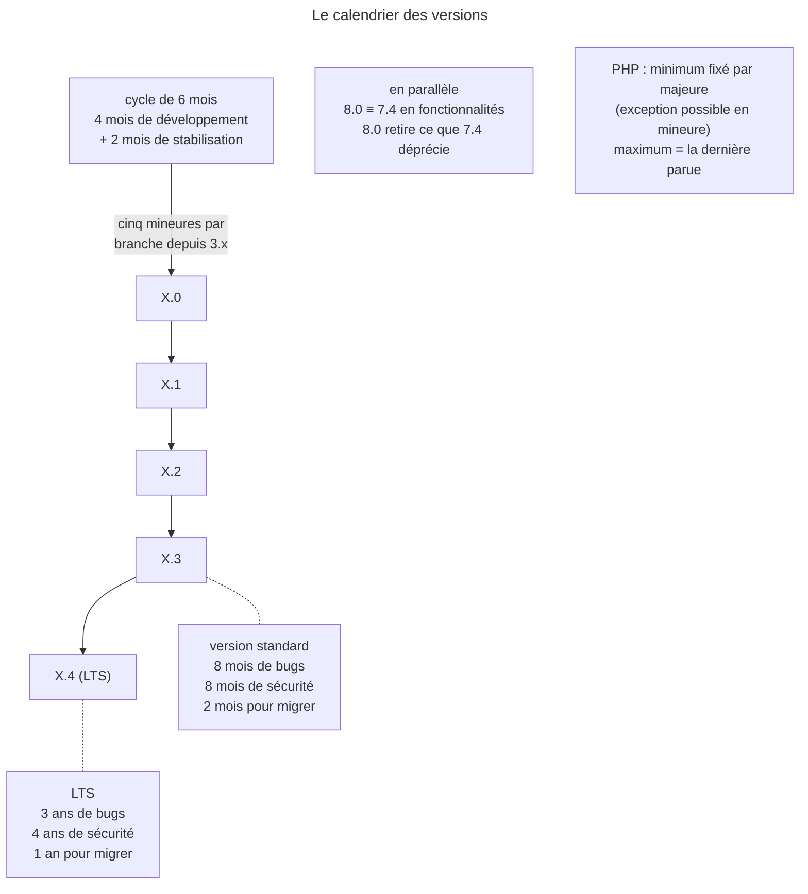

## Objectif

Connaître le calendrier de publication de Symfony et les durées de maintenance.
Ce sont des chiffres : ils se retiennent ou ne se retiennent pas.

## L'essentiel

Symfony publie selon le **temps**, pas selon le contenu : un correctif environ
chaque mois, une mineure tous les **six mois** (mai et novembre), une majeure
tous les **deux ans** (novembre des années impaires). La dernière mineure d'une
branche, X.4, est la LTS. Tout le reste est une affaire de chiffres qui vont
par paires.

## Le schéma

## L'exemple : la branche 7

7.0 sort en novembre 2023 ; 7.1, 7.2 et 7.3 sont standard, maintenues 8 mois ;
7.4, la LTS, sort en novembre 2025 avec 8.0 et reçoit 3 ans de correctifs de
bugs et 4 ans de correctifs de sécurité.

## Le modèle temporel

| Type | Fréquence | Contenu |
|---|---|---|
| **correctif** (7.1.4) | environ tous les mois | corrections de bugs seulement |
| **mineure** (7.1 → 7.2) | tous les **six mois**, en **mai** et en **novembre** | fonctionnalités, deprecations, aucune rupture |
| **majeure** (7.0 → 8.0) | tous les **deux ans**, en **novembre des années impaires** | peut rompre la compatibilité |

**Aucune feuille de route** n'annonce le contenu : le projet est piloté par la
communauté.

## Les six mois d'une version

**Quatre mois** de développement, puis **deux mois** de stabilisation —
corriger, préparer la publication, attendre que l'écosystème suive. Une
fonctionnalité qui n'est pas prête à temps est reportée au cycle suivant.

## LTS et durées de maintenance

Depuis la branche 3.x, une branche majeure compte **cinq** mineures, X.0 à
X.4 ; la **dernière** est la LTS. Une standard est maintenue **8 mois** pour
les bugs comme pour la security ; une LTS **3 ans** pour les bugs, **4 ans**
pour les failles. C'est le *dual maintenance mode* : les uns veulent les
nouveautés vite, les autres la stabilité. Les deux fenêtres de migration le
traduisent : **deux mois** pour passer d'une standard à la suivante, **un an**
pour une LTS.

## Le développement en double

Une majeure se développe en parallèle de la dernière mineure de la branche
précédente : 8.0 et 7.4 ont les **mêmes fonctionnalités**, et ne diffèrent que
par les deprecations, retirées dans 8.0.

Côté PHP, le **minimum** est fixé pour chaque majeure, par consensus de
l'équipe centrale ; par exception, une mineure de Symfony peut relever la
mineure minimale de PHP pour corriger un problème important. Le **maximum** est
la dernière version parue, nouvelles majeures de PHP comprises. Hors support,
les versions de PHP postérieures à la fin de vie « peuvent fonctionner ou non ».

## Pièges d'examen

**Une LTS n'a pas une seule durée, elle en a deux.** Trois ans de correction de
bugs, **quatre** ans de correction de failles : la security continue un an après
l'arrêt des bugs. Une version standard, elle, s'arrête à 8 mois pour les deux.

**Le calendrier est fixe, le contenu ne l'est pas.** Mineures en mai et
novembre, majeures en novembre des années impaires — mais **aucune feuille de
route** n'annonce leur contenu.

**8.0 et 7.4 ont les mêmes fonctionnalités.** Elles ne diffèrent que par les
deprecations, présentes dans l'une, supprimées dans l'autre. Monter en version
majeure n'apporte donc rien de neuf par lui-même.

**« Le minimum PHP est fixé par majeure » souffre une exception.** Une mineure
de Symfony peut relever la **mineure** minimale de PHP si cela aide à corriger
des problèmes importants.

**Durée de maintenance ≠ délai de migration.** Une version standard est
maintenue 8 mois, mais le délai annoncé pour migrer est de **deux mois** ; une
LTS est maintenue 3 ou 4 ans, et le délai est d'**un an**.

## Application

- Une entreprise qui veut migrer le moins souvent possible → une LTS tous les
  deux ans, et un an pour migrer.
- Préparer le passage à 8.0 → éliminer les deprecations sur 7.4.

## QCM d'entraînement

**Question 1.** Depuis quelle branche une majeure compte-t-elle exactement
cinq mineures ?

- **A.** Depuis la branche 2.x
- **B.** Depuis la branche 4.x, avec Flex
- **C.** Depuis toujours
- **D.** Depuis la branche 3.x

Correction

**Bonne réponse : D.** La règle des cinq mineures, de X.0 à X.4 avec la
dernière en LTS, s'applique à partir de la branche 3.x.

**Question 2.** Une fonctionnalité n'est pas prête au bout des quatre mois de
développement. Que devient-elle ?

- **A.** Elle est reportée au cycle suivant
- **B.** La publication est retardée d'un mois
- **C.** Elle sort marquée `@experimental`
- **D.** Elle passe dans un correctif mensuel

Correction

**Bonne réponse : A.** Le calendrier est fixe : la stabilisation commence à
date, et ce qui n'est pas prêt attend la version suivante.

**Question 3.** Une nouvelle majeure de PHP sort pendant la vie d'une version
de Symfony encore maintenue. Est-elle supportée ?

- **A.** Non : seule la prochaine majeure de Symfony
- **B.** Oui
- **C.** Seulement si c'est une LTS
- **D.** Seulement après un relèvement du minimum

Correction

**Bonne réponse : B.** La version maximale de PHP est la dernière publiée :
toute version parue pendant la vie d'une version de Symfony est supportée.

**Question 4.** Une version de Symfony est hors support. Quelle version de PHP
reste supportée ?

- **A.** Celle en vigueur à sa fin de vie
- **B.** Toutes les versions futures de PHP
- **C.** Aucune, dès la fin du support
- **D.** Le minimum fixé à sa publication, seulement

Correction

**Bonne réponse : A.** Le support PHP s'arrête avec elle ; les versions de PHP
plus récentes « may or may not function », sans garantie.

## Fiche express

**Si tu dois retenir seulement 7 choses :**

- Correctif **mensuel** ; mineure en **mai** et **novembre** ; majeure en
  **novembre des années impaires**.
- Cycle : **4 mois** de développement + **2 mois** de stabilisation.
- **Cinq** mineures par branche ; **X.4** est la LTS.
- Standard : **8 / 8 mois** ; LTS : **3 ans** de bugs, **4 ans** de sécurité.
- Migrer : **2 mois** en standard, **1 an** en LTS.
- 8.0 ≡ 7.4, moins les deprecations.
- PHP : minimum par majeure, maximum = la dernière parue.

Moyen mnémotechnique : **« Les chiffres vont par paires »**.

## Sources officielles

- [The Release Process](https://github.com/symfony/symfony-docs/blob/8.0/contributing/code/releases.rst)

