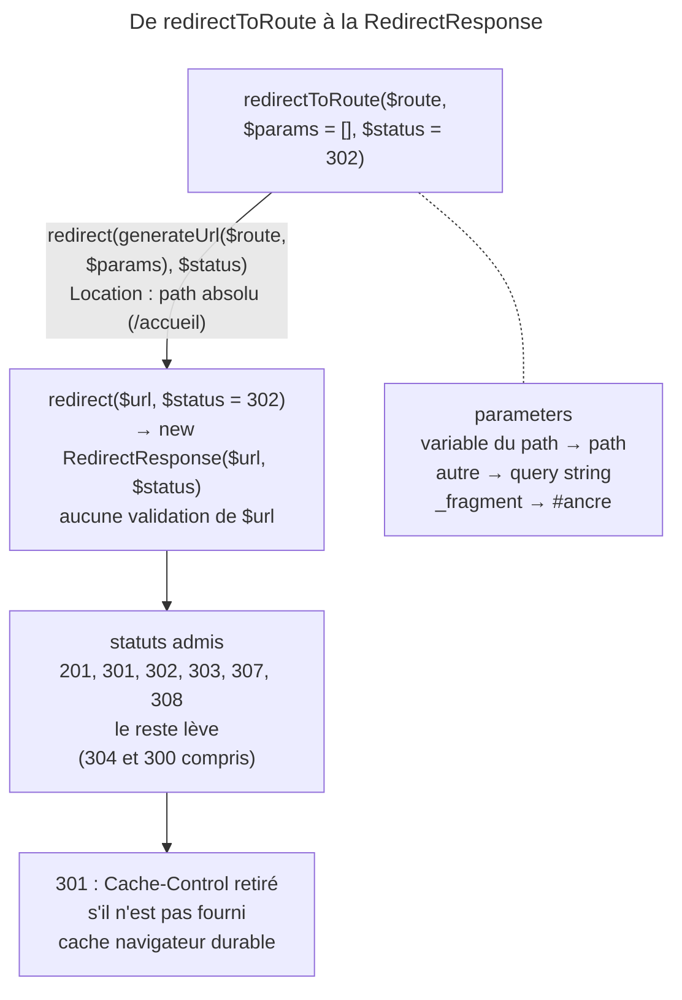

## Objectif

Rediriger le navigateur depuis un controller, et connaître le danger attaché à
l'une des deux methods.

## L'essentiel

Un controller redirige par `redirectToRoute()` (vers une route) ou
`redirect()` (vers une URL). Les deux rendent une `RedirectResponse` : le
navigateur repart, l'URL affichée change. Le statut est **302** par défaut,
seuls six codes sont admis, et `redirect()` ne vérifie jamais sa destination.

## Le schéma



## L'exemple : Post / Redirect / Get

```php
public function save(Request $request): Response
{
    // … enregistrement
    return $this->redirectToRoute('blog_show', ['slug' => $post->getSlug(), '_fragment' => 'comments']);
}
```

## Les deux methods

`redirectToRoute()` est bâtie sur `redirect()` : elle génère l'URL avec
`generateUrl()`, sans type de référence, donc en **path absolu** — `Location`
porte `/accueil`, pas `https://exemple.com/accueil`. Pas de quatrième argument
pour changer cela : une URL complète se construit soi-même, puis passe à
`redirect()`.

## Le statut

Le troisième argument porte le code, **302 par défaut** :
`redirectToRoute('homepage', [], 301)`. Un 301 est mis en cache par le
navigateur, parfois durablement : sans `Cache-Control` fourni, le constructor
retire ce header. Le constructor vérifie le statut par `isRedirect()` : **201,
301, 302, 303, 307 et 308** seulement ; tout autre code — 304, 200 — lève une
`InvalidArgumentException`, comme une URL vide.

## Parameters utiles

- un parameter qui n'est pas une variable du path part en query string :
  `redirectToRoute('blog_show', $request->query->all())` conserve la query
  string d'origine ;
- la key spéciale `_fragment` ajoute une ancre ;
- `$request->attributes->get('_route')` redirige vers la route courante.

## Le danger de `redirect()`

`redirect()` ne vérifie pas sa destination : une valeur venue du user y ouvre
un redirect non validé, vers le domain d'un attaquant. Toute URL redirigée est
validée, ou vient d'une route.

## Pièges d'examen

**Le statut par défaut est 302, pas 301.** Le permanent se demande
explicitement, par le troisième argument — et un 301 mis en cache par le
navigateur est difficile à reprendre.

**304 n'est pas un statut de redirect valide.** Il est dans la plage 3xx,
mais la Response de redirect le refuse et lève.

**`redirectToRoute()` produit un path, pas une URL complète.** Le type de
référence n'est pas exposé.

**Rediriger vers une URL ne valide pas cette URL.** Une destination construite
depuis une entrée user ouvre un redirect non validé.

**Un redirect est une vraie Response HTTP.** Le navigateur repart, l'URL
affichée change, et le controller d'arrivée s'exécute dans une seconde Request —
ce n'est pas un appel interne.

## Application

- Un déplacement définitif de page → `redirectToRoute('…', [], 301)`.
- Un redirect après login vers « la page demandée » → valider la cible,
  jamais un `next` brut.

## QCM d'entraînement

**Question 1.** Que contient le header `Location` de
`$this->redirectToRoute('homepage')` si la route a le path `/accueil` ?

- **A.** `/accueil`
- **B.** `https://exemple.com/accueil`
- **C.** `homepage`, le nom de la route
- **D.** `//exemple.com/accueil`

<details>
<summary>Correction</summary>

**Bonne réponse : A.** L'URL est générée avec le type de référence par défaut,
le path absolu ; rien dans la signature ne permet d'obtenir l'URL complète.

</details>

**Question 2.** La route `blog_show` a le path `/blog/{slug}`. Que produit
`redirectToRoute('blog_show', ['slug' => 'x', 'page' => 3, '_fragment' => 'c'])` ?

- **A.** `/blog/x/3#c`
- **B.** Une exception : `page` n'est pas déclaré
- **C.** `/blog/x?page=3&_fragment=c`
- **D.** `/blog/x?page=3#c`

<details>
<summary>Correction</summary>

**Bonne réponse : D.** Un parameter hors du path part en query string, et la
key spéciale `_fragment` devient l'ancre de l'URL.

</details>

**Question 3.** Que fait `$this->redirect('/a', 300)` ?

- **A.** Un redirect à choix multiples
- **B.** Une exception
- **C.** Un 302, le code étant corrigé
- **D.** Un 300, sans header `Location`

<details>
<summary>Correction</summary>

**Bonne réponse : B.** Une `InvalidArgumentException` : le constructor n'admet
que 201, 301, 302, 303, 307 et 308, et 300, pourtant 3xx, est refusé.

</details>

**Question 4.** Une `RedirectResponse` en 301 est créée sans `Cache-Control`.
Que devient ce header ?

- **A.** `no-cache, private`, comme toute Response
- **B.** `public, max-age=31536000`
- **C.** Il est retiré
- **D.** `no-store`, par security

<details>
<summary>Correction</summary>

**Bonne réponse : C.** Sur un 301 sans `Cache-Control` fourni, le constructor
le retire : le navigateur peut alors garder le redirect longtemps.

</details>

## Fiche express

**Si tu dois retenir seulement 6 choses :**

- `redirectToRoute()` = `redirect(generateUrl())` : un **path absolu**.
- Statut **302** par défaut ; 301 par le **troisième argument**.
- Admis : **201, 301, 302, 303, 307, 308** ; le reste lève.
- Hors path → **query string** ; `_fragment` → **ancre**.
- 301 sans `Cache-Control` : header **retiré**, cache durable.
- `redirect()` **ne valide rien** : jamais d'entrée user brute.

Moyen mnémotechnique : **« 302 par défaut, 301 pour toujours »**.

## Sources officielles

- [Controller, section « Redirecting »](https://github.com/symfony/symfony-docs/blob/8.0/controller.rst)
- [`AbstractController`](https://github.com/symfony/symfony/blob/8.0/src/Symfony/Bundle/FrameworkBundle/Controller/AbstractController.php)
- [`RedirectResponse`](https://github.com/symfony/symfony/blob/8.0/src/Symfony/Component/HttpFoundation/RedirectResponse.php)
- [`Response::isRedirect()`](https://github.com/symfony/symfony/blob/8.0/src/Symfony/Component/HttpFoundation/Response.php)

