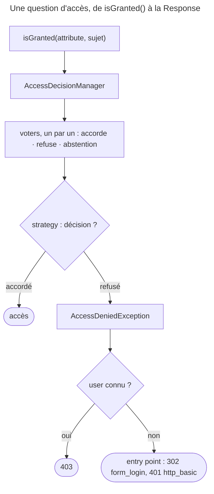

## Objectif

Savoir qui décide qu'un accès est accordé, par quel path, et quelle Response
part quand il est refusé. Les voters eux-mêmes et les strategies ont leur
propre item.

## L'essentiel

L'authorization répond à « avez-vous le **droit** ? », une fois l'identité
connue. Une seule question, `isGranted(attribute, sujet)`, passe par
l'`AccessDecisionManager` : des **voters** votent, une **strategy** tranche, et
un refus devient 401, 302 ou 403 selon que le user est connu.

## Le schéma



## L'exemple

```php
#[Route('/post/{id}/edit')]
public function edit(Post $post): Response
{
    $this->denyAccessUnlessGranted('POST_EDIT', $post);   // verbe métier + sujet
    // ...
}
```

```twig
<a href="/admin">Admin</a>
```

## La question posée

L'authorization s'exprime toujours de la même façon : `denyAccessUnlessGranted()`
et `isGranted()` dans un controller, `Security::isGranted()` dans un service,
`is_granted()` dans Twig.

## Le path

- `isGranted($attribute, $subject)` délègue à l'`AccessDecisionManager`.
- Chaque voter rend : accordé, refusé, ou **abstention**.
- Une **strategy** transforme les votes en décision ; les voters sont consultés
  **un par un**, et la strategy peut s'arrêter avant la fin.

| Strategy, deux voters `A` accorde, `B` refuse | Voters consultés | Décision |
|---|---|---|
| `affirmative` (défaut) | `A` seulement | accordé |
| `consensus` | `A` et `B` | accordé (égalité accordée par défaut) |
| `unanimous` | `A` et `B` | refusé |

En `affirmative`, le journal ne montre que `A.supports(EDIT)` et `A.vote` :
`AffirmativeStrategy::decide()` rend `true` au premier vote favorable. Un role
n'a pas de traitement à part : `RoleVoter` le vote, comme un voter maison vote
`EDIT`.

## Deux familles d'attributes

| Attribute | Portée |
|---|---|
| `ROLE_*` | ce que le user **est** |
| `IS_AUTHENTICATED_FULLY`, `IS_AUTHENTICATED_REMEMBERED`, `PUBLIC_ACCESS` | l'**état** de l'authentication |
| un verbe métier — `EDIT`, `PUBLISH` | ce que le user peut faire **sur un object** |

La troisième famille est la raison d'être des voters : un role ne dit pas
« l'auteur peut modifier **son** article ».

## Le sujet

Le second argument d'`isGranted()` est l'object concerné. Sans lui, un voter qui
exige un `Post` s'abstient ; et quand **tous** s'abstiennent, l'accès est
**refusé**.

## Refuser

`denyAccessUnlessGranted()` lève une `AccessDeniedException`, que le firewall
transforme :

| Situation | Response |
|---|---|
| anonyme, firewall `http_basic` | **401**, `WWW-Authenticate: Basic realm="Secured Area"` |
| anonyme, firewall `form_login` | **302** vers la page de connexion |
| user connu, sans le droit | **403** |

Le status dépend de l'authentication et de l'entry point, pas de
l'authorization.

## Pièges d'examen

**Un role passe par un voter**, comme n'importe quel attribute.

**Tous les voters ne votent pas toujours** : en `affirmative`, le premier
« accordé » arrête la consultation.

**Le statut n'est pas toujours 403** : un anonyme reçoit la Response de l'entry point — redirect pour un form, 401 pour HTTP Basic.

**Sans sujet, un voter d'object ne peut rien décider** et s'abstient.

## Application

- Un `AuditVoter` qui journalise chaque décision ne voit pas toutes les
  Requests → en `affirmative`, la consultation s'arrête au premier « accordé ».
- `isGranted('POST_EDIT')` refuse toujours → le sujet manque : passer `$post`.

## QCM d'entraînement

**Question 1.** Deux voters supportent `EDIT` : le premier accorde, le second
refuserait. Strategy par défaut. Combien de voters votent ?

- **A.** Deux : tous les voters votent toujours
- **B.** Aucun : les votes contraires s'annulent
- **C.** Un seul
- **D.** Deux, et l'accès est refusé à l'égalité

<details>
<summary>Correction</summary>

**Bonne réponse : C.** En `affirmative`, la consultation s'arrête au premier
« accordé » : le second voter n'est même pas interrogé.

</details>

**Question 2.** Avec la strategy `consensus`, un voter accorde, un autre
refuse, aucun réglage particulier. Quelle décision ?

- **A.** Accordé : l'égalité accorde par défaut
- **B.** Refusé : l'égalité refuse par défaut
- **C.** Une exception : un consensus exige une majorité
- **D.** Abstention

<details>
<summary>Correction</summary>

**Bonne réponse : A.** `allow_if_equal_granted_decisions` vaut `true` par
défaut : une égalité entre votes favorables et défavorables accorde.

</details>

**Question 3.** Un voter dont `supports()` exige un `Post` est le seul voter.
Le controller appelle `isGranted('POST_EDIT')`, **sans** sujet. Résultat ?

- **A.** Accordé : aucun voter n'a refusé
- **B.** Une exception : le sujet est obligatoire
- **C.** Le voter vote sur le user seul
- **D.** Refusé

<details>
<summary>Correction</summary>

**Bonne réponse : D.** Le voter s'abstient, et quand tous les voters
s'abstiennent, la décision par défaut est le refus.

</details>

**Question 4.** Un user **anonyme** demande une page qui exige `ROLE_ADMIN`,
sur un firewall `form_login`. Quelle Response ?

- **A.** 302 vers la page de connexion
- **B.** 403
- **C.** 401
- **D.** 200 avec un message d'erreur en page

<details>
<summary>Correction</summary>

**Bonne réponse : A.** L'entry point du form redirige vers la connexion. B est
la Response d'un user connu ; C, celle d'un firewall `http_basic`.

</details>

## Fiche express

**Si tu dois retenir seulement 7 choses :**

- **`isGranted(attribute, sujet)`** partout ; `is_granted()` dans Twig.
- **`AccessDecisionManager`** : voters, puis **strategy**.
- Vote : **accordé**, **refusé**, **abstention**.
- **`affirmative`** (défaut) s'arrête au premier « accordé ».
- Un **role** passe par un voter (`RoleVoter`).
- Sans sujet, un voter d'object **s'abstient** ; tous abstenus : **refus**.
- Refus : **401** ou **302** pour un anonyme (entry point), **403** pour un
  user connu.

Moyen mnémotechnique : **« Demander, voter, trancher, répondre »**.

```text
isGranted → AccessDecisionManager → voters (accordé/refusé/abstention, un par un) → strategy (affirmative par défaut)
→ AccessDeniedException → 401/302 anonyme (entry point), 403 connu
```

## Sources officielles

- [`VoterInterface`, branche 8.0](https://github.com/symfony/symfony/blob/8.0/src/Symfony/Component/Security/Core/Authorization/Voter/VoterInterface.php)
- [`AccessDecisionManager`, branche 8.0](https://github.com/symfony/symfony/blob/8.0/src/Symfony/Component/Security/Core/Authorization/AccessDecisionManager.php)
- [`AffirmativeStrategy`, branche 8.0](https://github.com/symfony/symfony/blob/8.0/src/Symfony/Component/Security/Core/Authorization/Strategy/AffirmativeStrategy.php)
- [Security](https://github.com/symfony/symfony-docs/blob/8.0/security.rst)

