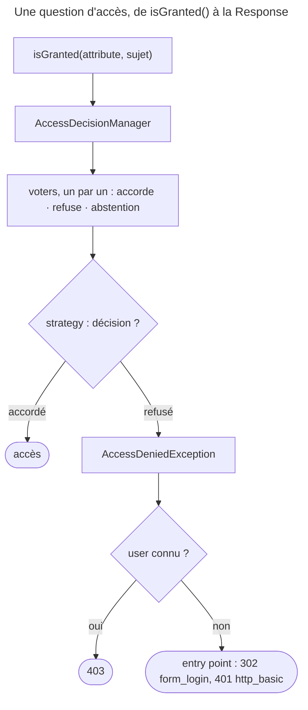

## Objectif

Savoir qui décide qu'un accès est accordé, par quel path, et quelle Response
part quand il est refusé. Les voters eux-mêmes et les strategies ont leur
propre item.

## Avant la règle : le problème à résoudre

Un blog a trois règles :

- seuls les admins voient l'array de bord ;
- une page « Mon compte » exige d'être connecté ;
- un auteur peut modifier **ses** articles, pas ceux des autres.

Les deux premières dépendent de **qui** est le user. La troisième dépend aussi
de **l'object** : le même user a le droit sur un article et pas sur un autre.
Il faut un mécanisme unique qui sache poser ces trois questions, et qui
réponde quelque chose de cohérent quand la réponse est non.

## Le fil rouge : modifier un article

```php
#[Route('/post/{id}/edit')]
public function edit(Post $post): Response
{
    $this->denyAccessUnlessGranted('POST_EDIT', $post);   // verbe métier + sujet
    // ...
}
```

```twig
<a href="/admin">Admin</a>
```

## Le cycle complet en un schéma



## La question posée

L'authorization répond à **« avez-vous le droit ? »**, une fois l'identité
connue. Elle s'exprime toujours de la même façon :

```php
$this->denyAccessUnlessGranted('ROLE_ADMIN');
$this->isGranted('EDIT', $post);
if ($security->isGranted('POST_EDIT', $post)) { }
```

```twig

```

## Le path

`isGranted($attribute, $subject)` délègue à l'`AccessDecisionManager`. Celui-ci
interroge les voters, chacun retournant l'une de trois valeurs : accordé,
refusé, ou **abstention**. Une **strategy** transforme ces votes en décision
unique.

Les voters ne sont pas forcément **tous** interrogés : l'`AccessDecisionManager`
leur demande leur vote **un par un** (un generator), et la strategy peut
s'arrêter avant la fin. Exécuté avec Security Core 8.0.15, deux voters
supportant `EDIT` — le premier accorde, le second refuse :

| Strategy | Voters consultés | Décision |
|---|---|---|
| `affirmative`, le défaut | `A` seulement | accordé |
| `consensus` | `A` et `B` | accordé (égalité, `allow_if_equal_granted_decisions` vrai par défaut) |
| `unanimous` | `A` et `B` | refusé |

Le point à retenir reste que le framework ne compare rien lui-même : un role est
vérifié par un voter comme le reste. `ROLE_ADMIN` n'est pas traité
différemment de `EDIT` — seul le voter qui répond change (`RoleVoter`, exécuté :
`ROLE_USER` accordé à `alice`, `ROLE_ADMIN` refusé).

## Deux familles d'attributes

| Attribute | Portée |
|---|---|
| `ROLE_*` | ce que le user **est** |
| `IS_AUTHENTICATED_FULLY`, `IS_AUTHENTICATED_REMEMBERED`, `PUBLIC_ACCESS` | l'**état** de l'authentication |
| un verbe métier — `EDIT`, `PUBLISH` | ce que le user peut faire **sur un object** |

La troisième famille est la raison d'être des voters : un role ne peut pas
exprimer « l'auteur peut modifier son propre article ».

## Le sujet

Le second argument d'`isGranted()` est l'object concerné. C'est lui qui permet à
un voter de décider au cas par cas ; sans lui, la question ne porte que sur
le user. Exécuté : un voter dont `supports()` exige un `Post` s'abstient sans
sujet, et quand tous s'abstiennent, l'accès est **refusé** ; avec un `Post`, il
vote et accorde.

## Refuser

`denyAccessUnlessGranted()` lève une `AccessDeniedException`. Le firewall la
transforme selon que le user est connu ou non. Exécuté, sur la même action
exigeant `ROLE_ADMIN` :

| Situation | Response |
|---|---|
| anonyme, firewall en `http_basic` | **401**, `WWW-Authenticate: Basic realm="Secured Area"` |
| anonyme, firewall en `form_login` | **302** vers la page de connexion |
| `alice` connue, sans `ROLE_ADMIN` | **403** — « Access Denied. The user doesn't have ROLE_ADMIN. » |

Le status code dépend donc de l'authentication — et, pour un anonyme, de
l'**entry point** du firewall —, pas de l'authorization.

## Concrètement dans ton application

- Une zone réservée à un role : `ROLE_*`, dans `access_control` ou
  `denyAccessUnlessGranted()`.
- Une page qui exige seulement d'être connecté : `IS_AUTHENTICATED_FULLY` ou
  `IS_AUTHENTICATED_REMEMBERED`.
- Un droit sur un object : un verbe métier, le sujet en second argument, et un
  voter qui le traite.
- Un lien à masquer : `is_granted()` dans Twig, avec la même question que le
  controller.

## À comprendre

- **Pourquoi des voters ?** Pour qu'une règle qui dépend de l'object vive dans
  une class testable, et non dans chaque controller.
- **Pourquoi l'abstention ?** Pour qu'un voter qui ne connaît pas une question
  ne la tranche pas par défaut : seuls ceux qui savent votent.
- **Pourquoi un anonyme ne reçoit-il pas 403 ?** Parce qu'on peut encore lui
  proposer de s'identifier : c'est le role de l'entry point.

## À mémoriser

- `isGranted($attribute, $subject)` → `AccessDecisionManager` → voters →
  strategy.
- Voters consultés **un par un** ; `affirmative` s'arrête au premier
  « accordé ».
- Trois familles d'attributes : role, état d'authentication, verbe métier.
- Sans sujet, un voter d'object s'abstient ; abstention de tous → refusé.
- 403 pour un user connu ; pour un anonyme, la Response de l'entry point.
- Moyen mnémotechnique : **« Demander, voter, trancher, répondre »**.

## Pièges d'examen

**Un role passe par un voter**, comme n'importe quel attribute.

**Tous les voters ne votent pas toujours** : en `affirmative`, le premier
« accordé » arrête la consultation.

**Le statut n'est pas toujours 403** : un anonyme reçoit la Response de l'entry point — redirect pour un form, 401 pour HTTP Basic.

**Sans sujet, un voter d'object ne peut rien décider** et s'abstient.

## Application : trois scénarios

**Scénario 1 — Le voter jamais appelé.** Un `AuditVoter` doit journaliser chaque
vote sur `EDIT`, mais ses logs sont vides quand un autre voter accorde avant
lui. *Solution.* En `affirmative`, la consultation s'arrête au premier
« accordé » : le journal ne doit pas dépendre d'un vote, ou la strategy doit
changer.

**Scénario 2 — Le form qui renvoie 302.** Un client API s'étonne de
recevoir un redirect au lieu d'une erreur. *Solution.* Il est anonyme sur
un firewall `form_login` : l'entry point redirige. Un firewall d'API a un entry
point qui répond 401.

**Scénario 3 — Le droit toujours refusé.** `isGranted('POST_EDIT')` refuse
même à l'auteur. *Solution.* Le sujet manque : passer l'article,
`isGranted('POST_EDIT', $post)`, pour que le voter ne s'abstienne pas.

## QCM d'entraînement

Six questions sur l'authorization. Choisis avant d'ouvrir la correction.

**Question 1.** Deux voters supportent `EDIT` : le premier accorde, le second refuserait. Strategy par défaut. Combien de voters votent ?

- **A.** Deux : tous les voters votent toujours
- **B.** Aucun : les votes contraires s'annulent
- **C.** Un seul
- **D.** Deux, et l'accès est refusé à l'égalité

<details>
<summary>Correction</summary>

**Bonne réponse : C.** La consultation s'arrête au premier « accordé » ;
exécuté, `affirmative` ne consulte que `A`, puis accorde.

A est le piège. B et D inventent des règles.

</details>

**Question 2.** Avec la strategy `consensus`, un voter accorde, un autre refuse, aucun réglage particulier. Quelle décision ?

- **A.** Accordé : l'égalité accorde par défaut
- **B.** Refusé : l'égalité refuse par défaut
- **C.** Une exception : un consensus exige une majorité
- **D.** Abstention

<details>
<summary>Correction</summary>

**Bonne réponse : A.** `allow_if_equal_granted_decisions` vaut `true` par
défaut (exécuté).

B inverse la default value. C et D sont faux.

</details>

**Question 3.** Qui vérifie l'attribute `ROLE_ADMIN` passé à `isGranted()` ?

- **A.** Le firewall, avant tout voter
- **B.** Un voter, comme pour tout attribute
- **C.** L'`AccessDecisionManager`, par comparaison directe
- **D.** Le user provider

<details>
<summary>Correction</summary>

**Bonne réponse : B.** `RoleVoter` traite les `ROLE_*` ; le framework ne compare
rien lui-même.

A, C et D supposent un traitement à part pour les roles.

</details>

**Question 4.** Un voter dont `supports()` exige un `Post` est le seul voter. Le controller appelle `isGranted('POST_EDIT')`, **sans** sujet. Résultat ?

- **A.** Accordé : aucun voter n'a refusé
- **B.** Une exception : le sujet est obligatoire
- **C.** Le voter vote sur le user seul
- **D.** Refusé

<details>
<summary>Correction</summary>

**Bonne réponse : D.** Le voter s'abstient, et quand tous s'abstiennent l'accès
est refusé ; exécuté : abstention, puis décision `false`.

A est le piège. B et C sont faux.

</details>

**Question 5.** Un user **anonyme** demande une page qui exige `ROLE_ADMIN`, sur un firewall `form_login`. Quelle Response ?

- **A.** 302 vers la page de connexion
- **B.** 403
- **C.** 401
- **D.** 200 avec un message d'erreur en page

<details>
<summary>Correction</summary>

**Bonne réponse : A.** L'entry point du form redirige (exécuté).

B est la Response d'un user connu. C est celle d'un firewall `http_basic`. D est
faux.

</details>

**Question 6.** `alice`, connectée avec `ROLE_USER`, appelle une action qui fait `denyAccessUnlessGranted('ROLE_ADMIN')`. Quelle Response ?

- **A.** 302 vers la page de connexion
- **B.** 401, avec `WWW-Authenticate`
- **C.** 403
- **D.** 500 : l'exception n'est pas attrapée

<details>
<summary>Correction</summary>

**Bonne réponse : C.** Exécuté : « Access Denied. The user doesn't have
ROLE_ADMIN. ».

A et B sont des Responses d'entry point, pour un anonyme. D : le firewall
attrape l'exception.

</details>

## Fiche express

**Si tu dois retenir seulement 6 choses :**

- **`isGranted(attribute, sujet)`** → `AccessDecisionManager` → **voters** →
  **strategy**.
- Vote : **accorder, refuser, s'abstenir** ; abstention de tous → refusé.
- Voters consultés **un par un** : `affirmative` s'arrête au premier
  « accordé ».
- Un **role passe par un voter** (`RoleVoter`), comme le reste.
- Verbe métier : **passer le sujet**, sinon le voter s'abstient.
- Refus : **403** si connu ; sinon **entry point** (302 form, 401 basic).

**En une phrase, pour tout reconstruire :**

```text
isGranted(attr, sujet) → voters un par un (oui / non / abstention) → strategy
  → refus : AccessDeniedException → connu ? 403 : entry point (302 | 401)
```

## Sources officielles

- [`VoterInterface`, branche 8.0](https://github.com/symfony/symfony/blob/8.0/src/Symfony/Component/Security/Core/Authorization/Voter/VoterInterface.php)
- [`AccessDecisionManager`, branche 8.0](https://github.com/symfony/symfony/blob/8.0/src/Symfony/Component/Security/Core/Authorization/AccessDecisionManager.php)
- [`AffirmativeStrategy`, branche 8.0](https://github.com/symfony/symfony/blob/8.0/src/Symfony/Component/Security/Core/Authorization/Strategy/AffirmativeStrategy.php)
- [Security](https://github.com/symfony/symfony-docs/blob/8.0/security.rst)
