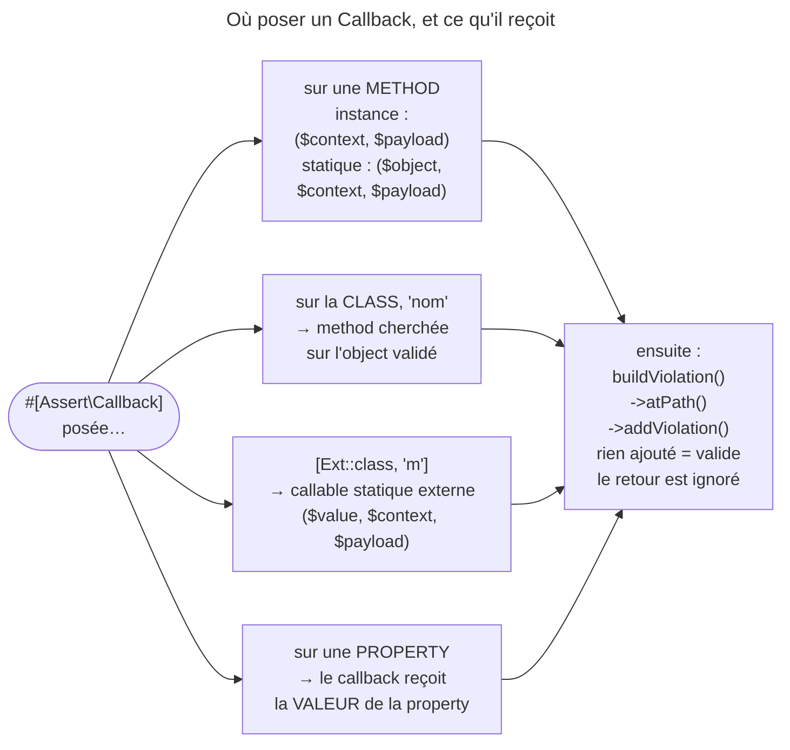

## Objectif

Écrire une règle de validation arbitraire sans créer de class de constraint, et
connaître la signature attendue — elle change selon que la method est
d'instance ou statique.

## L'essentiel

`Callback` fait appeler **ta** method par le validator : elle seule décide
des violations. Deux choses tombent à l'examen : la signature change selon que
la method est d'instance ou **statique**, et la valeur retournée est
**ignorée** — seule une violation ajoutée compte.

## Le schéma



## L'exemple : un `Author`

```php
class Author
{
    public string $firstName = '';
    private array $fakeNames = ['Toto', 'Test', 'Foo'];

    #[Assert\Callback]
    private function validate(ExecutionContextInterface $context, mixed $payload): void
    {
        if (in_array($this->firstName, $this->fakeNames, true)) {
            $context->buildViolation('Ce prénom semble inventé.')
                ->atPath('firstName')
                ->addViolation();
        }
    }
}
```

## Le principe

`Callback` est la porte de sortie quand aucune constraint native n'exprime la
règle, et qu'une class de constraint serait disproportionnée.

- L'attribute se pose sur la method ; sur la class, il nomme la method :
  `#[Assert\Callback(callback: 'validate')]`.
- La method peut être **privée** : elle est appelée, et sa violation remonte.

Elle accepte aussi une **property** : le callback reçoit alors la **valeur** de
la property, et sa violation porte le path de la property. Un nom de method
seul y est cherché sur cette valeur — une string — d'où une
`ConstraintDefinitionException` : « Method "nope" targeted by Callback
constraint does not exist in class "string". ».

## Les deux signatures

| Forme | Signature |
|---|---|
| instance | `validate(ExecutionContextInterface $context, mixed $payload)` |
| statique, closure | `validate(mixed $value, ExecutionContextInterface $context, mixed $payload)` |

Une method statique n'a pas `$this` : l'object validé lui est passé, **en
premier**. `CallbackValidator` teste `isStatic()` et choisit l'appel. Une
method statique écrite avec la signature d'instance lève une `TypeError`, pas
une validation silencieusement fausse.

Le `$payload` est la donnée de l'option `payload`, transmise telle quelle : le
validator ne s'en sert pas.

## Les formes du `callback`

| Valeur de l'option | Où la method est cherchée |
|---|---|
| un nom de method | sur la **valeur validée** — l'object, sur une class |
| `[Classe::class, 'méthode']` | le callable statique désigné, **hors** de la class |
| une closure | appelée avec `($value, $context, $payload)` |

Un nom de method absent lève une `ConstraintDefinitionException`.

## Ce que le callback doit faire

**Ne pas ajouter de violation, c'est dire « valide ».** Pour signaler un
problème : `$context->buildViolation('message')`, puis `->atPath('firstName')`
si la règle vise un field, puis `->addViolation()`. Sans `atPath()`, la
violation est rattachée à l'object : son path vaut `''`.

## Pièges d'examen

**La signature statique commence par la valeur, pas par le contexte** ; la
confondre lève une `TypeError`.

**Le retour est ignoré.** Une règle non respectée doit produire une violation,
pas un `return false`.

**Un nom de method seul est cherché sur la valeur validée** — l'object quand
la constraint est posée sur la class —, jamais ailleurs.

**Posée sur la class, `Callback` voit tout l'object**, ce qui la rend adaptée
aux règles croisées — mais il faut alors `atPath()` pour attribuer
l'erreur au bon field.

## Application

- Une règle partagée par plusieurs entités → une class `ZipChecker` à method
  **statique**, et `[ZipChecker::class, 'check']` ; une vraie constraint si la
  règle se réutilise beaucoup.
- Une date de fin qui doit suivre la date de début → `Callback` sur la class,
  et `atPath('endDate')`.

## QCM d'entraînement

**Question 1.** `#[Assert\Callback]` est posé sur une method **privée** de
l'entité validée. Que se passe-t-il à la validation ?

- **A.** La method est ignorée : le validator ne voit que les methods publiques
- **B.** Une exception : un callback doit être public
- **C.** La method est appelée normalement
- **D.** Elle n'est appelée que si elle est aussi statique

<details>
<summary>Correction</summary>

**Bonne réponse : C.** La visibilité de la method ne compte pas : le validator
l'appelle, et les violations qu'elle ajoute remontent comme les autres.

</details>

**Question 2.** Une method de callback posée sur la class appelle
`buildViolation('…')->addViolation()`, sans `atPath()`. Quel path porte la
violation ?

- **A.** Le nom de la première property déclarée dans la class
- **B.** Le nom de la method de callback qui l'a ajoutée
- **C.** Le nom court de la class validée, en minuscules
- **D.** Un path vide

<details>
<summary>Correction</summary>

**Bonne réponse : D.** Sans `atPath()`, la violation est rattachée à l'object
lui-même ; `atPath()` sert à l'attribuer à un field précis.

</details>

**Question 3.** `#[Assert\Callback('check')]` est posé sur la property
`$email`, une string. Que se passe-t-il à la validation ?

- **A.** `check()` est appelée sur l'object qui porte `$email`
- **B.** Une `ConstraintDefinitionException`
- **C.** Aucune violation : la constraint est ignorée sur une property
- **D.** Une violation « This value is not valid. »

<details>
<summary>Correction</summary>

**Bonne réponse : B.** Sur une property, la valeur validée est la string : un
nom de method seul y est cherché, et la class `string` ne l'a pas.

</details>

**Question 4.** Une method **statique** porte `#[Assert\Callback]` mais garde
la signature `(ExecutionContextInterface $c, mixed $payload)`. Résultat ?

- **A.** Une `TypeError` au premier appel
- **B.** La validation passe en silence : le contexte est ignoré
- **C.** Le validator détecte l'ordre et l'adapte à la déclaration
- **D.** Une violation est ajoutée au path de la method

<details>
<summary>Correction</summary>

**Bonne réponse : A.** L'object validé arrive en premier argument, là où la
method attend un contexte d'exécution : PHP refuse le type.

</details>

## Fiche express

**Si tu dois retenir seulement 6 choses :**

- `Callback` appelle **ta** method ; elle seule décide des violations.
- Instance : `(context, payload)` ; **statique / closure : `(value, context,
  payload)`** — sinon `TypeError`.
- Nom seul : cherché sur la valeur validée ; array : callable statique externe.
- Sur une property, le callback reçoit la **valeur** de la property.
- **Aucune violation = valide** ; `return false` est ignoré.
- `atPath()` pour rattacher l'erreur à un field.

Moyen mnémotechnique : **« Statique, l'object d'abord »**.

## Sources officielles

- [Constraint `Callback`](https://github.com/symfony/symfony-docs/blob/8.0/reference/constraints/Callback.rst)
- [Validator 8.0, `CallbackValidator`](https://github.com/symfony/symfony/blob/8.0/src/Symfony/Component/Validator/Constraints/CallbackValidator.php)

