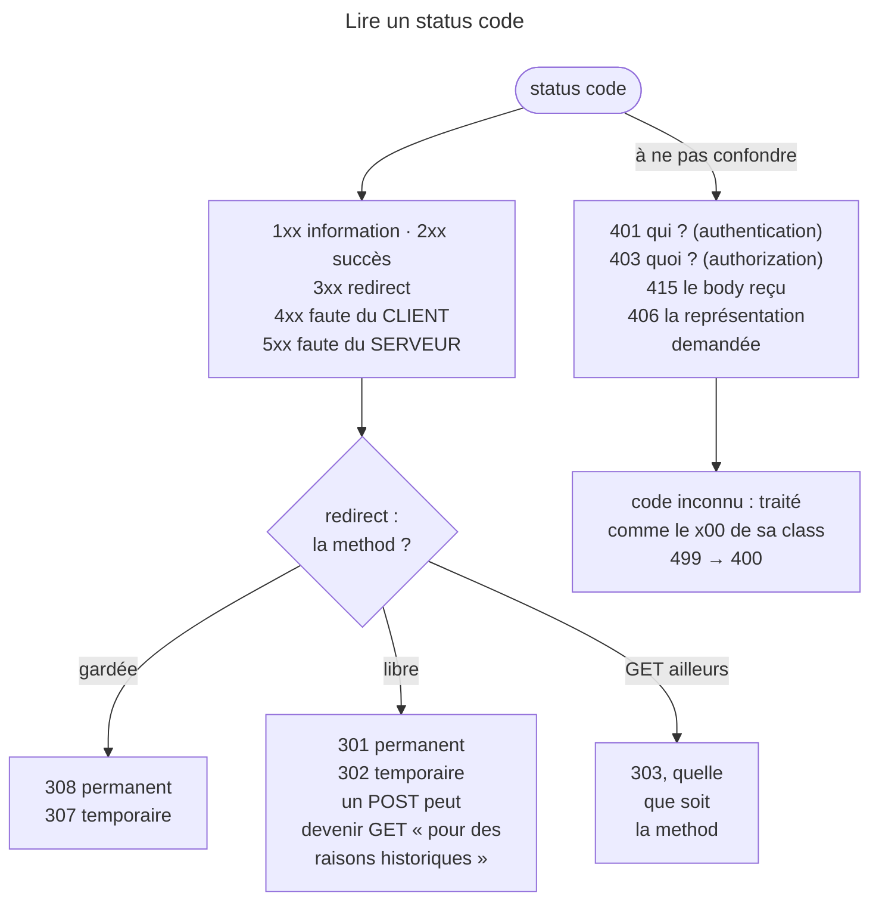

## Objectif

Reconnaître la class d'un status code et les codes qui tombent à l'examen.

## L'essentiel

Un status code se lit d'abord par son **premier chiffre** : il donne la class,
et donc à qui revient la faute. L'examen interroge ensuite quelques paires
qu'on confond : `401` et `403`, les quatre redirects et `303`, `415` et `406`,
`204` et `200`.

## Le schéma



## L'exemple : des constants plutôt que des nombres

```php
use Symfony\Component\HttpFoundation\Response;

return new Response('', Response::HTTP_NO_CONTENT);           // 204
return new Response('', Response::HTTP_PERMANENTLY_REDIRECT); // 308 — pas HTTP_PERMANENT_REDIRECT
```

## Les cinq classes

RFC 9110 §15 définit cinq classes, identifiées par le premier chiffre :

| Class | Sens | Exemple |
|---|---|---|
| `1xx` | Information — Request reçue, traitement continue | `100 Continue` |
| `2xx` | Succès | `200 OK` |
| `3xx` | Redirect — action supplémentaire requise | `301 Moved Permanently` |
| `4xx` | Erreur **client** — la Request est fautive | `404 Not Found` |
| `5xx` | Erreur **serveur** — le serveur a échoué sur une Request valide | `500 Internal Server Error` |

Un client qui reçoit un code inconnu le traite comme le `x00` de sa class :
un `499` est une erreur client générique. Les codes valides vont de 100 à 599 ;
`setStatusCode(600)` lève une `InvalidArgumentException`.

## Les codes qui comptent

| Code | Constant | À retenir |
|---|---|---|
| `201`, `204` | `HTTP_CREATED`, `HTTP_NO_CONTENT` | `204` interdit tout body |
| `301`, `302`, `303`, `304` | `HTTP_MOVED_PERMANENTLY`, `HTTP_FOUND`, `HTTP_SEE_OTHER`, `HTTP_NOT_MODIFIED` | |
| `307`, `308` | `HTTP_TEMPORARY_REDIRECT`, `HTTP_PERMANENTLY_REDIRECT` | method et body gardés |
| `401`, `403`, `404` | `HTTP_UNAUTHORIZED`, `HTTP_FORBIDDEN`, `HTTP_NOT_FOUND` | `401` exige `WWW-Authenticate` |
| `405`, `406`, `415`, `422` | `HTTP_METHOD_NOT_ALLOWED`, `HTTP_NOT_ACCEPTABLE`, `HTTP_UNSUPPORTED_MEDIA_TYPE`, `HTTP_UNPROCESSABLE_ENTITY` | `405` exige `Allow` |

`404` est *heuristically cacheable* (§15.1), comme `405`, `410`, `414` et `501` :
se méfier des « jamais ».

## Pièges d'examen

**401 vs 403.** `401 Unauthorized` signifie « je ne sais pas qui vous êtes » —
authentication manquante ou invalide. `403 Forbidden` signifie « je sais qui
vous êtes, et vous n'avez pas le droit ». Le nom `401` est trompeur : il concerne
l'**authentication**, pas l'authorization.

**301 vs 302 vs 307/308.** `301` et `308` sont permanents, `302` et `307` sont
temporaires. La différence entre l'ancienne et la nouvelle paire tient à la
method : `307` et `308` **préservent la method et le body** de la Request,
alors qu'après `301`/`302` un agent **peut**, « pour des raisons
historiques », changer un `POST` en `GET` (§15.4.2, §15.4.3).

**`303 See Other` n'entre pas dans ce 2×2.** Il demande un `GET` (ou `HEAD`)
sur une autre ressource, quelle que soit la method d'origine : c'est
POST-Redirect-GET, là où `307` rejouerait le `POST`.

**204 vs 200.** `204 No Content` interdit un body ; `200` avec un body vide
n'est pas équivalent.

**`415` et `406` ne parlent pas du même message.** `415 Unsupported Media Type`
porte sur le **corps envoyé** : RFC 9110 §15.5.16 le définit comme le refus de
servir « parce que le contenu est dans un format que cette method ne prend pas
en charge sur la ressource visée ». La cause peut être le `Content-Type`, le
`Content-Encoding`, ou l'inspection directe des données. `406 Not Acceptable`
porte à l'inverse sur la **représentation demandée en retour**.

Le header à joindre suit la même séparation, et c'est le détail qui tranche :
sur un codage non supporté la RFC préconise `Accept-Encoding` en Response, sur un
type de média non supporté elle préconise `Accept`.

**4xx vs 5xx.** Le premier chiffre attribue la faute : au client ou au serveur.

## Application

- Un form POST qui doit finir sur une page de confirmation → `303`.
- Une API qui reçoit du XML alors qu'elle ne lit que du JSON → `415`, avec
  `Accept` dans la Response.

## QCM d'entraînement

**Question 1.** Que fait `$response->setStatusCode(600)` sur HttpFoundation
8.0 ?

- **A.** Il accepte le code, sans texte de statut
- **B.** Il le ramène à `500`, le `x00` de la class
- **C.** Une `InvalidArgumentException`
- **D.** Il le ramène à `599`, la borne haute

<details>
<summary>Correction</summary>

**Bonne réponse : C.** Les codes valides vont de 100 à 599 ; hors de cette
plage, la Response refuse le code au lieu de le corriger en silence.

</details>

**Question 2.** Quelle constant de `Response` vaut `308` ?

- **A.** `HTTP_PERMANENT_REDIRECT`
- **B.** `HTTP_PERMANENTLY_REDIRECT`
- **C.** `HTTP_MOVED_PERMANENTLY`
- **D.** `HTTP_PERMANENT_REDIRECTION`

<details>
<summary>Correction</summary>

**Bonne réponse : B.** Le nom ne reprend pas l'intitulé de la RFC, et
`HTTP_MOVED_PERMANENTLY` vaut `301` ; `HTTP_PERMANENT_REDIRECT` n'existe pas.

</details>

**Question 3.** Une ressource n'accepte que `GET` et reçoit un `DELETE`. Quel
header la RFC impose-t-elle dans la Response `405` ?

- **A.** `Allow`, avec les methods acceptées
- **B.** `WWW-Authenticate`, avec un challenge
- **C.** `Accept`, avec les types acceptés
- **D.** Aucun : le header est facultatif

<details>
<summary>Correction</summary>

**Bonne réponse : A.** Le serveur doit lister les methods que la ressource
accepte ; `WWW-Authenticate` est, lui, exigé avec un `401`.

</details>

**Question 4.** Une Response `404`, sans aucun header de cache, peut-elle être
réutilisée par un cache ?

- **A.** Non : une erreur n'est jamais mise en cache
- **B.** Seulement si elle porte `Expires`
- **C.** Oui : `404` est *heuristically cacheable*
- **D.** Seulement par le navigateur, jamais par un proxy

<details>
<summary>Correction</summary>

**Bonne réponse : C.** La RFC range `404` parmi les codes qu'un cache peut
réutiliser avec une expiration heuristique, comme `405`, `410` et `501`.

</details>

## Fiche express

**Si tu dois retenir seulement 6 choses :**

- Le **premier chiffre** donne la class ; un code inconnu vaut son `x00`.
- `401` = **authentication**, `403` = **authorization**.
- `307`/`308` préservent la method ; `301`/`302` ne la garantissent pas ;
  `303` impose un `GET`.
- `415` = le body reçu, `406` = la représentation demandée.
- `204` interdit un body ; `405` exige `Allow`, `401` `WWW-Authenticate`.
- `Response::HTTP_*` évite les codes magiques — `308` est
  `HTTP_PERMANENTLY_REDIRECT`.

Moyen mnémotechnique : **401 pose « qui ? », 403 pose « quoi ? »** — identité
contre permission.

## Sources officielles

- [RFC 9110 §15 — *Status Codes*](https://github.com/httpwg/httpwg.github.io/blob/master/specs/rfc9110.html#status.codes)
- [RFC 9110 §15.5.16 — *415 Unsupported Media Type*](https://github.com/httpwg/httpwg.github.io/blob/master/specs/rfc9110.html#status.415)
- [`Response`](https://github.com/symfony/symfony/blob/8.0/src/Symfony/Component/HttpFoundation/Response.php) — constantes `HTTP_*` (branche 8.0, `6f841c0`)
