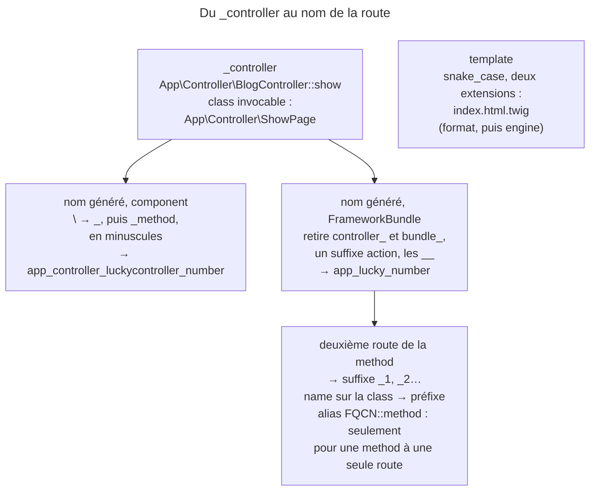

## Objectif

Connaître les conventions propres aux controllers, et savoir lesquelles sont
**obligatoires**. Les conventions générales du framework — casse, préfixes
`Abstract`, suffixes `Interface` et `Trait` — sont traitées dans le lot Symfony
Architecture.

## L'essentiel

Presque rien n'est imposé à un controller : le suffixe `Controller`, la class de
base, l'absence de suffixe `Action` sont des conventions. **Une seule
obligation** : un route name unique. Quand on l'omet, Symfony le génère en deux
couches — le component, puis FrameworkBundle qui le raccourcit — et c'est ce
nom généré que l'examen fait calculer.

## Le schéma



## L'exemple : une route sans nom

```php
namespace App\Controller;

final class LuckyController extends AbstractController
{
    #[Route('/lucky/number')]
    public function number(): Response   // nom généré : app_lucky_number
    {
        // ...
    }
}
```

## Rien n'est imposé, presque

| Élément | Convention | Obligatoire ? |
|---|---|---|
| class de controller | suffixe `Controller` | non |
| method d'action | aucun suffixe `Action` | non — mais le suffixe reste reconnu |
| class de base | étendre `AbstractController` | non |
| template | `snake_case`, deux extensions | non |
| route name | unique dans l'application | **oui** |

Le template porte deux extensions : `index.html.twig`, la première étant le
format produit.

## Le format `_controller`

`App\Controller\BlogController::show` : class pleinement qualifiée, `::`, nom
de method — la string que le router dépose dans l'attribute `_controller`. Pour
une class **invocable**, la class seule suffit.

## Le route name, et qui le génère

Le component Routing, dans `AttributeClassLoader::getDefaultRouteName()`,
remplace les `\` par des `_`, ajoute `_` et le nom de la method, met le tout
**en minuscules**, puis ajoute `_` et `defaultRouteIndex` à partir de la
deuxième route d'une même method. `AttributeRouteControllerLoader`, de
FrameworkBundle, retire ensuite les segments `bundle_` et `controller_`, un
suffixe `action`, et les `__` restants.

| Method | Component seul | Avec FrameworkBundle |
|---|---|---|
| `LuckyController::number` | `app_controller_luckycontroller_number` | `app_lucky_number` |
| `BlogController::showAction` | `app_controller_blogcontroller_showaction` | `app_blog_show` |
| deuxième route de la même method | suffixe `_1` | `app_lucky_number_1` |

Rien ne découpe le `CamelCase` : `LuckyController` devient `luckycontroller`.
Un `name` porté par la class est préfixé. Une method qui ne déclare qu'une
route reçoit en plus l'alias `App\Controller\LuckyController::number`.

## Pièges d'examen

**Le suffixe `Controller` est une convention, pas une constraint** — pas plus
qu'étendre une class de base ne l'est.

**Le nom généré n'est pas du `snake_case`.** Rien ne découpe le `CamelCase` :
`LuckyController` devient `luckycontroller`, pas `lucky_controller`. La lisibilité
de `app_lucky_number` vient du **retrait** du segment `controller_`, pas d'une
conversion de casse. Le `snake_case` est recommandé pour les **templates**.

**Sans FrameworkBundle, le nom généré reste celui du component.** Le nom court
est un apport du bundle.

**Une deuxième route sur la même method ne collisionne pas** : elle reçoit un
suffixe numérique, `_1`, `_2`…

**Le suffixe `Action` n'est plus utilisé, mais il est encore reconnu** : le
loader du bundle le retire du nom généré.

## Application

- Générer l'URL d'une route sans nom explicite → le nom généré, ou l'alias
  `FQCN::méthode`.
- Plusieurs routes vers la même action → elles reçoivent `_1`, `_2`.

## QCM d'entraînement

**Question 1.** Avec FrameworkBundle, quel nom reçoit la route sans `name` de
`App\Controller\AdminController::index` ?

- **A.** `admin_index`
- **B.** `app_admin_controller_index`
- **C.** `app_admin_index`
- **D.** `app_controller_admincontroller_index`

<details>
<summary>Correction</summary>

**Bonne réponse : C.** Le component produit le nom long en minuscules ; le
loader du bundle en retire le segment `controller_`.

</details>

**Question 2.** La class `BlogController` porte `#[Route(name: 'blog_')]`, et
sa method `list()` une route sans nom. Quel nom obtient-elle ?

- **A.** `blog_list`
- **B.** `blog_app_blog_list`
- **C.** `app_blog_list`
- **D.** `app_blog_blog_list_1`

<details>
<summary>Correction</summary>

**Bonne réponse : B.** Le `name` de la class est un préfixe, posé devant le nom
généré complet, qui garde son `app_blog_list`.

</details>

**Question 3.** Une method porte deux attributes `#[Route]` sans nom.
Reçoit-elle l'alias `App\Controller\LuckyController::twice` ?

- **A.** Oui, sur la première route
- **B.** Oui, sur les deux routes
- **C.** Non : une erreur de doublon de nom
- **D.** Non : une route seulement

<details>
<summary>Correction</summary>

**Bonne réponse : D.** L'alias fondé sur le nom pleinement qualifié n'est
ajouté que pour une method qui ne déclare qu'une route ; ici, deux noms suffixés.

</details>

**Question 4.** Que désigne `html` dans `index.html.twig` ?

- **A.** Le format produit par le template
- **B.** L'engine de rendu
- **C.** Le domain de translation
- **D.** Rien : une simple convention de nom

<details>
<summary>Correction</summary>

**Bonne réponse : A.** La première extension dit ce que le template produit,
la seconde quel engine le rend ; la documentation recommande les deux.

</details>

## Fiche express

**Si tu dois retenir seulement 6 choses :**

- **Une seule obligation** : un route name unique.
- `Controller`, `AbstractController`, pas d'`Action` : des **conventions**.
- `_controller` = `FQCN::méthode`, ou le **FQCN seul** si invocable.
- Nom généré : component en **minuscules**, sans découpe du CamelCase.
- FrameworkBundle retire **`controller_`** et `action` → `app_lucky_number`.
- Deuxième route : **`_1`** ; alias FQCN seulement pour **une** route.

Moyen mnémotechnique : **« S'il contient controller, c'est le component nu »**.

## Sources officielles

- [Controller, section « A Basic Controller »](https://github.com/symfony/symfony-docs/blob/8.0/controller.rst)
- [Routing, génération d'URL et alias de route](https://github.com/symfony/symfony-docs/blob/8.0/routing.rst)
- [`AttributeClassLoader` (component Routing)](https://github.com/symfony/symfony/blob/8.0/src/Symfony/Component/Routing/Loader/AttributeClassLoader.php)
- [`AttributeRouteControllerLoader` (FrameworkBundle)](https://github.com/symfony/symfony/blob/8.0/src/Symfony/Bundle/FrameworkBundle/Routing/AttributeRouteControllerLoader.php)
- [Templates, section « Template Naming »](https://github.com/symfony/symfony-docs/blob/8.0/templates.rst)

