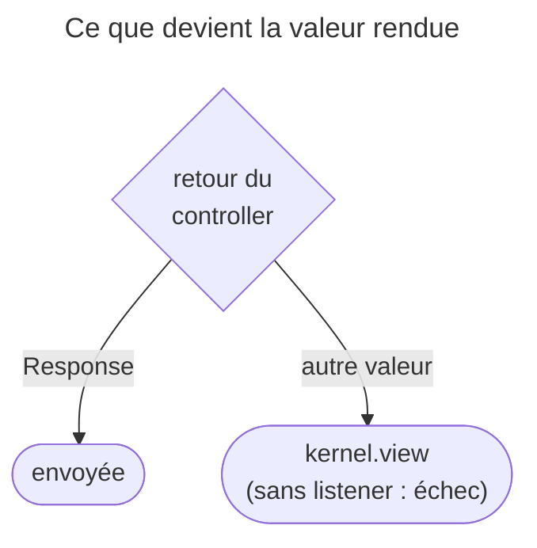
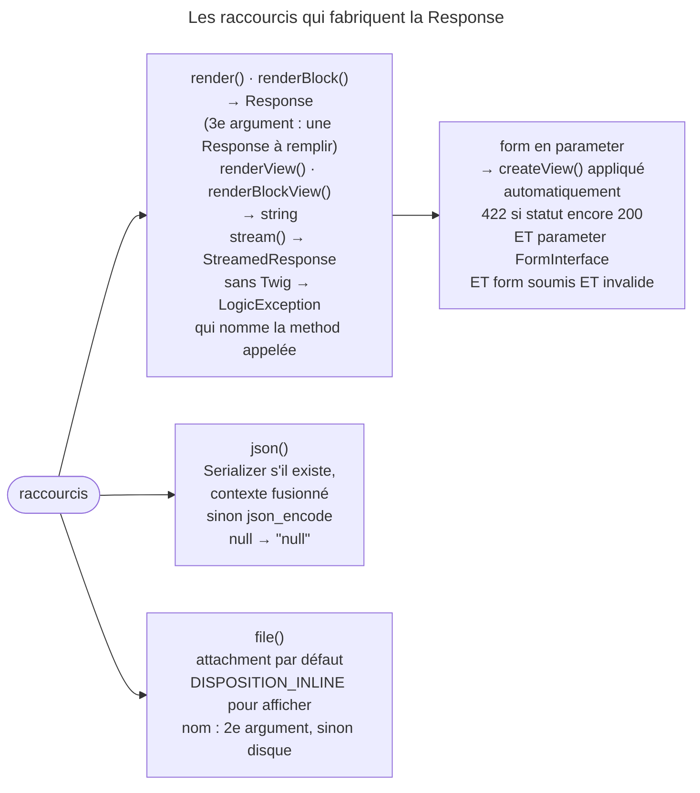

## Objectif

Produire la Response depuis un controller, et choisir le bon raccourci. Le
catalogue des sous-classes de `Response` et les methods de test de statut
appartiennent au lot HTTP.

## L'essentiel

Un controller retourne une `Response` ; sinon, `kernel.view` doit convertir la
valeur. Les raccourcis d'`AbstractController` se distinguent par leur return
type : `render()` rend une **Response**, `renderView()` une **string**,
`file()` une `BinaryFileResponse` qui **télécharge** par défaut. Le piège
central est le **422** automatique, qui exige trois conditions à la fois.

## Le schéma





## L'exemple : un form, deux issues

```php
public function new(Request $request): Response
{
    $form = $this->createForm(PostType::class)->handleRequest($request);
    if ($form->isSubmitted() && $form->isValid()) {
        // … enregistrement
        return $this->redirectToRoute('post_index');
    }

    // 200 au premier affichage, 422 si soumis et invalide
    return $this->render('post/new.html.twig', ['form' => $form]);
}
```

## La règle

Un controller doit retourner un object `Response`. S'il retourne autre chose,
l'event `kernel.view` est dispatché pour convertir la valeur ; sans listener
capable de le faire, la Request échoue.

## Rendre un template

| Method | Retourne |
|---|---|
| `render()`, `renderBlock()` | un object `Response` |
| `renderView()`, `renderBlockView()` | une **string** |
| `stream()` | une `StreamedResponse`, envoyée au fil du rendu |

Le troisième argument de `render()` est une `Response` déjà construite, dont il
remplit le contenu : c'est ainsi qu'on impose un autre statut. Sans le bundle
Twig, ces methods lèvent une `LogicException` qui nomme la method appelée et le
package à installer.

**Un form est converti pour vous.** Chaque parameter `FormInterface` est
remplacé par son `createView()` avant le rendu : l'appeler à la main est
redondant, pas faux.

**Le 422 automatique tient à trois conditions** : la Response est encore en
**200**, un parameter est un `FormInterface`, et ce form est **soumis et
invalide**. Un statut explicite l'emporte ; un form jamais soumis laisse le
200. `renderBlock()` suit la même règle.

## JSON

`json()` retourne une `JsonResponse`. Avec le Serializer, le contexte est
fusionné par-dessus les options d'encoding par défaut : c'est par lui qu'on les
change. Sans Serializer, `json_encode` sert, et une donnée `null` donne la
string `null`.

## Servir un file

`file()` retourne une `BinaryFileResponse` en disposition `attachment` : le
navigateur télécharge. Pour afficher dans la page, il faut
`ResponseHeaderBag::DISPOSITION_INLINE`. Le deuxième argument renomme le file
vu par le user ; omis, c'est le nom réel sur disque. Le header de disposition
est écrit dans tous les cas.

## Pièges d'examen

**Deux methods de rendu, deux return types.** L'une retourne une `Response`
prête à être retournée par le controller, l'autre une simple string. Retourner
la string depuis un controller déclenche `kernel.view`, et sans listener pour
la convertir, la Request échoue.

**Le 422 n'est pas inconditionnel.** Il faut un statut encore à 200, un
parameter `FormInterface`, et un form **soumis** *et* invalide. Un statut
explicite l'emporte ; un form non soumis ne déclenche rien.

**Servir un file télécharge par défaut.** L'affichage dans la page demande de
changer explicitement la disposition.

**Sans Twig, le rendu lève.** La `LogicException` nomme la method et le package
manquant ; ce n'est pas une Response vide.

## Application

- Le HTML d'un template doit devenir le body d'un email → `renderView()`.
- Une page de form doit répondre 400 quoi qu'il arrive → passer
  `new Response(null, 400)` en troisième argument.

## QCM d'entraînement

**Question 1.** Un form soumis et **valide** est passé à `render()`, sans
Response en troisième argument. Quel statut sort ?

- **A.** 200
- **B.** 422, le form ayant été soumis
- **C.** 201, une ressource créée
- **D.** 302, vers la même page

<details>
<summary>Correction</summary>

**Bonne réponse : A.** La promotion en 422 exige un form soumis **et**
invalide ; un form valide laisse le statut par défaut.

</details>

**Question 2.** Sans component Serializer, que contient le body de
`$this->json(null)` ?

- **A.** `{}`
- **B.** `null`
- **C.** Un body vide
- **D.** `[]`

<details>
<summary>Correction</summary>

**Bonne réponse : B.** Le raccourci traite `null` à part et passe la string
`null` déjà encodée ; une `JsonResponse` construite avec `null` aurait rendu `{}`.

</details>

**Question 3.** `renderBlock()` reçoit un form soumis et invalide, sans
Response en troisième argument. Quel statut sort ?

- **A.** 200 : seul `render()` promeut le statut
- **B.** 400
- **C.** 422
- **D.** Une `LogicException`

<details>
<summary>Correction</summary>

**Bonne réponse : C.** `render()` et `renderBlock()` passent par le même code
interne, qui applique la même promotion en 422.

</details>

**Question 4.** Un controller retourne `$this->file('/var/data/f81c.pdf')`
sans autre argument. Quel nom de file le navigateur propose-t-il ?

- **A.** `download.pdf`
- **B.** Aucun : pas de header de disposition
- **C.** Le nom de la route courante
- **D.** `f81c.pdf`

<details>
<summary>Correction</summary>

**Bonne réponse : D.** Sans deuxième argument, la disposition annonce le nom
réel du file sur disque, en mode `attachment`.

</details>

## Fiche express

**Si tu dois retenir seulement 6 choses :**

- Retourner une `Response`, sinon **`kernel.view`** doit convertir.
- `render()` → **Response**, `renderView()` → **string**.
- Form en parameter : **`createView()`** automatique.
- 422 : statut **200** + `FormInterface` + **soumis et invalide** ; statut explicite gagnant.
- `json()` : Serializer si présent, contexte = **options d'encoding** ; `null` → `null`.
- `file()` : **attachment** par défaut, `DISPOSITION_INLINE` pour afficher.

Moyen mnémotechnique : **« View, c'est la vue seule : une string »**.

## Sources officielles

- [AbstractController, branche 8.0](https://github.com/symfony/symfony/blob/8.0/src/Symfony/Bundle/FrameworkBundle/Controller/AbstractController.php)
- [Controller, « Returning JSON Response »](https://github.com/symfony/symfony-docs/blob/8.0/controller.rst)

