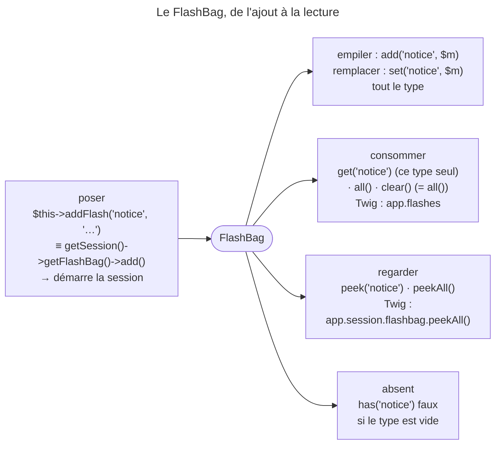

## Objectif

Poser un flash message, savoir où il est stocké et quand il disparaît.

## L'essentiel

Un flash message est un message de **session** utilisé une seule fois : il
disparaît dès qu'il est lu. C'est l'outil du *Post / Redirect / Get* : traiter,
poser un message, rediriger, l'afficher. Tout tient dans la différence entre ce
qui **consomme** et ce qui **regarde** — et entre `add()`, qui empile, et
`set()`, qui écrase.

## Le schéma



## L'exemple : après un enregistrement

```php
public function edit(Request $request): Response
{
    // … traitement du form
    $this->addFlash('notice', 'Vos modifications ont été enregistrées.');

    return $this->redirectToRoute('app_post_show', ['id' => $post->getId()]);
}
```

## Ce que c'est

Un message stocké en **session**, consommé à la première lecture. Poser un
flash **démarre la session** : il n'y a pas de flash sans cookie de session. Le
type — `notice`, `warning`, `error` — est une string libre.

## Poser

`addFlash()` équivaut strictement à
`$request->getSession()->getFlashBag()->add()`. Il **lève** une
`LogicException` si les sessions sont désactivées, ou si la session
n'implémente pas `FlashBagAwareSessionInterface`. Le sac expose aussi `set()`,
qui remplace tout le type : deux `add()` puis un `set()` ne laissent que le
dernier message.

## Lire, et le piège

| Method | Effet |
|---|---|
| `get('warning')` / `all()` | retourne les messages **et les consomme** |
| `peek('warning')` / `peekAll()` | retourne les messages **sans** les consommer |

`get()` ne vide que son type, `all()` vide tout ; `clear()` est un alias de
`all()` — elle vide **et retourne**. Un type présent mais vide compte pour
absent : `has()` répond `false`, et `get()` rend sa default value.

## Pièges d'examen

**Lire un flash le consomme.** Afficher les messages deux fois dans la même page
par le path ordinaire en fait disparaître la moitié : la seconde lecture ne
trouve plus rien. La consultation sans consommation existe, c'est une autre
method.

**`set()` n'ajoute pas, elle remplace.** Deux `add()` puis un `set()` ne laissent
qu'un message. Seul `add()` empile.

**`clear()` retourne les messages qu'elle efface.** Ignorer sa return value
jette les messages.

**`get()` ne vide que son type.** Vider tout demande `all()`.

**Poser un flash démarre la session.** Le flash message *est* de la session ; il
n'y a pas de flash sans cookie de session.

**Le type du message est libre.** `notice`, `warning`, `error` sont des usages,
pas une enum imposée par le framework.

## Application

- Afficher les flashs dans le header **et** dans le body → `peekAll()` en haut,
  `app.flashes` une seule fois.
- Confirmer un enregistrement avant un redirect → `addFlash()`.

## QCM d'entraînement

**Question 1.** Le code appelle `add('notice', 'a')`, `add('notice', 'b')`,
puis `set('notice', 'X')`. Que contient le type `notice` ?

- **A.** `['a', 'b', 'X']`
- **B.** `['X']`
- **C.** `['a', 'b']` : `set()` est ignoré
- **D.** `'X'`, une string seule

<details>
<summary>Correction</summary>

**Bonne réponse : B.** `set()` remplace tout le type par les messages qu'on lui
passe, mis en array ; seul `add()` empile.

</details>

**Question 2.** Le sac porte un `notice` et un `warning`. Le code lit
`get('notice')`. Que devient le `warning` ?

- **A.** Il reste en place
- **B.** Il est consommé avec le reste
- **C.** Il est déplacé sous `notice`
- **D.** Une exception : un seul type par lecture

<details>
<summary>Correction</summary>

**Bonne réponse : A.** `get()` ne retire que la key demandée ; c'est `all()`
qui vide l'ensemble du sac.

</details>

**Question 3.** Le type `notice` existe, mais son array est vide. Que répond
`has('notice')` ?

- **A.** `true` : la key existe
- **B.** `null`
- **C.** `false`
- **D.** Une `LogicException`

<details>
<summary>Correction</summary>

**Bonne réponse : C.** `has()` exige une key présente **et** un array non vide ;
un type vidé compte pour absent.

</details>

**Question 4.** Les sessions sont désactivées dans `framework.yaml`, et un
controller appelle `addFlash()`. Que se passe-t-il ?

- **A.** Rien : le message est perdu en silence
- **B.** Le message est gardé en mémoire pour la Request
- **C.** Une session est démarrée malgré tout
- **D.** Une `LogicException`, qui dit quoi activer

<details>
<summary>Correction</summary>

**Bonne réponse : D.** Le raccourci préfère échouer bruyamment : son message
indique qu'il faut activer les sessions dans `config/packages/framework.yaml`.

</details>

## Fiche express

**Si tu dois retenir seulement 6 choses :**

- Flash = **session**, lu une fois ; poser un flash **démarre** la session.
- `addFlash()` ≡ `getFlashBag()->add()`, et **lève** sans session.
- `add()` **empile**, `set()` **écrase** le type.
- `get()` / `all()` / `clear()` **consomment** ; `peek()` / `peekAll()` non.
- `get()` vide **son type** ; `clear()` vide et **retourne**.
- Type vide = **absent** pour `has()`.

Moyen mnémotechnique : **« Peek regarde, le reste consomme »**.

## Sources officielles

- [Sessions, section « Flash Messages »](https://github.com/symfony/symfony-docs/blob/8.0/session.rst)
- [`FlashBag`](https://github.com/symfony/symfony/blob/8.0/src/Symfony/Component/HttpFoundation/Session/Flash/FlashBag.php)
- [`AbstractController::addFlash()`](https://github.com/symfony/symfony/blob/8.0/src/Symfony/Bundle/FrameworkBundle/Controller/AbstractController.php)

