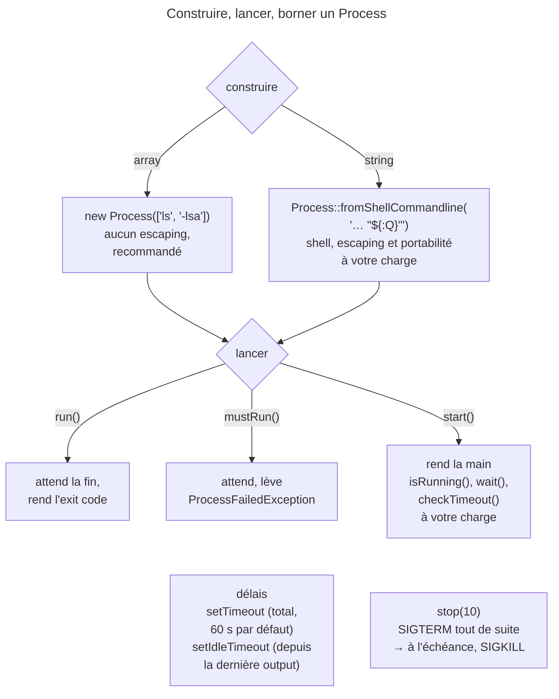

## Objectif

Exécuter un programme externe, savoir quand l'appel rend la main, et savoir ce
qui l'interrompt.

## L'essentiel

`Process` exécute un programme externe dans un sous-processus, en gérant les
différences entre systèmes et l'escaping des arguments ; il remplace
`exec()`, `passthru()`, `shell_exec()` et `system()`. Trois questions décident
de tout : la forme de la command (array ou string), le moment où l'appel rend
la main, et ce qui l'interrompt — deux délais et `stop()`.

## Le schéma



## L'exemple : lister un dossier

```php
$process = new Process(['ls', '-lsa']);
$process->setTimeout(120);
$process->run();

if (!$process->isSuccessful()) {
    throw new ProcessFailedException($process);
}
echo $process->getOutput();
```

## Array ou string

- Le **array d'arguments est la forme recommandée** : pas d'escaping, les
  signaux passent. `['printf', '%s', 'a b;c $HOME']` affiche `a b;c $HOME`,
  littéral.
- Une string, par `Process::fromShellCommandline()`, sert aux fonctionnalités
  du shell (`>`, `|`) ; les valeurs passent par des variables
  d'environment, `"${:NOM}"` restant portable. Une valeur non fournie lève une
  `InvalidArgumentException` au lancement.
- Un process **hérite de toutes les variables du système** ; passer
  `['OTHER' => 'x']` laisse une variable non nommée toujours héritée : pour en
  retirer une, la passer à `false`.

## Trois façons de lancer

| Appel | Rend la main | En cas d'échec |
|---|---|---|
| `run()` | à la fin du process | rend un exit code |
| `mustRun()` | à la fin du process | lève `ProcessFailedException` |
| `start()` | **immédiatement** | rien : à vous de vérifier |

Après `start()`, `isRunning()` interroge l'état et `wait()` **bloque**.
`ExecutableFinder` trouve le path d'un exécutable, `PhpExecutableFinder` celui
du binaire PHP.

## Récupérer l'output

`getOutput()` et `getErrorOutput()` rendent **tout** ;
`getIncrementalOutput()` seulement ce qui est arrivé depuis le dernier appel.
`disableOutput()` économise la mémoire mais interdit ces lectures **et**
`setIdleTimeout()` — dans les deux ordres, `LogicException` ; pendant
l'exécution, `RuntimeException`.

## Les deux délais

- `setTimeout()` borne la **durée totale** : **60 secondes** par défaut.
- `setIdleTimeout()` borne le temps **depuis la dernière sortie**.
- Le premier dépassé expire le process : `ProcessTimedOutException`.

Sur un process asynchrone, personne ne surveille le délai :

| À 1,5 s, `sleep 3` limité à 1 s | Résultat |
|---|---|
| `isRunning()`, `getOutput()` | rien n'est levé |
| `checkTimeout()` | `ProcessTimedOutException` |
| `wait()` | `ProcessTimedOutException` : il vérifie le délai en attendant |

`stop()` envoie d'abord `SIGTERM`, puis, si le process tourne encore à
l'échéance (10 s par défaut), le signal passé — `SIGKILL` par défaut.

## Pièges d'examen

**L'array d'arguments est la forme recommandée** ; la string transfère
l'escaping et la portabilité à l'appelant.

**Le délai par défaut est de 60 secondes**, et sur un process asynchrone il
faut appeler `checkTimeout()` soi-même.

**`disableOutput()` interdit aussi `setIdleTimeout()`.**

**Pour retirer une variable d'environment héritée, il faut la mettre à
`false`** — passer d'autres variables ne la retire pas.

**`stop()` commence par `SIGTERM`** ; `SIGKILL` n'arrive qu'à l'échéance.

**`wait()` vérifie le délai**, mais `isRunning()` et `getOutput()` non.

## Application

- Une command dont un argument vient d'un form → le array d'arguments,
  sans escaping manuel.
- Un traitement long lancé en tâche de fond → `start()`, puis `checkTimeout()`
  dans la loop d'attente.

## QCM d'entraînement

**Question 1.** Un process lancé par `start()` tourne encore, et le code
appelle `disableOutput()`. Que se passe-t-il ?

- **A.** L'output cesse d'être collectée à partir de maintenant
- **B.** Une `RuntimeException`
- **C.** Rien : la collecte s'arrête à la fin du process
- **D.** Le process est arrêté pour changer le réglage

<details>
<summary>Correction</summary>

**Bonne réponse : B.** La collecte de l'output ne se change ni pendant
l'exécution, ni dans un sens ni dans l'autre ; il faut décider avant le lancement.

</details>

**Question 2.** `sleep 3` est lancé par `start()` avec un délai d'une
seconde. À 1,5 s, le code appelle seulement `getOutput()`. Que se passe-t-il ?

- **A.** Une `ProcessTimedOutException`
- **B.** Le process est arrêté en silence
- **C.** `getOutput()` rend `null`
- **D.** Rien n'est levé

<details>
<summary>Correction</summary>

**Bonne réponse : D.** `getOutput()` ne vérifie pas le délai ; seuls
`checkTimeout()` et `wait()` le font, et l'appelant doit les invoquer.

</details>

**Question 3.** Un script ignore `SIGTERM`. Le code appelle `$process->stop(2)`.
Quand le process s'arrête-t-il ?

- **A.** Tout de suite : `stop()` envoie `SIGKILL`
- **B.** Au bout des 2 secondes
- **C.** Jamais : `stop()` attend indéfiniment
- **D.** Après 10 secondes, le défaut

<details>
<summary>Correction</summary>

**Bonne réponse : B.** `stop()` commence par `SIGTERM`, puis envoie
`SIGKILL` à l'échéance qu'on lui donne ; un process qui ignore le premier
attend le second.

</details>

**Question 4.** Un script doit lancer `git`, dont il ignore le path absolu.
Quel outil du component le trouve ?

- **A.** `ExecutableFinder`
- **B.** `PhpExecutableFinder`
- **C.** `Process::which('git')`
- **D.** `fromShellCommandline('which git')`, seul moyen

<details>
<summary>Correction</summary>

**Bonne réponse : A.** `ExecutableFinder::find()` rend le path absolu d'un
exécutable ; `PhpExecutableFinder` est réservé au binaire PHP.

</details>

## Fiche express

**Si tu dois retenir seulement 7 choses :**

- **Array** recommandé ; string = shell, escaping à votre charge, `"${:NOM}"`.
- `run()` attend et rend le code ; **`mustRun()`** lève ; **`start()`** rend la
  main.
- Délai total **60 s** par défaut ; idle = depuis la dernière sortie.
- Asynchrone : **`checkTimeout()`** à appeler ; `wait()` vérifie aussi.
- `disableOutput()` interdit `getOutput()` et **`setIdleTimeout()`**.
- Variable héritée retirée seulement par **`false`**.
- `stop()` : **`SIGTERM`**, puis `SIGKILL` à l'échéance.

Moyen mnémotechnique : **« Lancer, attendre, couper »**.

## Sources officielles

- [`components/process.rst`, branche 8.0](https://github.com/symfony/symfony-docs/blob/8.0/components/process.rst)
- [`Process`, branche 8.0](https://github.com/symfony/symfony/blob/8.0/src/Symfony/Component/Process/Process.php)

