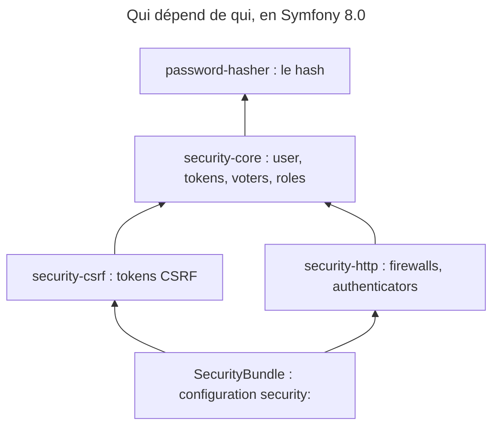

## Objectif

Séparer trois packages que l'on croit n'en former qu'un, et savoir lequel répond
de quoi — et lequel dépend de l'autre.

## L'essentiel

La security de Symfony n'est pas d'un seul tenant : le **hash**, les **tokens CSRF** et
le **modèle** (users, tokens, voters, roles) vivent dans trois packages
distincts. Hacher un password ou protéger un form **n'exige pas** le système
complet — mais tous les packages ne s'installent pas seuls.

## Le schéma



## L'exemple

```text
composer require symfony/password-hasher   → le hash, seul
composer require symfony/security-csrf     → les tokens CSRF, + security-core, + password-hasher
composer require symfony/security-bundle   → tout : core, csrf, http, password-hasher, configuration
```

## Trois components, trois responsabilités

| Package | Ce qu'il fournit |
|---|---|
| `symfony/security-core` | le modèle : `UserInterface`, tokens, voters, décision d'accès, hiérarchie des roles |
| `symfony/security-csrf` | la génération et la vérification de tokens CSRF |
| `symfony/password-hasher` | le hash et la vérification des passwords |

S'y ajoutent `security-http`, qui branche le modèle sur la Request HTTP —
firewalls, authenticators, entry points —, et `SecurityBundle`, qui câble le
tout dans le framework et expose la key `security:`.

## Qui dépend de qui

Lu dans les `composer.json` de la branche 8.0 :

| Package | `require` (hors PHP et contrats) |
|---|---|
| `password-hasher` | **rien** |
| `security-core` | `password-hasher` |
| `security-csrf` | `security-core` |
| `security-http` | `security-core`, `http-foundation`, `http-kernel`, `property-access` |
| `SecurityBundle` | les quatre, plus le framework |

`require symfony/password-hasher` n'installe donc que lui ;
`require symfony/security-csrf` tire aussi `security-core` et
`password-hasher`, pour une raison modeste : `security-csrf` lève les
exceptions de `security-core`.

## Pourquoi la séparation compte

- `password-hasher` sert sans authentication : seul dans un projet,
  `PasswordHasherFactory` avec l'algorithme `auto` produit un hash
  `$2y$13$…`, et aucune class de `security-core` n'est chargée.
- `security-csrf` protège un form **sans firewall** — c'est ce qu'utilise le
  component Form. Il installe `security-core`, sans exiger de configuration
  de sécurité.
- Aucun de ces packages ne dépend de Doctrine ni d'une base de données.

## Ce qui vit dans `security-core`

- `UserInterface` et le contrat user ;
- les **tokens** (`TokenInterface`) et leur stockage ;
- l'**authorization** : `AccessDecisionManager`, `Voter`, strategies ;
- la **hiérarchie des roles**.

Il ne **dépend** pas de HTTP : `http-foundation` n'y figure qu'en
`require-dev`. Quelques classes optionnelles s'en servent quand il est
présent, comme `UsageTrackingTokenStorage` pour la session. Une décision
d'accès se prend donc aussi en console ou dans un worker.

## Pièges d'examen

**Le hash n'est pas dans `security-core`** : il a son propre package,
`password-hasher` — dont `security-core` dépend.

**La protection CSRF n'est pas liée à l'authentication** : aucun firewall
requis. Mais `security-csrf` n'est pas un package isolé : il installe
`security-core`.

**Seul `password-hasher` s'installe vraiment seul.**

**`security-core` ne dépend pas de HTTP.** Firewalls et authenticators
appartiennent à `security-http`.

## Application

- Une command hache des passwords importés → `symfony/password-hasher` seul,
  sans firewall ni bundle.
- Un voter doit tourner dans un worker Messenger → il vit dans
  `security-core`, qui n'exige aucune Request.

## QCM d'entraînement

**Question 1.** Un site sans authentication installe `symfony/security-csrf`.
Quel autre package de sécurité arrive avec lui ?

- **A.** Aucun : `security-csrf` est autonome
- **B.** `security-http`, pour lire le token dans la Request
- **C.** `security-core`, puis `password-hasher` par lui
- **D.** `SecurityBundle`, pour la configuration

<details>
<summary>Correction</summary>

**Bonne réponse : C.** `security-csrf` requiert `security-core`, dont il lève
les exceptions, et `security-core` requiert à son tour `password-hasher`.

</details>

**Question 2.** `security-core` a-t-il `symfony/http-foundation` dans son
`require` ?

- **A.** Non : seulement en `require-dev`
- **B.** Oui : les tokens sont stockés en session
- **C.** Oui : les voters reçoivent la Request
- **D.** Non, et aucune de ses classes ne s'en sert

<details>
<summary>Correction</summary>

**Bonne réponse : A.** Le package ne l'exige pas ; quelques classes
optionnelles s'en servent seulement quand il est installé par ailleurs.

</details>

**Question 3.** Une command console hache un password avec l'algorithme `auto`,
dans un projet qui n'installe que `password-hasher`. Que produit-elle ?

- **A.** Une exception : il faut un firewall
- **B.** Un hash `$2y$13$…`
- **C.** Un hash SHA-512 en base64
- **D.** Une exception : `auto` exige `security-core`

<details>
<summary>Correction</summary>

**Bonne réponse : B.** `auto` hache en bcrypt au coût 13 ; aucune dependency
de sécurité n'est requise, ni firewall ni `security-core`.

</details>

**Question 4.** Dans quel package vivent les firewalls, les authenticators et
les entry points ?

- **A.** `security-core`
- **B.** `security-csrf`
- **C.** `password-hasher`
- **D.** `security-http`

<details>
<summary>Correction</summary>

**Bonne réponse : D.** `security-http` traduit une Request en tentative
d'authentication et une décision d'accès en Response ; `security-core` reste
sans HTTP.

</details>

## Fiche express

**Si tu dois retenir seulement 5 choses :**

- **`password-hasher`** : le hash, **sans aucune dependency** de sécurité.
- **`security-core`** : user, tokens, voters, roles — **sans HTTP** ; dépend
  de `password-hasher`.
- **`security-csrf`** : tokens CSRF **sans firewall** ; dépend de
  `security-core`.
- **`security-http`** : firewalls, authenticators, la Request.
- **`SecurityBundle`** : les quatre + la configuration `security:`.

Moyen mnémotechnique :
**« Hacher seul, protéger sans compte, contrôler avec le core »**.

```text
password-hasher ← security-core ← security-csrf
                  security-core ← security-http ← SecurityBundle (+ csrf + hasher)
```

## Sources officielles

- [Security](https://github.com/symfony/symfony-docs/blob/8.0/security.rst)
- [`security-core`, `composer.json` 8.0](https://github.com/symfony/symfony/blob/8.0/src/Symfony/Component/Security/Core/composer.json)
- [`security-csrf`, `composer.json` 8.0](https://github.com/symfony/symfony/blob/8.0/src/Symfony/Component/Security/Csrf/composer.json)
- [`password-hasher`, `composer.json` 8.0](https://github.com/symfony/symfony/blob/8.0/src/Symfony/Component/PasswordHasher/composer.json)

