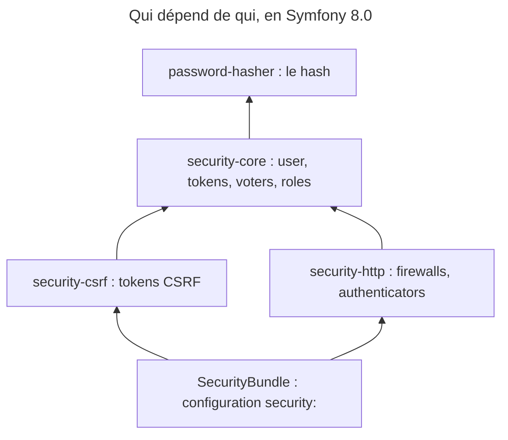

## Objectif

Séparer trois packages que l'on croit n'en former qu'un, et savoir lequel répond
de quoi — et lequel dépend de l'autre.

## Avant la règle : le problème à résoudre

Trois projets ont chacun un besoin de « security » :

- un script d'import doit **hacher** des passwords avant de les écrire,
  sans aucune page de connexion ;
- un site vitrine veut **protéger son form de contact** contre le CSRF,
  sans comptes users ;
- une application métier a des **users, des roles et des pages
  réservées**.

Installer « tout Symfony Security » pour les deux premiers serait absurde. La
security est donc découpée en packages ; encore faut-il savoir **lequel**
fournit quoi, et **ce que chacun entraîne** avec lui.

## Le fil rouge : trois `composer require`

```text
composer require symfony/password-hasher   → le hash, seul
composer require symfony/security-csrf     → les tokens CSRF, + security-core, + password-hasher
composer require symfony/security-bundle   → tout : core, csrf, http, password-hasher, configuration
```

## Le cycle complet en un schéma



## Trois components, trois responsabilités

| Package | Ce qu'il fournit |
|---|---|
| `symfony/security-core` | le modèle : `UserInterface`, tokens, voters, décision d'accès, hiérarchie des roles |
| `symfony/security-csrf` | la génération et la vérification de tokens CSRF |
| `symfony/password-hasher` | le hash et la vérification des passwords |

À quoi s'ajoutent `security-http`, qui branche le modèle sur la Request HTTP —
firewalls, authenticators, entry points — et `SecurityBundle`, qui câble le
tout dans le framework et expose la key `security:` de configuration.

## Qui dépend de qui

Les responsabilités sont séparées ; les packages, eux, ne sont pas tous
indépendants. Lu dans les `composer.json` de la branche 8.0 (et dans ceux
installés en 8.0.x) :

| Package | `require` (hors PHP et contrats) |
|---|---|
| `password-hasher` | **rien** |
| `security-core` | `password-hasher` |
| `security-csrf` | `security-core` |
| `security-http` | `security-core`, `http-foundation`, `http-kernel`, `property-access` |
| `SecurityBundle` | les quatre, plus le framework |

Exécuté, une résolution Composer le confirme : `require symfony/password-hasher`
n'installe que lui ; `require symfony/security-csrf` tire aussi `security-core`
et `password-hasher`. La raison est modeste — `security-csrf` lève les exceptions
de `security-core` (`RuntimeException`, `InvalidArgumentException`).

## Pourquoi la séparation compte

`password-hasher` sert dans une application sans authentication. Exécuté, seul
dans un projet : `PasswordHasherFactory` avec l'algorithme `auto` produit un
hash `$2y$13$…`, `verify()` rend `true` pour le bon password et `false`
sinon, et aucune class de `security-core` n'est chargée.

`security-csrf` protège un form **sans firewall** — c'est ce qu'utilise le
component Form. Il installe `security-core`, mais n'exige ni authentication ni
configuration de sécurité. Aucun de ces packages ne dépend de Doctrine ni d'une
base de données.

C'est la réponse à une question d'examen classique : hacher un password
**n'exige pas** le système de sécurité complet.

## Ce qui vit dans `security-core`

- `UserInterface` et le contrat user ;
- les **tokens** (`TokenInterface`) et leur stockage ;
- l'**authorization** : `AccessDecisionManager`, `Voter`, strategies ;
- la **hiérarchie des roles**.

Ce component ne **dépend** pas de HTTP : `http-foundation` n'y figure qu'en
`require-dev` (lu). Quelques classes optionnelles s'en servent quand il est
présent — `UsageTrackingTokenStorage` pour la session, `LazyResponseException`
pour une Response, `ExpressionVoter` pour exposer la Request. C'est
`security-http` qui traduit une Request en tentative d'authentication et une
décision en Response.

## Concrètement dans ton application

- Un import qui hache des passwords : `symfony/password-hasher` seul.
- Un form protégé sans comptes : `symfony/security-csrf` (le component
  Form s'en sert), sans firewall.
- Des users, des roles, des pages réservées : `symfony/security-bundle`,
  qui apporte les quatre packages et la configuration `security:`.

## À comprendre

- **Pourquoi séparer ?** Pour qu'un besoin limité n'importe pas toute la
  security : un hash n'a pas besoin de firewall.
- **Pourquoi `security-core` sans HTTP ?** Parce qu'un user, un role ou une
  décision d'accès existent aussi en console ou en message asynchrone ; HTTP
  n'est qu'un des moyens de s'authentifier.
- **Pourquoi `security-csrf` dépend-il de `security-core` ?** Pour ses
  exceptions — une dependency technique, pas un besoin d'authentication.

## À mémoriser

- `security-core` = modèle, tokens, authorization, roles ; aucune dependency à
  HTTP.
- `security-csrf` = tokens CSRF, sans firewall ; dépend de `security-core`.
- `password-hasher` = hash ; ne dépend de rien.
- `security-http` relie le modèle à la Request ; `SecurityBundle` le configure.
- Moyen mnémotechnique : **« Hacher seul, protéger sans compte, contrôler avec
  le core »**.

## Pièges d'examen

**Le hash n'est pas dans `security-core`** : il a son propre package,
`password-hasher` — dont `security-core` dépend.

**La protection CSRF n'est pas liée à l'authentication** : aucun firewall
requis. Mais `security-csrf` n'est pas un package isolé : il installe
`security-core`.

**Seul `password-hasher` s'installe vraiment seul.**

**`security-core` ne dépend pas de HTTP.** Firewalls et authenticators
appartiennent à `security-http`.

## Application : trois scénarios

**Scénario 1 — Le script d'import.** Une command hache 10 000 passwords
importés. *Solution.* `composer require symfony/password-hasher` et
`PasswordHasherFactory` : pas de bundle de sécurité, pas de firewall.

**Scénario 2 — Le form de contact.** Un site sans comptes veut le token
CSRF sur son form. *Solution.* `symfony/security-csrf` : le component Form
l'utilise sans authentication. `security-core` arrive avec, sans configuration.

**Scénario 3 — Le voter dans un worker.** Un worker Messenger doit appliquer la
même règle d'accès qu'un controller. *Solution.* Les voters vivent dans
`security-core`, qui ne dépend pas de HTTP : la décision d'accès ne demande pas
de Request.

## QCM d'entraînement

Cinq questions sur les packages de sécurité. Choisis avant d'ouvrir la
correction.

**Question 1.** Un projet exécute `composer require symfony/password-hasher` et rien d'autre. Quels packages de sécurité sont installés ?

- **A.** `password-hasher` et `security-core`
- **B.** `password-hasher` seulement
- **C.** `password-hasher`, `security-core` et `security-http`
- **D.** Tout `SecurityBundle`

<details>
<summary>Correction</summary>

**Bonne réponse : B.** `password-hasher` ne requiert aucun autre package de
sécurité (lu dans son `composer.json`, résolution exécutée).

A est le piège : c'est l'inverse, `security-core` dépend de `password-hasher`.
C et D sont faux.

</details>

**Question 2.** Un site sans authentication installe `symfony/security-csrf`. Quel autre package de sécurité arrive avec lui ?

- **A.** Aucun : `security-csrf` est autonome
- **B.** `security-http`, pour lire le token dans la Request
- **C.** `security-core`, puis `password-hasher` par lui
- **D.** `SecurityBundle`, pour la configuration

<details>
<summary>Correction</summary>

**Bonne réponse : C.** `security-csrf` requiert `security-core` (pour ses
exceptions), qui requiert `password-hasher`.

A est le piège. B et D ne sont pas requis.

</details>

**Question 3.** Dans quel package vivent les voters et l'`AccessDecisionManager` ?

- **A.** `security-http`
- **B.** `SecurityBundle`
- **C.** `password-hasher`
- **D.** `security-core`

<details>
<summary>Correction</summary>

**Bonne réponse : D.** `security-core` porte le modèle : user, tokens,
authorization, roles.

A porte les firewalls et authenticators. B câble le tout. C ne fait que le
hash.

</details>

**Question 4.** `security-core` a-t-il `symfony/http-foundation` dans son `require` ?

- **A.** Non : seulement en `require-dev`
- **B.** Oui : les tokens sont stockés en session
- **C.** Oui : les voters reçoivent la Request
- **D.** Non, et aucune de ses classes ne s'en sert

<details>
<summary>Correction</summary>

**Bonne réponse : A.** Lu dans le `composer.json` 8.0. Quelques classes
optionnelles s'en servent quand il est présent.

B et C confondent usage optionnel et dependency. D oublie ces classes
optionnelles.

</details>

**Question 5.** Une command console doit hacher un password avec l'algorithme `auto`, dans un projet qui n'installe que `password-hasher`. Que produit le hash ?

- **A.** Une exception : il faut un firewall
- **B.** Un hash SHA-512 en base64
- **C.** Un hash `$2y$13$…`
- **D.** Une exception : `auto` exige `security-core`

<details>
<summary>Correction</summary>

**Bonne réponse : C.** Exécuté avec `PasswordHasherFactory` 8.0.8 :
`verify()` rend `true` pour le bon password, et aucune class de
`security-core` n'est chargée.

A et D inventent une dependency. B n'est pas ce que produit `auto`.

</details>

## Fiche express

**Si tu dois retenir seulement 5 choses :**

- **`password-hasher`** : le hash, **sans aucune dependency** de sécurité.
- **`security-core`** : user, tokens, voters, roles — **sans HTTP** ; dépend
  de `password-hasher`.
- **`security-csrf`** : tokens CSRF **sans firewall** ; dépend de
  `security-core`.
- **`security-http`** : firewalls, authenticators, la Request.
- **`SecurityBundle`** : les quatre + la configuration `security:`.

**En une phrase, pour tout reconstruire :**

```text
password-hasher ← security-core ← security-csrf
                  security-core ← security-http ← SecurityBundle (+ csrf + hasher)
```

## Sources officielles

- [Security](https://github.com/symfony/symfony-docs/blob/8.0/security.rst)
- [`security-core`, `composer.json` 8.0](https://github.com/symfony/symfony/blob/8.0/src/Symfony/Component/Security/Core/composer.json)
- [`security-csrf`, `composer.json` 8.0](https://github.com/symfony/symfony/blob/8.0/src/Symfony/Component/Security/Csrf/composer.json)
- [`password-hasher`, `composer.json` 8.0](https://github.com/symfony/symfony/blob/8.0/src/Symfony/Component/PasswordHasher/composer.json)
