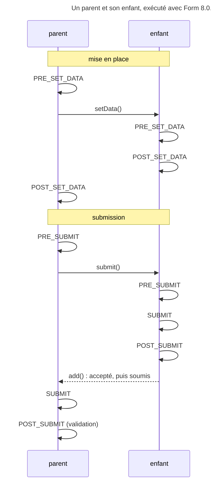
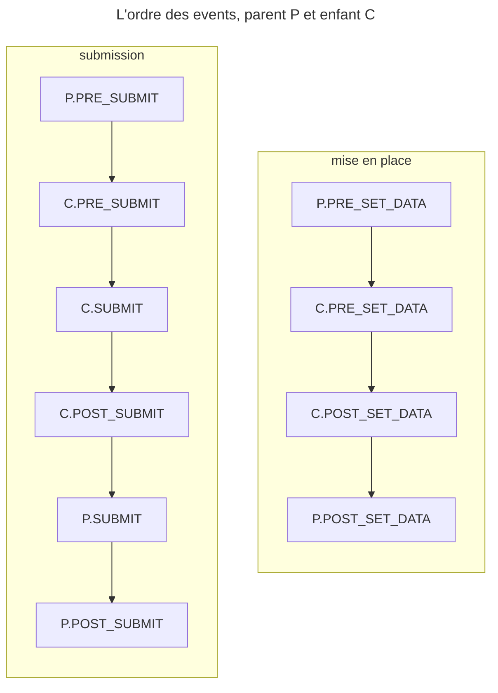

## Objectif

Modifier un form pendant son cycle de vie : ajouter un field selon la
donnée, assainir une valeur brute, réagir après la submission. C'est le
mécanisme qui rend un form dynamique.

## L'essentiel

`buildForm()` s'exécute une fois, sans connaître ni l'object ni la Request.
Les **cinq form events** permettent d'intervenir plus tard : deux à la mise en
place de la donnée initiale, trois à la submission. À chaque event, il faut
savoir **quelle donnée** on reçoit et si l'on peut encore **ajouter un
field**.

## Le schéma



## L'exemple : pays et région

```php
$builder->add('country', ChoiceType::class, ['choices' => $countries]);

$builder->addEventListener(FormEvents::PRE_SET_DATA, function (FormEvent $event) {
    $address = $event->getData();                                 // l'object initial
    $this->addRegion($event->getForm(), $address?->country);
});

$builder->get('country')->addEventListener(FormEvents::POST_SUBMIT, function (FormEvent $event) {
    $country = $event->getForm()->getData();                      // le pays soumis
    $this->addRegion($event->getForm()->getParent(), $country);   // au parent
});
```

## Deux moments, cinq events

| Event | Phase | Usage |
|---|---|---|
| `PRE_SET_DATA` | mise en place | modifier la donnée initiale, ajouter ou retirer des fields selon elle |
| `POST_SET_DATA` | mise en place | décider en connaissant l'état complet (object neuf ou existant ?) |
| `PRE_SUBMIT` | submission | assainir la donnée brute, ajouter des fields selon ce qui est envoyé |
| `SUBMIT` | submission | modifier la norm data ; les enfants sont déjà soumis |
| `POST_SUBMIT` | submission | réagir après coup ; **la validation s'exécute ici** |

## Ce que porte chaque event

Un field texte avec un model transformer entre l'int `5` et la string
`'n:5'`, soumis avec `'n:7'` :

| Event | `$event->getData()` | `$event->getForm()->getData()` |
|---|---|---|
| `PRE_SET_DATA` | `5` (modèle) | interdit : `RuntimeException` |
| `POST_SET_DATA` | `5` (modèle) | `5` |
| `PRE_SUBMIT` | `'n:7'` (brut : strings, arrays, `UploadedFile`) | `5` |
| `SUBMIT` | `'n:7'` (norm data) | `5` |
| `POST_SUBMIT` | `'n:7'` (**view data**) | `7` |

Dans `PRE_SET_DATA`, `$form->getData()` lève « A cycle was detected. Listeners
to the PRE_SET_DATA event must not call getData() if the form data has not
already been set. » : lire `$event->getData()`.

## Ce que dit le code sur le verrouillage

`Form::add()` ne teste qu'une chose : le form est-il marqué soumis ?
`Form::submit()` pose ce marqueur **après** `SUBMIT` et **avant**
`POST_SUBMIT`. Un listener du form racine ajoute `extra`, la Request envoyant
`extra = 'sent'` :

| Event | `add()` | Le field ajouté |
|---|---|---|
| `PRE_SET_DATA`, `POST_SET_DATA`, `PRE_SUBMIT` | accepté | soumis, donnée `'sent'` |
| `SUBMIT` | accepté, **sans erreur** | **jamais soumis** |
| `POST_SUBMIT` | `AlreadySubmittedException` : « You cannot add children to a submitted form. » | — |

## Les forms imbriqués



- L'enfant est soumis **en entier** avant le `SUBMIT` du parent : un field
  dépendant s'ajoute **au parent**, depuis le `POST_SUBMIT` de l'enfant, et il
  est soumis avec la valeur de la Request.
- La validation ne part que du **form racine** : `ValidationListener` écoute
  le `POST_SUBMIT` de chaque form mais n'agit que si `isRoot()`. Dans le
  `POST_SUBMIT` d'un enfant, aucune erreur de validation n'existe encore.

## La table de décision

| Besoin | Event |
|---|---|
| modifier la donnée initiale ; adapter la structure à elle | `PRE_SET_DATA` (ou `POST_SET_DATA`) |
| assainir la donnée brute soumise | `PRE_SUBMIT` |
| ajouter des fields d'après la valeur soumise | `PRE_SUBMIT` sur le **parent**, ou `POST_SUBMIT` sur l'**enfant** |
| modifier la norm data | `SUBMIT` |
| réagir après coup, journaliser | `POST_SUBMIT` |

La question qui tranche : réagit-on à la donnée **initiale** (l'object) ou à la
donnée **soumise** (la Request) ?

## Comment s'abonner

`$builder->addEventListener(FormEvents::PRE_SET_DATA, $callable)` pour un cas
local, ou une class `EventSubscriberInterface`, réutilisable. Les listeners se
déclarent pendant `buildForm()` : ensuite, le dispatcher est un
`ImmutableEventDispatcher`, et `addListener()` lève une
`BadMethodCallException`.

## Pièges d'examen

- `PRE_SUBMIT` reçoit la donnée **brute** : strings, arrays, files
  téléversés — pas d'object du modèle.
- **À `SUBMIT`, `add()` ne lève rien**, mais le field ajouté n'est jamais
  soumis ; l'exception n'arrive qu'à `POST_SUBMIT`.
- **`POST_SUBMIT` porte la view data** ; le modèle est sur le form.
- Dans `PRE_SET_DATA`, **`$form->getData()` lève une exception** : lire
  `$event->getData()`.
- La validation s'exécute sur le `POST_SUBMIT` de la **racine**, pas avant.
- Un field dépendant s'ajoute au **parent**.

## Application

- Une liste « région » qui dépend du pays → `PRE_SET_DATA` pour l'object
  existant, `POST_SUBMIT` sur `country` qui ajoute au parent.
- Supprimer les espaces d'un code postal avant toute transformation →
  `PRE_SUBMIT`.

## QCM d'entraînement

**Question 1.** Un listener sur le `POST_SUBMIT` du form racine appelle
`$event->getForm()->add('extra', TextType::class)`. Que se passe-t-il ?

- **A.** Le field est ajouté et soumis avec la Request
- **B.** Le field est ajouté, mais jamais soumis
- **C.** Une `AlreadySubmittedException`
- **D.** Le field est ajouté au form parent

<details>
<summary>Correction</summary>

**Bonne réponse : C.** Le form est déjà marqué soumis : « You cannot add
children to a submitted form. ». B décrit l'ajout à `SUBMIT`.

</details>

**Question 2.** Un field a un model transformer entre l'int `5` et la string
`'n:5'`. On soumet `'n:7'`. Que vaut `$event->getData()` dans un listener
`POST_SUBMIT` de ce field ?

- **A.** `7`, la model data
- **B.** `5`, la donnée initiale
- **C.** `null` : la donnée est déjà écrite dans l'object
- **D.** `'n:7'`, la view data

<details>
<summary>Correction</summary>

**Bonne réponse : D.** `POST_SUBMIT` porte la view data ; la model data, `7`,
se lit par `$event->getForm()->getData()`.

</details>

**Question 3.** Un form parent `p` a un enfant `c`. Dans quel ordre les events
de submission sont-ils déclenchés ?

- **A.** `p.PRE_SUBMIT`, `p.SUBMIT`, `p.POST_SUBMIT`, puis les trois de `c`
- **B.** `p.PRE_SUBMIT`, `c.PRE_SUBMIT`, `c.SUBMIT`, `c.POST_SUBMIT`, `p.SUBMIT`, `p.POST_SUBMIT`
- **C.** `c.PRE_SUBMIT`, `c.SUBMIT`, `c.POST_SUBMIT`, puis les trois de `p`
- **D.** `p.PRE_SUBMIT`, `c.PRE_SUBMIT`, `p.SUBMIT`, `c.SUBMIT`, `p.POST_SUBMIT`, puis `c.POST_SUBMIT`

<details>
<summary>Correction</summary>

**Bonne réponse : B.** L'enfant est soumis en entier entre le `PRE_SUBMIT` et
le `SUBMIT` du parent.

</details>

**Question 4.** Après `getForm()`, un développeur appelle
`$form->getConfig()->getEventDispatcher()->addListener(...)`. Que se
passe-t-il ?

- **A.** Le listener est ajouté pour la prochaine submission
- **B.** Une `BadMethodCallException`
- **C.** Le listener est ajouté, mais seulement aux enfants
- **D.** Rien : l'appel est ignoré sans erreur

<details>
<summary>Correction</summary>

**Bonne réponse : B.** Le dispatcher est immuable : « Unmodifiable event
dispatchers must not be modified. ». Les listeners se déclarent dans
`buildForm()`.

</details>

## Fiche express

**Si tu dois retenir seulement 7 choses :**

- **Cinq events** : `PRE_SET_DATA`, `POST_SET_DATA`, `PRE_SUBMIT`, `SUBMIT`,
  `POST_SUBMIT`.
- Données : **modèle, modèle, Request, normalisée, vue**.
- `PRE_SET_DATA` : lire **`$event->getData()`** ; `$form->getData()` lève une
  exception.
- `add()` : OK jusqu'à `PRE_SUBMIT` ; **ignoré à `SUBMIT`** ; **exception à
  `POST_SUBMIT`**.
- L'enfant est **soumis en entier** avant le `SUBMIT` du parent.
- Field dépendant : **ajouté au parent** depuis le `POST_SUBMIT` de l'enfant.
- Validation : **`POST_SUBMIT` de la racine** ; dispatcher immuable après
  `buildForm()`.

Moyen mnémotechnique : **« Poser, compléter, recevoir, normaliser,
conclure »**.

## Sources officielles

- [Form Events](https://github.com/symfony/symfony-docs/blob/8.0/form/events.rst)
- [Form 8.0, `Form`](https://github.com/symfony/symfony/blob/8.0/src/Symfony/Component/Form/Form.php) : `submit()`, `add()`, `remove()`, `getData()`
- [Form 8.0, `ValidationListener`](https://github.com/symfony/symfony/blob/8.0/src/Symfony/Component/Form/Extension/Validator/EventListener/ValidationListener.php)

