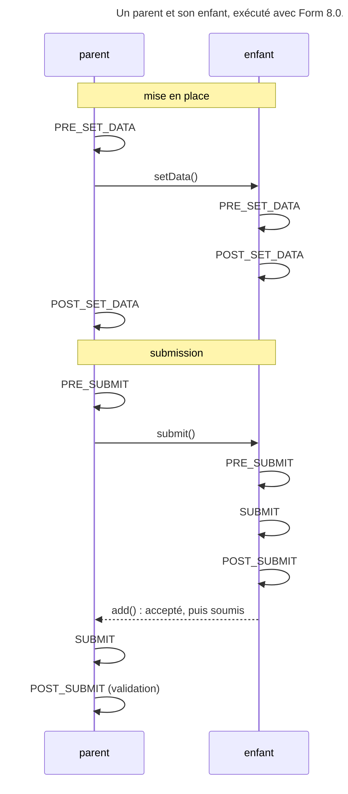

## Objectif

Modifier un form pendant son cycle de vie : ajouter un field selon la
donnée, assainir une valeur brute, réagir après la submission. C'est le
mécanisme qui rend un form dynamique.

## Prérequis

Les trois couches de données du component Form, et le dispatcher d'events.

## Deux moments, cinq events

Le cycle se divise en deux phases : la **mise en place** de la donnée initiale,
et la **submission**.

### Mise en place

Les entrées numérotées sont les events. Les lignes en retrait entre elles ne
sont pas des events : ce sont les transformations que le component effectue.

1. **`PRE_SET_DATA`** — la donnée du **modèle**, avant toute transformation. Les
   fields ne sont pas encore tous construits : **c'est ici qu'on en ajoute ou
   qu'on en retire** en fonction de la donnée initiale.

   *→ le component calcule les trois représentations*

2. **`POST_SET_DATA`** — les trois représentations existent. Bon endroit pour
   décider en connaissant l'état complet, par exemple « l'object est-il neuf ou
   existant ? ». On peut encore y ajouter ou retirer des fields, même si la
   documentation préfère `PRE_SET_DATA`.

### Submission

3. **`PRE_SUBMIT`** — la donnée **brute de la Request**, non transformée :
   strings et arrays, plus les objects `UploadedFile` d'un field de file.
   C'est le moment pour assainir une valeur, ou pour ajouter des fields d'après
   ce que le user a envoyé — le cas des listes dépendantes.

   *→ les enfants sont soumis, puis la vue est transformée en normalisée*

4. **`SUBMIT`** — la donnée **normalisée**. On peut encore changer les valeurs,
   mais les enfants ont **déjà été soumis** : la documentation dit qu'on ne peut
   plus ajouter ni retirer de field.

   *→ le component transforme la normalisée en modèle*

5. **`POST_SUBMIT`** — `$event->getData()` rend la donnée de **vue** ; la
   model data se lit par `$event->getForm()->getData()`. La structure de
   *ce* form est figée. **La validation s'exécute par un listener sur cet
   event**, ce qui explique qu'un object peuplé et validé soit disponible une
   fois la submission terminée.

## Ce que dit le code sur le verrouillage

`Form::add()` et `Form::remove()` ne testent qu'une chose : le form est-il
marqué soumis ? Or `Form::submit()` pose ce marqueur **après** l'event
`SUBMIT` et **avant** `POST_SUBMIT`. Exécuté avec `symfony/form` 8.0.15, un
listener du form racine qui ajoute un field `extra` :

| Event | `add()` | Le field ajouté |
|---|---|---|
| `PRE_SET_DATA`, `POST_SET_DATA`, `PRE_SUBMIT` | accepté | soumis, donnée envoyée |
| `SUBMIT` | accepté, **sans erreur** | **jamais soumis**, garde sa donnée initiale |
| `POST_SUBMIT` | `AlreadySubmittedException` | — |

Le lock de `SUBMIT` est donc fonctionnel, pas une exception : un field ajouté
là est silencieusement ignoré par la submission. L'exception n'arrive qu'à
`POST_SUBMIT`, avec « You cannot add children to a submitted form. ».

## Ce que porte chaque event

Exécuté sur un field texte muni d'un model transformer entre l'int
`5` et la string `'n:5'`, puis soumis avec `'n:7'` :

| Event | `$event->getData()` | `$event->getForm()->getData()` |
|---|---|---|
| `PRE_SET_DATA` | `5` | interdit : `RuntimeException` |
| `POST_SET_DATA` | `5` | `5` |
| `PRE_SUBMIT` | `'n:7'` | `5` |
| `SUBMIT` | `'n:7'` | `5` |
| `POST_SUBMIT` | `'n:7'` | `7` |

Dans un listener `PRE_SET_DATA`, appeler `getData()` sur le form lève
une `RuntimeException` : « A cycle was detected. Listeners to the PRE_SET_DATA
event must not call getData() if the form data has not already been set. » On
lit la donnée sur l'event.

## L'array de décision

| Besoin | Event |
|---|---|
| modifier la donnée initiale | `PRE_SET_DATA` |
| adapter la structure à la donnée initiale | `PRE_SET_DATA`, ou `POST_SET_DATA` |
| assainir la donnée brute soumise | `PRE_SUBMIT` |
| ajouter des fields d'après la valeur soumise | `PRE_SUBMIT` sur le **parent**, ou `POST_SUBMIT` sur l'**enfant** |
| modifier la norm data | `SUBMIT` |
| réagir après coup, journaliser | `POST_SUBMIT` |

La question qui tranche entre `PRE_SET_DATA` et `PRE_SUBMIT` est celle que pose
la documentation : réagit-on à la donnée **initiale**, qui vient de l'object, ou à
la donnée **soumise**, qui vient de la Request ?

## Les forms imbriqués

Un field dépendant d'un autre ne peut pas s'ajouter depuis son propre
`POST_SUBMIT` au form lui-même : sa structure est figée. On l'ajoute au
**form parent**, depuis l'event de l'enfant. C'est ce qui rend le pattern
des listes dépendantes contre-intuitif à écrire.

L'ordre de propagation explique pourquoi cela fonctionne : au `POST_SUBMIT` de
l'enfant, le parent n'a pas encore atteint son `SUBMIT`. Exécuté avec
`symfony/form` 8.0.15 : un field ajouté au parent à ce moment est soumis, avec
la valeur de la Request.



La validation, elle, ne part que du form **racine** : `ValidationListener`
écoute le `POST_SUBMIT` de chaque form, mais n'agit que si
`isRoot()` est vrai, et valide alors tout l'arbre. Exécuté : dans le `POST_SUBMIT` d'un enfant, aucune
erreur de validation n'existe encore ; dans un listener `POST_SUBMIT` de la
racine, de même priority mais enregistré après, l'erreur `NotBlank` est déjà là.

## Comment s'abonner

Sur le constructor, pour un cas local :

```php
$builder->addEventListener(FormEvents::PRE_SET_DATA, function (FormEvent $event) {
    $form = $event->getForm();
    $data = $event->getData();
});
```

Ou par une class implémentant `EventSubscriberInterface`, réutilisable et
injectable.

Les listeners se déclarent pendant `buildForm()` : une fois le form
construit, son dispatcher est un `ImmutableEventDispatcher`.

## Pièges d'examen

- `PRE_SUBMIT` reçoit la donnée **brute** : strings, arrays, files
  téléversés — pas d'object du modèle.
- **À `SUBMIT`, `add()` ne lève rien**, mais le field ajouté n'est jamais
  soumis ; l'exception n'arrive qu'à `POST_SUBMIT`.
- **`POST_SUBMIT` porte la view data** ; le modèle est sur le form.
- Dans `PRE_SET_DATA`, **`$form->getData()` lève une exception** : lire
  `$event->getData()`.
- La validation s'exécute sur le `POST_SUBMIT` de la **racine**, pas avant.
- Un field dépendant s'ajoute au **parent**.

## Points clés

- Cinq events, deux phases, un ordre fixe.
- Structure modifiable à `PRE_SET_DATA`, `POST_SET_DATA` et `PRE_SUBMIT`.
- `SUBMIT` : field ajouté ignoré ; `POST_SUBMIT` : `AlreadySubmittedException`.
- Données : modèle, modèle, Request, normalisée, vue.
- Le choix se fait sur l'origine de la donnée : object ou Request.

## Sources officielles

- [Form Events](https://github.com/symfony/symfony-docs/blob/8.0/form/events.rst)
- [Form 8.0, `Form`](https://github.com/symfony/symfony/blob/8.0/src/Symfony/Component/Form/Form.php) : `submit()`, `add()`, `remove()`, `getData()`
- [Form 8.0, `ValidationListener`](https://github.com/symfony/symfony/blob/8.0/src/Symfony/Component/Form/Extension/Validator/EventListener/ValidationListener.php)
