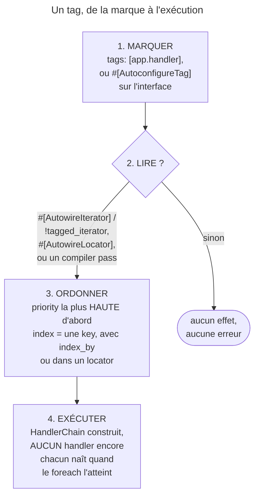

## Objectif

Marquer des services pour qu'un autre les retrouve sans les connaître par leur
nom, les recevoir sous forme d'itérable lazy, les ordonner par priority, les
indexer par une key, et poser les tags automatiquement depuis une interface.

## L'essentiel

Un `NotificationChain` qui nomme chaque canal doit changer à chaque nouveau
canal. Un **tag** marque les services pour qu'un consommateur les reçoive tous
sans les connaître. Le tag ne fait **rien** seul : il faut quelque chose qui le
lise. On les reçoit en itérable **lazy**, ordonnés par `priority`, indexés
seulement si on le demande.

## Le schéma



## Le fil rouge : des handlers de notification

```php
#[AutoconfigureTag('app.handler')]
interface HandlerInterface { public function notify(string $message): void; }

class HandlerChain
{
    public function __construct(
        #[AutowireIterator('app.handler')] private iterable $handlers,
    ) {
    }
}
```

## Ce qu'un tag fait : un marqueur, sans effet propre

```yaml
services:
    App\Handler\SmsHandler:
        tags: ['app.handler']
    App\Handler\EmailHandler:
        tags:
            - { name: 'app.handler', priority: 10 }
```

Un tag que rien ne lit ne lève aucune erreur. En debug, `UnusedTagsPass` le
signale dans le journal de compilation : « Tag "app.handlr" was defined on
service(s) …, but was never used. Did you mean "app.handler"? ».

## Recevoir les services tagués : un iterable lazy

| Besoin | Injection |
|---|---|
| appeler **tous** les services tagués, dans l'ordre | `#[AutowireIterator]` / `!tagged_iterator` |
| en appeler **un**, choisi par sa key | `#[AutowireLocator]` / `!tagged_locator` |

- L'iterable est un generator réembobinable : rien n'est construit avant
  l'itération.
- `exclude: [FaxHandler::class]` retire des services de l'iterator.

## Ordonner et nommer : `priority` et `index`

`#[AsTaggedItem(index: 'sms', priority: 10)]` les pose depuis la class.

| Injection | Keys obtenues |
|---|---|
| `#[AutowireIterator('app.handler')]` | `0, 1, 2…` : l'index est ignoré |
| `#[AutowireIterator('app.handler', indexAttribute: 'key')]` | `sms`, puis les noms de class |
| `#[AutowireLocator('app.handler')]` | `sms`, puis les noms de class |

- Défauts fournis par la class : `getDefaultPriority()` ; sous
  `index_by: key`, `getDefaultKeyName()` et `getDefaultKeyPriority()` — le
  `getDefaultPriority()` est alors ignoré.
- `default_index_method` nomme une autre method.

## Poser les tags sans configuration

`#[AutoconfigureTag]` sur une **interface** (répétable) tague toutes ses
implémentations, avec `autoconfigure: true`. Le framework fait de même pour
ses interfaces par `registerForAutoconfiguration()`, appelé dans
`FrameworkExtension`.

## Pièges d'examen

**Un tag n'a d'effet que si quelque chose le lit.** Taguer un service qu'aucune
passe ne collecte ne produit rien — aucune erreur, au mieux une ligne de journal
en debug.

**`priority` haute = appelé en premier**, comme pour les event listeners.

**L'iterator est lazy** : les services ne sont pas construits tant qu'on
n'itère pas.

**Un iterator sans `index_by` a des keys entières**, même si les services
déclarent un `index`.

**Une faute de frappe dans un nom de tag ne lève aucune erreur.** Le service
n'est simplement jamais collecté ; seul le journal de compilation, en debug, le
signale.

## Application

- Un nouvel exporteur doit être collecté sans YAML → `#[AutoconfigureTag]` sur
  son interface.
- Un seul handler, choisi à l'exécution par un code → `#[AutowireLocator]` et
  `$locator->get($code)`.

## QCM d'entraînement

**Question 1.** `HandlerChain` reçoit `#[AutowireIterator('app.handler')]`. Il
doit ignorer `FaxHandler`, qui reste un service. Quelle écriture ?

- **A.** `exclude: [FaxHandler::class]` dans `#[AutowireIterator]`
- **B.** `#[Exclude]` sur la class `FaxHandler`
- **C.** `#[AsTaggedItem(priority: -1000)]` sur `FaxHandler`
- **D.** `#[AutowireIterator('app.handler', indexAttribute: 'fax')]`

<details>
<summary>Correction</summary>

**Bonne réponse : A.** `exclude` retire le service de cet iterator seulement ;
B le retirerait du container, C ne fait que le reléguer en dernier.

</details>

**Question 2.** Avec `index_by: key`, quelle method statique d'un service
fournit sa key par défaut ?

- **A.** `getDefaultIndexName()`
- **B.** `getDefaultKeyName()`
- **C.** `getDefaultName()`
- **D.** `getTagKey()`

<details>
<summary>Correction</summary>

**Bonne réponse : B.** Le nom dérive de l'attribute d'index ; A n'est appelée
que si `default_index_method` la nomme.

</details>

**Question 3.** Comment les classes qui implémentent `EventSubscriberInterface`
reçoivent-elles leur tag en 8.0 ?

- **A.** `#[AutoconfigureTag]` posé sur l'interface
- **B.** Une passe qui inspecte toutes les classes de `src/` et de `vendor/`
- **C.** `registerForAutoconfiguration()`
- **D.** Le kernel, qui tague chaque service au démarrage

<details>
<summary>Correction</summary>

**Bonne réponse : C.** L'interface ne porte pas l'attribute : le framework
enregistre l'autoconfiguration depuis son extension.

</details>

**Question 4.** Un service définit `getDefaultPriority()` et l'iterator utilise
`index_by: key`. Cette method est-elle prise en compte ?

- **A.** Oui, toujours
- **B.** Oui, mais seulement dans un locator
- **C.** Non : un index désactive toute notion de priority dans l'iterator
- **D.** Non : on attend `getDefaultKeyPriority()`

<details>
<summary>Correction</summary>

**Bonne réponse : D.** Sous `index_by: key`, le nom de la method de priority
dérive lui aussi de l'attribute d'index.

</details>

## Fiche express

**Si tu dois retenir seulement 7 choses :**

- Un tag est un **marqueur** : sans lecteur, aucun effet, aucune erreur.
- **`#[AutowireIterator]`** : tous, **lazy** ; **`#[AutowireLocator]`** : un,
  par key.
- **`priority` haute = premier.**
- **`index`** ignoré sans `indexAttribute` / `index_by`.
- **`#[AsTaggedItem]`** sur la class, **`#[AutoconfigureTag]`** sur l'interface.
- `exclude` retire de l'iterator, pas du container.
- Sous `index_by: key` : **`getDefaultKeyName()`**, **`getDefaultKeyPriority()`**.

Moyen mnémotechnique : **« Marquer, Lire, Trier »** — sans le L, rien ne se
passe.

## Sources officielles

- [How to Work with Service Tags](https://github.com/symfony/symfony-docs/blob/8.0/service_container/tags.rst)
- [DependencyInjection 8.0, `PriorityTaggedServiceTrait`](https://github.com/symfony/symfony/blob/8.0/src/Symfony/Component/DependencyInjection/Compiler/PriorityTaggedServiceTrait.php)
- [DependencyInjection 8.0, `Argument\TaggedIteratorArgument`](https://github.com/symfony/symfony/blob/8.0/src/Symfony/Component/DependencyInjection/Argument/TaggedIteratorArgument.php)
- [FrameworkBundle 8.0, `UnusedTagsPass`](https://github.com/symfony/symfony/blob/8.0/src/Symfony/Bundle/FrameworkBundle/DependencyInjection/Compiler/UnusedTagsPass.php)
- [FrameworkBundle 8.0, `FrameworkExtension`](https://github.com/symfony/symfony/blob/8.0/src/Symfony/Bundle/FrameworkBundle/DependencyInjection/FrameworkExtension.php)

