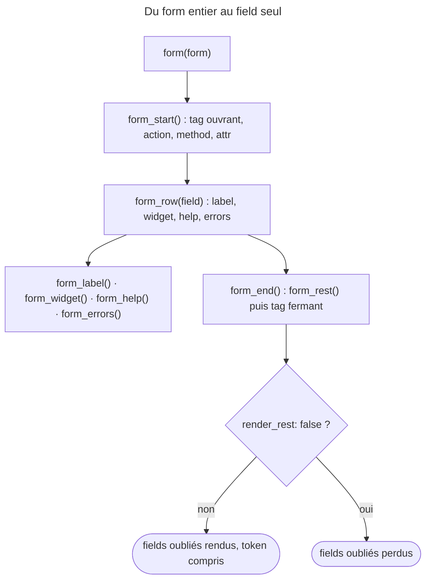

## Objectif

Rendre un form dans un template, du plus court au plus contrôlé, sans perdre
de field en route — ni le token CSRF.

## Avant la règle : le problème à résoudre

Le controller a passé `form` au template. Trois pages en ont trois usages :

- une page d'administration qui veut le form **tel quel**, en une ligne ;
- une page publique qui veut **choisir l'ordre** des fields et en grouper deux
  sur une ligne ;
- une page où un seul field demande un **balisage sur mesure** autour de sa zone
  de saisie.

Il faut donc des functions à plusieurs grains. Et dès qu'on rend les fields à la
main, une question surgit : **qui rend ceux qu'on a oubliés** — à commencer par
le field caché du token CSRF ?

## Le fil rouge : `task_form`

Un form `task_form` avec un field texte `task` (doté d'une aide) et un field
caché `secret`, qui joue le rôle du token :

```twig
{{ form_start(form) }}
    {{ form_row(form.task) }}
{{ form_end(form) }}
```

Exécuté avec `symfony/twig-bridge` 8.0.15, theme par défaut : `secret` est rendu
par `form_end()`, alors que le template ne le nomme jamais.

## Le cycle complet en un schéma



## Les functions

| Function | Ce qu'elle produit |
|---|---|
| `form(form)` | le form entier, d'un seul tenant |
| `form_start(form)` | le tag `<form>` ouvrant |
| `form_end(form)` | le tag fermant, **et les fields non encore rendus** |
| `form_row(form.champ)` | libellé + widget + aide + erreurs, dans son container |
| `form_label(form.champ)` | le libellé seul |
| `form_widget(form.champ)` | le field de saisie seul |
| `form_errors(form.champ)` | les erreurs du field |
| `form_help(form.champ)` | le texte d'aide |
| `form_rest(form)` | tous les fields non encore rendus |

Rendu réel, exécuté avec `symfony/twig-bridge` 8.0.15 et Twig 3.22, theme par
défaut, pour un field `task` avec une aide :

```html
<!-- form_row(form.task) -->
<div><label for="task_form_task" class="required">Task</label><input type="text"
 id="task_form_task" name="task_form[task]" required="required"
 aria-describedby="task_form_task_help" value="Écrire" /><div id="task_form_task_help"
 class="help-text">Aide</div></div>

<!-- form_widget(form.task) -->
<input type="text" id="task_form_task" name="task_form[task]" required="required" value="Écrire" />
```

`form_row()` relie la saisie à l'aide par `aria-describedby` ; `form_widget()`
seul ne le fait pas, puisqu'il ne rend pas l'aide.

Quelques détails exécutés :

- `form_label(form.task, 'Titre')` remplace le libellé ;
- `form_widget(form)`, appelé sur le form **entier**, rend toutes les lignes des
  enfants dans un `<div id="task_form">`, sans tag `<form>` ;
- `form_errors(form)` ne rend que les erreurs du form lui-même : une erreur
  posée sur `task` n'y figure pas, elle sort avec `form_errors(form.task)`.

Les functions prennent la **vue du field**, pas son nom : `form_row('task')`
lève une `TypeError` — `searchAndRenderBlock()` attend une `FormView` (exécuté).

### Les helpers `field_*`

Pour écrire son propre HTML, Twig Bridge fournit des functions qui rendent des
**valeurs**, pas du balisage. Exécuté : `field_name(form.task)` donne
`task_form[task]`, `field_value()` donne `Écrire`, `field_label()` donne `Task`,
`field_help()` donne `Aide`, et `field_errors()` la liste des messages.

## Trois niveaux de contrôle

```twig
{{ form(form) }}
```

```twig
{{ form_start(form) }}
    {{ form_row(form.username) }}
    {{ form_row(form.email) }}
{{ form_end(form) }}
```

```twig
{{ form_start(form) }}
    {{ form_label(form.username) }}
    {{ form_errors(form.username) }}
    {{ form_widget(form.username, {'attr': {'class': 'input-lg'}}) }}
{{ form_end(form) }}
```

Le premier pour un form standard, le deuxième pour choisir l'ordre ou grouper
des lignes, le troisième pour un balisage sur mesure autour d'un field.

## Le détail qui compte

`form_end()` rend **aussi** les fields qui n'ont pas été rendus explicitement :
son block appelle `form_rest(form)` sauf si `render_rest` vaut `false`. C'est ce
qui garantit que le token CSRF, qui est un field caché, part avec le form
même quand on a rendu les fields un par un.

Exécuté : un field caché non rendu explicitement apparaît avec `form_end(form)`
et disparaît avec `form_end(form, {'render_rest': false})`. Pour le token, cela
veut dire une submission refusée.

`FormRenderer` retient ce qui a été rendu : appeler `form_rest(form)` puis
`form_end(form)` ne rend le field caché **qu'une fois** (exécuté). Pour écarter
volontairement un field, `` le marque comme
rendu : `form_end()` ne l'émet plus.

### Un field ne se rend qu'une fois

Appeler `form_row(form.task)` puis `form_widget(form.task)` lève une
**`BadMethodCallException`** : « Field "task" has already been rendered, save
the result of previous render call to a variable and output that instead ».
Pour afficher deux fois un rendu, on le stocke dans une variable.

## Action, method, attributes

`form_start()` accepte l'action, la method et des attributes :

```twig
{{ form_start(form, {'action': path('cible'), 'method': 'GET'}) }}
{{ form_start(form, {'attr': {'novalidate': 'novalidate'}}) }}
```

`form()` accepte les mêmes variables : son block appelle `form_start(form)`, qui
les reçoit. Exécuté : `form(form, {'action': '/target', 'method': 'GET'})`
produit `<form name="task_form" method="get" action="/target">`.

Un navigateur n'envoie que `GET` et `POST`. Exécuté : pour une method `PUT`,
passée en variable ou en option du form, `form_start()` écrit
`method="post"` et ajoute `<input type="hidden" name="_method" value="PUT" />`.
Côté serveur, ce field n'est lu que si `framework.http_method_override` vaut
`true` — `false` par défaut en 8.0 (lu dans la configuration de
FrameworkBundle).

`novalidate` désactive la validation HTML5 du navigateur, ce qui est utile pour
observer la validation côté serveur.

## Concrètement dans ton application

- Un back-office : `{{ form(form) }}`, et un form theme pour le style.
- Une page soignée : `form_start()`, des `form_row()` dans l'ordre voulu,
  `form_end()` — sans `render_rest: false`.
- Un field au balisage particulier : `form_label()`, `form_widget()`,
  `form_errors()` séparés, ou les helpers `field_*` pour un HTML entièrement à
  soi.
- Un form d'édition en `PUT` : la method dans le form, et
  `http_method_override: true` dans la configuration.

## À comprendre

- **Pourquoi `form_end()` rend-il le reste ?** Parce que les fields techniques,
  le token d'abord, ne doivent pas dépendre de la mémoire du développeur.
- **Pourquoi une exception au second rendu ?** Parce que deux inputs portant le
  même `name` enverraient deux valeurs pour un field : le renderer refuse plutôt
  que de produire un form ambigu.
- **Pourquoi des helpers `field_*` ?** Pour les cas où le balisage du theme ne
  convient pas du tout : on garde les noms et valeurs exacts, sans le HTML.

## À mémoriser

- `form()` tout ; `form_row()` un field complet ; `form_widget()` la saisie
  seule.
- `form_end()` appelle `form_rest()`, sauf `render_rest: false`.
- Un field rendu deux fois : `BadMethodCallException`.
- Les functions prennent `form.champ`, pas `'champ'`.
- `form_start()` et `form()` portent `action`, `method` et `attr`.
- `PUT` / `PATCH` / `DELETE` : `method="post"` + field `_method`, lu seulement
  avec `http_method_override: true`.
- Moyen mnémotechnique : **« Ouvrir, ranger, fermer — la closure ramasse le
  reste »**.

## Pièges d'examen

**`form_end()` rend aussi ce qui n'a pas été rendu**, token CSRF
compris.

**Un field déjà rendu ne se rend pas une seconde fois** : exception.

**`form()` règle aussi action et method**, par le `form_start()` de son block.

**Les functions de rendu prennent le field, pas son nom.**

**Une method `PUT` n'est pas envoyée en `PUT`** : le tag porte `method="post"`
et un field caché `_method`, ignoré tant que `http_method_override` vaut
`false`.

## Application : trois scénarios

**Scénario 1 — Le form refusé à chaque envoi.** Le template rend chaque
field par `form_row()` et termine par `form_end(form, {'render_rest':
false})`. *Solution.* Retirer `render_rest: false` : le token CSRF n'était plus
rendu.

**Scénario 2 — L'exception au rendu.** Un template affiche `form_row(form.email)`
dans un encadré, puis `form_widget(form.email)` plus bas pour un rappel.
*Solution.* Un field ne se rend qu'une fois : stocker le premier rendu dans une
variable, ou n'afficher que le second.

**Scénario 3 — La modification qui arrive en `POST`.** Le form déclare
`'method' => 'PUT'` et la route n'accepte que `PUT`, mais le controller ne
reçoit jamais la Request. *Solution.* Le navigateur envoie un `POST` avec
`_method=PUT` : activer `framework.http_method_override`.

## QCM d'entraînement

Sept questions sur le rendu. Choisis avant d'ouvrir la correction.

**Question 1.** Que produit `{{ form_widget(form) }}` appelé sur le form entier, et non sur un field ?

- **A.** Une erreur : `form_widget()` n'accepte qu'un field enfant, pas un form
- **B.** Les lignes de tous les fields dans un `div`, sans tag `<form>`
- **C.** Le form complet, tag `<form>` compris
- **D.** Le premier field seulement, les autres étant ignorés

<details>
<summary>Correction</summary>

**Bonne réponse : B.** Exécuté : `<div id="task_form">` puis les lignes des
enfants, sans `<form>`.

A suppose qu'un form n'est pas un field ; c'en est un. C décrit `form(form)`. D
invente une limite.

</details>

**Question 2.** Un form déclare `'method' => 'PUT'`. Quel HTML ouvre `{{ form_start(form) }}` ?

- **A.** `<form method="put">`
- **B.** `<form method="post">` seul : `PUT` est ignoré
- **C.** `<form method="post">` et un field caché `_method`
- **D.** Une exception : un form HTML n'accepte que `GET` et `POST`

<details>
<summary>Correction</summary>

**Bonne réponse : C.** Exécuté. Le serveur ne lit `_method` que si
`framework.http_method_override` vaut `true`.

A écrit une method que le navigateur n'enverrait pas. B oublie le field caché.
D invente une exception.

</details>

**Question 3.** Un template écrit `{{ form_row('task') }}`, avec le nom du field entre quotes. Que se passe-t-il ?

- **A.** Le field `task` est rendu normalement
- **B.** Une ligne vide est rendue
- **C.** Une `BadMethodCallException` : aucun field nommé ainsi
- **D.** Une `TypeError` : une `FormView` est attendue

<details>
<summary>Correction</summary>

**Bonne réponse : D.** Exécuté : `searchAndRenderBlock()` refuse une string.

A suppose une recherche par nom. B invente un rendu vide. C confond avec le
second rendu d'un field.

</details>

**Question 4.** Le template rend `task`, appelle `form_rest(form)`, puis `form_end(form)`. Combien de fois le field caché `secret` apparaît-il ?

- **A.** Une fois, par `form_rest()`
- **B.** Deux fois : une par `form_rest()`, une par `form_end()`
- **C.** Zéro : `form_rest()` vide le form avant `form_end()`
- **D.** Une exception : le reste est rendu deux fois

<details>
<summary>Correction</summary>

**Bonne réponse : A.** Le renderer retient ce qui est rendu : le `form_rest()`
de `form_end()` ne trouve plus rien (exécuté).

B et D oublient cette mémoire. C invente un effacement.

</details>

**Question 5.** Le template veut que `form_end()` n'émette pas le field `secret`, mais continue de rendre les autres fields oubliés. Quelle écriture ?

- **A.** `form_end(form, {'render_rest': false})` après le dernier field
- **B.** `` avant `form_end(form)`
- **C.** `form_end(form, {'exclude': ['secret']})` sur la ligne finale
- **D.** `form_rest(form.secret)` après `form_end(form)`

<details>
<summary>Correction</summary>

**Bonne réponse : B.** Marquer le field comme rendu l'écarte du reste (exécuté).

A coupe **tous** les fields oubliés, token compris. C invente une option. D
rend le field.

</details>

**Question 6.** Une erreur est attachée au field `task`, une autre au form lui-même. Que rend `{{ form_errors(form) }}` ?

- **A.** Les deux erreurs, regroupées
- **B.** Rien : un form n'a pas d'erreurs propres
- **C.** L'erreur du form seulement
- **D.** L'erreur de `task` seulement

<details>
<summary>Correction</summary>

**Bonne réponse : C.** Exécuté : seule « Erreur globale » sort ; celle de `task`
sort avec `form_errors(form.task)`.

A suppose une collecte récursive. B : un form porte ses propres erreurs. D
inverse.

</details>

**Question 7.** Pour écrire son propre `<input>`, un template a besoin du nom HTML exact du field `task` du form `task_form`. Quel appel le donne ?

- **A.** `{{ form.task.vars.label }}`
- **B.** `{{ form_label(form.task) }}`
- **C.** `{{ form_widget(form.task) }}`
- **D.** `{{ field_name(form.task) }}`

<details>
<summary>Correction</summary>

**Bonne réponse : D.** Exécuté avec Twig Bridge 8.0.15 : `task_form[task]`.

A est le libellé. B et C rendent du balisage, pas une valeur.

</details>

## Fiche express

**Si tu dois retenir seulement 7 choses :**

- **`form()`** tout ; **`form_row()`** un field complet ; **`form_widget()`** la
  saisie seule.
- **`form_end()`** rend les fields oubliés, token compris — sauf
  `render_rest: false`.
- Un field se rend **une fois** ; sinon `BadMethodCallException`.
- Les functions prennent **`form.champ`**, jamais `'champ'`.
- `form_start()` / `form()` : **`action`**, **`method`**, **`attr`**.
- `PUT` : **`method="post"` + `_method`**, lu avec `http_method_override`.
- `form_errors(form)` : erreurs **du form seul** ; `field_*` : des valeurs sans
  HTML.

**En une phrase, pour tout reconstruire :**

```text
form_start(action, method, attr) → form_row / form_label+widget+errors → form_end()
  = form_rest() (tout ce qui reste, token compris) + </form>
```

## Sources officielles

- [Forms, « Rendering Forms »](https://github.com/symfony/symfony-docs/blob/8.0/forms.rst)
- [Twig Bridge 8.0, `form_div_layout.html.twig`](https://github.com/symfony/symfony/blob/8.0/src/Symfony/Bridge/Twig/Resources/views/Form/form_div_layout.html.twig)
- [Form 8.0, `FormRenderer`](https://github.com/symfony/symfony/blob/8.0/src/Symfony/Component/Form/FormRenderer.php)
