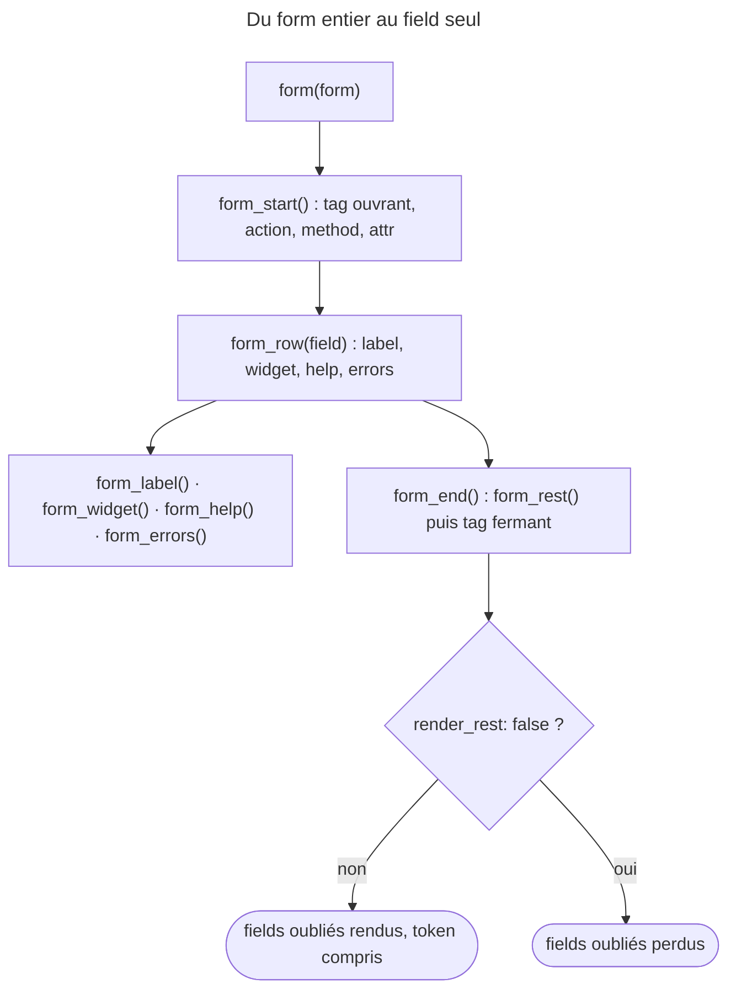

## Objectif

Rendre un form dans un template, du plus court au plus contrôlé, sans perdre
de field en route — ni le token CSRF.

## L'essentiel

Twig rend un form à trois grains : **tout** (`form()`), **ligne par ligne**
(`form_row()`), ou **pièce par pièce** (`form_label()`, `form_widget()`…).
Quel que soit le grain, `form_end()` rend les fields oubliés — le token CSRF
compris —, et un field ne se rend qu'**une fois**.

## Le schéma



## L'exemple : `task_form`

Un form avec un field texte `task` (doté d'une aide) et un field caché
`secret`, qui joue le rôle du token :

```twig
{{ form_start(form) }}
    {{ form_row(form.task) }}
{{ form_end(form) }}
```

`secret` est rendu par `form_end()`, alors que le template ne le nomme jamais.

## Les functions

| Function | Ce qu'elle produit |
|---|---|
| `form(form)` | le form entier |
| `form_start(form)` / `form_end(form)` | le tag ouvrant / le tag fermant **et les fields non rendus** |
| `form_row(form.champ)` | libellé + widget + aide + erreurs, dans son container |
| `form_label()`, `form_widget()`, `form_help()`, `form_errors()` | une pièce seule |
| `form_rest(form)` | tous les fields non encore rendus |

- `form_row()` relie la saisie à l'aide par `aria-describedby` ;
  `form_widget()` seul ne rend pas l'aide.
- `form_label(form.task, 'Titre')` remplace le libellé.
- `form_errors(form)` ne rend que les erreurs **du form lui-même** : une erreur
  sur `task` sort avec `form_errors(form.task)`.
- Les functions prennent la **vue du field** : `form_row('task')` lève une
  `TypeError`.
- Pour écrire son propre HTML, les helpers `field_*` rendent des **valeurs** :
  `field_name(form.task)` donne `task_form[task]` ; `field_value()`,
  `field_label()`, `field_help()`, `field_errors()`.

## Trois niveaux de contrôle

| Besoin | Rendu |
|---|---|
| un form standard, page d'administration | `{{ form(form) }}` |
| une page publique : choisir l'ordre, grouper des lignes | `form_start()`, des `form_row()`, `form_end()` |
| un balisage sur mesure autour d'un field | `form_label()`, `form_errors()`, `form_widget(…, {'attr': {…}})` |

## Le détail qui compte

- `form_end()` appelle `form_rest(form)`, sauf si `render_rest` vaut `false` :
  le token CSRF disparaît alors, et la submission est refusée.
- `FormRenderer` retient ce qui a été rendu : `form_rest(form)` puis
  `form_end(form)` ne rendent le field caché **qu'une fois**.
- `` écarte volontairement un field.
- `form_row(form.task)` puis `form_widget(form.task)` : `BadMethodCallException`,
  « Field "task" has already been rendered… ». Pour réafficher un rendu, le
  stocker dans une variable.

## Action, method, attributes

```twig
{{ form_start(form, {'action': path('cible'), 'method': 'GET'}) }}
{{ form_start(form, {'attr': {'novalidate': 'novalidate'}}) }}
```

- `form()` accepte les mêmes variables : son block appelle `form_start()`.
- Une method `PUT` : le tag porte `method="post"` et un field caché
  `_method` valant `PUT`, lu seulement si `framework.http_method_override` vaut
  `true` — `false` par défaut en 8.0.
- `novalidate` désactive la validation HTML5 du navigateur.

## Pièges d'examen

**`form_end()` rend aussi ce qui n'a pas été rendu**, token CSRF
compris.

**Un field déjà rendu ne se rend pas une seconde fois** : exception.

**`form()` règle aussi action et method**, par le `form_start()` de son block.

**Les functions de rendu prennent le field, pas son nom.**

**Une method `PUT` n'est pas envoyée en `PUT`** : le tag porte `method="post"`
et un field caché `_method`, ignoré tant que `http_method_override` vaut
`false`.

## Application

- Un form refusé à chaque envoi, rendu field par field et terminé par
  `render_rest: false` → retirer l'option : le token n'était plus rendu.
- Un form `PUT` qui n'atteint jamais la route `PUT` → activer
  `framework.http_method_override`.

## QCM d'entraînement

**Question 1.** Un template écrit `{{ form_row('task') }}`, avec le nom du
field en string. Que se passe-t-il ?

- **A.** Le field `task` est rendu normalement
- **B.** Une `TypeError`
- **C.** Une ligne vide, sans erreur
- **D.** Le field est rendu, mais sans son libellé

<details>
<summary>Correction</summary>

**Bonne réponse : B.** Les functions de rendu attendent une `FormView`, soit
`form.task` ; une string est refusée par le type de l'argument.

</details>

**Question 2.** Le form déclare `'method' => 'PUT'`, et
`http_method_override` n'est pas configuré. Qu'envoie le navigateur, et que
voit le routing ?

- **A.** Un `PUT`, reçu comme `PUT`
- **B.** Un `POST` avec `_method`, reçu comme `PUT`
- **C.** Un `GET` avec `_method` dans la query string
- **D.** Un `POST`, reçu comme `POST`

<details>
<summary>Correction</summary>

**Bonne réponse : D.** Le tag porte `method="post"` et un field `_method`, mais
ce field est ignoré tant que l'override vaut `false`, son défaut.

</details>

**Question 3.** Une violation est attachée au field `task`. Le template
n'appelle que `{{ form_errors(form) }}`. L'erreur apparaît-elle ?

- **A.** Oui, avec toutes les erreurs de l'arbre
- **B.** Oui, préfixée du nom du field
- **C.** Non
- **D.** Oui, dès que le form est soumis

<details>
<summary>Correction</summary>

**Bonne réponse : C.** `form_errors(form)` ne rend que les erreurs du form
lui-même ; celles de `task` sortent avec `form_errors(form.task)`.

</details>

**Question 4.** Un template appelle `{{ form_rest(form) }}` puis
`{{ form_end(form) }}`. Combien de fois le field caché `secret` est-il rendu ?

- **A.** Une fois
- **B.** Deux fois, une par appel
- **C.** Aucune : `form_rest()` vide le form
- **D.** Une exception : `secret` est déjà rendu

<details>
<summary>Correction</summary>

**Bonne réponse : A.** `FormRenderer` retient les fields déjà rendus :
`form_end()` ne réémet pas ce que `form_rest()` a produit.

</details>

## Fiche express

**Si tu dois retenir seulement 7 choses :**

- **`form()`** tout ; **`form_row()`** un field complet ; **`form_widget()`** la
  saisie seule.
- **`form_end()`** rend les fields oubliés, token compris — sauf
  `render_rest: false`.
- Un field se rend **une fois** ; sinon `BadMethodCallException`.
- Les functions prennent **`form.champ`**, jamais `'champ'`.
- `form_start()` / `form()` : **`action`**, **`method`**, **`attr`**.
- `PUT` : **`method="post"` + `_method`**, lu avec `http_method_override`.
- `form_errors(form)` : erreurs **du form seul** ; `field_*` : des valeurs sans
  HTML.

Moyen mnémotechnique : **« Ouvrir, ranger, fermer — la closure ramasse le
reste »**.

## Sources officielles

- [Forms, « Rendering Forms »](https://github.com/symfony/symfony-docs/blob/8.0/forms.rst)
- [Twig Bridge 8.0, `form_div_layout.html.twig`](https://github.com/symfony/symfony/blob/8.0/src/Symfony/Bridge/Twig/Resources/views/Form/form_div_layout.html.twig)
- [Form 8.0, `FormRenderer`](https://github.com/symfony/symfony/blob/8.0/src/Symfony/Component/Form/FormRenderer.php)

