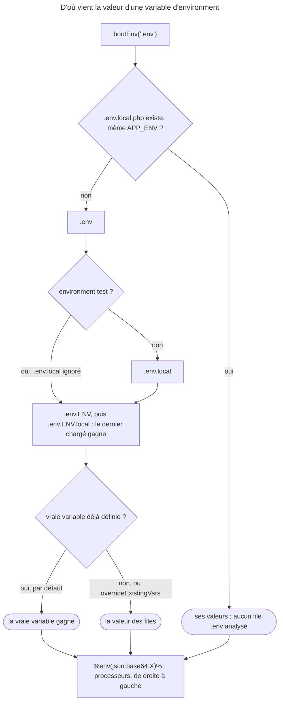

## Objectif

Savoir où une valeur de configuration est écrite, qui l'emporte quand plusieurs
sources la définissent, et comment une expression peut la calculer.

## Avant la règle : le problème à résoudre

La même application tourne sur un poste de développement, sur la CI et sur
deux serveurs de production. L'URL de la base change partout ; l'adresse de
l'administrateur, nulle part. Où écrire chaque valeur, et laquelle gagne quand
deux sources la définissent ?

Trois questions : la différence entre un **parameter** et une **variable
d'environment**, l'ordre de la **cascade `.env`**, et ce qu'**ExpressionLanguage**
permet d'écrire en configuration.

On suppose connus les environments Symfony, et les parameters du container.

## Le fil rouge : une application, quatre machines

```yaml
# config/services.yaml
parameters:
    app.admin_email: 'admin@example.com'          # figé à la compilation
    app.port: '%env(int:PORT)%'                    # lu à l'exécution, converti
```

```bash
# .env          → PORT=8000           (versionné, valeur par défaut)
# .env.local    → PORT=8080           (ce poste, hors test)
# .env.prod     → PORT=80             (la production, versionné)
# serveur       → export PORT=443     (vraie variable : elle gagne)
```

## Le cycle complet en un schéma



## Deux mécanismes, deux moments

C'est la distinction qui structure tout l'item :

| | Parameter | Variable d'environment |
|---|---|---|
| Écrit dans | `config/services.yaml`, key `parameters` | un file `.env`, ou le système |
| Référencé par | `%app.admin_email%` | `%env(DATABASE_URL)%` |
| Résolu | **à la compilation** du container | **à l'exécution** |

Un parameter est figé dans le container compilé ; une variable d'environment
ne l'est pas, et c'est précisément ce qui permet de déployer le même container
sur plusieurs machines.

## Les parameters

```yaml
parameters:
    app.admin_email: 'something@example.com'
    app.supported_locales: ['en', 'es', 'fr']
    app.some_constant: !php/const App\Entity\BlogPost::MAX_ITEMS
    app.some_enum: !php/enum App\Enum\PostState::Published
```

Le préfixe `app.` est une convention, non une obligation : il distingue les
parameters de l'application de ceux de Symfony.

Rejoué pour cette page avec DependencyInjection 8.0.15, un file YAML chargé
puis compilé : `!php/enum` donne **le case lui-même** — l'object enum, identique
à `PostState::Published` — et `!php/const` la valeur de la constant, `7`.

Un `%` littéral se **double** : `%%s` produit `%s`. Sans cela, Symfony y verrait
un nom de parameter. Exécuté : `'a %%s b'` est lu `a %s b`.

## La cascade `.env`

Quatre files, du plus général au plus spécifique :

| File | Portée | Versionné |
|---|---|---|
| `.env` | default values, tous environments | **oui** |
| `.env.local` | cette machine, tous environments | non |
| `.env.<env>` | un environment, toutes machines | **oui** |
| `.env.<env>.local` | cette machine, un environment | non |

Deux règles décident du reste, et ce sont elles que l'examen interroge :

- **`.env.local` est ignoré dans l'environment `test`** — délibérément, pour
  que les tests donnent le même résultat pour tout le monde ;
- **une vraie variable d'environment l'emporte** sur les files `.env`,
  qui ajoutent seulement ce qui manque — sauf si Dotenv est appelé avec
  `overrideExistingVars: true` (exécuté). Condition documentée :
  `variables_order` doit contenir `E`, pour exposer `$_ENV`.

Entre les files eux-mêmes, **le dernier chargé gagne**, dans l'ordre
ci-dessus. Exécuté avec Dotenv 8.0.15, une même key définie dans plusieurs
files :

| Key définie dans | En `dev` | En `test` |
|---|---|---|
| `.env`, `.env.local`, `.env.dev` | `.env.dev` | `.env` |
| `.env`, `.env.local` | `.env.local` | `.env` |
| `.env`, `.env.dev.local` | `.env.dev.local` | `.env` |

Le piège est la première ligne : **`.env.dev` l'emporte sur `.env.local`**.

Rejoué pour cette page : `A=system` défini avant le chargement reste `system` ;
avec `overrideExistingVars: true`, il prend la valeur de `.env.dev`.

Le file `.env` est lu et analysé **à chaque Request**, en production comme
ailleurs. Il n'y a donc pas de cache à vider après l'avoir modifié.

En production, `composer dump-env prod` ou la command `dotenv:dump` écrivent
les valeurs finales dans `.env.local.php` ; **s'il existe, les files `.env`
ne sont plus analysés**. Exécuté avec `Dotenv::bootEnv()` : une key absente du
`.env.local.php` n'est plus définie.

Deux précisions, lues dans la documentation et le code 8.0. La command
`dotenv:dump` **n'est pas enregistrée par défaut** : il faut déclarer le service
`Symfony\Component\Dotenv\Command\DotenvDumpCommand`. Et `bootEnv()` n'utilise
le `.env.local.php` que si son `APP_ENV` correspond à l'environment réel —
rejoué : une vraie variable `APP_ENV=dev` face à un `.env.local.php` qui déclare
`prod`, et les files `.env` sont de nouveau analysés.

`bootEnv()` fixe aussi `APP_DEBUG` quand il manque. Rejoué : `1` en `dev`, `0`
en `prod` ; un `APP_DEBUG=1` déjà défini est conservé, même en `prod`.

Sa syntaxe accepte des commentaires (`#`), l'interpolation (`${AUTRE_VAR}`), une
valeur de repli (`${VAR:-defaut}`), les guillemets simples pour un littéral et
les doubles pour interpoler — exécuté : avec `E=x`, `'${E}'` reste littéral et
`"${E}"` donne `x`.

## Les processeurs d'environment

Une variable d'environment est toujours une string. Un processeur la convertit
au moment de la lecture :

```yaml
parameters:
    app.debug: '%env(bool:APP_DEBUG)%'
    app.port:  '%env(int:PORT)%'
    app.hosts: '%env(json:ALLOWED_HOSTS)%'
```

Ils se **chaînent**, et se lisent de droite à gauche :
`%env(json:base64:CONFIG)%` décode d'abord la base64, puis lit le JSON.

Exécuté sur un container compilé (DependencyInjection 8.0.15) :

| Référence | Valeur |
|---|---|
| `%env(bool:APP_DEBUG)%`, avec `0` | `false` |
| `%env(RAW)%`, sans processeur | la string brute |
| `%env(json:base64:CONFIG)%` | l'array décodé |
| `%env(base64:json:CONFIG)%` — ordre inversé | `RuntimeException` : *Invalid JSON in env var "CONFIG"* |

## ExpressionLanguage

Le component compile et évalue des expressions d'une ligne, souvent booléennes.
Deux modes :

```php
$el = new ExpressionLanguage();
$el->evaluate('1 + 2');   // 3 — évalué, sans compilation
$el->compile('1 + 2');    // '(1 + 2)' — compilé en PHP, donc cachable
```

`parse()` rend un `ParsedExpression` ; `lint()` ne rend rien et lève une
`SyntaxError` si l'expression est invalide. Exécuté sur ExpressionLanguage
8.0.14, la dernière version 8.0 du component :

| Appel | Résultat |
|---|---|
| `lint('foo + 1', [])` | `SyntaxError` : *Variable "foo" is not valid* |
| même appel, `Parser::IGNORE_UNKNOWN_VARIABLES` | aucune erreur |
| `lint('bar()', [], …VARIABLES)` | `SyntaxError` : *The function "bar" does not exist* |
| même appel, `Parser::IGNORE_UNKNOWN_FUNCTIONS` | aucune erreur |
| `lint('1 +', null)` | `TypeError` : en 8.0, `$names` est un `array` |

La syntaxe a ses propres operators. Rejoué :

| Expression | Résultat |
|---|---|
| `"Hi " ~ name`, avec `name` = `Ana` | `Hi Ana` — `~` concatène ; compilé : `("Hi " . $name)` |
| `"Hi " + name` | `TypeError` : `+` est l'addition |
| `role in ["admin", "editor"]`, avec `editor` | `true` |
| `user.name ~ (user.isAdmin() ? "*" : "")` | `Ana*` — property, method, ternaire |

Dans le framework, ce component est ce qui rend possible une condition écrite en
configuration plutôt qu'en PHP — une condition de route, une règle
d'authorization.

## Concrètement dans ton application

- Une valeur identique partout : un **parameter**.
- Une valeur qui change par machine : `%env(…)%`, et un processeur pour le
  type.
- Un secret local : `.env.local`, jamais versionné.
- Une valeur propre à la CI : `.env.test` — `.env.local` n'y est pas lu.
- La production : vraies variables, ou `composer dump-env prod`.
- Une règle en configuration : une expression — condition de route,
  authorization.

## À comprendre

- **Pourquoi deux mécanismes ?** Le container compilé est figé ; ce qui doit
  varier d'une machine à l'autre doit être lu après la compilation.
- **Pourquoi la vraie variable gagne-t-elle ?** Les files `.env` sont des
  default values pour le développement ; le serveur, lui, sait.
- **Pourquoi `.env.local` est-il ignoré en test ?** Un réglage de poste ne doit
  pas changer le résultat des tests d'un développeur à l'autre.

## À mémoriser

- **Parameter** = compilation ; **`%env()%`** = exécution.
- Cascade : **`.env` → `.env.local` → `.env.<env>` → `.env.<env>.local`**, le
  dernier chargé gagne.
- **`.env.local` ignoré en `test`.**
- **Vraie variable > files `.env`**, sauf **`overrideExistingVars: true`**.
- **`.env.local.php`** : plus de `.env` analysé — si son `APP_ENV` correspond.
- Processeurs **de droite à gauche** ; **`%%`** pour `%`.
- ExpressionLanguage : **`evaluate()`**, **`compile()`**, **`lint()`** ; **`~`**
  concatène.
- Moyen mnémotechnique : **« Compilé ou lu ; le dernier gagne ; le serveur
  d'abord »**.

## Pièges d'examen

**Un parameter est résolu à la compilation, une variable d'environment à
l'exécution.**

**La vraie variable d'environment gagne** contre les files `.env`, sauf
avec `overrideExistingVars: true`.

**`.env.local` ne s'applique pas en `test`.**

**`.env.<env>` l'emporte sur `.env.local`** : le dernier file chargé gagne.

**Avec un `.env.local.php`, les files `.env` ne sont plus lus.**

**`.env` est relu à chaque Request** — aucun cache à vider.

**Les processeurs se chaînent de droite à gauche.**

**`%%` pour un `%` littéral.**

## Application : trois scénarios

**Scénario 1 — La valeur fantôme.** En `dev`, un développeur change `PORT` dans
`.env.local` ; l'application lit toujours la valeur de `.env.dev`.
*Solution.* `.env.dev` est chargé après `.env.local` : écrire la valeur dans
`.env.dev.local`.

**Scénario 2 — Le serveur têtu.** En production, une valeur modifiée dans
`.env.local` n'est pas prise en compte. *Solution.* Soit le serveur exporte une
vraie variable, qui gagne ; soit un `.env.local.php` existe et les files `.env`
ne sont plus lus — relancer `composer dump-env prod`.

**Scénario 3 — Le message composé.** Une condition doit construire
`"Bonjour " + nom` et lève une `TypeError`. *Solution.* En ExpressionLanguage,
la concaténation s'écrit `~` : `"Bonjour " ~ nom`.

## QCM d'entraînement

Six questions sur Dotenv, les parameters et ExpressionLanguage. Choisis avant
d'ouvrir la correction.

**Question 1.** `APP_ENV` vaut `prod` et `APP_DEBUG` n'est défini nulle part.
Que vaut `APP_DEBUG` après `Dotenv::bootEnv()` ?

- **A.** `1`, comme partout ailleurs
- **B.** Il reste indéfini
- **C.** `0`
- **D.** `false`, en booléen PHP

<details>
<summary>Correction</summary>

**Bonne réponse : C.** Exécuté : `'0'` en `prod`, `'1'` en `dev`. Lu dans
`bootEnv()` : la valeur dérive de `APP_ENV` quand elle manque, et reste une
string.

A vaut pour `dev`. B est faux. D oublie que les variables sont des strings.

</details>

**Question 2.** Le serveur exporte `APP_ENV=dev` ; un `.env.local.php` déclare
`APP_ENV` à `prod`. Que fait `bootEnv()` ?

- **A.** Il revient aux files `.env`
- **B.** Il utilise le `.env.local.php`, qui gagne
- **C.** Il lève une exception : deux environments
- **D.** Il passe l'application en `prod`

<details>
<summary>Correction</summary>

**Bonne réponse : A.** Exécuté : les valeurs de `.env` reviennent. Lu dans
`bootEnv()` : le `.env.local.php` n'est retenu que si son `APP_ENV` correspond.

B et D supposent que le file l'emporte sur la vraie variable. C est faux.

</details>

**Question 3.** Que contient le parameter `app.state` une fois le container
compilé ?

```yaml
parameters:
    app.state: !php/enum App\Enum\PostState::Published
```

- **A.** La string `'published'`, la valeur du case
- **B.** Le case `PostState::Published` lui-même
- **C.** La string `'App\Enum\PostState::Published'`
- **D.** Une erreur : un enum n'est pas un parameter valide

<details>
<summary>Correction</summary>

**Bonne réponse : B.** Exécuté : un object `PostState`, identique au case.

A serait la valeur du backed enum, pas le case. C et D sont faux.

</details>

**Question 4.** Que rend `$el->evaluate('"Hi " ~ name', ['name' => 'Ana'])` ?

- **A.** Une `SyntaxError` : `~` n'existe pas
- **B.** `true` : `~` compare deux strings
- **C.** `Hi ~ Ana`
- **D.** `Hi Ana`

<details>
<summary>Correction</summary>

**Bonne réponse : D.** Exécuté. `~` est l'operator de concaténation ; compilé,
il devient `.` en PHP.

A, B et C sont faux ; `"Hi " + name` lèverait une `TypeError`.

</details>

**Question 5.** Le serveur de production n'a pas Composer. Comment produire le
`.env.local.php` ?

- **A.** `php bin/console cache:warmup --env=prod`
- **B.** Rien : Symfony l'écrit à la première Request
- **C.** `dotenv:dump`, une fois son service déclaré
- **D.** `php bin/console debug:dotenv --dump`

<details>
<summary>Correction</summary>

**Bonne réponse : C.** La documentation 8.0 : la command `dotenv:dump` n'est
pas enregistrée par défaut ; il faut déclarer `DotenvDumpCommand` comme service.

A et B n'écrivent pas ce file. D n'existe pas avec cette option.

</details>

**Question 6.** `.env` définit `PORT=8000`, `.env.local` `PORT=8080`, et
`.env.dev.local` `PORT=9000`. Que lit l'application en `test` ?

- **A.** `8000`
- **B.** `8080`
- **C.** `9000`
- **D.** Rien : aucun file de test

<details>
<summary>Correction</summary>

**Bonne réponse : A.** En `test`, `.env.local` est ignoré, et `.env.dev.local`
ne concerne que `dev` : seul `.env` s'applique (exécuté sur le même schéma).

B oublie que `.env.local` n'est pas lu en test. C vise un autre environment. D
est faux : `.env` vaut pour tous.

</details>

## Fiche express

**Si tu dois retenir seulement 8 choses :**

- **Parameter** : compilation ; **`%env()%`** : exécution.
- **`.env` → `.env.local` → `.env.<env>` → `.env.<env>.local`** ; le dernier gagne.
- **`.env.local` ignoré en test.**
- **Vraie variable > `.env`**, sauf `overrideExistingVars: true`.
- **`.env.local.php`** remplace les `.env` (même `APP_ENV`).
- **`.env` relu à chaque Request** : pas de cache.
- **Processeurs de droite à gauche** ; `%%` = `%`.
- **ExpressionLanguage** : `evaluate()` / `compile()` / `lint()`, `~` concatène.

**En une phrase, pour tout reconstruire :**

```text
parameter = compilé, %env()% = lu ; .env < .env.local (sauf test) < .env.ENV < .env.ENV.local < vraie variable (sauf override) ;
.env.local.php court-circuite tout ; processeurs droite→gauche ; EL : evaluate/compile/lint, ~ concatène
```

## Sources officielles

- [Configuring Symfony](https://github.com/symfony/symfony-docs/blob/8.0/configuration.rst)
- [Environment Variable Processors](https://github.com/symfony/symfony-docs/blob/8.0/configuration/env_var_processors.rst)
- [The ExpressionLanguage Component](https://github.com/symfony/symfony-docs/blob/8.0/components/expression_language.rst)
- [`Dotenv`, branche 8.0](https://github.com/symfony/symfony/blob/8.0/src/Symfony/Component/Dotenv/Dotenv.php)
- [`ExpressionLanguage`, branche 8.0](https://github.com/symfony/symfony/blob/8.0/src/Symfony/Component/ExpressionLanguage/ExpressionLanguage.php)
