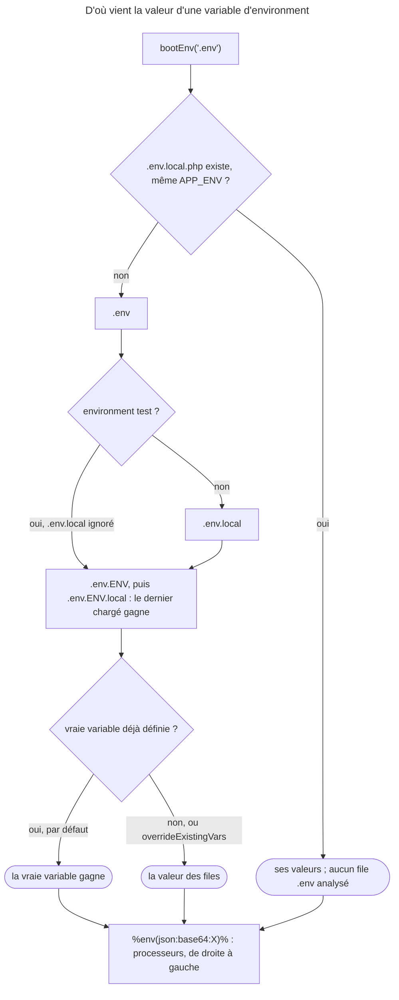

## Objectif

Savoir où une valeur de configuration est écrite, qui l'emporte quand plusieurs
sources la définissent, et comment une expression peut la calculer.

## L'essentiel

Un **parameter** est figé à la compilation du container ; une **variable
d'environment** est lue à l'exécution. Les files `.env` se chargent en
cascade — le dernier chargé gagne —, mais une vraie variable du serveur passe
avant eux. Et ExpressionLanguage évalue ou compile une expression d'une ligne,
écrite en configuration.

## Le schéma



## L'exemple

```yaml
# config/services.yaml
parameters:
    app.admin_email: 'admin@example.com'          # figé à la compilation
    app.port: '%env(int:PORT)%'                    # lu à l'exécution, converti
```

```bash
# .env          → PORT=8000           (versionné, valeur par défaut)
# .env.local    → PORT=8080           (ce poste, hors test)
# .env.prod     → PORT=80             (la production, versionné)
# serveur       → export PORT=443     (vraie variable : elle gagne)
```

## Deux mécanismes, deux moments

| | Parameter | Variable d'environment |
|---|---|---|
| Écrit dans | `config/services.yaml`, key `parameters` | un file `.env`, ou le système |
| Référencé par | `%app.admin_email%` | `%env(DATABASE_URL)%` |
| Résolu | **à la compilation** | **à l'exécution** |

C'est ce qui permet de déployer le même container compilé sur plusieurs
machines.

## Les parameters

```yaml
parameters:
    app.supported_locales: ['en', 'es', 'fr']
    app.some_constant: !php/const App\Entity\BlogPost::MAX_ITEMS
    app.some_enum: !php/enum App\Enum\PostState::Published
```

- `!php/enum` donne **le case lui-même**, l'object enum ; `!php/const`, la
  valeur de la constant.
- Un `%` littéral se **double** : `'a %%s b'` est lu `a %s b`.
- Le préfixe `app.` est une convention.

## La cascade `.env`

| File | Portée | Versionné |
|---|---|---|
| `.env` | default values, tous environments | **oui** |
| `.env.local` | cette machine — **ignoré en `test`** | non |
| `.env.<env>` | un environment | **oui** |
| `.env.<env>.local` | cette machine, un environment | non |

- Entre les files, **le dernier chargé gagne**, dans cet ordre : en `dev`,
  `.env.dev` l'emporte sur `.env.local`.
- **Une vraie variable d'environment l'emporte** sur les files `.env`,
  qui ajoutent seulement ce qui manque — sauf si Dotenv est appelé avec
  `overrideExistingVars: true`. `variables_order` doit contenir `E`.
- `.env` est relu **à chaque Request** : aucun cache à vider.
- `composer dump-env prod` écrit `.env.local.php` ; **s'il existe, et si son
  `APP_ENV` correspond**, les files `.env` ne sont plus analysés. La command
  `dotenv:dump` exige de déclarer le service `DotenvDumpCommand`.
- `bootEnv()` fixe `APP_DEBUG` quand il manque : `'1'` en `dev`, `'0'` en
  `prod`, une string.
- Syntaxe : `#`, `${AUTRE_VAR}`, `${VAR:-defaut}` ; guillemets simples =
  littéral, doubles = interpolation.

## Les processeurs d'environment

Une variable d'environment est une string ; un processeur la convertit, et
ils se chaînent **de droite à gauche** :

| Référence | Valeur |
|---|---|
| `%env(bool:APP_DEBUG)%`, avec `0` | `false` |
| `%env(json:base64:CONFIG)%` | base64 décodé, puis JSON lu : l'array |
| `%env(base64:json:CONFIG)%` | `RuntimeException` : *Invalid JSON in env var "CONFIG"* |

## ExpressionLanguage

```php
$el = new ExpressionLanguage();
$el->evaluate('1 + 2');   // 3 — évalué, sans compilation
$el->compile('1 + 2');    // '(1 + 2)' — compilé en PHP, donc cachable
```

- `parse()` rend un `ParsedExpression` ; `lint()` ne rend rien et lève une
  `SyntaxError` — variable ou function inconnue, sauf flags `Parser::IGNORE_*`.
- `~` concatène : `"Hi " ~ name` donne `Hi Ana` ; `+` sur une string lève une
  `TypeError`. `in`, properties, methods et ternaire sont acceptés.
- Dans le framework : une condition de route, une règle d'authorization.

## Pièges d'examen

**Un parameter est résolu à la compilation, une variable d'environment à
l'exécution.**

**La vraie variable d'environment gagne** contre les files `.env`, sauf
avec `overrideExistingVars: true`.

**`.env.local` ne s'applique pas en `test`.**

**`.env.<env>` l'emporte sur `.env.local`** : le dernier file chargé gagne.

**Avec un `.env.local.php`, les files `.env` ne sont plus lus.**

**`.env` est relu à chaque Request** — aucun cache à vider.

**Les processeurs se chaînent de droite à gauche.**

**`%%` pour un `%` littéral.**

## Application

- En `dev`, `PORT` modifié dans `.env.local` est ignoré → `.env.dev` est chargé
  après : écrire dans `.env.dev.local`.
- En production, `.env.local` modifié n'a aucun effet → une vraie variable
  gagne, ou un `.env.local.php` existe : relancer `composer dump-env prod`.

## QCM d'entraînement

**Question 1.** `APP_ENV` vaut `prod` et `APP_DEBUG` n'est défini nulle part.
Que vaut `APP_DEBUG` après `Dotenv::bootEnv()` ?

- **A.** `1`, comme partout ailleurs
- **B.** Il reste indéfini
- **C.** `0`
- **D.** `false`, en booléen PHP

<details>
<summary>Correction</summary>

**Bonne réponse : C.** La valeur dérive de `APP_ENV` quand elle manque, et
reste une string : `'0'` en `prod`, `'1'` en `dev`.

</details>

**Question 2.** Le serveur exporte `APP_ENV=dev` ; un `.env.local.php` déclare
`APP_ENV` à `prod`. Que fait `bootEnv()` ?

- **A.** Il revient aux files `.env`
- **B.** Il utilise le `.env.local.php`, qui gagne
- **C.** Il lève une exception : deux environments
- **D.** Il passe l'application en `prod`

<details>
<summary>Correction</summary>

**Bonne réponse : A.** Le `.env.local.php` n'est retenu que si son `APP_ENV`
correspond à l'environment réel ; sinon les files `.env` sont analysés.

</details>

**Question 3.** Que contient le parameter `app.state` une fois le container
compilé ?

```yaml
parameters:
    app.state: !php/enum App\Enum\PostState::Published
```

- **A.** La string `'published'`, la valeur du case
- **B.** Le case `PostState::Published` lui-même
- **C.** La string `'App\Enum\PostState::Published'`
- **D.** Une erreur : un enum n'est pas un parameter valide

<details>
<summary>Correction</summary>

**Bonne réponse : B.** Un object `PostState`, identique au case ; A serait la
valeur d'un backed enum, pas le case lui-même.

</details>

**Question 4.** Que rend `$el->evaluate('"Hi " ~ name', ['name' => 'Ana'])` ?

- **A.** Une `SyntaxError` : `~` n'existe pas
- **B.** `true` : `~` compare deux strings
- **C.** `Hi ~ Ana`
- **D.** `Hi Ana`

<details>
<summary>Correction</summary>

**Bonne réponse : D.** `~` est l'operator de concaténation, compilé en `.` ;
`"Hi " + name` lèverait une `TypeError`.

</details>

## Fiche express

**Si tu dois retenir seulement 8 choses :**

- **Parameter** : compilation ; **`%env()%`** : exécution.
- **`.env` → `.env.local` → `.env.<env>` → `.env.<env>.local`** ; le dernier gagne.
- **`.env.local` ignoré en test.**
- **Vraie variable > `.env`**, sauf `overrideExistingVars: true`.
- **`.env.local.php`** remplace les `.env` (même `APP_ENV`).
- **`.env` relu à chaque Request** : pas de cache.
- **Processeurs de droite à gauche** ; `%%` = `%`.
- **ExpressionLanguage** : `evaluate()` / `compile()` / `lint()`, `~` concatène.

Moyen mnémotechnique :
**« Compilé ou lu ; le dernier gagne ; le serveur d'abord »**.

```text
parameter = compilé, %env()% = lu ; .env < .env.local (sauf test) < .env.ENV < .env.ENV.local < vraie variable (sauf override) ;
.env.local.php court-circuite tout ; processeurs droite→gauche ; EL : evaluate/compile/lint, ~ concatène
```

## Sources officielles

- [Configuring Symfony](https://github.com/symfony/symfony-docs/blob/8.0/configuration.rst)
- [Environment Variable Processors](https://github.com/symfony/symfony-docs/blob/8.0/configuration/env_var_processors.rst)
- [The ExpressionLanguage Component](https://github.com/symfony/symfony-docs/blob/8.0/components/expression_language.rst)
- [`Dotenv`, branche 8.0](https://github.com/symfony/symfony/blob/8.0/src/Symfony/Component/Dotenv/Dotenv.php)
- [`ExpressionLanguage`, branche 8.0](https://github.com/symfony/symfony/blob/8.0/src/Symfony/Component/ExpressionLanguage/ExpressionLanguage.php)

