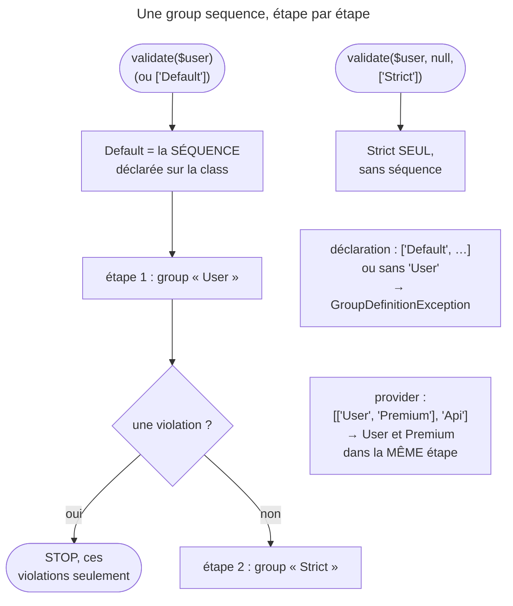

## Objectif

Ordonner les validation groups pour qu'un group coûteux ne s'exécute que si
le précédent a réussi — et maîtriser les effets de bord que cet ordre introduit.

## L'essentiel

Une **group sequence** valide des groups **par étapes** et s'arrête à la
première étape qui produit une violation : le contrôle coûteux ne tourne que
si le simple a réussi. Trois effets de bord tombent à l'examen : `Default`
devient la séquence, demander un group la contourne, et un provider la rend
dynamique.

## Le schéma



## L'exemple : un `User` en deux étapes

```php
#[Assert\GroupSequence(['User', 'Strict'])]
class User
{
    #[Assert\NotBlank]
    private string $username;

    #[Assert\IsTrue(groups: ['Strict'])]
    public function isPasswordSafe(): bool { /* appel réseau, lent */ }
}
```

`username` vide : seule sa violation apparaît, le service distant n'est pas
appelé. `username` rempli : la violation de `Strict` peut apparaître.

## Le mécanisme

- Étape 1 : le group du **nom de la class** (`User`, les constraints sans
  group). Étape 2 : `Strict`.
- L'arrêt se fait à la première **étape** en échec, pas à la première
  constraint : toutes les violations de l'étape remontent.
- Autres déclarations : `$metadata->setGroupSequence([...])` en PHP, l'option
  `validation_groups` d'un form.
- Une séquence ponctuelle se passe à `validate()` :
  `validate($user, null, new GroupSequence(['Default', 'Strict']))`.

## Le premier effet de bord : `Default` change de sens

Hors séquence, `Default` et le nom de la class désignent la même chose. Sur une
class qui déclare une séquence, `Default` **est** la séquence. La séquence se
déclare donc avec le **nom de la class**.

`sequence_provider.rst` annonce une récursion infinie ; ce que fait le code :
`ClassMetadata::setGroupSequence()` refuse la séquence avant.

| Séquence déclarée sur la class | Résultat |
|---|---|
| `['Default', 'Strict']` | `GroupDefinitionException` : « The group "Default" is not allowed in group sequences. » |
| `['Strict']`, sans le nom de la class | `GroupDefinitionException` : « The group "MissingClass" is missing in the group sequence. » |

Une séquence passée à `validate()` échappe à ce contrôle : `Default` y est
accepté.

## Le deuxième : valider un group de la séquence la contourne

| Appel | Ce qui est validé |
|---|---|
| `validate($user)` ou `['Default']` | la séquence : `User`, puis `Strict` si `User` passe |
| `['User']` | `User` seul |
| `['Strict']` | `Strict` seul, sans passer par `User` |

La séquence protège la validation **par défaut**, pas chaque group pris
isolément.

## Le troisième : la séquence peut être dynamique

Quand l'ordre dépend de l'object, la class implémente
`GroupSequenceProviderInterface` et porte `#[Assert\GroupSequenceProvider]` :

```php
public function getGroupSequence(): array|GroupSequence
{
    return $this->isPremium()
        ? [['User', 'Premium'], 'Api']   // User et Premium : une seule étape
        : ['User', 'Api'];
}
```

| Retour, une violation dans chaque group | Violations |
|---|---|
| `['User', 'Premium', 'Api']` | celles de `User` |
| `[['User', 'Premium'], 'Api']` | celles de `User` **et** de `Premium` |

Un provider n'est pas contrôlé comme une séquence de class : un retour sans le
nom de la class ne lève rien.

## Pièges d'examen

- `Default` dans une séquence de class : **exception**, pas récursion —
  déclarer avec le **nom de la class**, obligatoire.
- Valider explicitement un group de la séquence, ou le nom de la class,
  **ignore** la séquence.
- Un array **imbriqué** réunit des groups dans une même étape ; à plat, chacun
  est sa propre étape.
- La séquence s'arrête à la **première étape** en échec, pas à la première
  constraint.
- Une `GroupSequence` passée à `validate()` accepte `Default` : le contrôle ne
  s'applique qu'à la séquence déclarée sur la class.

## Application

- Un password vérifié contre un service externe, inutile si le form est déjà
  invalide → `#[Assert\GroupSequence(['User', 'Strict'])]`.
- Un test qui valide `['Strict']` directement ne teste **pas** la séquence →
  appeler `validate($user)`.

## QCM d'entraînement

**Question 1.** `User` déclare `#[Assert\GroupSequence(['User', 'Strict'])]`.
Le code appelle `validate($user, null, ['User'])`, `username` rempli et une
constraint `Strict` en échec. Que rend l'appel ?

- **A.** La violation de `Strict` : `User` passe, la séquence continue
- **B.** Une `GroupDefinitionException` : `User` n'est pas un group
- **C.** Aucune violation
- **D.** La violation de `Strict`, puisque `User` vaut `Default` ici

<details>
<summary>Correction</summary>

**Bonne réponse : C.** Demander le group du nom de la class le valide seul :
seul `Default`, ou l'absence de group, déroule la séquence.

</details>

**Question 2.** Un provider rend `['Premium', 'Api']`, sans le nom de la class.
Que se passe-t-il à la validation ?

- **A.** Une `GroupDefinitionException`, comme sur une séquence de class
- **B.** La séquence est déroulée normalement
- **C.** Le nom de la class est ajouté en tête de la séquence
- **D.** Le provider est ignoré et `Default` validé à sa place

<details>
<summary>Correction</summary>

**Bonne réponse : B.** Le contrôle du nom de la class ne porte que sur la
séquence déclarée sur la class, pas sur le retour d'un provider.

</details>

**Question 3.** `Contact`, sans séquence déclarée, est validé avec
`new GroupSequence(['Default', 'Strict'])`, et un field `Default` est vide.
Que se passe-t-il ?

- **A.** Une `GroupDefinitionException` : `Default` est interdit
- **B.** Une récursion infinie, comme l'annonce la documentation
- **C.** `Default` est sauté, et `Strict` validé seul
- **D.** La violation du field vide, sans `Strict`

<details>
<summary>Correction</summary>

**Bonne réponse : D.** Une séquence passée à `validate()` accepte `Default` ;
elle s'arrête après cette première étape en échec.

</details>

**Question 4.** Dans la séquence `['User', 'Strict']`, deux constraints du
group `User` échouent. Combien de violations remontent ?

- **A.** Une : la séquence s'arrête à la première constraint
- **B.** Deux, celles de `User`
- **C.** Trois, `Strict` compris
- **D.** Aucune, la séquence ayant échoué

<details>
<summary>Correction</summary>

**Bonne réponse : B.** L'arrêt se fait à la fin de l'étape en échec : tout le
group `User` est validé, puis `Strict` n'est pas exécuté.

</details>

## Fiche express

**Si tu dois retenir seulement 6 choses :**

- Une séquence valide des **étapes** et s'arrête à la **première en échec**.
- Sur la class, `Default` **est** la séquence : déclarer avec le **nom de la
  class**.
- `Default` dans une séquence de class, ou nom de la class absent →
  `GroupDefinitionException`.
- Demander `['Strict']` ou `['User']` **contourne** la séquence.
- Provider : à plat, une étape par group ; **sous-tableau = une étape**.
- Une `GroupSequence` passée à `validate()` accepte `Default`.

Moyen mnémotechnique : **« D'abord le simple, ensuite le cher »**.

## Sources officielles

- [How to Sequentially Apply Validation Groups](https://github.com/symfony/symfony-docs/blob/8.0/validation/sequence_provider.rst)
- [Validator 8.0, `ClassMetadata::setGroupSequence()`](https://github.com/symfony/symfony/blob/8.0/src/Symfony/Component/Validator/Mapping/ClassMetadata.php)

