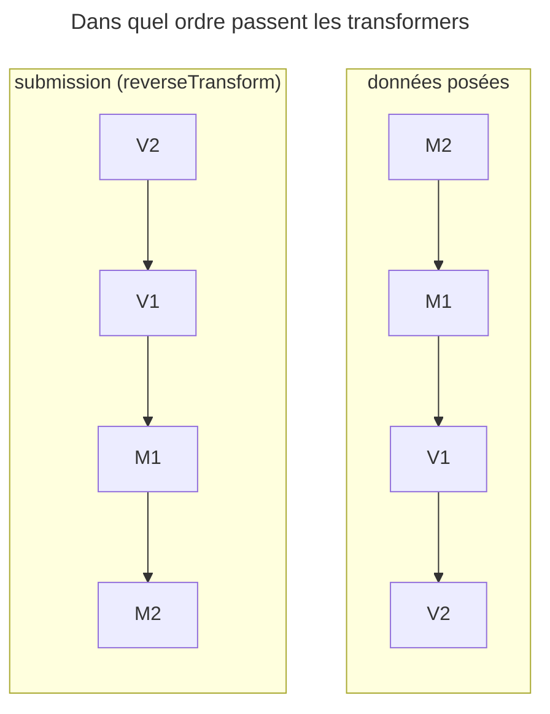

## Objectif

Écrire une conversion entre deux couches de données, dans le bon sens et au bon
niveau, et signaler proprement une saisie impossible à convertir. Les trois
couches sont définies dans l'item *Form component*.

## L'essentiel

Un data transformer convertit une valeur entre deux couches du form, **dans
les deux sens** : `transform()` du modèle vers la vue, `reverseTransform()` au
retour de la submission. Il s'attache au modèle ou à la vue, et signale une
saisie impossible par `TransformationFailedException`, sans faire planter la
page.

## Le schéma

```mermaid
---
title: Où passent les transformers
---
flowchart LR
  accTitle: Le trajet des transformers entre les trois couches d'un form
  accDescr: Quand les données sont posées sur le form, les model transformers appellent transform du modèle vers la norm data, puis les view transformers de la norm data vers la view data. À la submission, reverseTransform est appelé dans l'ordre inverse, des view transformers vers les model transformers. createView n'appelle aucun transformer. Une TransformationFailedException rend le field non synchronisé et affiche invalid_message.
  M["model data"] -->|"model transformer · transform()"| N["norm data"]
  N -->|"view transformer · transform()"| V["view data"]
  V -->|"view transformer · reverseTransform()"| N2["norm data"]
  N2 -->|"model transformer · reverseTransform()"| M2["model data"]
```



## L'exemple : un numéro d'issue

```php
class IssueToNumberTransformer implements DataTransformerInterface
{
    public function transform(mixed $issue): string
    {
        return null === $issue ? '' : (string) $issue->getNumber();
    }

    public function reverseTransform(mixed $number): ?Issue
    {
        if (!$number) {
            return null;
        }
        $issue = $this->issues->find($number);
        if (null === $issue) {
            $e = new TransformationFailedException(sprintf('No issue %s', $number));
            $e->setInvalidMessage('Issue {{ value }} inconnue.', ['{{ value }}' => $number]);
            throw $e;
        }

        return $issue;
    }
}

$builder->add('issue', TextType::class);
$builder->get('issue')->addModelTransformer($transformer);
```

## L'interface

| Method | Sens | Appelée |
|---|---|---|
| `transform()` | modèle → vue | quand les données sont posées sur le form |
| `reverseTransform()` | vue → modèle | à la submission |

Les noms se lisent depuis le **modèle**. `transform()` n'est **pas** appelée
au rendu : `createView()` n'appelle aucun transformer. Après la submission,
`transform()` repasse pour resynchroniser la vue.

## Deux niveaux d'attachement

| Method | Convertit entre |
|---|---|
| `addModelTransformer()` | donnée du **modèle** et norm data — un numéro en object métier |
| `addViewTransformer()` | norm data et view data — un format d'affichage |

## L'ordre d'une chaîne de transformers

`FormConfigBuilder::addViewTransformer()` ajoute **à la fin** ;
`addModelTransformer()` insère **en tête**. Avec `M1`, `M2`, `V1`, `V2` ajoutés
dans cet ordre :



## Signaler un échec

- `TransformationFailedException` : le field n'est plus synchronisé
  (`isSynchronized()` à `false`), sa donnée vaut `null`, sa view data garde la
  saisie, et le form est invalide.
- Le message affiché est l'option **`invalid_message`** (« This value is not
  valid. ») ; celui de l'exception n'est jamais montré.
- `setInvalidMessage()` sur l'exception fixe un message public, lu par
  `FormValidator` : seulement avec l'extension Validator.
- Toute autre exception **sort** de `submit()` : une
  `InvalidArgumentException` remonte telle quelle.

## Valeurs vides

- `transform(null)` rend l'équivalent vide du type **cible** : `''` pour une
  string, `0` pour un int.
- Convention inverse : `reverseTransform()` rend `null` pour une string vide.
  Sans view transformer, le form convertit `''` en `null` lui-même ; un view
  transformer qui laisse passer `''` le transmet au model transformer.
- Le raccourci `CallbackTransformer` prend `transform` puis `reverseTransform`
  en arguments de constructor.

### Un exemple documenté qui ignore le vide

L'exemple de tags de `data_transformers.rst` (8.0) fait `implode()` et
`explode()` sans traiter `null`. Avec PHP 8.4 : tags `null` posés →
`TypeError` ; field soumis vide → deprecation d'`explode()`, donnée `['']`.
Traiter `null` dans chaque function suffit.

## Pièges d'examen

**`transform()` s'exécute quand les données sont posées, pas au rendu.**

**Le sens des deux methods se lit depuis le modèle.** L'une va vers la vue,
l'autre fait le path de retour à la submission.

**Modèle et vue ne s'attachent pas au même endroit**, et les transformers de
modèle s'empilent en tête.

**Un échec se signale par l'exception dédiée** ; tout autre type sort de
`submit()`. Le message affiché est `invalid_message`, pas celui de l'exception.

**Pour `null`, la valeur rendue suit le type cible** : `''` pour une string.

**L'exemple documenté des tags échoue sur `null`** : `TypeError`.

## Application

- Un field texte qui doit remplir une property `Issue` → un model transformer,
  `reverseTransform()` qui cherche l'issue.
- Un numéro inconnu → `TransformationFailedException`, et `invalid_message`
  pour le texte affiché.

## QCM d'entraînement

**Question 1.** Un transformer journalise ses appels. Le controller crée le
form avec des données initiales, puis appelle `createView()`. Combien
d'appels à `transform()` déclenche `createView()` ?

- **A.** Un, pour préparer la valeur affichée
- **B.** Aucun
- **C.** Deux : un par couche du form
- **D.** Un par field de la vue rendue

<details>
<summary>Correction</summary>

**Bonne réponse : B.** `transform()` s'exécute quand les données sont posées,
à la création du form ; la vue reprend la donnée déjà convertie.

</details>

**Question 2.** `reverseTransform()` lève une `InvalidArgumentException` pour
une saisie qu'il ne sait pas convertir. Que se passe-t-il à `submit()` ?

- **A.** Le field est désynchronisé, avec `invalid_message`
- **B.** La saisie est ignorée, le field vaut `null`
- **C.** L'exception remonte
- **D.** Une violation portant le message de l'exception

<details>
<summary>Correction</summary>

**Bonne réponse : C.** Seule `TransformationFailedException` est convertie en
erreur de form ; toute autre exception sort de `submit()`.

</details>

**Question 3.** L'exception d'échec reçoit `setInvalidMessage('Issue {{ value }}
inconnue.')`, mais le form factory n'a pas l'extension Validator. Quel message
voit le user ?

- **A.** « Issue 42 inconnue. »
- **B.** Le message de l'exception, « No issue 42 »
- **C.** Aucun : le form reste valide
- **D.** Celui de l'option `invalid_message`

<details>
<summary>Correction</summary>

**Bonne réponse : D.** C'est `FormValidator`, fourni par l'extension
Validator, qui lit le message public ; sans lui, l'option s'applique.

</details>

**Question 4.** Le `CallbackTransformer` de tags fait
`fn ($tags) => implode(', ', $tags)` sans traiter `null`. Que se passe-t-il
quand les tags du modèle valent `null` ?

- **A.** Une `TypeError`
- **B.** Une string vide, puisque rien n'est à joindre
- **C.** Une `TransformationFailedException`, le field désynchronisé
- **D.** La string `'null'`

<details>
<summary>Correction</summary>

**Bonne réponse : A.** `implode()` exige un array en PHP 8.4 ; le transformer
doit rendre `''` pour `null`.

</details>

## Fiche express

**Si tu dois retenir seulement 6 choses :**

- **`transform()`** modèle → vue, quand les données sont posées ;
  **`reverseTransform()`** au retour.
- **`addModelTransformer()`** : modèle ↔ norm ; **`addViewTransformer()`** :
  norm ↔ vue.
- Model transformers **en tête**, view transformers **à la fin**.
- Échec : **`TransformationFailedException`** → désynchronisé, message
  `invalid_message` ; autre exception : elle remonte.
- `transform(null)` → **vide du type cible** ; `reverseTransform('')` → `null`.
- `CallbackTransformer` pour une conversion d'une ligne.

Moyen mnémotechnique : **« Transformer pour montrer, inverser pour
relire »**.

## Sources officielles

- [How to Use Data Transformers](https://github.com/symfony/symfony-docs/blob/8.0/form/data_transformers.rst)
- [Form 8.0, `DataTransformerInterface`](https://github.com/symfony/symfony/blob/8.0/src/Symfony/Component/Form/DataTransformerInterface.php) et [`FormConfigBuilder`](https://github.com/symfony/symfony/blob/8.0/src/Symfony/Component/Form/FormConfigBuilder.php)
- [Form 8.0, `TransformationFailureListener`](https://github.com/symfony/symfony/blob/8.0/src/Symfony/Component/Form/Extension/Core/EventListener/TransformationFailureListener.php)

