## Objectif

Écrire une conversion entre deux couches de données, dans le bon sens et au bon
niveau, et signaler proprement une saisie impossible à convertir. Les trois
couches sont définies dans l'item *Form component*.

## Avant la règle : le problème à résoudre

Un form de ticket demande le **numéro** d'une issue (« 42 »), mais
l'entité `Task` attend un object `Issue`. Un autre field affiche des tags,
stockés en array, sous forme de texte « php, symfony ».

Dans les deux cas, la valeur n'a pas la même forme pour le user et pour
le modèle. Il faut une conversion **dans les deux sens** — pour afficher, puis
pour relire la saisie —, et une façon de dire « ce numéro n'existe pas » sans
faire planter la page.

## Le fil rouge : un numéro d'issue

```php
class IssueToNumberTransformer implements DataTransformerInterface
{
    public function transform(mixed $issue): string
    {
        return null === $issue ? '' : (string) $issue->getNumber();
    }

    public function reverseTransform(mixed $number): ?Issue
    {
        if (!$number) {
            return null;
        }
        $issue = $this->issues->find($number);
        if (null === $issue) {
            $e = new TransformationFailedException(sprintf('No issue %s', $number));
            $e->setInvalidMessage('Issue {{ value }} inconnue.', ['{{ value }}' => $number]);
            throw $e;
        }

        return $issue;
    }
}
```

```php
$builder->add('issue', TextType::class);
$builder->get('issue')->addModelTransformer($transformer);
```

## Le cycle complet en un schéma

```mermaid
---
title: Où passent les transformers
---
flowchart LR
  accTitle: Le trajet des transformers entre les trois couches d'un form
  accDescr: Quand les données sont posées sur le form, les model transformers appellent transform du modèle vers la norm data, puis les view transformers de la norm data vers la view data. À la submission, reverseTransform est appelé dans l'ordre inverse, des view transformers vers les model transformers. createView n'appelle aucun transformer. Une TransformationFailedException rend le field non synchronisé et affiche invalid_message.
  M["model data"] -->|"model transformer · transform()"| N["norm data"]
  N -->|"view transformer · transform()"| V["view data"]
  V -->|"view transformer · reverseTransform()"| N2["norm data"]
  N2 -->|"model transformer · reverseTransform()"| M2["model data"]
```



## L'interface

`DataTransformerInterface` a deux methods, et leurs noms se lisent depuis le
**modèle** :

| Method | Sens | Appelée |
|---|---|---|
| `transform()` | modèle → vue | quand les données sont posées sur le form |
| `reverseTransform()` | vue → modèle | à la submission |

C'est l'erreur classique : `reverseTransform()` n'est pas « l'inverse de ce qu'on
veut », c'est le path de retour, celui qui traite la donnée du navigateur.

`transform()` n'est **pas** appelée au rendu. Exécuté avec `symfony/form`
8.0.15 et des transformers qui journalisent : `getForm()` sur des données
initiales appelle `M.transform`, puis `V.transform` ; `createView()` n'appelle
rien ; la submission appelle `V.reverseTransform`, `M.reverseTransform`, puis
de nouveau `V.transform` pour resynchroniser la vue.

## Deux niveaux d'attachement

```php
$builder->get('issue')->addModelTransformer($transformer);
$builder->get('issue')->addViewTransformer($transformer);
```

| Method | Convertit entre |
|---|---|
| `addModelTransformer()` | donnée du **modèle** et norm data |
| `addViewTransformer()` | donnée **normalisée** et view data |

Le choix dépend de ce que l'on convertit. Transformer un numéro saisi en object
métier est une affaire de modèle ; changer le format d'affichage d'une valeur
déjà normalisée est une affaire de vue.

## L'ordre d'une chaîne de transformers

`FormConfigBuilder::addViewTransformer()` **ajoute à la fin** ;
`addModelTransformer()` **insère en tête**. Exécuté avec `M1`, `M2`, `V1`, `V2`
ajoutés dans cet ordre :

```text
données posées : M2 → M1 → V1 → V2
soumission     : V2 → V1 → M1 → M2   (reverseTransform)
```

Le dernier model transformer ajouté est donc le plus proche du modèle.

## Signaler un échec

Quand la valeur soumise ne peut pas être convertie, le transformer lève
`TransformationFailedException`. Exécuté : le field n'est plus
**synchronisé** (`isSynchronized()` à `false`), sa donnée vaut `null`, sa view
data garde la saisie `'42'`, et le form est invalide avec « This value is not
valid. ».

Ce message vient de l'option **`invalid_message`** du field ; celui de
l'exception n'est jamais montré. `setInvalidMessage()` sur l'exception fixe un
message public, mais seulement quand l'extension Validator est active — c'est
`FormValidator` qui le lit. Exécuté : avec l'extension, « Numéro 42 inconnu. » ;
sans elle, l'option `invalid_message` s'applique.

Toute autre exception **sort** de `submit()` : exécuté, une
`InvalidArgumentException` levée dans `reverseTransform()` remonte telle quelle.

## Valeurs vides

La documentation demande que `transform()` rende, pour `null`, l'équivalent vide
du type **cible** : string vide, `0` pour un int, `0.0` pour un float. Un
transformer qui produit une string rend donc `''`. Retourner `null` quand
même ne casse pas un field texte : exécuté, sa variable de vue `value` vaut
`''`.

Dans l'autre sens, la convention de l'interface est que `reverseTransform()`
retourne `null` pour une string vide. Qui fait la conversion dépend du field
(lu dans `Form::viewToNorm()`, exécuté) :

| Field soumis vide | Ce que reçoit le model transformer |
|---|---|
| sans view transformer | `null` : le form convertit `''` lui-même |
| avec un view transformer qui suit la convention | `null`, rendu par lui |
| avec un view transformer qui laisse passer `''` | `''` |

Le view transformer, lui, reçoit toujours `''`.

## Le raccourci

`CallbackTransformer` prend les deux functions en arguments de constructor —
`transform` puis `reverseTransform` — et évite d'écrire une class pour une
conversion d'une ligne.

## Un exemple documenté qui ignore le vide

L'exemple `CallbackTransformer` de `data_transformers.rst` (8.0) convertit des
tags par `implode(', ', …)` et `explode(', ', …)`, sans traiter `null`. Exécuté
avec PHP 8.4 :

| Situation | Résultat |
|---|---|
| tags `['a', 'b']` posés | vue `'a, b'` |
| tags `null` posés | `TypeError` levée par `implode()` |
| field soumis vide | deprecation d'`explode()` sur `null`, donnée `['']` |

Traiter le vide dans chaque function suffit : `null` donne `''` dans un sens,
`[]` dans l'autre.

## Concrètement dans ton application

- Un identifier saisi qui devient une entité : un **model** transformer, qui
  lève `TransformationFailedException` quand rien n'est trouvé.
- Un message d'erreur sur mesure : `invalid_message` sur le field, ou
  `setInvalidMessage()` sur l'exception avec le Validator installé.
- Une conversion d'une ligne : `CallbackTransformer`, en traitant `null` dans
  les deux functions.
- Un format d'affichage d'une valeur déjà normalisée : un **view**
  transformer.

## À comprendre

- **Pourquoi deux methods ?** Parce que le form doit afficher la model data et
  relire celle du navigateur : deux trajets, deux conversions.
- **Pourquoi une exception dédiée ?** Parce qu'une saisie impossible à
  convertir est une erreur du user, pas un bug : le form la transforme
  en message ; toute autre exception est un bug, et remonte.
- **Pourquoi `invalid_message` et pas le message de l'exception ?** Parce que
  l'exception peut contenir des détails internes, qu'on ne veut pas montrer.

## À mémoriser

- `transform()` : modèle → vue, à la pose des données ; `reverseTransform()` :
  retour, à la submission ; rien au rendu.
- `addModelTransformer()` insère en tête ; `addViewTransformer()` ajoute à la
  fin.
- `TransformationFailedException` : field non synchronisé, donnée `null`,
  erreur `invalid_message`.
- `setInvalidMessage()` exige l'extension Validator.
- Toute autre exception sort de `submit()`.
- `null` → vide du type cible ; `''` → `null` en retour.
- Moyen mnémotechnique : **« Transformer pour montrer, inverser pour
  relire »**.

## Pièges d'examen

**`transform()` s'exécute quand les données sont posées, pas au rendu.**

**Le sens des deux methods se lit depuis le modèle.** L'une va vers la vue,
l'autre fait le path de retour à la submission.

**Modèle et vue ne s'attachent pas au même endroit**, et les transformers de
modèle s'empilent en tête.

**Un échec se signale par l'exception dédiée** ; tout autre type sort de
`submit()`. Le message affiché est `invalid_message`, pas celui de l'exception.

**Pour `null`, la valeur rendue suit le type cible** : `''` pour une string.

**L'exemple documenté des tags échoue sur `null`** : `TypeError`.

## Application : trois scénarios

**Scénario 1 — L'erreur 500 sur un numéro inconnu.** Le transformer lève une
`InvalidArgumentException` quand l'issue n'existe pas, et la page plante.
*Solution.* Lever `TransformationFailedException` : le field devient invalide
et le user voit `invalid_message`.

**Scénario 2 — Le message technique affiché.** L'équipe veut « Issue 42
inconnue. » au lieu de « This value is not valid. ». *Solution.* Fixer
`invalid_message` sur le field, ou appeler `setInvalidMessage()` sur
l'exception — ce second moyen n'agit qu'avec l'extension Validator.

**Scénario 3 — Le nouveau ticket qui plante.** Le form de création d'un
`Post` sans tags lève une `TypeError` à la construction. *Solution.* Le
`CallbackTransformer` fait `implode()` sur `null` : traiter le vide, `null ?
'' : implode(...)`, et `'' → []` dans l'autre sens.

## QCM d'entraînement

Six questions sur les transformers. Choisis avant d'ouvrir la correction.

**Question 1.** Un transformer journalise ses appels. Le controller crée le form avec des données initiales, puis appelle `createView()`. Quand `transform()` s'est-elle exécutée ?

- **A.** Pendant `createView()`, pour produire la valeur affichée
- **B.** À la construction du form
- **C.** Jamais : `transform()` ne sert qu'à la submission
- **D.** Deux fois : à la construction, puis au rendu

<details>
<summary>Correction</summary>

**Bonne réponse : B.** Exécuté : `getForm()` appelle les `transform()`,
`createView()` n'appelle aucun transformer.

A est le piège : l'intuition « transformer pour afficher ». C inverse les
roles. D invente un second appel.

</details>

**Question 2.** On ajoute à un field les model transformers `M1` puis `M2`. Lequel reçoit en premier la model data quand elle est posée ?

- **A.** `M1`, le premier ajouté
- **B.** Les deux en parallèle
- **C.** `M2` : `addModelTransformer()` insère en tête
- **D.** Aucun : les model transformers n'agissent qu'à la submission

<details>
<summary>Correction</summary>

**Bonne réponse : C.** Exécuté : `M2 → M1 → V1 → V2` à la pose des données.

A est le piège : c'est l'ordre des view transformers, ajoutés à la fin. B et D
sont faux.

</details>

**Question 3.** `reverseTransform()` lève `TransformationFailedException('No issue 42')`, sans `setInvalidMessage()`, et le field n'a pas d'option `invalid_message`. Quel message voit le user ?

- **A.** « No issue 42 »
- **B.** Aucun : le field est simplement vidé
- **C.** Une page d'erreur 500
- **D.** « This value is not valid. »

<details>
<summary>Correction</summary>

**Bonne réponse : D.** C'est la default value d'`invalid_message` ; le
message de l'exception n'est jamais montré (exécuté).

A est le piège. B oublie l'erreur. C confond avec une autre exception, qui,
elle, sort de `submit()`.

</details>

**Question 4.** `reverseTransform()` lève une `InvalidArgumentException` pour une saisie qu'il ne sait pas convertir. Que se passe-t-il à `submit()` ?

- **A.** L'exception remonte de `submit()`
- **B.** Le field devient non synchronisé, avec « This value is not valid. »
- **C.** La donnée devient `null`, sans erreur
- **D.** La saisie est gardée telle quelle dans le modèle

<details>
<summary>Correction</summary>

**Bonne réponse : A.** Seule `TransformationFailedException` est convertie en
erreur de form (exécuté).

B décrit le comportement de l'exception dédiée. C et D inventent des
comportements.

</details>

**Question 5.** Un field texte n'a qu'un **model** transformer, aucun view transformer. Il est soumis vide. Que reçoit le `reverseTransform()` du model transformer ?

- **A.** `''`, la string soumise
- **B.** `null` : le form convertit `''` lui-même
- **C.** `false`
- **D.** Rien : un field vide n'appelle pas le transformer

<details>
<summary>Correction</summary>

**Bonne réponse : B.** Sans view transformer, `Form::viewToNorm()` rend `null`
pour `''` (lu, et exécuté).

A est ce que reçoit un **view** transformer. C et D sont faux.

</details>

**Question 6.** L'exemple documenté des tags (`implode(', ', …)` / `explode(', ', …)`) est utilisé sur un `Post` neuf dont les tags valent `null`. Que se passe-t-il à la construction du form ?

- **A.** La vue affiche une string vide
- **B.** Une `TransformationFailedException`, rendue en erreur
- **C.** Une `TypeError` levée par `implode()`
- **D.** Une simple deprecation, puis la vue vide

<details>
<summary>Correction</summary>

**Bonne réponse : C.** Exécuté avec PHP 8.4 : `implode()` refuse `null`.

A suppose un traitement du vide que l'exemple n'a pas. B : rien n'est converti
en erreur hors submission. D confond avec `explode()` sur `null` à la
submission.

</details>

## Fiche express

**Si tu dois retenir seulement 6 choses :**

- **`transform()`** : modèle → vue, à la pose des données ;
  **`reverseTransform()`** : retour, à la submission. Rien au rendu.
- **Model** transformer : modèle ↔ norm ; **view** transformer : norm ↔ vue.
- `addModelTransformer()` **en tête**, `addViewTransformer()` **à la fin**.
- Échec : **`TransformationFailedException`** → non synchronisé, donnée
  `null`, **`invalid_message`** ; toute autre exception remonte.
- `setInvalidMessage()` : **avec le Validator** seulement.
- Vide : `null` → `''` (type cible) ; `''` → `null`.

**En une phrase, pour tout reconstruire :**

```text
modèle --transform()--> norm --transform()--> vue      (pose des données)
modèle <--reverse()---- norm <--reverse()---- vue      (submission ; échec = TransformationFailedException)
```

## Sources officielles

- [How to Use Data Transformers](https://github.com/symfony/symfony-docs/blob/8.0/form/data_transformers.rst)
- [Form 8.0, `DataTransformerInterface`](https://github.com/symfony/symfony/blob/8.0/src/Symfony/Component/Form/DataTransformerInterface.php) et [`FormConfigBuilder`](https://github.com/symfony/symfony/blob/8.0/src/Symfony/Component/Form/FormConfigBuilder.php)
- [Form 8.0, `TransformationFailureListener`](https://github.com/symfony/symfony/blob/8.0/src/Symfony/Component/Form/Extension/Core/EventListener/TransformationFailureListener.php)
